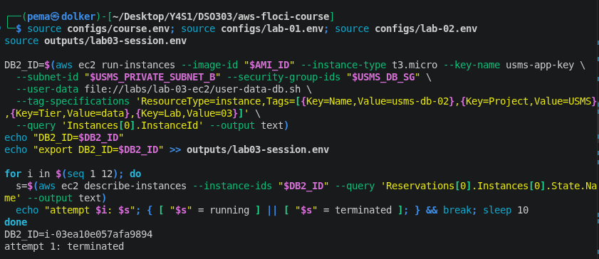
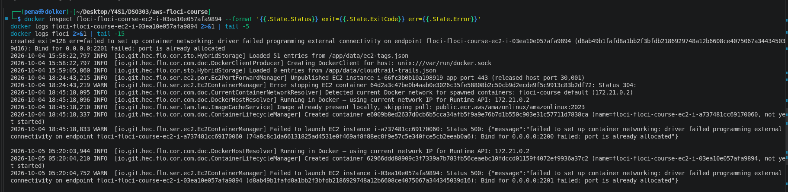
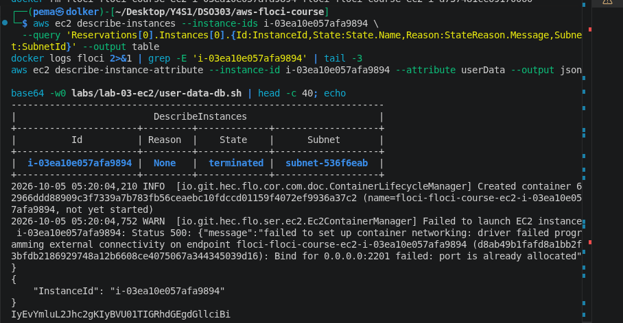
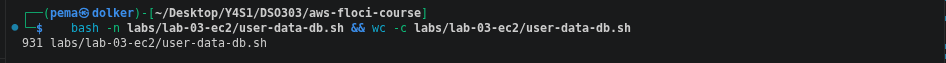
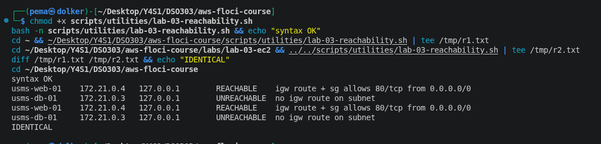
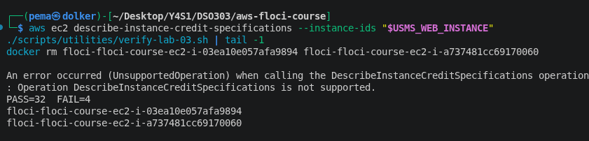
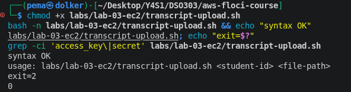
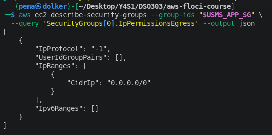
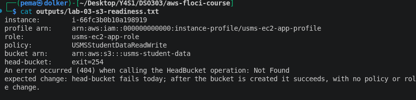

# Lab 03 Exercises: EC2

**Pema Dolker - DSO303**

Everything here was run against Floci, not real AWS. Where Floci behaved
differently from real AWS, I say so and say what real AWS would have
done instead.

---

## Exercise 1 - Basic: a maintenance instance

I launched `usms-admin-01-host` into `usms-public-subnet-b` with
`usms-app-key`, `usms-app-sg`, no instance profile, and the tags the
exercise asked for, using the long command-line form and a waiter.

`run-instances` returned an instance ID, but the waiter failed with a
terminal `terminated` state instead of reaching `running`. The Floci logs
behind the scenes explain why: each instance gets its own Docker
container with a published host port, and the port this one needed was
already taken — the container never started, and Floci marked the
instance `terminated` as a result. This isn't an AWS-level error at all
(there's no such thing as a host port on real EC2); it's specific to how
this Floci build runs instances as containers.

So I couldn't show the expected one-running-instance result — what I can
show is a correctly-formed launch request that failed for an
infrastructure reason outside the lab's own API surface. I only attempted
it once, since each failed launch leaves another un-removable
`terminated` row behind.




## Exercise 2 - Intermediate: a self-describing bootstrap

I wrote `labs/lab-03-ec2/user-data-db.sh` (well under the 16 KB limit): it installs
PostgreSQL, creates a `usms` database, and writes a marker file with the
instance ID and a timestamp — checking for that marker *first* so a
second run exits immediately and changes nothing. `bash -n` passed before
I used it anywhere.

Launching `usms-db-02` with this script hit the exact same container
port-binding failure as Exercise 1 (a different port, same cause). I
couldn't do the byte-for-byte diff the exercise asks for either, for the
reason already covered in `notes.md`: `describe-instance-attribute
--attribute userData` doesn't return the stored script on this build at
all, only the instance ID. What I could confirm is the other half — a
local base64 encode of my script starts with the same bytes
(`#!/bin/bash`) the CLI would have sent — but that's checking my own file
against itself, not a round trip through the API.





The outer heredoc has to stay quoted so that my own shell doesn't expand
`$MARKER` and the other variables while writing the file — they need to
reach the instance unevaluated and only resolve at boot, on the instance
itself. The idempotence comes from the marker-file check at the top of the
script, together with `set -euo pipefail`: the marker is written last, so
a failed install stops the script before the marker exists and a re-run
retries it, instead of skipping a half-finished install forever. A second run of user data would only ever happen in
practice if something deleted that marker and cloud-init were explicitly
told to run user data on every boot (not the default), or if a brand-new
instance were launched from an image that already carried the marker and
script baked in — a plain stop/start never triggers it again on its own.

## Exercise 3 - Problem solving: a reachability report

`scripts/utilities/lab-03-reachability.sh` checks, for every running
instance tagged `Project=USMS`, whether its subnet's route table has a
route to an internet gateway and whether its security group allows port
80 from anywhere — never the instance's name or tags — and prints a
verdict. I used `set -uo pipefail` and deliberately left out `-e`: with
`-e`, one failed lookup on one instance would silently stop the whole
report, and a report that quietly gives up partway through is worse than
one that prints an error for a single row and keeps going.

Run from the repository root and from inside `labs/lab-03-ec2/`, the
output was identical both times. `usms-web-01` came back `REACHABLE` and
`usms-db-01` came back `UNREACHABLE` — correctly, because the verdict
comes from the private subnet's route table having no internet-gateway
route, not from the instance's address field (which, on this build,
Floci fills in with a placeholder public IP even for the private
instance — the script ignores that and gets the right answer anyway).
The admin and db-02 instances from Exercises 1 and 2 never reached
`running`, so the script's "no public address but routed" case never
actually got exercised.



## Exercise 4 - Challenge: right-size and clean up

### What the numbers say

The portal has 400 concurrent users, mostly reading, and the single `t3.micro` sits at 85% CPU at midday and is idle overnight. Two facts about the t3 family change how to read that.

**1. Every t3 size from micro to medium has the same 2 vCPUs.** A `t3.micro`, `t3.small` and `t3.medium` differ in memory (1, 2 and 4 GiB) and in their CPU *baseline*, not in the number of processors. If the app needs 1.7 vCPU at midday, it still needs 1.7 vCPU on a `t3.medium`, so the CPU graph would still read about 85%. "Scaling up" inside the t3 family buys memory and burst allowance, not more processing power.

**2. 85% sustained is a specific problem for a burstable instance.** A `t3.micro` is only guaranteed a baseline of 10% per vCPU. It earns 12 CPU credits an hour (one credit is one vCPU running flat out for one minute) and spends them whenever it runs above baseline. At 85% it uses about 1.7 vCPU against a baseline of 0.2 vCPU, so it spends credits much faster than it earns them. What happens then depends on the credit specification:

- **standard** mode: when the credits run out, the instance is throttled down to its 10% baseline, so the portal suddenly becomes very slow at lunchtime;
- **unlimited** mode: it keeps running at full speed and AWS bills the extra at **$0.05 per vCPU-hour**.

t3 instances launch in **unlimited** mode by default, and we never changed it, so we should be paying, not throttling. I checked:

```bash
aws ec2 describe-instance-credit-specifications --instance-ids "$USMS_WEB_INSTANCE" --output table
```

CpuCredits: unlimited  (i-66fc3b0b10a198919)

That is probably part of why finance thinks the EC2 line is too high: the bill is not just the $7.59 instance, it includes surplus credits every busy day.

### Scale up or scale out?

I assumed the busy period lasts about **4 hours a day at 85%**, and the other 20 hours average about **5%**. (We don't have the real graph, so these are stated assumptions; with CloudWatch data, I would use the real `CPUUtilization` average.)

- **Scale up** (one bigger instance): simple, no code or network changes. But as shown above, inside t3 it doesn't add CPU, it only removes the surplus charge, because a `t3.medium` has a higher baseline (20%). It is still one machine, so one failure takes the whole portal down, and we pay the bigger price all night while it is idle.
- **Scale out** (two smaller instances behind a load balancer): each instance carries half the load, about 42.5% at peak, so the user-facing slowness goes away. It survives one instance or one Availability Zone failing. With an Auto Scaling group (Lab 06's idea), it can shrink to one instance overnight, which is the only option that actually saves money when the portal is idle. The cost is a load balancer, and the app must not keep session state on one server.

### Monthly cost comparison

Linux on-demand, `us-east-1`, 730 hours a month:

| Option | How it is calculated | Per month |
|---|---|---|
| **A. Today:** 1 × t3.micro, unlimited | $0.0104 × 730 = $7.59, plus surplus: 24-hour average CPU ≈ (4 h × 85% + 20 h × 5%) / 24 ≈ 18.3%, which is 8.3 points over the 10% baseline; 8.3% × 2 vCPU × 24 h ≈ 4.0 vCPU-h a day × $0.05 ≈ $0.20/day ≈ $6.08 | **≈ $13.67** |
| **B. Scale up:** 1 × t3.medium | $0.0416 × 730; 24-hour average stays under its 20% baseline, so no surplus charge | **$30.37** |
| **C. Scale out:** 2 × t3.small behind an ALB, 1 instance overnight | instances: (12 h × 2 + 12 h × 1) × $0.0208 × 30.4 days ≈ $22.76; ALB: $0.0225 × 730 = $16.43; ALB public IPv4: 2 × $0.005 × 730 = $7.30; LCUs at this traffic are small | **≈ $46.50** + a few dollars of LCU |

My recommendation is **C**, even though it costs the most. Option A is the cheapest on paper, but users get a slow portal every midday and one failure takes everything down. Option B costs more than A and fixes neither problem. Option C is the only one that adds real CPU at peak, survives a failure, and scales down at night. If finance only wants a cheaper bill and the slowness is acceptable, the honest answer is that the micro is not overpriced; it is undersized.

Sources: [EC2 T3 instances](https://aws.amazon.com/ec2/instance-types/t3/) (vCPUs, credits per hour, baselines, unlimited by default, $0.05 per vCPU-hour); [Unlimited mode concepts](https://docs.aws.amazon.com/AWSEC2/latest/UserGuide/burstable-performance-instances-unlimited-mode-concepts.html); [EC2 on-demand pricing](https://aws.amazon.com/ec2/pricing/on-demand/) (t3.micro $0.0104, t3.small $0.0208, t3.medium $0.0416 per hour); [Elastic Load Balancing pricing](https://aws.amazon.com/elasticloadbalancing/pricing/); [Amazon VPC pricing](https://aws.amazon.com/vpc/pricing/) (public IPv4).



### What I would delete today

First I listed every candidate, so nothing is deleted by guesswork:

```bash
aws ec2 describe-instances --filters Name=tag:Ephemeral,Values=true \
  --query 'Reservations[].Instances[].[InstanceId,Tags[?Key==`Name`]|[0].Value,State.Name]' --output table
aws ec2 describe-volumes --filters Name=status,Values=available \
  --query 'Volumes[].[VolumeId,Tags[?Key==`Name`]|[0].Value]' --output table
aws ec2 describe-addresses \
  --query 'Addresses[?AssociationId==null].[AllocationId,PublicIp,Tags[?Key==`Name`]|[0].Value]' --output table
```

```
DescribeInstances (Ephemeral=true)
  i-a737481cc69170060   usms-admin-01-host   terminated

DescribeVolumes (status=available)
  vol-a43428afc5a80af0c   usms-web-data-vol

DescribeAddresses (not associated)
  eipalloc-a64be5014af20c8d6   54.56.239.64   usms-nat-eip
```

`usms-nat-eip` shows as unassociated only because this Floci build doesn't record the NAT gateway's link to its Elastic IP. On real AWS it would show as associated with the NAT gateway's network interface. It belongs to Lab 02, so it stays.

What the inventory showed and what I decided:

- `usms-web-data-vol` shows as available (unattached) only because `attach-volume` is unsupported on this build. It is in the KEEP column, so I left it alone.
- `usms-nat-eip` belongs to Lab 02's NAT gateway, so I left it alone too.
- The admin host and `usms-db-02` from Exercises 1 and 2 were already `terminated`, because Floci could not start their containers.

Dependency order: instances first (they hold volumes and addresses), then volumes, then addresses.

**1. The Exercise 1 admin host**

```
What is deleted:     usms-admin-01-host, a practice instance with no data
What depends on it:  nothing; it is not in configs/lab-03.env
Reversible?          no, a terminated instance cannot be restarted (it can be relaunched from the same command)
Effect on later labs: none
```

```bash
ADMIN_ID=$(aws ec2 describe-instances --filters Name=tag:Tier,Values=admin \
  --query 'Reservations[0].Instances[0].InstanceId' --output text)
aws ec2 terminate-instances --instance-ids "$ADMIN_ID"   # already terminated on Floci; safe to re-run
```

**2. The Exercise 2 instance `usms-db-02`**

```
What is deleted:     usms-db-02, a practice data-tier instance
What depends on it:  nothing; it never reached running
Reversible?          no (relaunch with user-data-db.sh if needed)
Effect on later labs: none; Lab 06 replaces the data tier with RDS anyway
```

```bash
DB2_ID=$(aws ec2 describe-instances --filters Name=tag:Name,Values=usms-db-02 \
  --query 'Reservations[0].Instances[0].InstanceId' --output text)
aws ec2 terminate-instances --instance-ids "$DB2_ID"
```

**3. The two dead Docker containers behind those launches** (Floci-specific; real EC2 has nothing like this)

```
What is deleted:     two stopped containers Floci created for the failed launches
What depends on it:  nothing; they never started
Reversible?          not needed, they held no state
Effect on later labs: none; usms-web-01 and usms-db-01 have their own containers
```

```bash
docker ps -a --filter status=created --filter status=exited
docker rm floci-floci-course-ec2-i-03ea10e057afa9894 floci-floci-course-ec2-i-a737481cc69170060
```

`./scripts/utilities/verify-lab-03.sh` reported the same result before and after the cleanup, so nothing the core build needed was touched.

## Exercise 5 - Integration: prepare the S3 hand-off for Lab 4

`labs/lab-03-ec2/transcript-upload.sh` takes a student ID and a file
path, validates that both were given and that the file exists, and
uploads to `s3://usms-student-data/transcripts/<student-id>/<filename>`
using `aws s3 cp` — no access key anywhere in it, since it relies
entirely on the instance's profile for credentials.

No extra outbound rule was needed, and I confirmed why: `usms-app-sg`
already carries the default allow-all outbound rule every security group
gets, which is what lets the instance reach S3 over HTTPS in the first
place — and because security groups are stateful, the response traffic
is allowed back in automatically, with no inbound rule required.





`USMS_BUCKET_NAME=usms-student-data` is already exported by
`configs/lab-01.env` (it has been there since Lab 1), so, as the exercise
allows, nothing needed adding to `configs/lab-03.env`. The readiness file
(`outputs/lab-03-s3-readiness.txt`) records the instance ID, the full
profile → role → policy chain, the bucket ARN the policy already names,
and the result of `head-bucket` against that bucket today — a 404, which
is the actual point of the exercise: the permission chain is already
complete on the EC2 side, and the only thing missing is the bucket
existing at all. The moment Lab 4 creates it, `head-bucket` should
succeed with nothing else changed.

