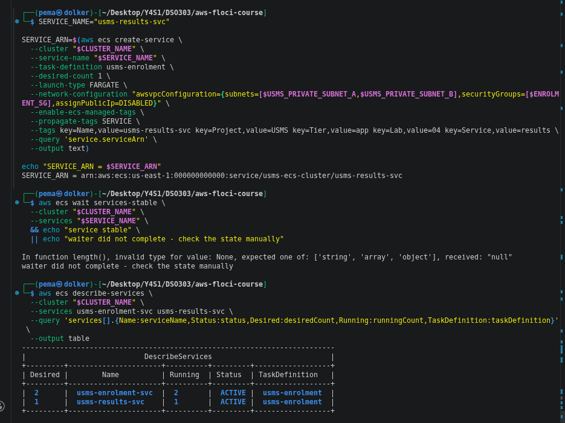
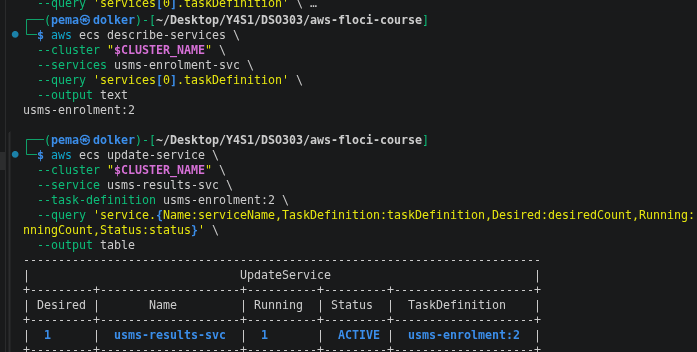
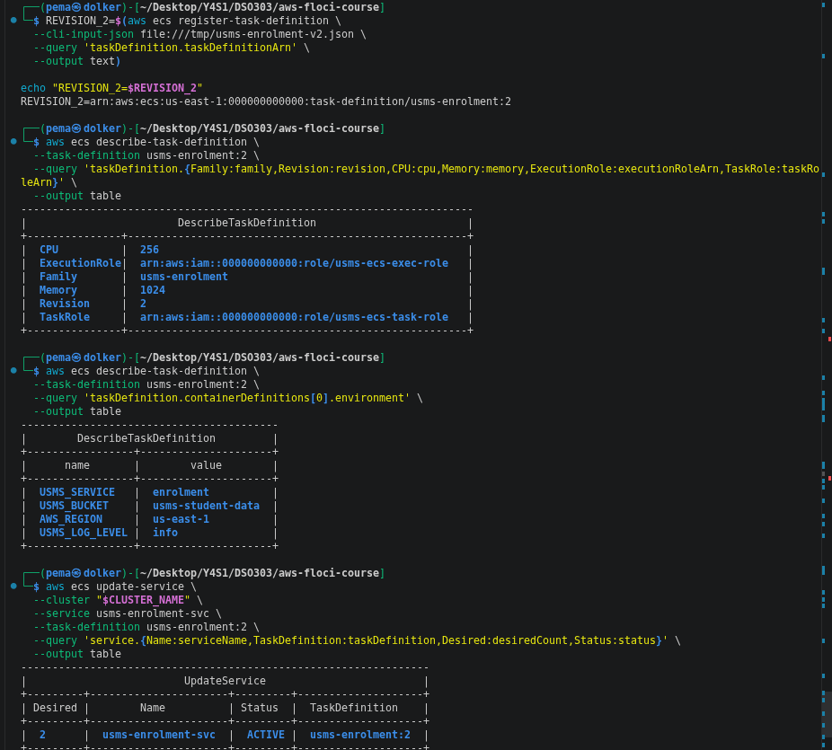
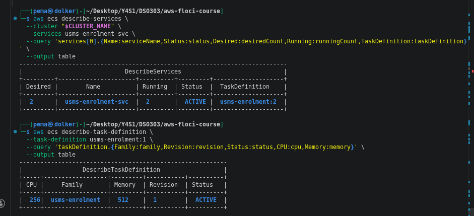
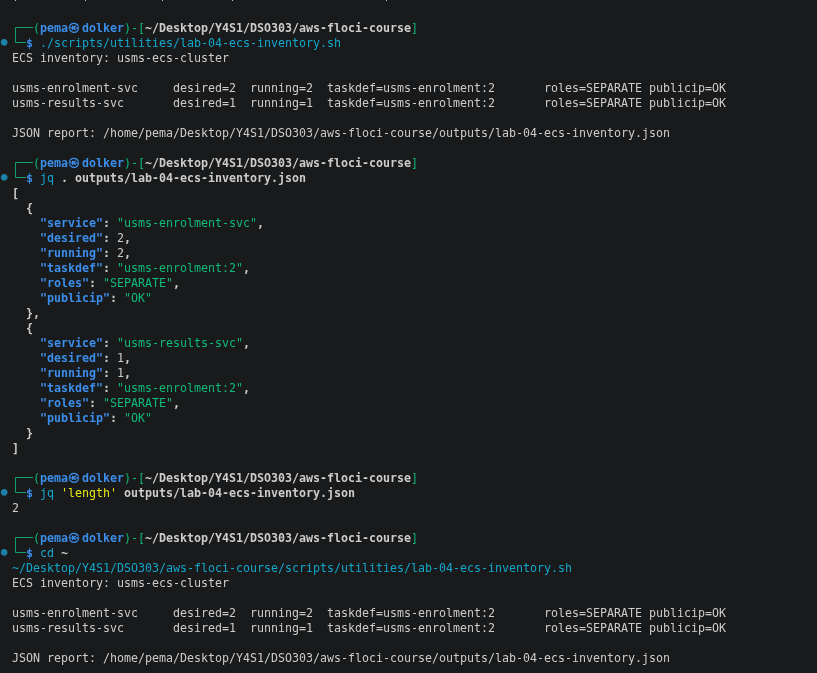
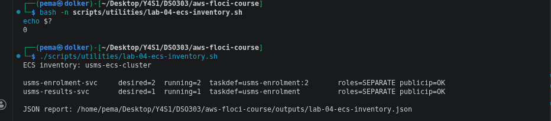
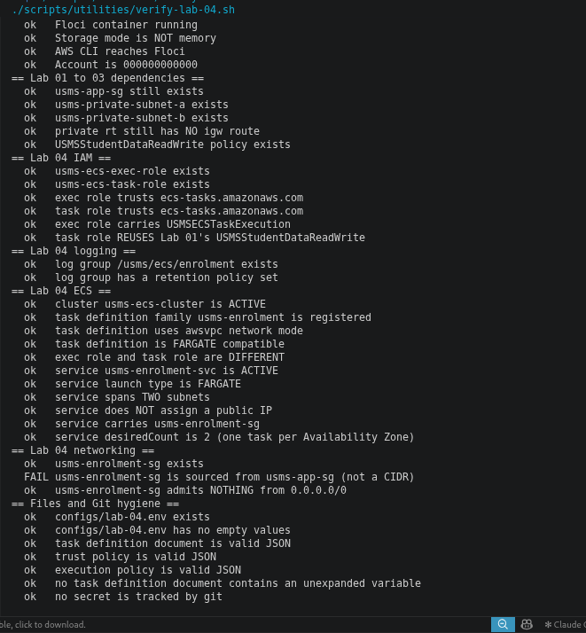
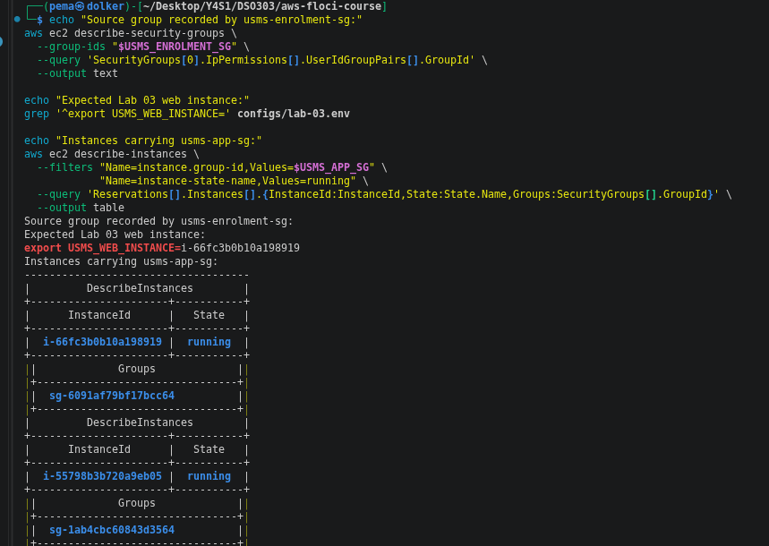
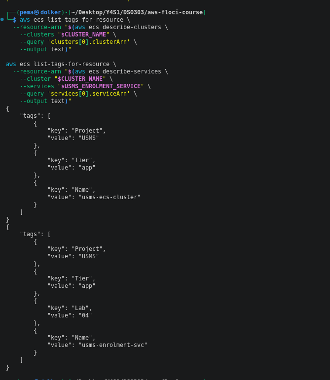

# Lab 04 - ECS Fargate Exercises

## Exercise 1 - Create a second ECS service

I created a second ECS service named `usms-results-svc` in the existing `usms-ecs-cluster`.

The service used the `usms-enrolment` task definition family, had a desired count of 1, used both private subnets, and used `usms-enrolment-sg`. The service was tagged with `Project=USMS`, `Tier=app`, `Lab=04`, and `Service=results`.

The service was later updated to use `usms-enrolment:2`, so both services were using the same task-definition revision before the results service was removed.







---

## Exercise 2 - Register a new task-definition revision

I created revision 2 of the `usms-enrolment` task definition.

The main changes were:

- CPU remained at 256 CPU units.
- Memory was increased from 512 MiB to 1024 MiB.
- `USMS_LOG_LEVEL=info` was added as an environment variable.
- The execution role and task role were explicitly set.
- The task continued to use Fargate and `awsvpc` networking.

The `usms-enrolment-svc` service was then updated from revision 1 to revision 2. After the update, the service had a desired count of 2 and a running count of 2.

Revision 1 was still registered and ACTIVE. This is because task-definition revisions are immutable; changing the service only changes which revision the service uses.







---

## Exercise 3 - ECS inventory script

I created `scripts/utilities/lab-04-ecs-inventory.sh` to inspect all services in the cluster.

The script lists the services first instead of using a hard-coded service name. For each service it reports:

- service name
- desired count
- running count
- task definition
- whether the execution and task roles are the same or separate
- whether a public IP is enabled

The script also creates a JSON report at:

`outputs/lab-04-ecs-inventory.json`

The final inventory showed:

| Service | Desired | Running | Task definition | Roles | Public IP |
|---|---:|---:|---|---|---|
| `usms-enrolment-svc` | 2 | 2 | `usms-enrolment:2` | SEPARATE | OK |
| `usms-results-svc` | 1 | 1 | `usms-enrolment:2` | SEPARATE | OK |

I also ran the script from my home directory to confirm that it works from a different working directory.




---

## Exercise 4 - Enrolment week capacity plan

### Why fixed desired count 2 is not enough

The current `usms-enrolment-svc` has a desired count of 2, but there is no mechanism in the service that reads traffic, CPU usage, memory usage, or the time of day and changes this number automatically.

Therefore, if traffic suddenly increases at 08:03, ECS will still try to keep the desired count at 2. The capacity can only change if a person manually runs an `update-service` command or a future scaling mechanism changes it.

This is why a fixed desired count cannot handle a predictable traffic peak properly.

Last year's outage shows this exactly. Enrolment opened at 08:00 and the service fell over at 08:03: two tasks were simply not enough, and nothing could add a third without someone noticing, logging in and typing a command. Even a metric-based policy alone would have been late. A CPU alarm usually needs a few minutes of high readings before it fires, and a new Fargate task then needs 20-60 seconds to start plus two passed health checks before it gets traffic. By then the damage at 08:03 was done. The capacity has to be there *before* 08:00.

### Where the numbers come from

The brief doesn't give request rates, so I state my assumptions here. Each one can be replaced with a real figure once we have last year's logs or a load test.

| Assumption | Value | Why |
|---|---|---|
| Students enrolling | 4,000 | USMS is a mid-sized university; replace with the Registrar's real count |
| Requests per student during enrolment | 30 | log in, view modules, add/drop a few, confirm, check timetable |
| Share of the week's traffic in the first 20 minutes | 90% | given in the brief |
| Peak vs average inside those 20 minutes | 2× | everyone clicks at 08:00 exactly, so the first minutes are busier than the average |
| Requests one task can serve | 25 per second | for a 0.25 vCPU task; **this must be confirmed by a load test** |

Derivation:

- Requests in the window: 4,000 × 30 × 0.9 = **108,000** in 1,200 seconds = **90 requests/second** on average.
- Peak: 90 × 2 = **180 requests/second**.
- Tasks needed at peak: 180 ÷ 25 = 7.2, so **8 tasks**.
- Round up to an even number so both Availability Zones carry the same load: **10 tasks (5 per AZ)**. That leaves 2 tasks of headroom, so the service survives losing a task, or a burst 25% above my estimate.

### Proposed capacity plan (handed to Lab 06)

| Setting | Value | Too high costs... | Too low costs... |
|---|---:|---|---|
| **Minimum** | 2 tasks | paying for idle tasks all year, every night and weekend | below 2, one task failing, or one AZ going down, takes the whole service offline |
| **Scheduled floor** | 10 tasks, Monday 07:40-09:00 | about 70 cents a month for 80 minutes a week, so the real risk is setting it too low | a repeat of 08:03: users see errors before scaling reacts |
| **Maximum** | 16 tasks | a runaway policy or a bot attack could scale far and bill heavily; 16 caps the worst case at about $0.23 an hour | if real demand is far above my estimate, scaling hits the ceiling and users get errors anyway |

Why these times: the floor goes up at **07:40**, 20 minutes early, so new tasks have time to start, register with the target group and pass health checks well before 08:00. It drops back at **09:00**, after the 20-minute rush plus a safety margin. The maximum is 1.6× the floor, so target tracking still has room to add 6 tasks if my estimate is wrong.

### What should trigger a change

1. **A schedule**, for the part we can predict. Application Auto Scaling scheduled actions raise the minimum to 10 at 07:40 every enrolment Monday and drop it back to 2 at 09:00.
2. **Target tracking**, for the part we can't. Keep the number of requests each task handles near a target (`ALBRequestCountPerTarget`, which Lab 05 Exercise 5 prepared), or keep CPU around 60% if only CPU is available. This catches demand above my estimate, and any busy period outside the schedule.

What I would tell the team building the policies: **don't rely on reacting**. The schedule is what prevents the 08:03 failure; target tracking is only the safety net. Size the scale-out cooldown around the 20-60 second Fargate start time, scale in slowly (5-10 minutes) so tasks aren't removed in the middle of the rush, and test the whole thing on a quiet day before enrolment week.

### Monthly cost comparison

Fargate Linux/x86, US East (N. Virginia): **$0.04048 per vCPU-hour** and **$0.004445 per GB-hour**. Revision 2 uses 0.25 vCPU and 1 GB:

(0.25 × $0.04048) + (1 × $0.004445) = **$0.014565 per task-hour**, using 730 hours per month.

| Option | Calculation | Per month |
|---|---|---:|
| Fixed at today's 2 tasks | 2 × $0.014565 × 730 | **$21.26** |
| Fixed at my peak of 10 tasks | 10 × $0.014565 × 730 | **$106.32** |
| **Scheduled: 2 tasks, 10 during the Monday window** | $21.26 + 8 extra tasks × $0.014565 × 1.33 h × 4.33 Mondays | **$21.94** |

Fixed at 2 is cheap and falls over. Fixed at 10 never falls over, but costs five times as much, and almost all of the extra task-hours are the 3 a.m. Sunday capacity finance complained about. The schedule gets the peak capacity for **68 cents a month** more than today. These figures cover Fargate compute only; the load balancer, logs and data transfer are the same in all three options.

Source: [AWS Fargate pricing](https://aws.amazon.com/fargate/pricing/) (US East (N. Virginia): $0.000011244 per vCPU-second and $0.000001235 per GB-second, which come to the hourly rates above).

### Switching off the Exercise 1 service

```
What is deleted:     usms-results-svc, the practice service from Exercise 1 (desired count 1)
What depends on it:  nothing; it is not in configs/lab-04.env and no load balancer points at it
Reversible?          yes; recreate it with the Exercise 1 create-service command
Effect on later labs: none; Lab 05 and Lab 06 only use usms-enrolment-svc
```

A service with running tasks can't be deleted directly, so I scaled it to 0 first, then deleted it, then checked:

```bash
aws ecs update-service --cluster usms-ecs-cluster --service usms-results-svc --desired-count 0
aws ecs delete-service --cluster usms-ecs-cluster --service usms-results-svc
aws ecs describe-services --cluster usms-ecs-cluster --services usms-results-svc \
  --query 'services[0].status' --output text
# INACTIVE
```

### Final verification

The final verification was run using:

`./scripts/utilities/verify-lab-04.sh`

The verifier reported **PASS=36 FAIL=1**. The one failure is a known benign Floci issue:

- **Security-group source reference:** Floci did not retain the `UserIdGroupPairs` reference for the intended `usms-app-sg` source. The TCP/80 rule exists, but its source group reference cannot be recovered from Floci.

This is a documented Floci limitation, not a resource that should be deleted and recreated to force the verifier to pass. (The git-hygiene check used to also flag `outputs/.gitkeep`, because it rejected every tracked file under `outputs/`. It now allows exactly that one file, which Lab 01 requires to be tracked, and still fails on anything else.)



---

## Exercise 5 - Lab 03 linkage audit

The intended source security group for `usms-enrolment-sg` was:

`usms-app-sg = sg-6091af79bf17bcc64`

The Lab 03 configuration specified the web instance:

`i-66fc3b0b10a198919`

The running instance lookup confirmed that `i-66fc3b0b10a198919` is running and carries `usms-app-sg`.

However, checking `usms-enrolment-sg` showed an empty `UserIdGroupPairs` value. Therefore, Floci did not retain the security-group-to-security-group reference that was intended when the rule was created.

The result is recorded as **MISMATCH – Floci limitation**, rather than claiming that the linkage was successfully verified.

The detailed evidence is stored in:

`outputs/lab-04-lab03-linkage.txt`

The TCP/80 rule is temporary. Lab 05 should remove this temporary linkage once the load balancer becomes the only caller of the enrolment service.

### ECS tag audit

The ECS cluster has:

- `Project=USMS`
- `Tier=app`
- `Name=usms-ecs-cluster`

The `usms-enrolment-svc` service has:

- `Project=USMS`
- `Tier=app`
- `Lab=04`
- `Name=usms-enrolment-svc`

Both ECS resources therefore have the required `Project=USMS` tag.







---

## Conclusion

Lab 04 demonstrated how an ECS Fargate service is connected to a task definition, IAM roles, networking and security groups. I also created a second service, registered a new task-definition revision, and wrote an inventory script to inspect the services.

The capacity exercise showed that a fixed desired count cannot respond automatically to a predictable traffic peak. A combination of scheduled scaling and metric-based scaling would be more suitable for the next lab.

The Exercise 5 audit also showed a limitation of Floci where the security-group source reference was not retained, so the mismatch was documented instead of hiding it.