# AWS Practical Laboratory 4 Report

**Student Name:** Pema Dolker   
**Module:** DSO303  
**Practical:** Lab 04 - Running the USMS Enrolment Service on Amazon ECS with Fargate   
**Environment:** Floci 1.5.34 (local AWS API emulator, Docker Compose, hybrid storage), account 000000000000, us-east-1

**Support path:** B. ECS, CloudWatch and CloudWatch Logs are supported, but Application Auto Scaling is not available on this build. Auto scaling is the subject of Lab 06, so this lab was not affected.

Step by step notes and the review questions are in `notes/lab-04-notes.md`, and the five exercises are in `labs/lab-04-ecs/exercises.md`.

> Labels used below:
> **Observed** = I ran it and saw it.
> **Floci limitation** = behaved differently from real AWS.

## 1. Aim / Objective

The aim of this practical is to move the USMS enrolment service onto Amazon ECS with Fargate, inside the private subnets built in Lab 02. I created a cluster, a log group, an execution role and a task role, a security group that only accepts traffic from the web tier, a task definition, and a service that keeps two tasks running in two Availability Zones. By the end I should be able to explain what each of these pieces does, why a task needs two different roles, and why the service's desired count is the number that auto scaling will change in Lab 06.

## 2. Introduction

Amazon ECS (Elastic Container Service) runs containers for you. With the Fargate launch type there are no servers to manage at all: I describe the container, and AWS finds the CPU and memory to run it. This is different from Lab 03, where I had to launch and look after the EC2 instance myself.

The main parts I used in this lab:

- **Cluster** - a named group that tasks and services belong to. With Fargate it holds no servers, it is just a boundary.
- **Task definition** - the recipe for a task: the image, CPU and memory, ports, environment, logging and the two roles. Each change makes a new numbered revision, and old revisions are never edited.
- **Task** - one running copy of a task definition. With the `awsvpc` network mode each task gets its own network interface in my subnet and its own security group.
- **Service** - keeps a chosen number of tasks running (the desired count) and replaces any task that stops.
- **Execution role** - used by ECS itself to pull the image and write logs before my code starts.
- **Task role** - used by my application code inside the container, for example to call S3.
- **CloudWatch Logs** - where the container's output goes, kept for a set number of days.

Containers matter in cloud computing because the same image runs the same way everywhere, and a service like ECS can start, stop and replace copies of it in seconds, which is what makes scaling and self-healing possible.

## 3. Use Case

- The USMS enrolment API, which should keep running even if one copy or one Availability Zone fails.
- A small team that wants to run containers without patching or sizing EC2 instances.
- A service that will later need to grow and shrink with demand, because the service's desired count is a single number that can be changed by hand or by auto scaling.
- Keeping an internal API off the internet: the tasks have no public address and only accept traffic from the web tier's security group.

## 4. System Architecture / Design

```text
 usms-vpc 10.0.0.0/16 (Lab 02)
  usms-public-subnet-a
    usms-web-01 (Lab 03, usms-app-sg)  --tcp/80-->  the enrolment tasks
    usms-nat  -->  usms-igw  -->  public.ecr.aws (image pull for the private tasks)
  usms-private-subnet-a   task 1   usms-enrolment-sg   no public IP
  usms-private-subnet-b   task 2   usms-enrolment-sg   no public IP

 ECS
  usms-ecs-cluster / usms-enrolment-svc   FARGATE, awsvpc, desired 2
  task definition usms-enrolment:2        256 CPU / 1024 MiB, container enrolment-api
  usms-enrolment-sg    in tcp/80 from usms-app-sg
  usms-ecs-exec-role   USMSECSTaskExecution (ECR pull, logs to /usms/ecs/enrolment, 7 days)
  usms-ecs-task-role   USMSStudentDataReadWrite (the same policy as usms-ec2-app-role)
```

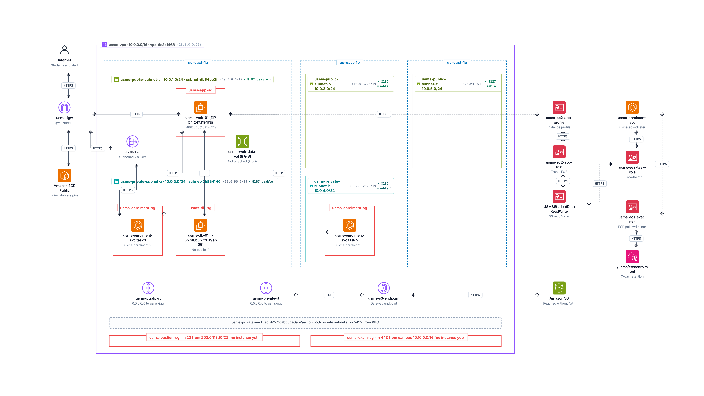

The two tasks run in different Availability Zones, so losing one zone still leaves one task. They have no public address, so the only way out to pull the image is through the NAT gateway from Lab 02. The execution role is used by ECS to start the task, and the task role is what the application itself would use. The S3 bucket named in the task role's policy does not exist yet, so it is not drawn.

## 5. Implementation Procedure

1. **Steps 1 to 3** - started Floci, sourced `course.env` and the Lab 01 to 03 env files, recorded the earlier verify scripts as a baseline, and ran the support probe (Path B).
2. **Step 4** - assumed `usms-developer-role`, created `usms-ecs-cluster`, then unset the temporary credentials.
3. **Step 5** - created the log group `/usms/ecs/enrolment` and set its retention to 7 days.
4. **Steps 6 and 7** - created the execution role with the least-privilege `USMSECSTaskExecution` policy, and the task role reusing Lab 01's `USMSStudentDataReadWrite` unchanged.
5. **Step 8** - created `usms-enrolment-sg` and allowed tcp/80 from `usms-app-sg`.
6. **Step 9** - registered the task definition `usms-enrolment:1` (Fargate, awsvpc, 256 CPU / 512 MiB, container `enrolment-api`).
7. **Steps 10 and 11** - created `usms-enrolment-svc` with desired count 2 in both private subnets and no public IP, read it back, and in the "Your turn" changed the desired count to 3 and back to 2.
8. **Step 12** - wrote `configs/lab-04.env` with every name, ID and ARN found by lookup.
9. **Step 13** - committed the work.
10. **Section 9** - ran `verify-lab-04.sh`.
11. **Exercises** - a second service, task definition revision 2 (which the service now runs), an ECS inventory script, an enrolment week capacity plan, and an audit linking this lab back to Lab 03.

## 6. Results and Evidence

### 6.1 CLI Output

**Steps 1 to 3 - environment, baseline and probe**

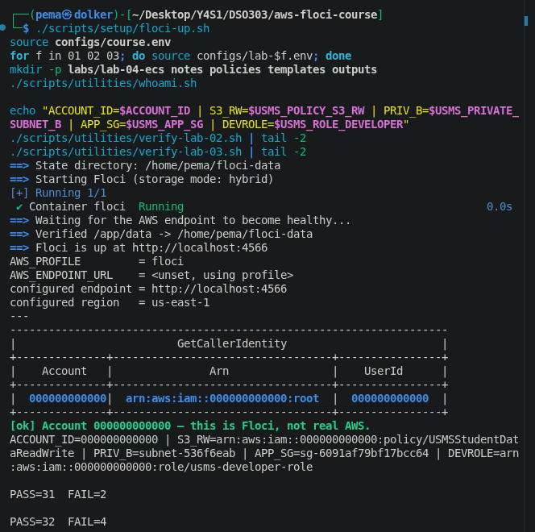

**Observed:** `whoami.sh` confirmed account `000000000000`. `verify-lab-02.sh` gave PASS=31 FAIL=2 and `verify-lab-03.sh` gave PASS=32 FAIL=4, not the FAIL=0 the lab expects. These failures come from earlier labs and I did not repair them here. They are the known Floci limitations already written up in my Lab 02 and Lab 03 notes.

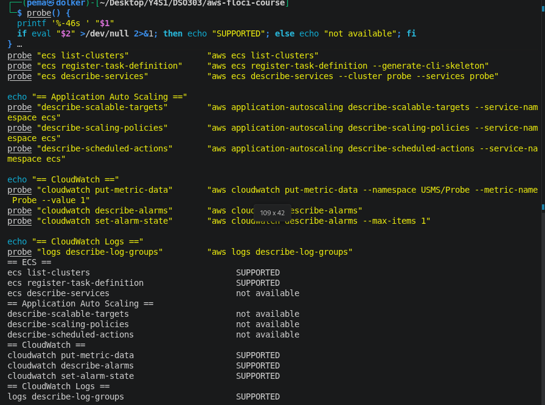

**Observed:** ECS, CloudWatch and CloudWatch Logs calls answered. All three `application-autoscaling` calls were "not available", so I am on **Path B**. `describe-services` showed "not available" only because the probe names a cluster that does not exist.

**Step 4 - cluster**

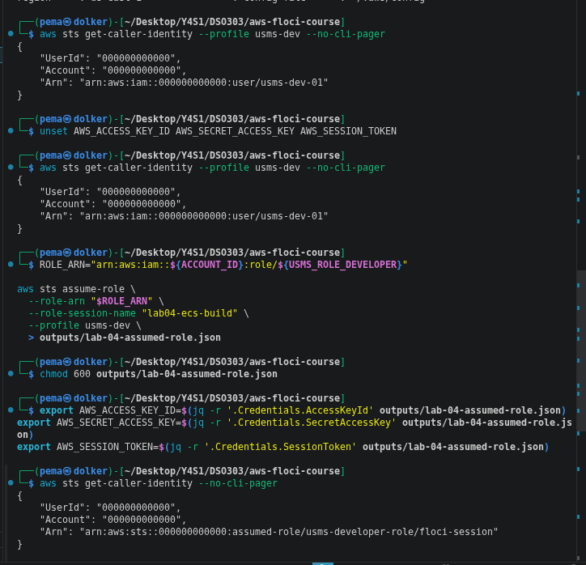

**Observed:** before the assume-role, the `usms-dev` profile identified as `user/usms-dev-01`; after exporting the temporary credentials, the caller was the assumed role. **Floci limitation:** the session name I passed (`lab04-ecs-build`) was ignored and the ARN ended in `floci-session`. The role assumption itself worked.

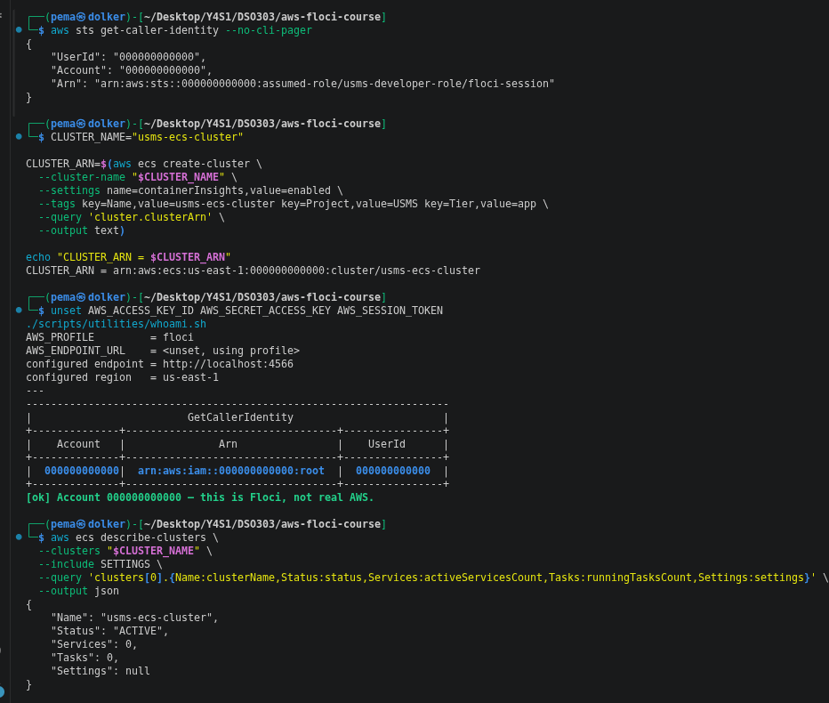

**Observed:** status ACTIVE, 0 services, 0 tasks. **Floci limitation:** `Settings` came back `null`, so `containerInsights` was not stored. On real AWS it would be, and Lab 06's target tracking depends on the CPU metric it publishes.

**Step 5 - log group**

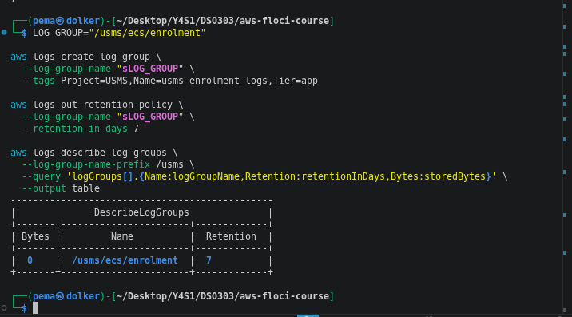

**Observed:** `/usms/ecs/enrolment` exists with retention 7 and 0 bytes stored. Retention is a separate call because `create-log-group` has no retention option.

**Steps 6 and 7 - IAM roles**

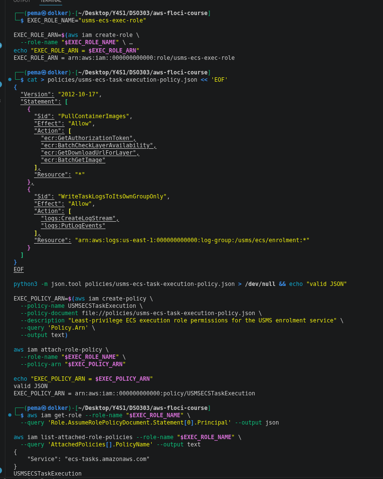

**Observed:** the principal is `ecs-tasks.amazonaws.com` and the attached policy is `USMSECSTaskExecution` (ECR pull, and log writes to one log group only).

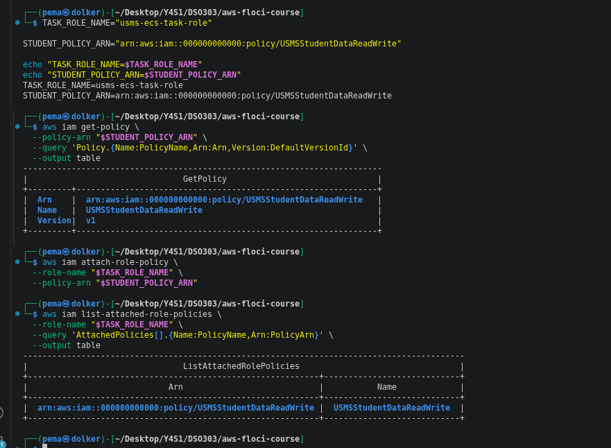

**Observed:** `usms-ecs-task-role` carries `USMSStudentDataReadWrite`, version v1. The same policy is now on `usms-ec2-app-role` (Lab 03) and this task role, delivered by two different mechanisms. The bucket still does not exist, so neither chain can be exercised yet. **Floci limitation:** task containers cannot fetch role credentials, which I reasoned about rather than tested.

**Step 8 - security group**

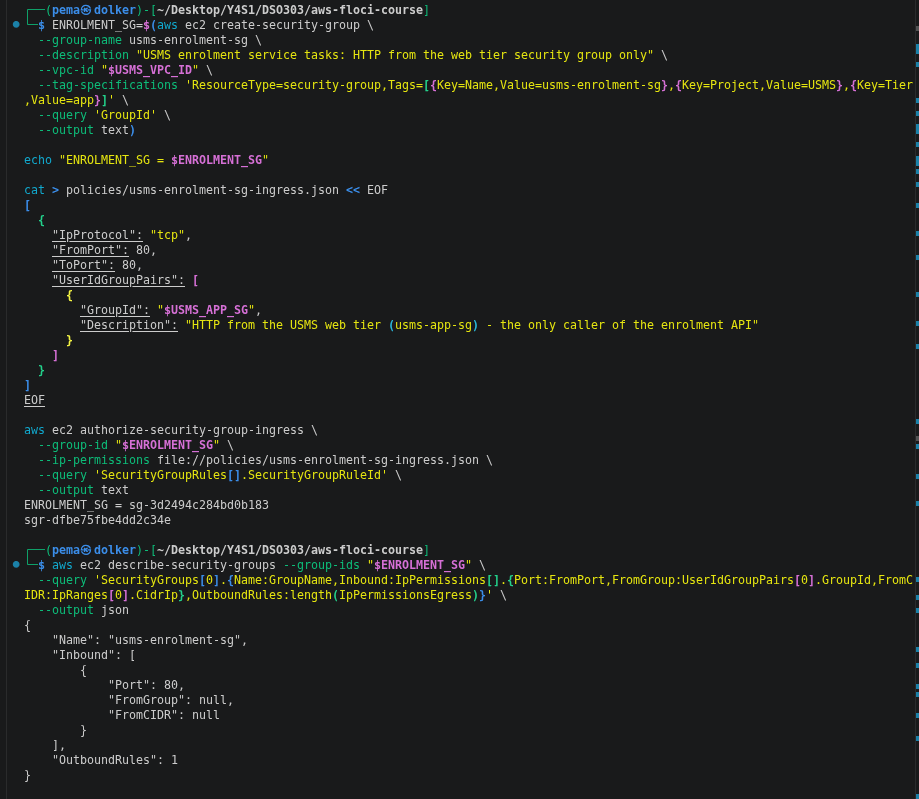

**Observed:** `usms-enrolment-sg` created, an ingress rule on TCP/80 authorised, one outbound rule. **Floci limitation:** the read-back showed `FromGroup: null` and `FromCIDR: null`. The rule was created from a file with `UserIdGroupPairs` pointing at `usms-app-sg`, but Floci did not return the source group. I recorded this instead of rewriting the rule as a CIDR, which would defeat the purpose of the step.

**Step 9 - task definition**

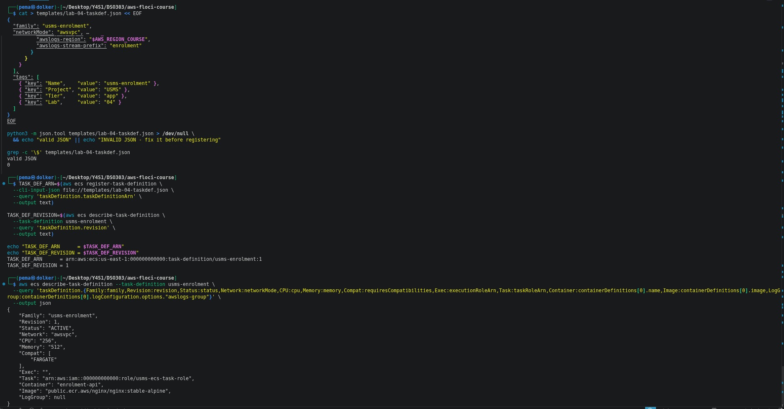

**Observed:** `usms-enrolment:1` registered, ACTIVE, awsvpc, FARGATE, 256 CPU / 512 MiB, container `enrolment-api`, and the `grep -c '\$'` check printed 0.

**Observed, and worth flagging:** revision 1 was registered with an empty `executionRoleArn`. `$EXEC_ROLE_ARN` was empty when I wrote the template, and `templates/lab-04-taskdef.json` still shows `"executionRoleArn": ""`. The `grep -c '\$'` check printed 0 because an empty variable leaves no `$` behind, so it could not catch this. On real AWS the task could not have pulled its image or written logs. Revision 2 sets the role explicitly (`templates/lab-04-taskdef-rev2.json`) and is the revision the service runs.

**Floci limitation:** `logConfiguration` is accepted but not returned. `describe-task-definition` shows `LogGroup: null` on both revisions, although the template contains the correct `awslogs-group`.

**Steps 10 and 11 - service**

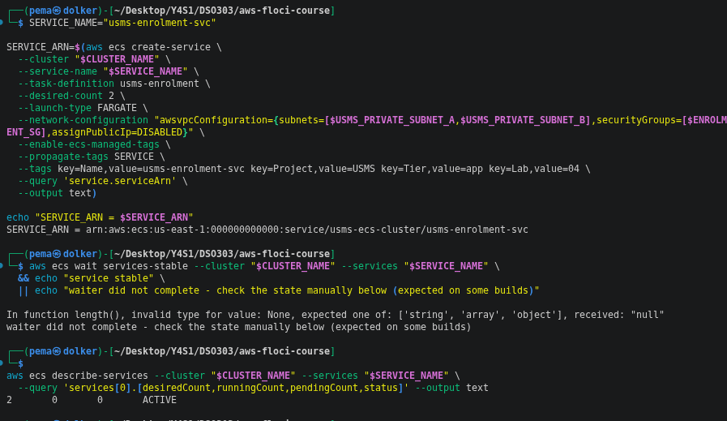

**Observed:** service created; the ARN ends `service/usms-ecs-cluster/usms-enrolment-svc`, the form Lab 06 will need. Immediately afterwards `describe-services` showed desired 2, running 0, pending 0, ACTIVE. **Floci limitation:** `aws ecs wait services-stable` failed with `In function length(), invalid type for value: None`, so I fell back to manual `describe-services`, as the lab allows.

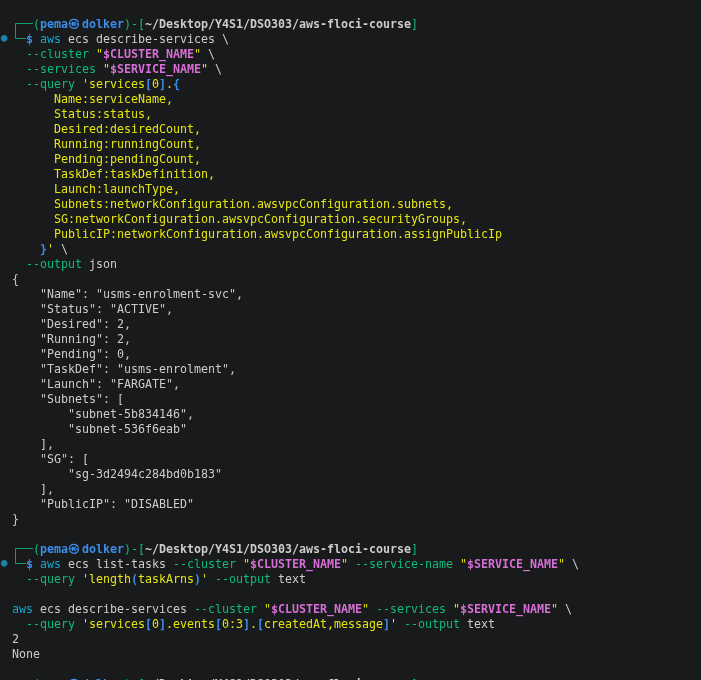

**Observed:** desired 2, running 2, pending 0, FARGATE, both private subnets, security group `usms-enrolment-sg`, `assignPublicIp` DISABLED, and `list-tasks` returned 2. **Floci limitation:** the service `events` list printed `None`, so the service's own narration was not available. The service's `taskDefinition` shows the family name only.

"Your turn" - the manual capacity change:

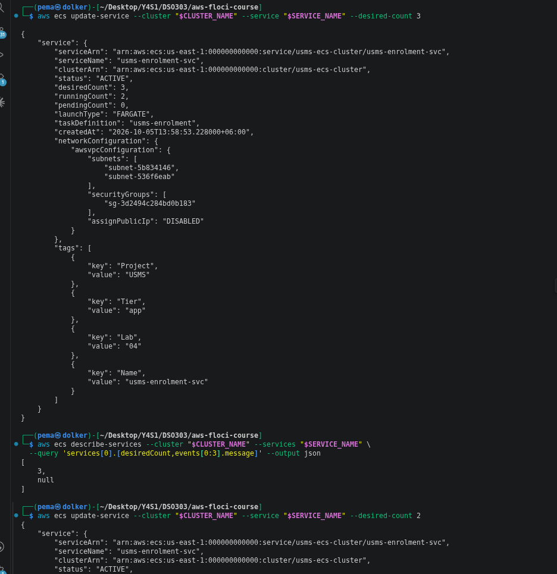

**Observed:** `update-service --desired-count 3` returned `desiredCount: 3` while `runningCount` was still 2, then `--desired-count 2` set it back. **Floci limitation:** the events list returned null, so there was no narration of the change. On real AWS a third task would start within 20 to 60 seconds.

**Step 12 - recording outputs**

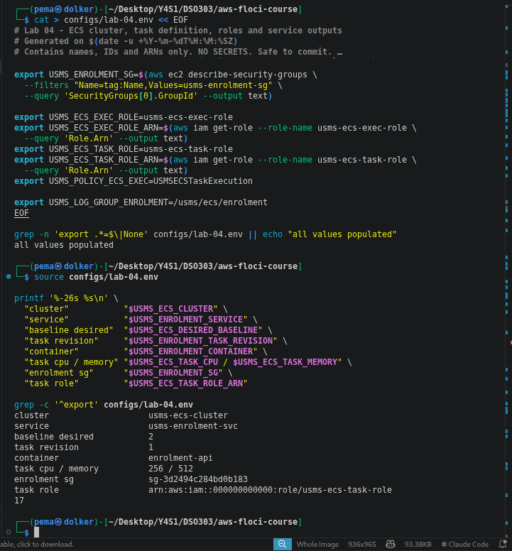

**Observed:** all values populated, 17 exports, baseline desired 2, task revision 1, container `enrolment-api`, 256 / 512, and the enrolment security group and task role ARN resolved by lookup.

**Step 13 - Git commit**


**Section 9 - verification**


**Observed:** PASS=36 FAIL=1.

| Failed check | Reason |
|---|---|
| `usms-enrolment-sg is sourced from usms-app-sg` | Floci does not retain `UserIdGroupPairs` (Step 8). The TCP/80 rule exists. |

I did not delete and recreate the security group to force FAIL=0. One caution: on revision 1 the check "exec role and task role are DIFFERENT" passed because the execution role was genuinely empty in revision 1 (Step 9), and an empty string differs from any ARN.

### 6.2 AWS Management Console Verification

Floci does not have a web console, so there is no console screenshot for this lab. Every resource was checked with `describe` and `list` commands instead, and the screenshots in 6.1 are that verification.

## 7. Analysis and Discussion

The objectives were achieved. The cluster, log group, both roles, the security group, the task definition and a service of two Fargate tasks in two private subnets all exist and read back as the handout asks. The two most important ideas came through clearly: the service's `desiredCount` is the only number that will change when scaling is added in Lab 06, and Lab 01's policy works unchanged on a second kind of compute (a task role instead of an instance profile).

Not everything matched real AWS. Container Insights was not stored, the security group's source reference was not returned, the waiter crashed, the service had no events, and Application Auto Scaling is missing. I wrote these down as Floci limitations instead of working around them.

Problems I ran into and how I fixed them:

- **Empty execution role in revision 1.** The template variable was empty when I wrote it, and the handout's `grep` check could not catch an empty value. I found it when reading the task definition back, and registered revision 2 with the role set explicitly (Exercise 2). The service now runs revision 2.
- **The waiter crashed.** `wait services-stable` failed inside Floci, so I polled `describe-services` by hand until running was 2.
- **Earlier labs were not at FAIL=0.** The Lab 02 and Lab 03 failures are the same known Floci limitations, so I recorded them as the baseline instead of rebuilding those labs.

## 8. Reflection

**What I learned.** The split between the execution role and the task role was the clearest new idea. One is for ECS to start the container, the other is for my code once it runs, and mixing them up would either break the start or give the code more than it needs. I also learned that a task definition is never edited: a change is a new revision, and the service simply points at a different number.

**Challenges.** The hardest part was the empty execution role. Every command succeeded and the check passed, so nothing looked wrong. It only showed up when I read the task definition back, which taught me to check the stored values, not the success messages.

**Real world use.** For USMS, ECS on Fargate fits well because the team is small and there are no servers to patch. Running two tasks in two Availability Zones from the start means a single failure does not take enrolment down.

**What I want to explore more.** Putting the service behind a load balancer (Lab 05) so clients do not need to know task addresses, and auto scaling the desired count (Lab 06).

## 9. Conclusion

The objectives were achieved. The USMS enrolment service now runs on ECS Fargate as two tasks in two private subnets, with a cluster, a log group, separate execution and task roles, and a security group that only accepts the web tier. Everything Lab 05 and Lab 06 need is recorded in `configs/lab-04.env`.

The key ideas I am taking from this lab are that Fargate removes the servers but not the networking, that a task needs two roles for two different jobs, that task definitions are versioned and never changed in place, and that the desired count is the one number that scaling will control.

## 10. Appendix

- Notes and review questions: `notes/lab-04-notes.md`
- Exercises 1 to 5: `labs/lab-04-ecs/exercises.md`
- Task definitions: `templates/lab-04-taskdef.json` (revision 1), `templates/lab-04-taskdef-rev2.json` (revision 2, the one the service runs)
- Policy documents: `policies/trust-ecs-tasks.json`, `policies/usms-ecs-task-execution-policy.json`, `policies/usms-enrolment-sg-ingress.json`
- Recorded names and ARNs: `configs/lab-04.env` (17 exports)
- Scripts: `scripts/utilities/verify-lab-04.sh`, `scripts/utilities/lab-04-ecs-inventory.sh` (Exercise 3), `scripts/cleanup/lab-04-cleanup.sh` (not run)
- Screenshots: `screenshots/lab-04/`

