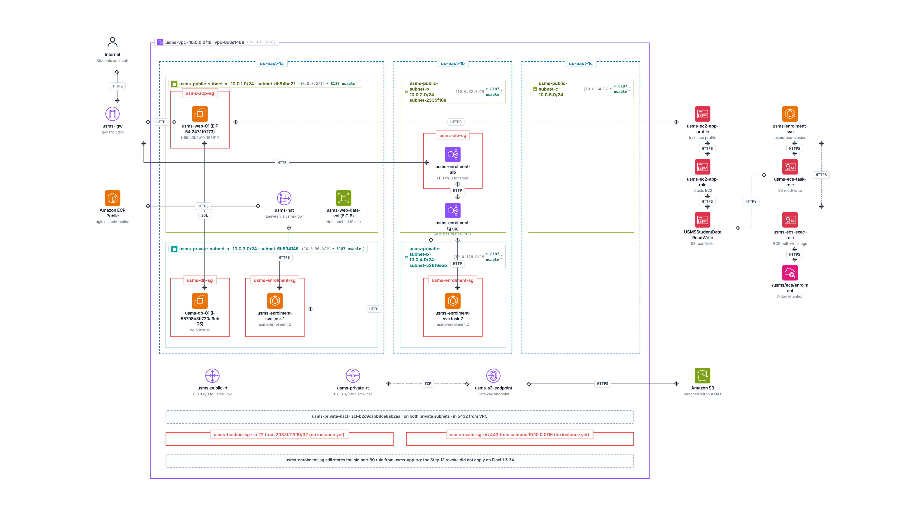
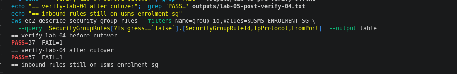
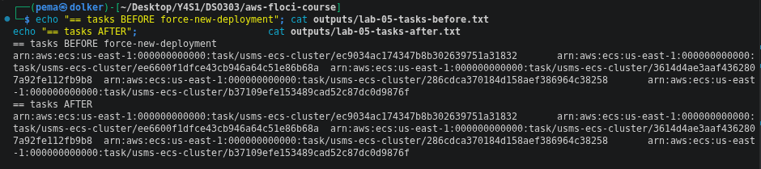

# AWS Practical Laboratory 5 Report

**Student Name:** Pema Dolker   
**Module:** DSO303      
**Practical:** Lab 05 - Putting the ECS Service Behind an Application Load Balancer     
**Environment:** Floci (local AWS API emulator, Docker Compose, hybrid storage), account 000000000000, us-east-1. Original run on Floci 1.5.34, re-checked on 2.2.0 on 15 Oct 2026 (see Section 6.1, Floci upgrade).

**Support path:** B, control plane only. The probe answered for everything, but Step 12's curl could not connect, which is the handout's definition of Path B: every object exists and reads back, but no request is served.

Step by step notes and the seven review questions are in `notes/lab-05-notes.md`, and the five exercises are in `labs/lab-05-ecs-alb/exercises.md`.

> Labels used below:
> **Observed** = I ran it and saw it.
> **Floci limitation** = behaved differently from real AWS.

## 1. Aim / Objective

The aim of this practical is to put the `usms-enrolment-svc` service from Lab 04 behind an internet-facing Application Load Balancer. I built a firewall for the load balancer, the load balancer across the two public subnets, an `ip` target group, a listener with a fixed-response health rule, attached the service to the target group, and cut over so the tasks accept traffic from the load balancer's security group only. The task definition (`usms-enrolment:2`) does not change, because the load balancer only changes how clients find the tasks.

## 2. Introduction

In Lab 04 the enrolment tasks were running, but anyone who wanted to reach them had to know each task's IP address, and those addresses change every time a task is replaced. A load balancer fixes this by giving clients one stable name and spreading their requests over whatever tasks are healthy at that moment.

The main parts I used in this lab:

- **Application Load Balancer (ALB)** - a layer 7 (HTTP) load balancer with nodes in at least two Availability Zones. An internet-facing ALB sits in the public subnets and has a public DNS name.
- **Listener** - a port and protocol the ALB listens on (here HTTP:80), with a default action.
- **Listener rule** - a condition such as a path, with its own action and a priority. Rules are checked in priority order before the default action.
- **Target group** - the set of targets the ALB sends traffic to, with a health check. For Fargate tasks in `awsvpc` mode the target type must be `ip`.
- **Service attachment** - when the ECS service is linked to a target group, it registers and deregisters its own tasks, so nobody has to do it by hand.
- **Security group chaining** - the tasks' security group allows traffic from the ALB's security group, not from an IP range.

Load balancers matter in cloud computing because they are what makes running several copies of a service useful: clients see one address, failed copies stop getting traffic, and new copies are added without anyone changing a setting.

## 3. Use Case

- Giving students one stable address for the enrolment API, no matter how many tasks are running or where they are.
- Rolling out a new version of a service one task at a time without dropping requests.
- Sending different paths to different services through one load balancer, for example `/results` to a results service (Exercise 1).
- Keeping the application tasks private: only the load balancer is on the internet, and the tasks only accept traffic from it.

## 4. System Architecture / Design

```text
 Internet --> usms-igw --> usms-enrolment-alb   internet-facing, public subnets a and b
                            usms-alb-sg: in tcp/80 and tcp/443 from 0.0.0.0/0
                            listener HTTP:80
                              rule 10   /alb-health  -->  fixed response 200
                              default              -->  usms-enrolment-tg (target type ip, health check GET /)
                                                          --> task 1 (usms-private-subnet-a)
                                                          --> task 2 (usms-private-subnet-b)

 usms-enrolment-svc   usms-enrolment:2, desired 2, registers and deregisters its own targets
 usms-enrolment-sg    in tcp/80 from usms-alb-sg (Step 9)
                      the old tcp/80 rule from usms-app-sg is still stored (Step 13 revoke did not apply)
```



Clients now only need the load balancer's DNS name. The tasks stay in the private subnets and the target group holds their IP addresses, which the ECS service keeps up to date. On real AWS the cutover in Step 13 would leave usms-alb-sg as the only source that can reach the tasks. On Floci 1.5.34 the old rule stayed, so the picture shows the intended path and a note about the leftover rule.

## 5. Implementation Procedure

1. **Steps 1 to 3** - started Floci, sourced `course.env` and the Lab 01 to 04 env files, recorded the earlier verify scripts as a baseline, and probed the load balancer and ECS APIs.
2. **Step 4** - created `usms-alb-sg` with tcp/80 from anywhere, and in the "Your turn" added tcp/443.
3. **Step 5** - created `usms-enrolment-alb` (internet-facing, both public subnets) and set its attributes.
4. **Steps 6 and 7** - created `usms-enrolment-tg` (target type `ip`, health check `GET /`), widened and restored the matcher, and set the deregistration delay and routing algorithm.
5. **Step 8** - created the HTTP:80 listener forwarding to the target group.
6. **Step 9** - allowed tcp/80 on `usms-enrolment-sg` from `usms-alb-sg`.
7. **Step 10** - attached the service to the target group (recreating the service, see Section 7).
8. **Step 11** - watched the tasks register themselves, then changed the desired count to 3 and back to 2.
9. **Step 12** - tried to reach the ALB and built the five-block proof chain instead.
10. **Steps 13 and 14** - tried the cutover (revoking the old `usms-app-sg` rule) and a forced new deployment.
11. **Steps 15 to 17** - added the `/alb-health` rule, proved persistence across a restart, and ran the exposure audit.
12. **Step 18 and Section 9** - wrote `configs/lab-05.env` and ran `verify-lab-05.sh`.
13. **After the Floci upgrade** - re-checked the earlier limitations on 2.2.0 before starting Lab 06.

## 6. Results and Evidence

### 6.1 CLI Output

**Steps 1 to 3 - environment, baseline and probe**


**Observed:** account `000000000000`. Lab 02 `FAIL=1`, Lab 03 `FAIL=4`, Lab 04 `FAIL=1`. These are the known Floci limitations already written up in those labs' notes, and I did not repair them here.


**Observed:** every probe answered `SUPPORTED`, which on its own points at Path A. Step 12 settled it as Path B.

**Step 4 - load balancer firewall**


**Observed:** `usms-alb-sg` created in `usms-vpc` (`sg-d6a9f362a51555d9e`) with one inbound rule, tcp/80 from `0.0.0.0/0`. The internet-facing load balancer needs that rule to work at all.


**Observed:** the second rule was added (`policies/usms-alb-sg-ingress-443.json`). It only opens the firewall: nothing answers on 443 until there is an HTTPS listener, and that needs a TLS certificate. ACM issues public certificates for free but only after I prove I control a domain, which no API call can do for me.

**Step 5 - the load balancer**


**Observed:** `usms-enrolment-alb` is `internet-facing`, type `application`, state `active`, with nodes in `us-east-1a` (`subnet-db54be2f`) and `us-east-1b` (`subnet-2335f16e`) and `usms-alb-sg` attached. The waiter completed on the first poll.


**Observed:** `idle_timeout.timeout_seconds=60` and `routing.http.drop_invalid_header_fields.enabled=true` both read back.

**Steps 6 and 7 - target group**


**Observed:** `usms-enrolment-tg`: target type `ip` (mandatory for `awsvpc` tasks), HTTP/80, in `usms-vpc`, health check `GET /` on the traffic port every 30 s, timeout 5 s, healthy 2, unhealthy 2, matcher `200`. Attached to no load balancer yet (`LBs: 0`).


**Observed:** in the "Your turn", `modify-target-group` accepted both values and `describe-target-groups` read each one back. My answers (a) and (b) are in `notes/lab-05-notes.md`.


**Observed:** `deregistration_delay.timeout_seconds=30` and `load_balancing.algorithm.type=least_outstanding_requests`.

**Step 8 - listener**


**Observed:** an HTTP:80 listener whose default action forwards to `usms-enrolment-tg` (`templates/lab-05-listener-default-actions.json`). `describe-target-groups` now reports `AttachedToLoadBalancers: 1`.

**Step 9 - tasks accept traffic from the load balancer**


**Observed:** `authorize-security-group-ingress` on `usms-enrolment-sg` returned a rule ID (`sgr-956fffaebe69d12b5`) using `policies/usms-enrolment-sg-ingress-alb.json`. **Floci limitation:** the rule's source group cannot be read back (`UserIdGroupPairs` comes back empty), the same bug as in Labs 02 to 04.

**Step 10 - attaching the service**


**Observed:** `update-service --load-balancers ... --health-check-grace-period-seconds ...` returned no error but stored neither. The same flags worked on `create-service`, so I deleted and recreated `usms-enrolment-svc` with the load balancer attached at creation (same task definition `usms-enrolment:2`, desired count, subnets and security group; `outputs/lab-05-svc-delete.json`, `lab-05-svc-recreate.json`). The screenshot shows the result: one `loadBalancers` entry for `usms-enrolment-tg`, `enrolment-api`, port 80, 2/2 running. **Floci limitation (1.5.34):** `healthCheckGracePeriodSeconds` was accepted but returned `null`.

**Step 11 - targets and scaling by hand**


**Observed:** both task addresses (`172.21.0.3`, `172.21.0.4`) registered themselves in the target group and read `healthy` on the first poll. I did not trust that on its own, see Step 12.


**Observed:** in the "Your turn", at desired 3 a third address appeared in the target group by itself (`initial` first); at desired 2 it went back to two. I never ran `register-targets` or `deregister-targets`: the ECS service owns registration. Without that I would have had to do it by hand for every scaling event.

**Step 12 - does it actually serve traffic?**


**Observed:** the load balancer's DNS name does not resolve (`http_code=000`), so on this build there is no data path. `healthy` is a control-plane fact, not proof of a served request. Instead the five-block chain in `outputs/lab-05-path-proof.txt` shows: listener, then target group, then registered targets, then the service that registered them, then the firewall rule. The targets are flagged "not in a Lab 02 private subnet" only because Floci runs tasks on its own Docker network (`172.21.0.0/16`). **Floci limitation:** this is Path B as the handout defines it.

**Steps 13 and 14 - cutover and rolling deployment**



**Observed (Step 13):** three attempts to revoke the old `usms-app-sg` rule on `usms-enrolment-sg` each printed `Return: True`, and `describe-security-group-rules` still showed three port-80 ingress rules every time (`sgr-e1d02f8b7ba560a15`, `sgr-dfbe75fbe4dd2c34e`, `sgr-956fffaebe69d12b5`). The handout expects the Step 13 diff to show one check changing from ok to FAIL. On this build the diff was empty: the revoke never took effect, and the source-group check could not read `UserIdGroupPairs` in either run. The rule count is the real evidence. **Floci limitation (1.5.34):** `revoke-security-group-ingress` reported success without removing anything, so the cutover could not be shown as a state change. The command and the intent are correct.



**Observed (Step 14):** `update-service --force-new-deployment` returned success, but `list-tasks` before and after (`outputs/lab-05-tasks-before.txt`, `lab-05-tasks-after.txt`) gave the same task ARNs and the same target addresses 3 m 39 s later, so no task was replaced. **Floci limitation (1.5.34):** `force-new-deployment` is a no-op here. I could not observe the `initial`, `healthy`, `draining` sequence and described it from the lab text instead.

**Steps 15 to 17 - rule, persistence and audit**


**Observed:** the priority-10 rule (`/alb-health` to a fixed response 200) exists, but its condition `Values` read back as `[]`. **Floci limitation:** nested arrays are lost on read-back; the other rule fields were correct. `curl` returned `000` for the same reason as Step 12.


**Observed:** after `floci-down.sh` and `floci-up.sh`, the `diff` of the before and after captures was empty: **PERSISTENCE PROVEN** for the load balancer, target group, listener, rule, the service's attachment and `usms-alb-sg`, with every ARN found again from the API. **Caveat:** the `usms-enrolment-sg` query crashed (`length()` on null) in both captures, so that one object is not covered by the diff.


**Observed:** block 1 shows the load balancer reachable from `0.0.0.0/0` on 80 and 443. Block 2 reported a mismatch only because `UserIdGroupPairs` is unreadable; the raw rule count from `describe-security-group-rules` is the reliable evidence (3 rules). Block 3 first printed `carrier: None`. I first assumed a filter bug, but `describe-instances` showed `usms-web-01` was `stopped` after the Floci restart; after `start-instances` the carrier matched `lab-03.env`. Block 4: `describe-tags` works, and both the load balancer and the target group carry `Lab=05`.

**Step 18 and Section 9 - recording outputs and verification**


**Observed:** `configs/lab-05.env` populated (15 exports, 16 after Exercise 5 added the ResourceLabel). `USMS_SVC_GRACE_PERIOD` was `None` on 1.5.34. The prescribed escaping for the listener ARN broke in zsh, so I computed it outside the heredoc.


**Observed:** `PASS=45 FAIL=4`. The four failures: `usms-enrolment-sg admits tcp/80 from usms-alb-sg` (unreadable `UserIdGroupPairs`), `healthCheckGracePeriodSeconds is set` and `lab-05.env has no empty values` (both the grace period), and `exactly ONE deployment` (deployments returned null). One **false pass**: `cutover done: usms-enrolment-sg no longer admits usms-app-sg` passes only because the group source cannot be read; the three raw rules show the old rule is still there.

**Floci upgrade - re-checking on 2.2.0 (15 Oct 2026)**

Lab 06 needs Application Auto Scaling, which 1.5.34 does not implement, so I upgraded to 2.2.0 and re-checked what this lab had flagged as limitations.

| Finding on 1.5.34 | On 2.2.0 |
|---|---|
| `healthCheckGracePeriodSeconds` accepted but not returned | **Fixed.** `update-service --health-check-grace-period-seconds 60` reads back `60`; `USMS_SVC_GRACE_PERIOD=60` |
| `describe-services` deployments `null` (`length()` crash) | **Fixed.** `length(deployments)` returns `1` |
| `UserIdGroupPairs` empty on security-group rules | **Still empty** on `usms-enrolment-sg` (three port-80 rules, no sources shown) |
| `verify-lab-05.sh` `PASS=45 FAIL=4` | `PASS=48 FAIL=1` - only the security-group source check remains |
| `revoke-security-group-ingress`, `force-new-deployment`, rule `Values` read-back, `update-service --load-balancers` | not re-tested yet |

`verify-lab-02.sh` and `verify-lab-04.sh` each still have one failure, the same unreadable group source (`usms-db-sg` from `usms-app-sg`, `usms-enrolment-sg` from `usms-alb-sg`). Lab 03 changed after the restart because `usms-web-01` was stopped.

### 6.2 AWS Management Console Verification

Floci does not have a web console, so there is no console screenshot for this lab. Every resource was checked with `describe` commands instead, and the screenshots in 6.1 are that verification.

## 7. Analysis and Discussion

The objectives were achieved for the control plane. The security groups, load balancer, target group, listener, health rule and the service attachment were all built, read back and shown to survive a restart, and the service registered its own targets when the desired count changed. What this Floci build could not show was a served request, the security group cutover as a real state change, a rolling deployment, and readable group-based rules. Each one is recorded as a limitation with what real AWS would do, not as a pass.

The result that taught me the most was Step 11 together with Step 12. The targets were `healthy` straight away, which looked like success, but the DNS name did not even resolve. A health status is something the control plane writes down, not proof that a request was served, so I built the five-block chain to show what was really there.

Problems I ran into and how I fixed them:

- **`update-service` ignored the load balancer.** It returned no error but stored nothing, so I deleted and recreated the service with the load balancer attached at creation, keeping the same task definition, desired count, subnets and security group.
- **The revoke did not remove the rule.** It printed `True` three times while the rule stayed. I kept the raw rule count as evidence and marked the verify script's cutover check as a false pass instead of hiding it.
- **The listener ARN broke the env file in zsh.** The handout's escaping did not work in zsh, so I computed the value outside the heredoc.
- **`usms-web-01` was stopped after a restart.** The audit printed `carrier: None` until I started the instance again.

## 8. Reflection

**What I learned.** Before this lab I thought of a load balancer as one box. It is really four objects: the load balancer, the listener, the rules and the target group, and the ECS service is what keeps the target group filled in. I also understood why the target type has to be `ip` for Fargate: each task has its own address, not a port on a shared instance.

**Challenges.** The hardest part was telling apart what was my mistake and what was Floci. When the revoke reported success and the rule was still there, I checked the rule IDs three times before accepting it was the emulator. Recreating the service in Step 10 also felt risky, so I saved the old and new definitions first.

**Real world use.** For USMS this is the shape I would use in production: one internet-facing ALB in the public subnets, the tasks private, and the tasks' security group only accepting the ALB's group. For real use I would add an ACM certificate, an HTTPS:443 listener and a redirect from 80 to 443, as I worked out in Exercise 4.

**What I want to explore more.** Seeing a real rolling deployment go through `initial`, `healthy` and `draining` on real AWS, and auto scaling the service on the ALB's request count per target, which is what Lab 06 sets up with the ResourceLabel from Exercise 5.

## 9. Conclusion

The objectives were achieved for everything Floci could show. The enrolment service now sits behind `usms-enrolment-alb` with an `ip` target group, an HTTP:80 listener, a `/alb-health` rule and a security group chain from the load balancer to the tasks, and the service registers its own tasks. Everything persisted across a restart and is recorded in `configs/lab-05.env` for Lab 06.

The key ideas I am taking from this lab are that the load balancer gives clients one stable address while ECS keeps the targets behind it current, that a healthy target is not the same as a served request, and that a security group can trust another security group instead of an address range.

## 10. Appendix

- Notes and the seven review questions: `notes/lab-05-notes.md`
- Exercises 1 to 5 (a second path through the load balancer, repairing the verify check, the load balancer report tool, the exposure review, the ResourceLabel hand-off to Lab 06): `labs/lab-05-ecs-alb/exercises.md`
- Request bodies: `templates/lab-05-listener-default-actions.json`, `templates/lab-05-rule-actions.json`, `templates/lab-05-rule-conditions.json`, `templates/lab-05-service-load-balancers.json`, and from Exercise 1 `templates/lab-05-ex1-results-rule-actions.json`, `templates/lab-05-ex1-results-rule-conditions.json`
- Policy documents: `policies/usms-alb-sg-ingress.json`, `policies/usms-alb-sg-ingress-443.json`, `policies/usms-enrolment-sg-ingress-alb.json`
- Recorded names and ARNs: `configs/lab-05.env` (16 exports after Exercise 5)
- Scripts: `scripts/utilities/verify-lab-05.sh`, `scripts/utilities/usms-lb-report.sh` (Exercise 3), `scripts/utilities/usms-resource-label.sh` (Exercise 5), `scripts/cleanup/lab-05-cleanup.sh` (not run)
- Screenshots: `screenshots/lab5/`
- Kept locally and not committed (git-ignored): the service delete and recreate files, the path proof, the tasks before and after files and the restart captures

**Note on AI use:** I used Claude (an AI assistant) as a guide while doing this lab. I ran every command myself, and the screenshots are from my own terminal. The notes and this report were written with its help, and I read and checked them before committing.