# Lab 05 Report - ECS Service Behind an Application Load Balancer

**Course:** DSO303
**Environment:** Floci (AWS-compatible emulator, hybrid storage), account `000000000000`, `us-east-1`.
Original run on Floci **1.5.34**; upgraded to **2.2.0** on 15 Oct 2026 (see section 14).

**Support path (Step 3):** A for the control plane, B for the data path (see Step 12).
Per-step reasoning and evidence: `notes/lab-05-notes.md`. Exercises: `labs/lab-05-ecs-alb/exercises.md`.

> Labels used below:
**Observed** = I ran it and saw it.
**Floci limitation** = behaved differently from real AWS.

## 1. Aim

Put the `usms-enrolment-svc` service from Lab 04 behind an internet-facing Application Load Balancer:
a firewall for the load balancer, the load balancer across the two public subnets, an `ip` target group,
a listener with a fixed-response health rule, the service attached to the target group, and a cutover so
the tasks accept traffic from the load balancer's security group only. The task definition
(`usms-enrolment:2`) does not change - the load balancer only changes how clients find the tasks.

## 2. Environment and prerequisites (Steps 1-3)

Floci started with `floci-up.sh`, `course.env` and the Lab 01-04 env files sourced, and `whoami.sh`
confirmed account `000000000000`:

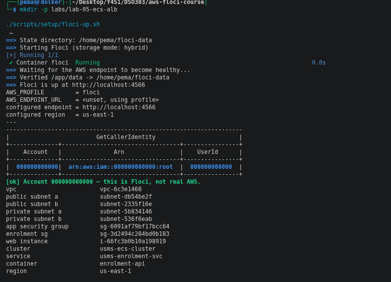

Baseline from the earlier labs:

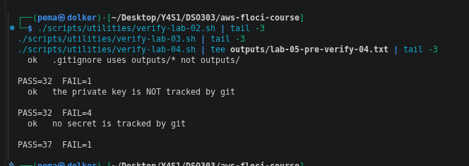

**Observed:** Lab 02 `FAIL=1`, Lab 03 `FAIL=4`, Lab 04 `FAIL=1`. These are the known Floci limitations
already written up in those labs' notes; I did not repair them here.

Step 3 probe of the load balancer API:

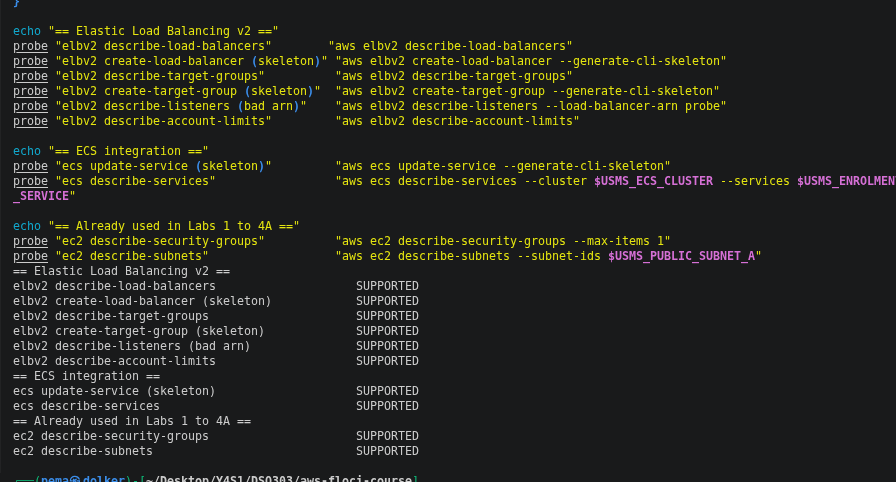

**Observed:** every probe answered `SUPPORTED`, so the control plane is Path A.

## 3. Load balancer firewall (Step 4)

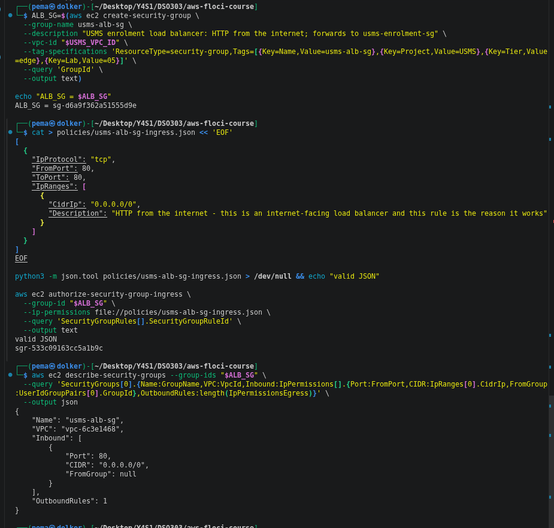

**Observed:** `usms-alb-sg` created in `usms-vpc` (`sg-d6a9f362a51555d9e`) with one inbound rule, tcp/80
from `0.0.0.0/0`. The internet-facing load balancer needs that rule to work at all.

"Your turn" - open tcp/443:

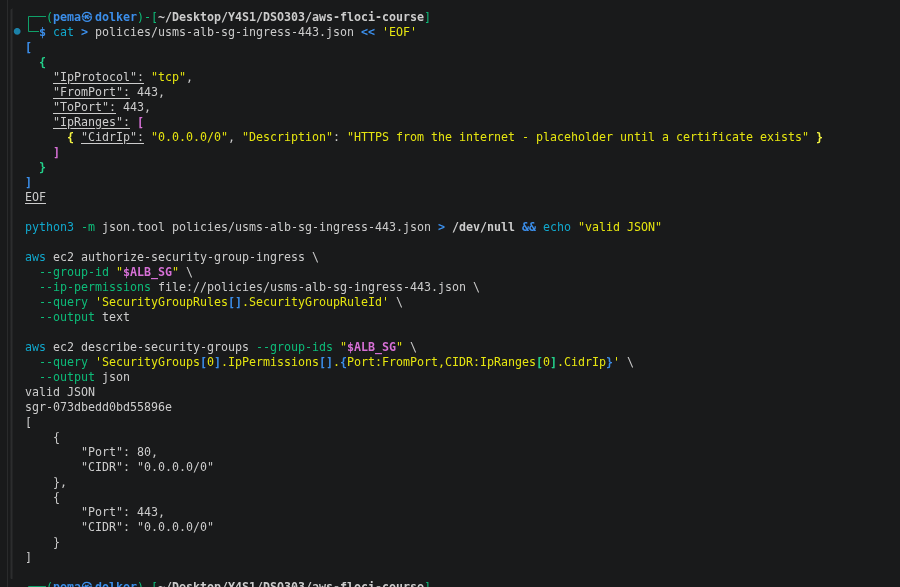

**Observed:** the second rule was added (`policies/usms-alb-sg-ingress-443.json`). It only opens the
firewall: nothing answers on 443 until there is an HTTPS listener, and that needs a TLS certificate. ACM
issues public certificates for free but only after I prove I control a domain, which no API call can do
for me.

## 4. The load balancer (Step 5)

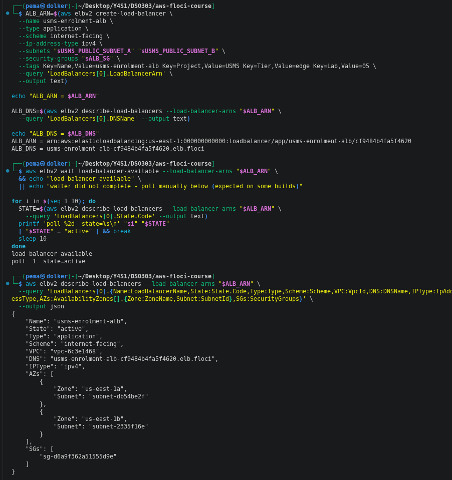

**Observed:** `usms-enrolment-alb` is `internet-facing`, type `application`, state `active`, with nodes in
`us-east-1a` (`subnet-db54be2f`) and `us-east-1b` (`subnet-2335f16e`) and `usms-alb-sg` attached. The
waiter completed on the first poll.

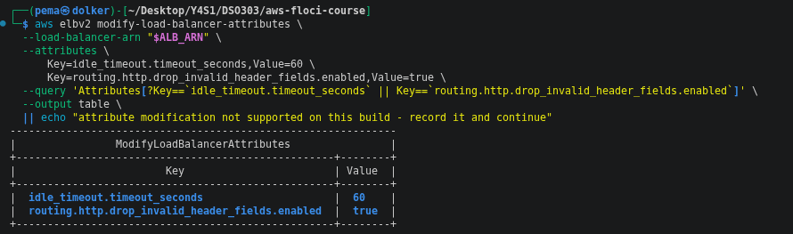

**Observed:** `idle_timeout.timeout_seconds=60` and `routing.http.drop_invalid_header_fields.enabled=true`
both read back.

## 5. Target group (Steps 6 and 7)

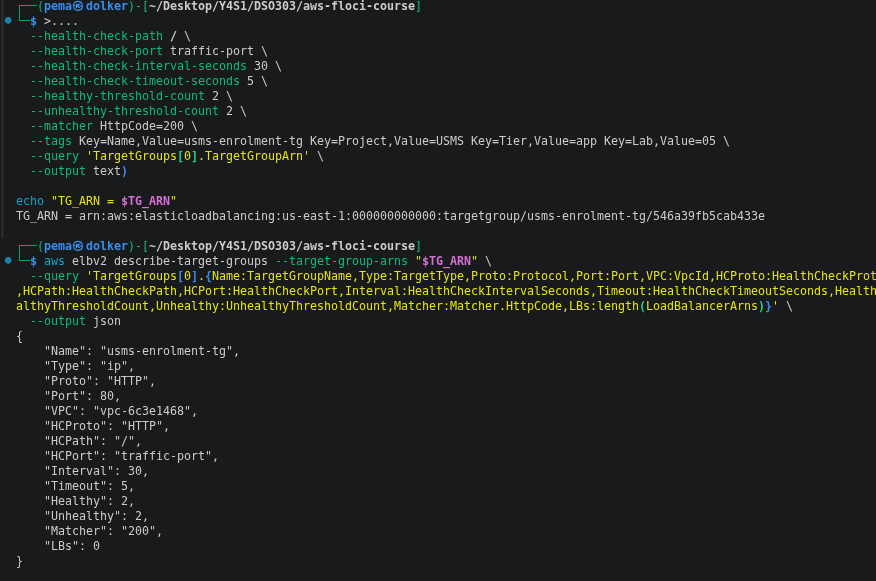

**Observed:** `usms-enrolment-tg`: target type `ip` (mandatory for `awsvpc` tasks), HTTP/80, in
`usms-vpc`, health check `GET /` on the traffic port every 30 s, timeout 5 s, healthy 2, unhealthy 2,
matcher `200`. Attached to no load balancer yet (`LBs: 0`).

"Your turn" - widen the matcher to `200-399`, then put it back:

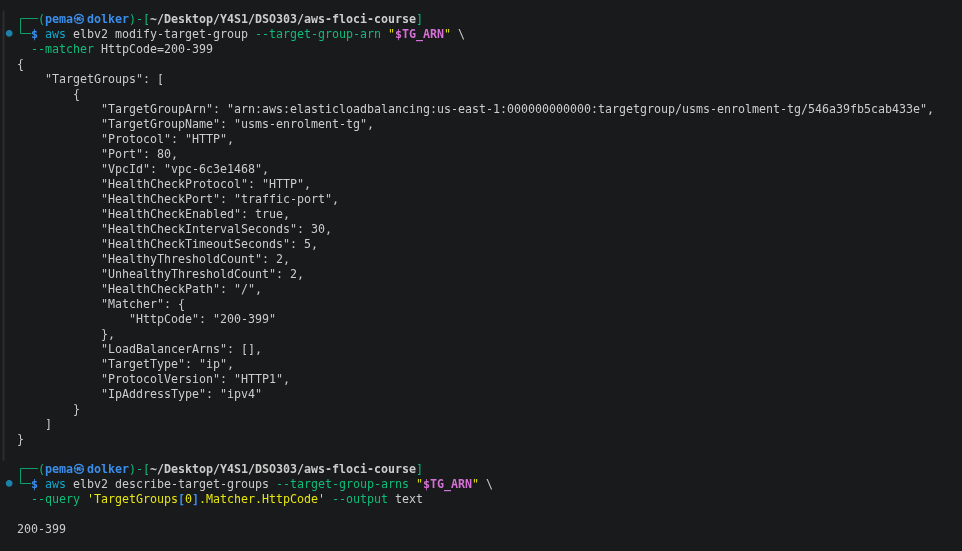
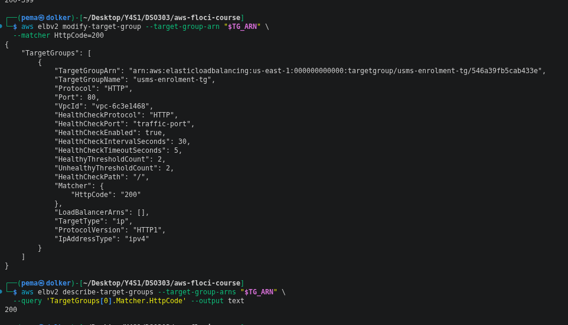

**Observed:** `modify-target-group` accepted both and `describe-target-groups` read each value back. My
answers (a) and (b) are in `notes/lab-05-notes.md`.

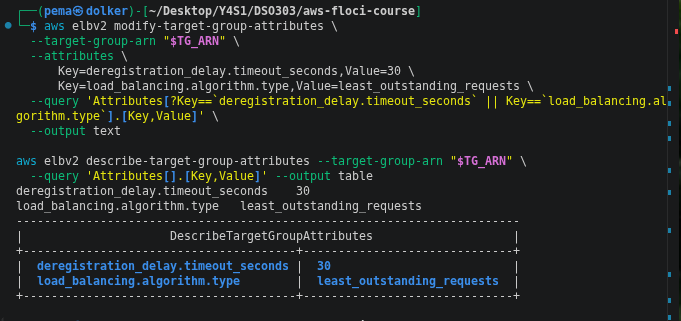

**Observed:** `deregistration_delay.timeout_seconds=30` and
`load_balancing.algorithm.type=least_outstanding_requests`.

## 6. Listener (Step 8)

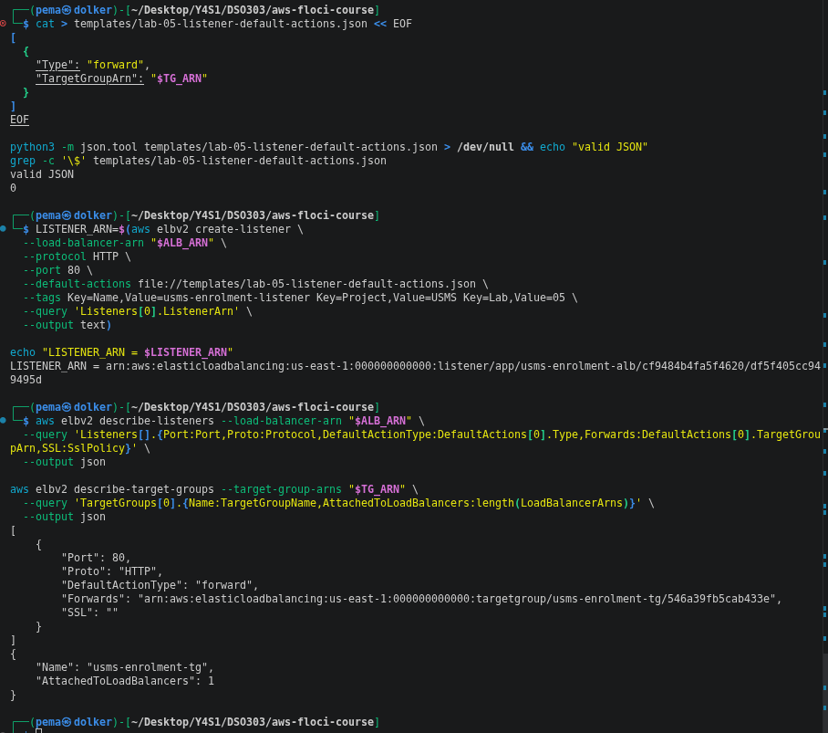

**Observed:** an HTTP:80 listener whose default action forwards to `usms-enrolment-tg`
(`templates/lab-05-listener-default-actions.json`). `describe-target-groups` now reports
`AttachedToLoadBalancers: 1`.

## 7. Tasks accept traffic from the load balancer (Step 9)

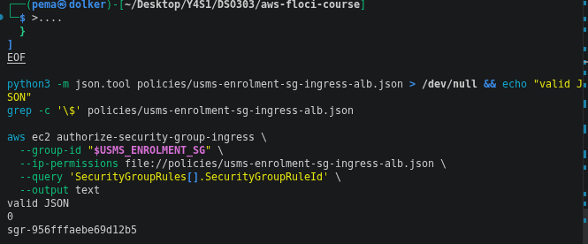

**Observed:** `authorize-security-group-ingress` on `usms-enrolment-sg` returned a rule ID
(`sgr-956fffaebe69d12b5`) using `policies/usms-enrolment-sg-ingress-alb.json`.
**Floci limitation:** the rule's source group cannot be read back (`UserIdGroupPairs` comes back empty),
the same bug as in Labs 02-04.

## 8. Attaching the service (Step 10)

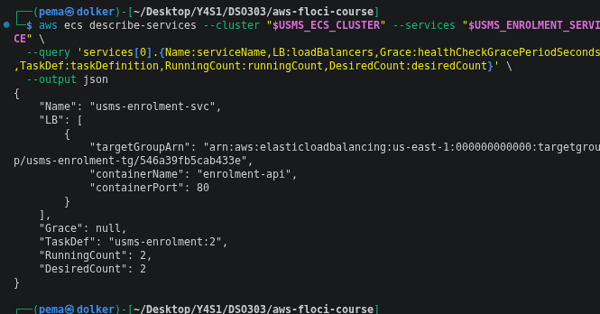

**Observed:** `update-service --load-balancers ... --health-check-grace-period-seconds ...` returned no
error but stored neither. The same flags worked on `create-service`, so I deleted and recreated
`usms-enrolment-svc` with the load balancer attached at creation (same task definition `usms-enrolment:2`,
desired count, subnets and security group; `outputs/lab-05-svc-delete.json`, `lab-05-svc-recreate.json`).
The screenshot shows the result: one `loadBalancers` entry for `usms-enrolment-tg`, `enrolment-api`, port 80,
2/2 running.
**Floci limitation (1.5.34):** `healthCheckGracePeriodSeconds` was accepted but returned `null`.

## 9. Targets and scaling by hand (Step 11)

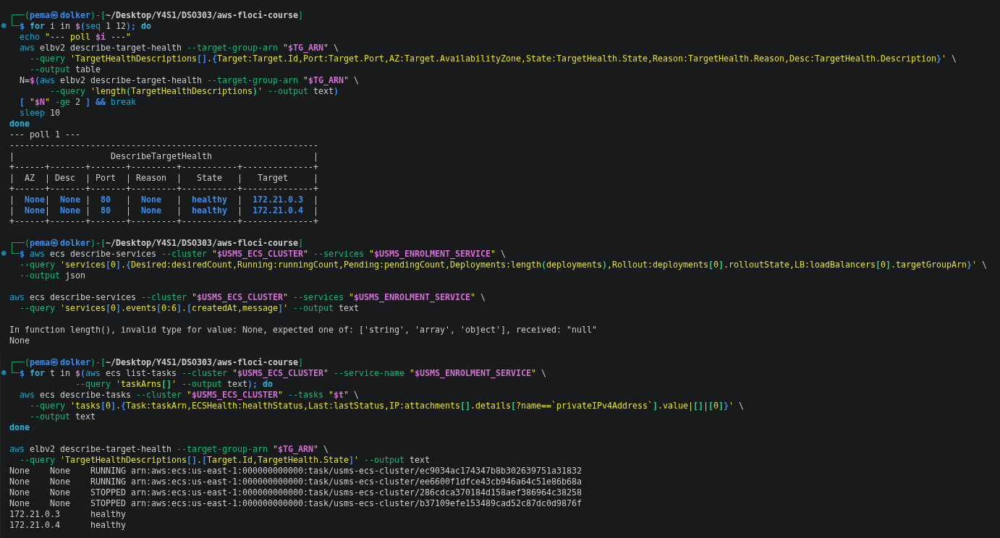

**Observed:** both task addresses (`172.21.0.3`, `172.21.0.4`) registered themselves in the target group and
read `healthy` on the first poll. I did not trust that on its own - see Step 12.

"Your turn" - change `desiredCount` and watch the target group:

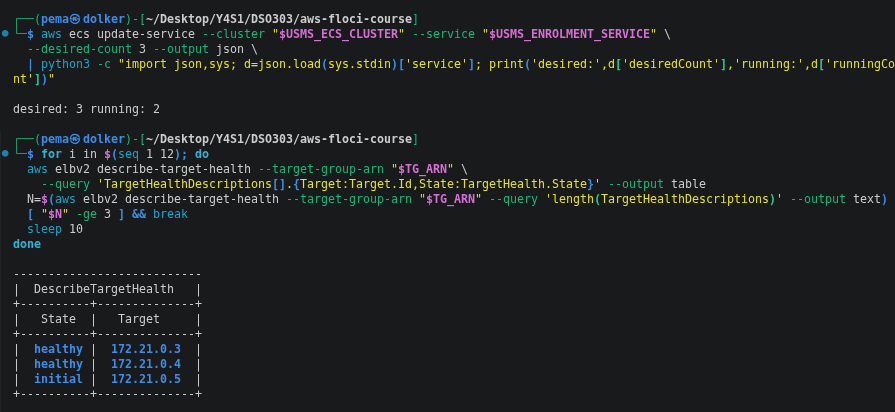
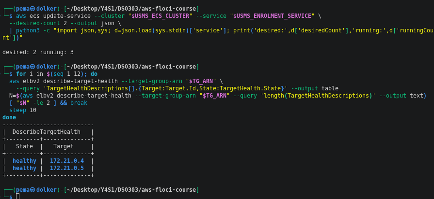

**Observed:** at desired 3 a third address appeared in the target group by itself (`initial` first); at
desired 2 it went back to two. I never ran `register-targets` or `deregister-targets`: the ECS service owns
registration. Without that I would have had to do it by hand for every scaling event.

## 10. Does it actually serve traffic? (Step 12)

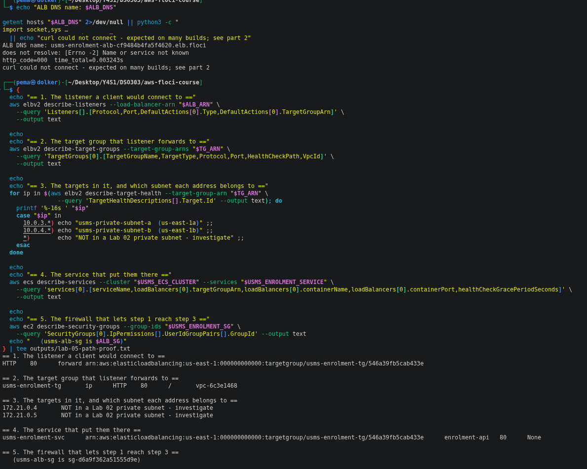

**Observed:** the load balancer's DNS name does not resolve (`http_code=000`), so on this build there is no
data path. `healthy` is a control-plane fact, not proof of a served request.
Instead the five-block chain in `outputs/lab-05-path-proof.txt` shows: listener -> target group ->
registered targets -> the service that registered them -> the firewall rule. The targets are flagged "not in
a Lab 02 private subnet" only because Floci runs tasks on its own Docker network (`172.21.0.0/16`).
**Floci limitation:** control plane Path A, data path Path B.

## 11. Cutover and rolling deployment (Steps 13 and 14)

**Observed (Step 13):** three attempts to revoke the old `usms-app-sg` rule on `usms-enrolment-sg` each
printed `Return: True`, and `describe-security-group-rules` still showed three port-80 ingress rules every
time (`sgr-e1d02f8b7ba560a15`, `sgr-dfbe75fbe4dd2c34e`, `sgr-956fffaebe69d12b5`).
**Floci limitation (1.5.34):** `revoke-security-group-ingress` reports success without removing anything,
so the cutover could not be shown as a state change. The command and the intent are correct.

**Observed (Step 14):** `update-service --force-new-deployment` returned success, but `list-tasks` before
and after (`outputs/lab-05-tasks-before.txt`, `lab-05-tasks-after.txt`) gave the same task ARNs and the same
target addresses 3 m 39 s later, so no task was replaced.
**Floci limitation (1.5.34):** `force-new-deployment` is a no-op here. I could not observe the
`initial -> healthy -> draining` sequence and describe it from the lab text instead.

<!-- TODO screenshots: Step 13 (revoke attempts + rule count) and Step 14 (list-tasks before/after). -->

## 12. Rule, persistence and audit (Steps 15-17)

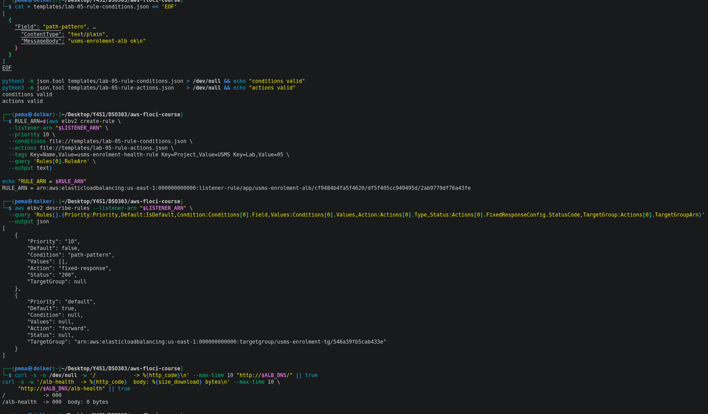

**Observed:** the priority-10 rule (`/alb-health` -> fixed-response 200) exists, but its condition `Values`
read back as `[]`. **Floci limitation:** nested arrays are lost on read-back; the other rule fields were
correct. `curl` returned `000` for the same reason as Step 12.

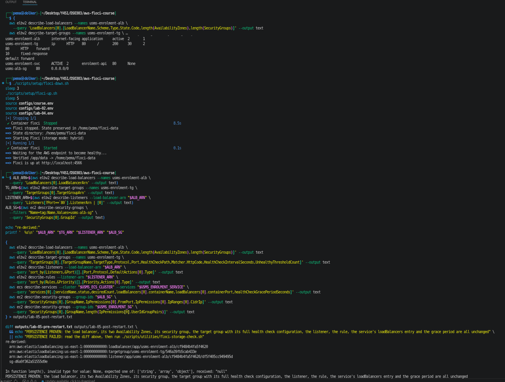

**Observed:** after `floci-down.sh` / `floci-up.sh`, `diff` of the before and after captures was empty:
**PERSISTENCE PROVEN** for the load balancer, target group, listener, rule, the service's attachment and
`usms-alb-sg`, with every ARN re-derived from the API. **Caveat:** the `usms-enrolment-sg` query crashed
(`length()` on null) in both captures, so that one object is not covered by the diff.

Step 17 audit:

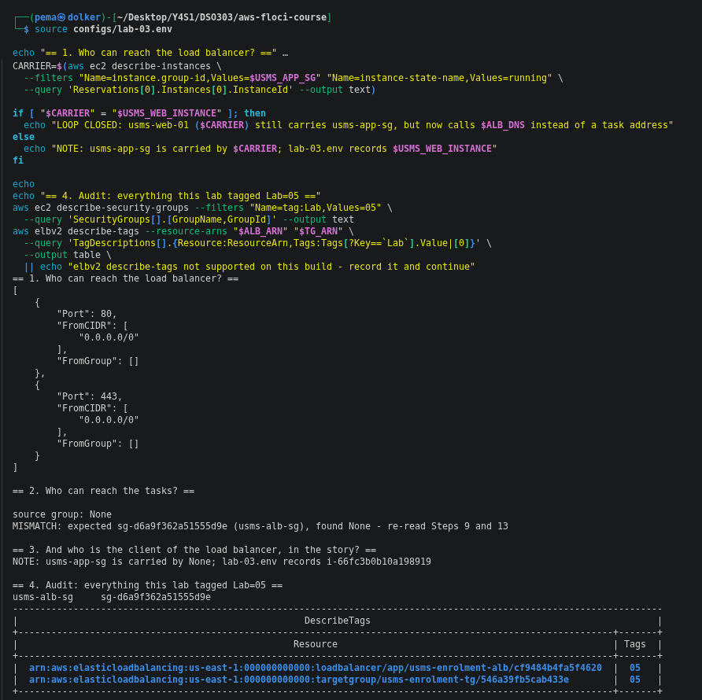
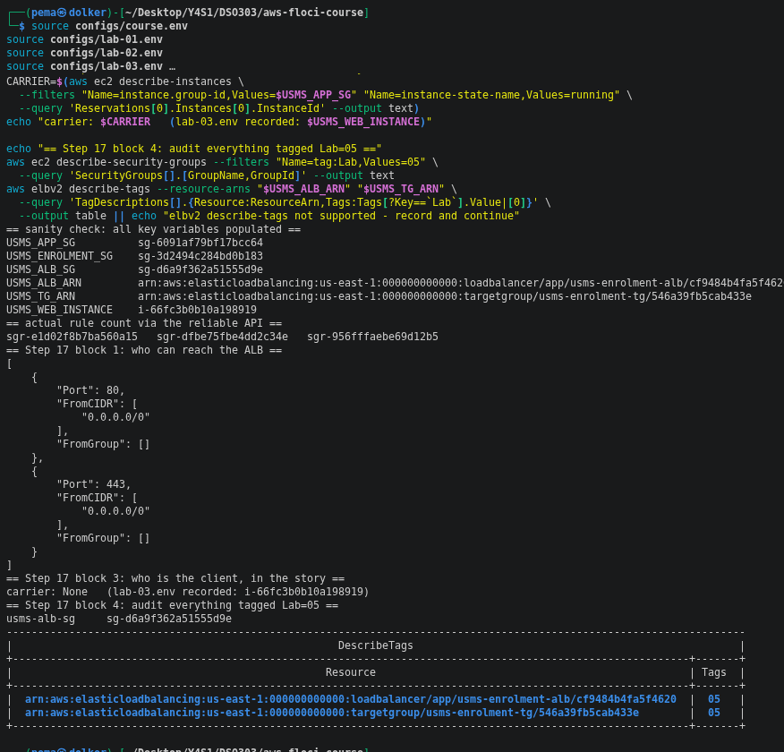
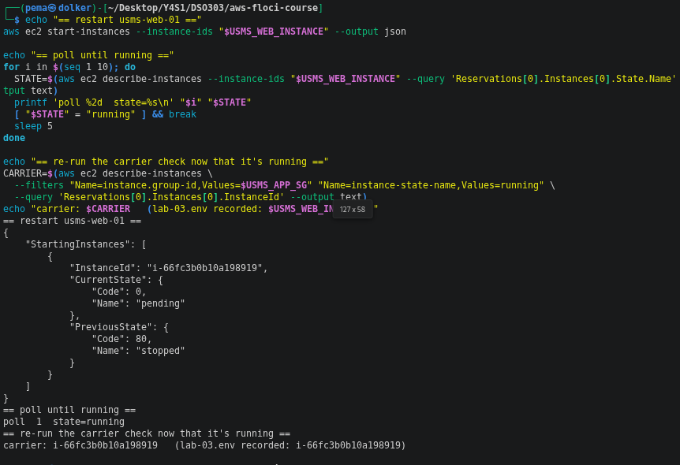

**Observed:** block 1 shows the load balancer reachable from `0.0.0.0/0` on 80 and 443. Block 2 reported a
mismatch only because `UserIdGroupPairs` is unreadable; the raw rule count from `describe-security-group-rules`
is the reliable evidence (3 rules). Block 3 first printed `carrier: None`. I first assumed a filter bug, but
`describe-instances` showed `usms-web-01` was `stopped` after the Floci restart; after `start-instances` the
carrier matched `lab-03.env`. Block 4: `describe-tags` works, both the load balancer and the target group
carry `Lab=05`.

## 13. Recording outputs and verification (Step 18, Section 9)

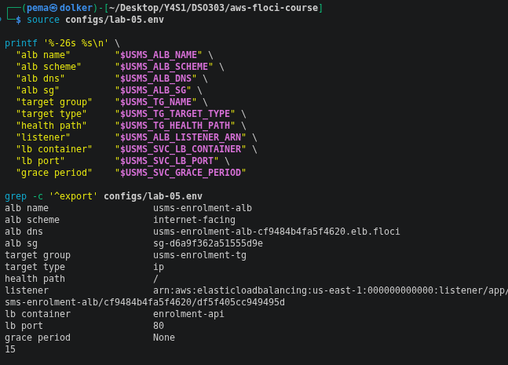

**Observed:** `configs/lab-05.env` populated (15 exports, 16 after Exercise 5 added the ResourceLabel).
`USMS_SVC_GRACE_PERIOD` was `None` on 1.5.34. The prescribed escaping for the listener ARN broke in zsh, so I
computed it outside the heredoc.

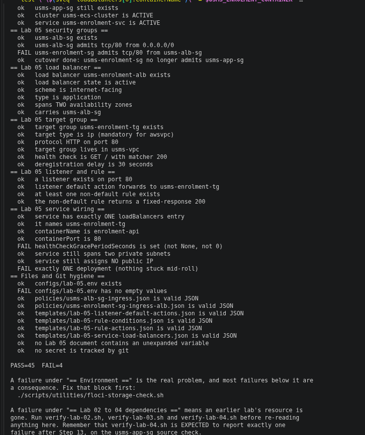

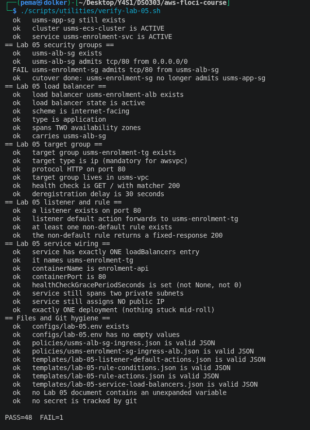

**Observed:** `PASS=45 FAIL=4`. The four failures: `usms-enrolment-sg admits tcp/80 from usms-alb-sg`
(unreadable `UserIdGroupPairs`), `healthCheckGracePeriodSeconds is set` and `lab-05.env has no empty values`
(both the grace period), and `exactly ONE deployment` (deployments returned null). One **false pass**:
`cutover done: usms-enrolment-sg no longer admits usms-app-sg` passes only because the group source cannot
be read; the three raw rules show the old rule is still there.

## 14. Update after upgrading Floci 1.5.34 -> 2.2.0 (15 Oct 2026)

Lab 06 needs Application Auto Scaling, which 1.5.34 does not implement, so I upgraded to 2.2.0 and re-checked
what Lab 05 had flagged as limitations.

| Finding on 1.5.34 | On 2.2.0 |
|---|---|
| `healthCheckGracePeriodSeconds` accepted but not returned | **Fixed.** `update-service --health-check-grace-period-seconds 60` reads back `60`; `USMS_SVC_GRACE_PERIOD=60` |
| `describe-services` deployments `null` (`length()` crash) | **Fixed.** `length(deployments)` returns `1` |
| `UserIdGroupPairs` empty on security-group rules | **Still empty** on `usms-enrolment-sg` (three port-80 rules, no sources shown) |
| `verify-lab-05.sh` `PASS=45 FAIL=4` | `PASS=48 FAIL=1` - only the security-group source check remains |
| `revoke-security-group-ingress`, `force-new-deployment`, rule `Values` read-back, `update-service --load-balancers` | not re-tested yet |

`verify-lab-02.sh` and `verify-lab-04.sh` each still have one failure, the same unreadable group source
(`usms-db-sg` from `usms-app-sg`, `usms-enrolment-sg` from `usms-alb-sg`). Lab 03 changed after the restart
because `usms-web-01` was stopped.

## 15. Exercises and review questions

Exercises 1-5 (second path through the load balancer, repairing the verify check, the load balancer report
tool, the exposure review, the ResourceLabel hand-off to Lab 06) are in
`labs/lab-05-ecs-alb/exercises.md`. The seven review questions are in `notes/lab-05-notes.md`.

## 16. Conclusion

The load balancer gives clients one stable address while ECS keeps the set of task addresses behind it
current: the service registers and deregisters targets by itself, as Step 11 showed by changing only
`desiredCount`. The whole control plane (security groups, load balancer, target group, listener, rule,
service attachment) was built, read back and shown to survive a restart. What this Floci build could not show:
a served request, the security-group cutover as a real state change, a rolling deployment, and readable
group-based rules. Each is recorded as a limitation with what real AWS would do, not as a pass.