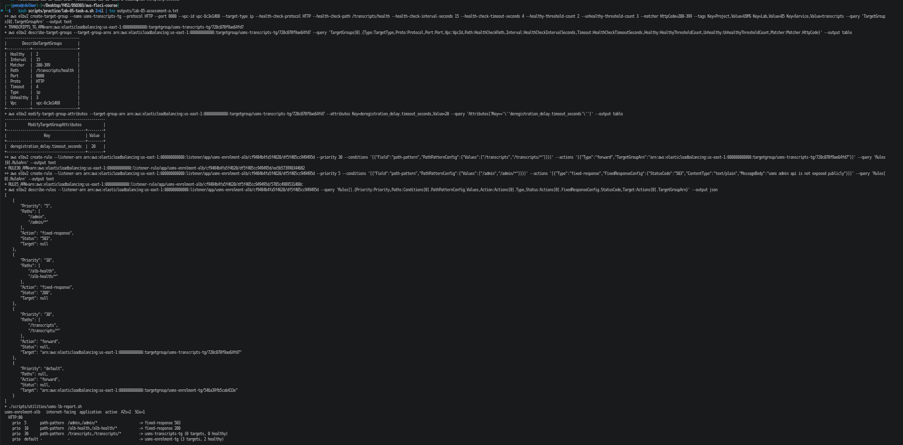

# Lab 05 - Section 13.1 Assessment (practice run)

The in-class assessment session for Section 13.1 was not held, so I worked through it afterwards as practice, using my notes and exercises. Task B needs an instructor-injected fault, so it is described rather than performed.

## Task A - Build from requirements

The requirement asked for:

- a target group `usms-transcripts-tg` in `usms-vpc`, HTTP on port 8080, registering targets by address (`ip`), with a health check on `/transcripts/health` every 15 s, a 4 s timeout, healthy after 2 successes, unhealthy after 3 failures, and any 2xx or 3xx counting as success (`200-399`);
- a deregistration delay of 20 s, set as an attribute, not by recreating the group;
- a rule at priority 30 sending `/transcripts` and everything below it to that target group;
- a rule at priority 5 answering `/admin` and everything below it with a fixed 503 and the body `usms admin api is not exposed publicly`, without contacting any target.

All the commands are in `scripts/practice/lab-05-task-a.sh`. Every ARN is captured with `$(...)` and `--query`, nothing is copied by hand. I ran it with:

```bash
bash scripts/practice/lab-05-task-a.sh 2>&1 | tee outputs/lab-05-assessment-a.txt
```

Output:




Two points the task was testing:

- **"Evaluated first" comes from the priority number, not the order I created things in.** The `/admin` rule was created *after* the `/transcripts` rule, but priority 5 is lower than 10, 20 and 30, so the load balancer checks it first. That is what the task means by a trap.
- **`describe-rules` is not in evaluation order, and `Priority` is a string**, so sorting it as text would put `"5"` after `"30"`. That is why the last step runs `usms-lb-report.sh`, which sorts the numbers properly and always prints `default` last.

Afterwards I removed the practice objects with `scripts/practice/lab-05-task-a-cleanup.sh` (rules first, then the target group), so `verify-lab-05.sh` is back to `PASS=48 FAIL=1`.

## Task B - Diagnose

Task B depends on the instructor changing one object in the running setup, so it cannot be done alone. This is the method I would follow, in the format the task asks for:

```
SYMPTOM     what I observed, and the exact command that showed it
HYPOTHESES  at least three ranked causes, written before testing anything
TEST        the ONE call that tells the causes apart
CAUSE       object, field, wrong value, right value
FIX         the command I ran
PROOF       the command and output showing it is correct again
```

The first commands I would run, because together they cover the whole chain from the listener to the task:

```bash
./scripts/utilities/verify-lab-05.sh | grep FAIL       # what changed since the known-good state
./scripts/utilities/usms-lb-report.sh                  # listener -> rules -> target groups -> target counts
aws elbv2 describe-target-health --target-group-arn "$USMS_TG_ARN" \
  --query 'TargetHealthDescriptions[].[Target.Id,TargetHealth.State,TargetHealth.Reason]' --output table
```

Faults I would expect, and what would point at each: the listener default action pointing at the wrong target group (report tool); the health-check path or matcher changed (`describe-target-groups`, and `Target.ResponseCodeMismatch` on real AWS); the `usms-alb-sg` rule removed from `usms-enrolment-sg` (`describe-security-group-rules` count); the service's desired count set to 0 (`describe-services`, empty target group); the `/alb-health` rule's priority or action changed (`describe-rules`).

## Task C - Explain

**1. "The target group is empty. Should I run `register-targets` with the tasks' addresses?"**

No. The target group is filled by the ECS service, through its `loadBalancers` entry: every time the service starts a task it registers that task's IP, and every time it stops one it deregisters it. Lab 05 Step 11 showed this when changing only `desiredCount`. If you register addresses by hand, ECS does not know about them. When those tasks are replaced, the old IPs stay in the target group, fail their health checks, or worse, point at whatever gets that IP next, and nothing will ever clean them up. An empty target group means something is wrong with the service: it isn't attached, desired count is 0, or its tasks are failing to start. The object responsible for the contents of the target group is the ECS service `usms-enrolment-svc`.

**2. ECS says the task is HEALTHY, but the target group says its address is unhealthy.**

It means the container is running and passes its own check, but the load balancer cannot get a good answer from it over the network. The application is probably fine and the path to it is not. The two most likely causes, in order: first, the security group, where `usms-enrolment-sg` doesn't allow the load balancer's group (`usms-alb-sg`) on the container port, so the health check times out; second, the health check settings don't match the application, such as the wrong path, the wrong port, or a matcher of `200` while the app answers `/` with a redirect. The first command I'd run is `aws elbv2 describe-target-health --target-group-arn "$USMS_TG_ARN"` and read `TargetHealth.Reason`. `Target.Timeout` points at the network or security group; `Target.ResponseCodeMismatch` points at the health check settings.

**3. What `--health-check-grace-period-seconds` does, and what happens without it (app needs 45 s, check every 30 s, unhealthy threshold 2).**

The grace period tells ECS to ignore the load balancer's health results for that many seconds after a task starts, so a slow-starting application isn't judged before it's ready. Without it, the sequence goes like this. The task starts and is registered, and the load balancer begins checking straight away. The first check fails because the app isn't listening yet. The next check comes 30 s later, still before the app is ready at 45 s, so it fails too. Two failures in a row reach the unhealthy threshold, so the target is marked unhealthy within about 30-60 s, before it has ever been able to answer. ECS sees an unhealthy task, stops it and starts a replacement, which needs the same 45 s and gets killed the same way, so the service never becomes stable. A grace period of 60 s or more (ours is 60) breaks the loop.

**4. Why `--target-type ip` is not a preference.**

Fargate tasks use the `awsvpc` network mode: each task gets its own network interface and its own IP address, and there is no EC2 instance underneath that we own or can name. A target group of type `instance` registers instance IDs, so it has nothing to register for a Fargate task; the only way to point at the task is by its IP. The alternative would have been `instance` (or `lambda`, for Lambda functions). The wrong choice would not fail when creating the target group, because any type is valid there. It would first fail at Step 10, when the service is attached: ECS rejects a load balancer configuration whose target group type is `instance` for a service using `awsvpc` networking.

## Task D - Evidence and hygiene

| Check | Status |
|---|---|
| `verify-lab-05.sh` FAIL=0 or each failure explained | `PASS=48 FAIL=1`; the failure (unreadable `UserIdGroupPairs`) is explained in `notes/lab-05-notes.md` |
| `configs/lab-05.env` committed, 16 exports after Exercise 5, no empty value or `None` | yes; `USMS_SVC_GRACE_PERIOD=60` since Floci 2.2.0 |
| `git status --short` shows nothing under `outputs/`, no root `.env` tracked | yes; `outputs/` is ignored except `.gitkeep` |
| `git check-ignore -v` on an assessment output file | git check-ignore -v outputs/lab-05-assessment-a.txt |
| Support path stated at the top of the notes, observed vs reasoned annotated | yes, Path B, with the observed/reasoned list |
| A commit describing the change | this file's commit |
