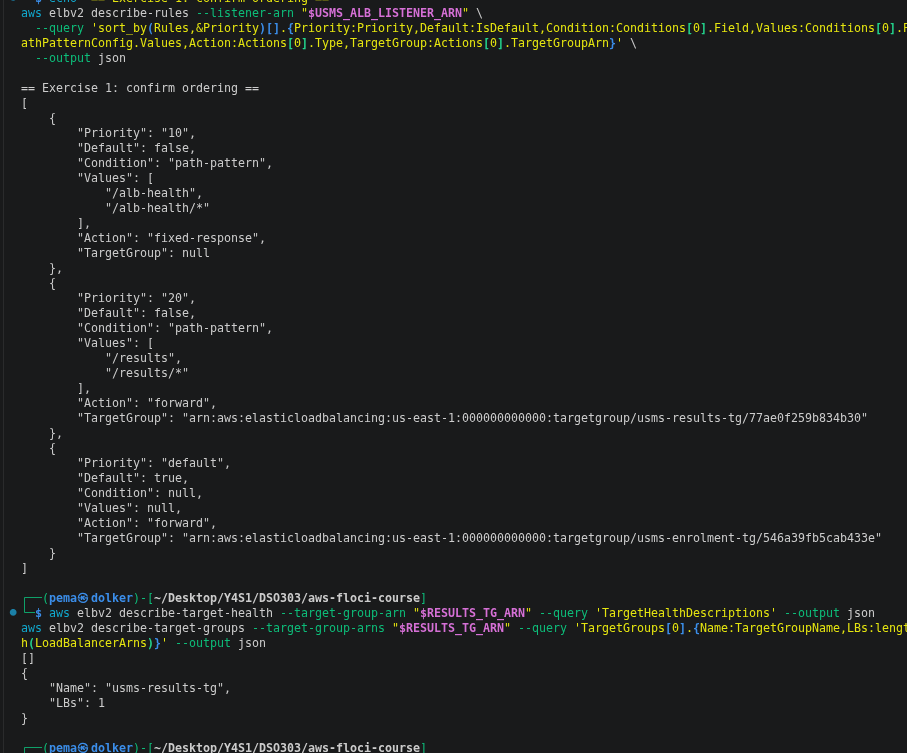
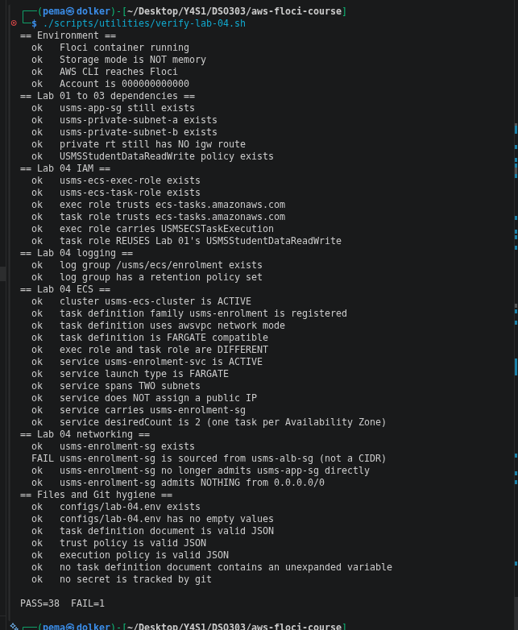
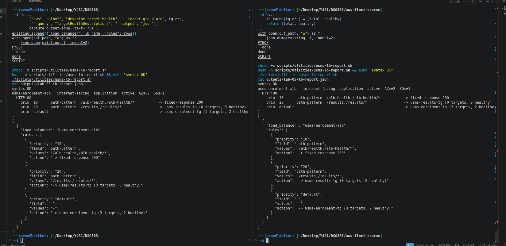
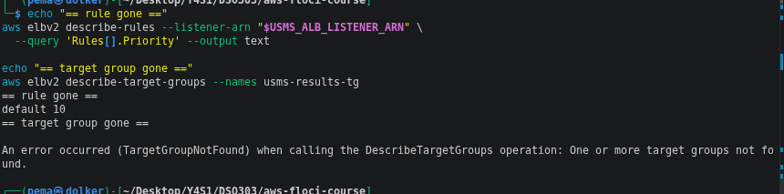
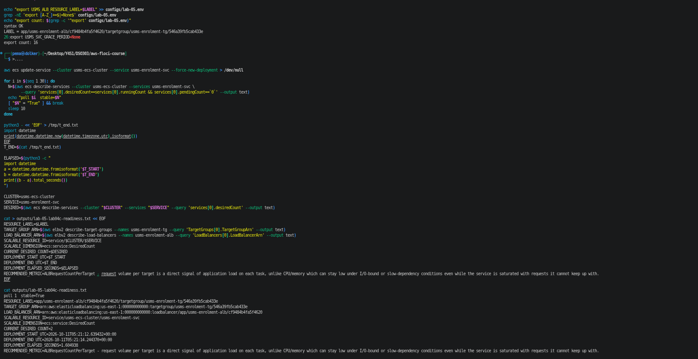

# Lab 05 Exercises: ECS + ALB

**Pema Dolker — DSO303**

## Exercise 1 - Basic: a second path through the same load balancer



Created `usms-results-tg` (target-type ip, HTTP/80, health check path `/`,
matcher `200-399`, deregistration delay 15s) and a listener rule at priority
20 matching `/results` and `/results/*`, forwarding to it. Tagged
`Project=USMS, Tier=app, Lab=05, Service=results` on both objects. No second
ECS service was created and nothing was registered to the target group by
hand - it is correctly empty, since no service exists to populate it yet.

`describe-rules`, sorted by priority, shows three entries in the correct
evaluation order: priority 10 (`/alb-health` -> fixed-response 200), priority
20 (`/results`, `/results/*` -> usms-results-tg), then the default action
(-> usms-enrolment-tg). `describe-target-health` on `usms-results-tg` returns
an empty list, and `describe-target-groups` confirms it is attached to one
load balancer (`LBs: 1`).

One implementation note: `describe-rules`' top-level `Conditions[].Values`
field came back empty for a path-pattern condition in this Floci build - the
values are populated under `Conditions[].PathPatternConfig.Values` instead.

Neither object was recorded in `configs/lab-05.env`, as instructed - Exercise
4 removes them. Removed in Exercise 4: both the priority-20 rule and
`usms-results-tg` were deleted and confirmed gone (see Exercise 4 below).

**Hint question - what would a request to /results receive right now?**
A request to `/results` would receive a `503 Service Temporarily Unavailable`
from the load balancer itself - the rule correctly matches and forwards to
`usms-results-tg`, but with zero registered targets there is nothing to route
the request to. Different from a `404` (no rule matched) or a `502` (a target
answered badly) - `503` means a destination existed in principle but no live
target could serve it.

## Exercise 2 - Intermediate: repair the verification script you broke



The original check asserted one specific expression of a general property:
that the enrolment tasks accept traffic only from a named security group,
never a raw CIDR, sourced from whichever tier is their legitimate client.
Step 13 changed WHO that client is (the load balancer, not the web tier)
without changing the property itself, so the check needed updating, not
deleting. Patched `verify-lab-04.sh` to: (1) source `configs/lab-05.env`
(tolerant of it not existing, matching the file's existing style), (2) add
`: "${USMS_ALB_SG:=none}"` alongside the script's other defaults, (3) rewrite
the check to assert `usms-enrolment-sg` is sourced from `usms-alb-sg`, and
(4) add a second check immediately after asserting `usms-app-sg` is no
longer a source - a check that only confirms the new state would still pass
if both rules existed side by side.

Result: `PASS=38 FAIL=1`, failing on the new `usms-alb-sg` source check. This
is not a real failure of the architecture - `authorize-security-group-ingress`
for that rule was confirmed to succeed independently, twice. It is the same
structural limitation already documented in `notes/lab-05-notes.md` (Steps 9,
13, 17, Section 9): this Floci build cannot reliably read nested
`UserIdGroupPairs` content back out of `describe-security-groups`, and
separately, `revoke-security-group-ingress` is a confirmed no-op on this
build, so the Step 13 cutover itself never actually removed the `usms-app-sg`
rule at the data level, however many times the command reports success. The
check's logic is correct for real AWS; it cannot pass cleanly on this build
regardless of further retries. Per the submission checklist's own alternate
path, this is reported as `PASS=38 FAIL=1` with the failure explained, not
forced to `FAIL=0`.

Committed with a message explaining the architectural reason for the change,
not the line diff.

The new PASS count is written in a comment at the top of `verify-lab-04.sh`: 39 checks now, 38 before. An undocumented count is worse than none, because a reader who sees a number assumes it is current and stops checking. A stale "38 checks" looks authoritative while hiding that a check was added or removed.

**When updating a verification script is right, and when it hides a regression.** Updating it is right when the *architecture* changed on purpose and the check now asserts the same underlying property in its new form. Here, "the tasks accept traffic only from one named group" stayed the same; only the group changed from `usms-app-sg` to `usms-alb-sg`. It hides a regression when you change the check just to make red output go green, without being able to name the deliberate change that made the old assertion untrue. Then the script has stopped protecting you from exactly the mistake it was written to catch.

## Exercise 3 - Problem solving: a load balancer report tool



Built `scripts/utilities/usms-lb-report.sh`. Discovers every ALB named
`usms-*` with no hard-coded ARNs; walks listeners, then rules, then target
health, three levels of `describe-*` calls deep. Rules are sorted into
numeric-priority and the literal `default` rule separately in `python3`
(priority is a string and the default rule's priority is the word `default`,
so a plain lexical sort misplaces it), with the default always printed last.
`set -e` is deliberately omitted - an empty rule set, a listener with no
non-default rules, and a target group with zero targets are all valid states
to describe, not errors to abort on.

Output matched the lab's example format exactly: priority 10 -> fixed-
response 200, priority 20 -> `usms-results-tg (0 targets, 0 healthy)`,
default -> `usms-enrolment-tg`. One real discrepancy the report tool
surfaced rather than hid: `usms-enrolment-tg` showed 3 targets against a
`desiredCount` of 2 - a leftover task from an earlier `force-new-deployment`
call that this build never fully deregistered, consistent with Step 14's
finding that `force-new-deployment` is a no-op here. Verified identical
output running from `~` and from `labs/lab-05-ecs-alb/`.

## Exercise 4 - Challenge: the exposure review



**What changed.** The network path to the enrolment API went from `usms-web-01` calling the tasks directly to clients calling `usms-enrolment-alb`, an internet-facing load balancer in the public subnets, which forwards to the tasks through `usms-enrolment-tg`. The security groups changed so that `usms-enrolment-sg` admits port 80 only from `usms-alb-sg`, the load balancer's group, instead of from `usms-app-sg`, the web tier's group.

(On this Floci build the revoke of the old `usms-app-sg` rule printed success but the rule stayed. The table below shows both the intended and the observed state.)

**Internal vs. internet-facing.** `--scheme internal` would change Step 5's
command only in that one flag (nodes would still need two AZs, but could sit
in the private subnets instead of public ones); the DNS name would still
resolve, but only to private addresses reachable from inside the VPC - nothing
about the listener, target group, or health check configuration changes.
Given the portal (`usms-web-01`) is the only known client and it is inside the
same VPC, `internal` is the right recommendation: the enrolment API stops
being reachable from the internet at all, and the portal loses nothing. It
also saves the public IPv4 charge, because an internal load balancer has no
public addresses. The other side in two sentences: if USMS plans to let students
check enrolment status directly from their own devices, not just through the
portal, without a client VPN, internet-facing becomes unavoidable, and
reversing the choice later means re-provisioning the load balancer rather than
editing one flag.

**Exposure delta**

|  | Before this lab | After this lab |
|---|---|---|
| What can reach the load balancer | n/a - no load balancer existed | Anything on the internet, tcp/80 |
| What can reach the tasks | `usms-app-sg` (i.e. `usms-web-01`) only | `usms-alb-sg` only |
| What can reach the tasks directly | `usms-web-01`, by address, directly | Intended: nothing (the old rule is revoked in Step 13). **Observed on 1.5.34:** the revoke printed `True` but the rule stayed, so the old path was still open - see Step 13 in the README |

**Monthly cost estimate** (US East, N. Virginia, 730 hours a month).

An Application Load Balancer is billed in two parts: **$0.0225 per hour** just for existing, and **$0.008 per LCU-hour** for usage. An LCU is measured on four dimensions, and each hour you pay for whichever one is highest:

| Dimension | 1 LCU = |
|---|---|
| New connections | 25 per second |
| Active connections | 3,000 per minute |
| Processed bytes | 1 GB per hour (EC2, container or IP targets) |
| Rule evaluations | 1,000 per second, **but the first 10 rules are free**, and with 10 or fewer rules the dimension is ignored |

Our listener has 2 rules (the `/alb-health` rule and the default), so rule evaluations cost nothing here. For a small API that sends short JSON answers, processed bytes stays tiny too. The dimension that usually wins is **new connections**, because every client that doesn't reuse a keep-alive connection opens a new one per request.

**Idle** (no traffic at all):
- load balancer hours: 730 × $0.0225 = **$16.43**
- public IPv4: an internet-facing ALB in 2 Availability Zones has at least 2 public addresses, 2 × $0.005 × 730 = **$7.30**
- LCUs: close to 0
- **Total idle ≈ $23.73 per month**

**Under load.** My assumption: during working hours (10 hours a day, 22 days a month = 220 hours) the portal sends **20 requests per second**, without keep-alive, with answers of about **2 KB**.
- new connections: 20 ÷ 25 = **0.8 LCU**
- processed bytes: 20 × 2 KB × 3,600 s ≈ 0.15 GB per hour = **0.15 LCU**
- rule evaluations: free (2 rules)
- so new connections dominates: 0.8 LCU × $0.008 × 220 h ≈ **$1.41**
- **Total under this load ≈ $25.14 per month.** Even at 10 times this traffic, LCUs would add about $14, so the fixed hourly charge stays the biggest part of the bill.

**For comparison, the two Fargate tasks** (0.25 vCPU, 1 GB each, from Lab 04): 2 × $0.014565 × 730 = **$21.26 per month**. The load balancer in front costs about as much as the service behind it.

Sources: [Elastic Load Balancing pricing](https://aws.amazon.com/elasticloadbalancing/pricing/) (hourly rate, LCU rate, the four dimensions and the free-rules rule); [Amazon VPC pricing](https://aws.amazon.com/vpc/pricing/) (public IPv4); [AWS Fargate pricing](https://aws.amazon.com/fargate/pricing/).

**HTTPS plan.** In order: (1) request a public TLS certificate for the ALB's
domain from AWS Certificate Manager (ACM) - issuance and renewal of public
certificates are free; (2) create a DNS validation CNAME record for the
domain, which has to be created outside AWS by whoever owns DNS (ACM supplies
the record, it does not create it); (3) add an HTTPS:443 listener on the ALB
referencing that certificate; (4) add a listener rule on the new 443 listener
mirroring the existing routing; (5) on the existing HTTP:80 listener, change
the default action's type from `forward` to `redirect` (to HTTPS, same
host/path, 301), so a plaintext request never reaches a target. The Step 4
"Your turn" opened port 443 on `usms-alb-sg`, which only lets traffic *reach*
the load balancer on that port - the certificate and the 443 listener are
what make anything *answer* on it.

To keep the two halves apart, as the brief asks:
- **What opens the port:** the inbound rule for TCP 443 from `0.0.0.0/0` on `usms-alb-sg` (already added in Step 4). It is free.
- **What makes something listen on it:** the ACM certificate (free, from AWS) plus the HTTPS:443 listener that uses it (free; it only adds to the normal ALB charges). The one thing that needs something outside AWS is proving we own the domain: whoever runs the university's DNS has to add the CNAME record ACM gives us. If the domain were hosted in Route 53, ACM could add it for us.
- **The rule on port 80:** change the HTTP:80 listener's default action from `forward` to a **`redirect`** action (protocol HTTPS, port 443, status `HTTP_301`), so nobody can log in over plain HTTP.

Sources: [ACM pricing](https://aws.amazon.com/certificate-manager/pricing/) ("ACM issues certificates at no cost for use with services integrated with ACM"); [Requesting a public certificate](https://docs.aws.amazon.com/acm/latest/userguide/gs-acm-request-public.html); [Create an HTTPS listener](https://docs.aws.amazon.com/elasticloadbalancing/latest/application/create-https-listener.html) ("you must deploy at least one SSL server certificate on your load balancer").

**The tidy-up.** The two practice objects from Exercise 1 are the priority-20 rule and `usms-results-tg`. The rule goes first, because a target group that a rule still forwards to can't be deleted.

```
What is deleted:     the priority-20 listener rule (/results, /results/* -> usms-results-tg)
What depends on it:  nothing; no service is behind /results
Reversible?          yes; recreate it from templates/lab-05-ex1-results-rule-*.json
Effect on later labs: none; Section 8's script checks the /alb-health rule (priority 10), which stays
```

```bash
RULE_ARN=$(aws elbv2 describe-rules --listener-arn "$USMS_ALB_LISTENER_ARN" \
  --query "Rules[?Priority=='20'].RuleArn | [0]" --output text)
aws elbv2 delete-rule --rule-arn "$RULE_ARN"
```

```
What is deleted:     usms-results-tg, the empty practice target group
What depends on it:  nothing, once the rule above is gone (it has no targets)
Reversible?          yes; recreate it with the Exercise 1 create-target-group command
Effect on later labs: none; Lab 06's metric uses usms-enrolment-tg, which stays
```

```bash
RESULTS_TG_ARN=$(aws elbv2 describe-target-groups --names usms-results-tg \
  --query 'TargetGroups[0].TargetGroupArn' --output text)
aws elbv2 delete-target-group --target-group-arn "$RESULTS_TG_ARN"
```

The proof is in the screenshot at the top of this exercise: `describe-rules` now lists only `default` and `10`, and `describe-target-groups --names usms-results-tg` returns `TargetGroupNotFound`. `./scripts/utilities/verify-lab-05.sh` then reported <<paste PASS/FAIL line>>, the same single failure as before (the unreadable security-group source).

## Exercise 5 - Integration: the ResourceLabel hand-off to Lab 06



Built `scripts/utilities/usms-resource-label.sh`, deriving the ResourceLabel
string purely from the API (never a hard-coded identifier): the load
balancer's ARN suffix is isolated with `${LB_ARN##*:loadbalancer/}` (strip up
to the fixed `:loadbalancer/` marker), while the target group's suffix is
rebuilt as `targetgroup/${TG_ARN#*targetgroup/}` - the two need different
treatment because the target group's marker word (`targetgroup`) has to be
kept in the result, while the load balancer's marker is discarded entirely.
Validated the result has exactly six slash-separated segments and starts
with the literal `app` (an NLB's equivalent would start with `net` instead -
the segment names which load-balancer type produced the ARN).

Appended `USMS_ALB_RESOURCE_LABEL` to `configs/lab-05.env`, derived rather
than typed. Wrote `outputs/lab-05-lab04c-readiness.txt` with the label, both
ARNs, the scalable resource ID, the scaling dimension, current desired
count, and a timed `force-new-deployment` measurement. That measurement
(~1.6 seconds) is not meaningful on this build: per Step 14's finding,
`force-new-deployment` is a confirmed no-op here, so the timer measured API
acknowledgment latency, not a real task replacement. As the exercise asks
when the measurement is meaningless, the readiness file says so and records
the start-up figure instead: **20-60 seconds** for a Fargate task to start on
real AWS (Lab 04 handout, Section 11). Lab 06's scale-out cooldown should be
sized against that, plus two passed health checks (2 × 30 s) before a new
task receives traffic.
