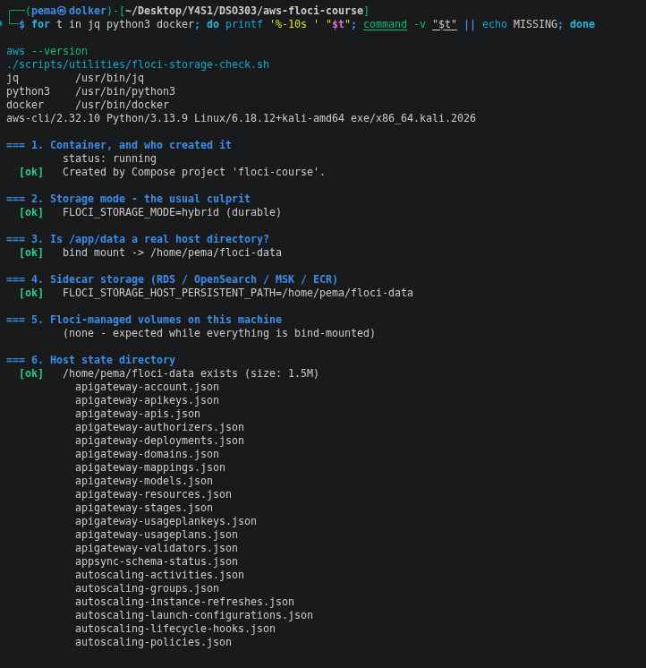
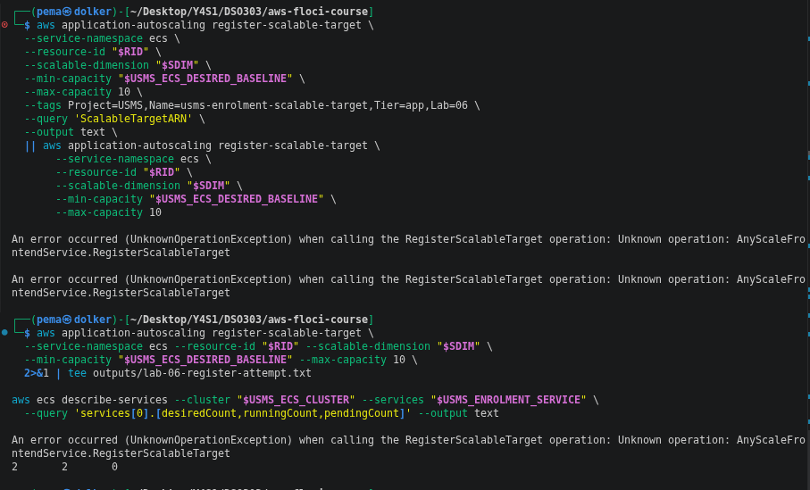
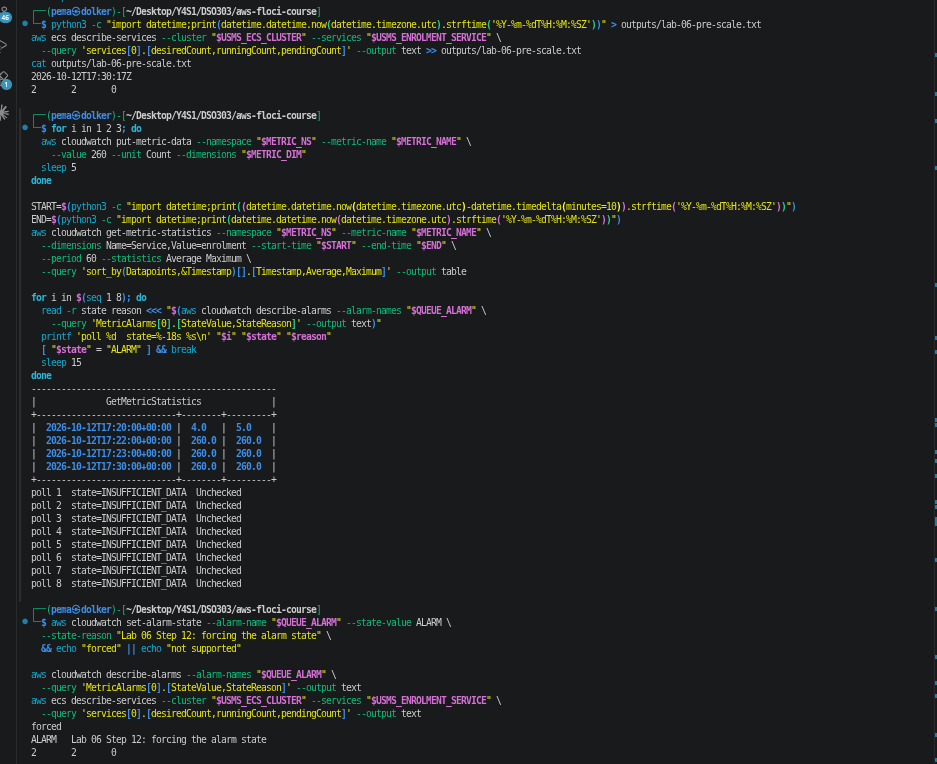
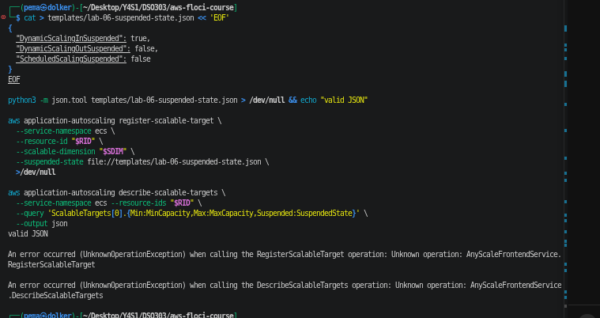
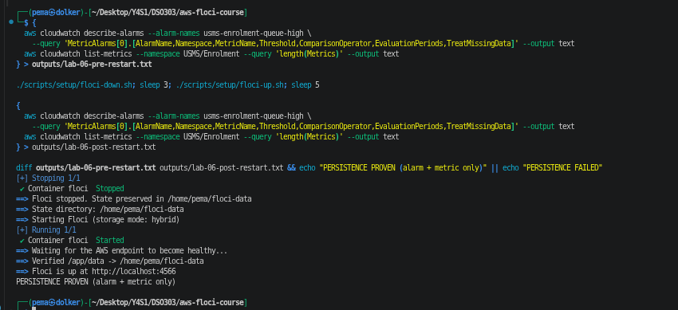
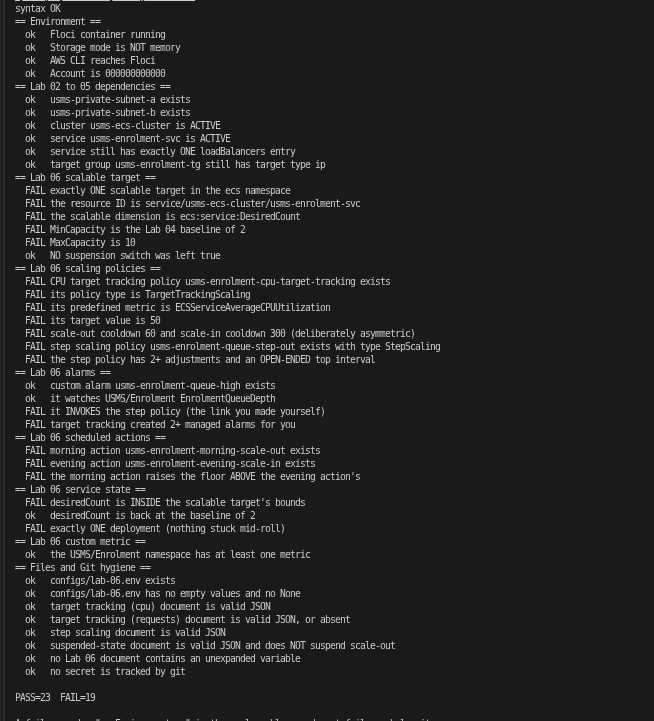
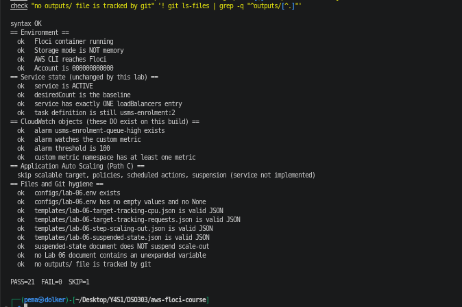

# Lab 06 Report - ECS Service Auto Scaling

**Course:** DSO303
**Environment:** Floci (AWS-compatible emulator, hybrid storage), account `000000000000`, `us-east-1`

**Support path (Step 3):** C - Application Auto Scaling not implemented on this build.
See `notes/lab-06-notes.md` for the full per-step reasoning and evidence.

> Labels used below:
**Observed** = I ran it and saw it.
**Floci limitation** = behaved differently from real AWS.

## 1. Aim

Add Application Auto Scaling to the USMS enrolment service built in Lab 04 and
fronted by the load balancer built in Lab 05: a scalable target bounding
`desiredCount` between 2 and 10, two target-tracking policies (CPU and ALB
request count), a step-scaling policy driven by a custom queue-depth metric,
and scheduled actions for predictable daily and weekly demand. No part of
Labs 01-05 should need to change - scaling only ever changes one integer,
the service's `desiredCount`.

## 2. Environment and prerequisites (Steps 1-3)

Tool check and the storage diagnostic script, all six checks `[ok]`:

Floci started with `floci-up.sh`, `configs/course.env` through `configs/lab-05.env`
sourced, and `whoami.sh` confirmed account `000000000000` and the baseline
values carried forward from Labs 02-05 (cluster, service, task CPU/memory,
both private subnets, the ALB and target group ARNs, grace period):

**Observed:** `USMS_SVC_GRACE_PERIOD` (grace period) printed `None` - carried
over from Lab 05's own finding that `healthCheckGracePeriodSeconds` is not
persisted on this build.

Step 3 dependency and support-path probe - verify scripts for Labs 02-05 and a
direct read of what ECS currently has:

**Observed:** the service is `ACTIVE` with `desiredCount` 2, `runningCount` 2,
no failures, confirming Lab 06 starts from a healthy baseline. The accumulated
FAIL counts in Labs 02-05 (FAIL=1, FAIL=4, FAIL=1, FAIL=4) are the same known
Floci limitations recorded in those labs' own notes and were not re-chased
here. Every `application-autoscaling` call in the Step 3 probe returned
`UnknownOperationException`, so this lab is on **Path C**.

## 3. Step 4 - service-linked role

**Observed:** `create-service-linked-role` for
`ecs.application-autoscaling.amazonaws.com` returned `UnsupportedOperation`,
and a direct `get-role` for `AWSServiceRoleForApplicationAutoScaling_ECSService`
returned `NoSuchEntity`. **Floci limitation:** on real AWS this role is created
automatically the first time a scalable target is registered and holds
`ecs:UpdateService` so Application Auto Scaling can act on the service's
behalf; here it cannot exist, so nothing downstream can assume it.

## 4. Step 5 - scalable target

**Observed:** the resource ID was derived from the service ARN itself
(`${SVC_ARN##*:}`) rather than typed, then validated as exactly three
slash-separated segments starting with the literal `service`:
`service/usms-ecs-cluster/usms-enrolment-svc`. Scaling dimension:
`ecs:service:DesiredCount`.

**Observed:** `register-scalable-target` (both the primary call and its
diagnostic fallback) returned `UnknownOperationException`, logged to
`outputs/lab-06-register-attempt.txt`. `describe-services` confirms the
service was untouched by the attempt: desired 2, running 2, pending 0.
**Floci limitation:** on real AWS this call would store MinCapacity 2 /
MaxCapacity 10 against the resource ID above, and since the service's
current `desiredCount` (2) already meets the floor, registering it would not
by itself change anything running.

## 5. Step 6 - re-registration and minimum capacity

**Observed:** `describe-scalable-targets` returned `UnknownOperationException`;
a separate `ecs describe-services` query using `length(deployments)` failed
with `invalid type for value: None` (a Floci JMESPath quirk, not related to
Application Auto Scaling). A re-registration attempt with `--max-capacity 12`
also returned `UnknownOperationException`.

**(a)** On real AWS, re-registering the scalable target with `MinCapacity`
raised to 5 would immediately raise `desiredCount` to 5 with no policy and no
alarm involved - the floor enforces itself the moment it is registered.
**(b)** A forgotten raised floor means paying for the extra tasks indefinitely
and blocks scale-in below that floor; `describe-scalable-targets`'
`MinCapacity` field is the one call a monitor would check to catch it.

## 6. Steps 7-9 - target-tracking policies (templates only)

CPU target-tracking template and the `put-scaling-policy` attempt:

**Observed:** `templates/lab-06-target-tracking-cpu.json` (target 50% average
service CPU, 60s scale-out / 300s scale-in cooldown) validated as JSON.
`put-scaling-policy` returned `UnknownOperationException`; `CPU_POLICY_ARN`
stayed empty.

Managed target-tracking alarms, checked by the prefix AWS would use:

**Observed:** `describe-alarms --alarm-name-prefix "TargetTracking-${RID}"`
returned an empty list (`length(MetricAlarms)` = 0). **Floci limitation:**
on real AWS, a successful target-tracking policy creates and manages two
CloudWatch alarms per policy (high for scale-out, low for scale-in);
since no policy exists here, neither do they.

Request-count template, built from Lab 05's `ResourceLabel` hand-off:

**Observed:** `USMS_ALB_RESOURCE_LABEL` from `configs/lab-05.env` validated
as six slash-separated segments starting with `app` and with `targetgroup`
as the fourth segment -
`app/usms-enrolment-alb/cf9484b4fa5f4620/targetgroup/usms-enrolment-tg/546a39fb5cab433e`.
`templates/lab-06-target-tracking-requests.json` (target 1000 requests per
target, same cooldowns) validated as JSON with that label embedded.

## 7. Step 10 - custom metric and step-scaling policy

Custom metric published and read back:

**Observed:** `USMS/Enrolment EnrolmentQueueDepth` published with values 3, 5,
4 and dimension `Service=enrolment`; `list-metrics` confirms the metric and
dimension exist. `templates/lab-06-step-scaling-out.json` validated as JSON:
+1 task for a breach of 0-100 over threshold, +3 for 100 and above (bounds
relative to the alarm threshold). The custom alarm
`usms-enrolment-queue-high` was created watching that metric with threshold
100, `GreaterThanOrEqualToThreshold`, 1 evaluation period, `notBreaching` for
missing data - and **without** `--alarm-actions`, since the step-scaling
policy it would point to could not be created (`PutScalingPolicy` also
returns `UnknownOperationException`). Initial state: `INSUFFICIENT_DATA`.

## 8. Step 12 - firing the alarm (wiring only, loop not closed)

**Observed:** baseline captured to `outputs/lab-06-pre-scale.txt` (desired 2,
running 2, pending 0). Three datapoints of 260 published (`get-metric-statistics`
confirms the metric rose to 260, well above the alarm's threshold of 100).
Polling the alarm's state eight times over two minutes showed
`INSUFFICIENT_DATA` / "Unchecked" throughout - **Floci limitation:** this
build does not evaluate alarms on a schedule the way real CloudWatch does.
`set-alarm-state --state-value ALARM` was accepted and stored directly.

**Observed, prediction vs. reality:** a small script reads the alarm
(watching `EnrolmentQueueDepth`, threshold 100.0, currently `ALARM`), reads
its `AlarmActions` (`null` - no policy attached), states the policy that
*should* exist (`usms-enrolment-queue-step-out`, blocked by
`PutScalingPolicy -> UnknownOperationException`), and computes what the step
policy would select for this breach: 260 - 100 = 160, which falls in the
open-ended `100+` step, `ScalingAdjustment=+3`. On real AWS this chain
(alarm -> policy -> `UpdateService`) would move `desiredCount` from 2 to 5.
Here, `describe-services` confirms `desiredCount` stayed at 2 throughout -
none of alarm evaluation, alarm-to-policy, or policy-to-`desiredCount` are
connected on this build. The alarm was reset to `OK` and the metric lowered
back down (4, 3, 2) to restore baseline. Evidence:
`outputs/lab-06-scaling-proof.txt`.

## 9. Step 13 - suspension (conceptual)

**Observed:** `templates/lab-06-suspended-state.json` written as the runbook
artefact - `DynamicScalingInSuspended: true`, scale-out and scheduled actions
left active, i.e. scale-in suspended only. Both
`register-scalable-target --suspended-state ...` and a follow-up
`describe-scalable-targets` returned `UnknownOperationException`, so the
setting could not actually be applied or read back. Separately (analysis,
not this template): the more dangerous suspension flag to leave on by
accident is `DynamicScalingOutSuspended`, since a service can then only
shrink and never grow, with nothing visibly wrong in policies, alarms or
graphs until capacity is already too low.

## 10. Step 14 - persistence (reduced)

**Observed:** the scalable target, policies and scheduled actions cannot be
tested for persistence since none of them exist on this build. What *does*
exist - the custom CloudWatch alarm's six key fields and the custom metric's
datapoint count - was captured before and after a full `floci-down.sh` /
`floci-up.sh` cycle and diffed: identical both times.
**PERSISTENCE PROVEN (alarm + metric only).**

## 11. Step 15 - the nine-line chain

**Observed (blocks 4-7 of the nine-step chain in `notes/lab-06-notes.md`):**
`desiredCount`/`runningCount` 2/2, task definition still `usms-enrolment:2`,
`healthCheckGracePeriodSeconds` `None` (Lab 05's known gap), `assignPublicIp`
`DISABLED` in both private subnets, one load balancer attachment, and three
registered targets - all three Floci's own Docker-network IPs
(`172.21.0.x`) rather than real VPC ENIs, all reported `unhealthy` with
`AvailabilityZone` `None`. Lines 2-4 of the chain (the scaling signal, the
alarm/policy, and the write to `desiredCount`) are the only ones Lab 06 owns
and the only ones that could not be exercised here; lines 5-9 (ECS, the
network path, the security group, target registration, the health check)
are Labs 02, 04 and 05's work and needed no change, confirming the chain's
central point: scaling only ever changes one integer.

## 12. Step 16 - recording outputs and final verification

`configs/lab-06.env` generated and checked for completeness:

**Observed:** 22 exports, all populated (no empty values, no `None`),
sourcing cleanly. Policy and scheduled-action ARNs are honestly recorded as
`not-created` rather than fabricated, since none of them could be registered
on this build.

First verification pass, against the full AWS-shaped checklist (expects
Application Auto Scaling throughout):

**Observed:** PASS=23, FAIL=19. Every failure traces to one root cause -
no scalable target, policies or scheduled actions exist, because
`application-autoscaling` is unimplemented - not to anything built
incorrectly. Section by section: Lab 02-05 dependencies all pass; every Lab
06 scalable-target, scaling-policy and scheduled-action check fails for the
same reason; the custom alarm and metric checks pass; service-state checks
split, since `desiredCount` being at baseline is itself indistinguishable
from "scaling never happened" on this build.

Reduced, Path-C-aware verification - checks only what this build can
actually support, and records the rest as a single explicit skip rather than
nineteen misleading failures:

**Observed:** PASS=21, FAIL=0, SKIP=1 (`scalable target, policies,
scheduled actions, suspension (service not implemented)`). This is the
honest version of the check: it does not claim Application Auto Scaling
works, and it does not fail the lab for an environment limitation outside
my control.

## 13. Exercises

Exercises 1 to 5 are in `labs/lab-06-ecs-autoscaling/exercises.md`. Exercises
1-3 are not attempted (no scalable target to attach policies to, read alarms
from, or discover). Exercise 4 is the enrolment-week capacity plan, fully
answerable without Application Auto Scaling. Exercise 5 is split: the
scaling-history export and the real latency measurement are blocked by Path
C and recorded as such; the IAM policy-to-bucket-ARN check and the
`head-bucket` probe against Lab 10's not-yet-created bucket both work fully.

## 14. Conclusion

Everything that depends only on IAM, ECS and CloudWatch was built and
verified for real: the service-linked role's absence confirmed, the resource
ID correctly derived and validated, a working custom metric and alarm,
target-tracking and step-scaling policy documents written and JSON-validated
against the real resource label from Lab 05, the alarm's math checked by
hand against the step-scaling template, and persistence proven for the
pieces that actually exist. Every part that needed
`application-autoscaling` itself - registering the scalable target,
creating either target-tracking policy, creating the step-scaling policy,
scheduled actions, and suspension - returned `UnknownOperationException`
and was recorded as blocked rather than faked. The chain in Step 15 is the
key idea of the lab: auto scaling changes exactly one integer,
`desiredCount`, and everything built in Labs 02, 04 and 05 reacts to that
integer without caring who or what wrote it.