# Lab 06 - Independent Exercises

Environment: Floci 2.2.0, support path A for alarms and step scaling (see notes/lab-06-notes.md).

## Exercise 1 - A memory policy, and a scale-out-only policy

Config written to `templates/lab-06-target-tracking-memory.json` with a quoted heredoc (`<< 'EOF'`),
because the file contains no variables and nothing in it should be expanded by the shell:
ECSServiceAverageMemoryUtilization, TargetValue 70.0, ScaleOutCooldown 60, ScaleInCooldown 600,
DisableScaleIn true.

Commands (screenshots ex1-1, ex1-2): the managed alarm count was captured first with
`describe-alarms --alarm-name-prefix "TargetTracking-${RID}" --query 'length(MetricAlarms)'`, then
`put-scaling-policy ... --policy-name usms-enrolment-memory-target-tracking --policy-type
TargetTrackingScaling --target-tracking-scaling-policy-configuration file://templates/lab-06-target-tracking-memory.json
--query PolicyARN`, captured into `MEM_POLICY_ARN`. The policy was not added to configs/lab-06.env,
because Exercise 4 removes it.

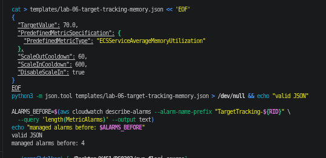

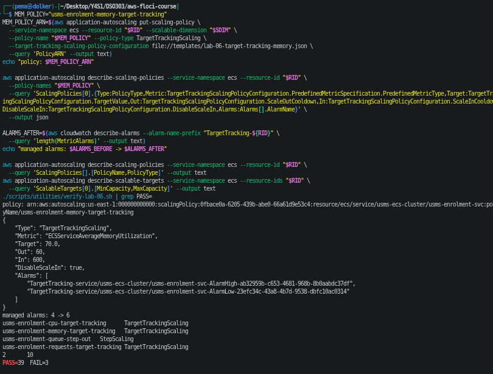

Prediction before running: four target tracking alarms become five, not six, and verify-lab-06.sh stays
at PASS=39 FAIL=3 (the same three scheduled-action failures), because no check counts the policies or
requires an exact number of managed alarms - "2+ managed alarms" is still true.

Result:
- Read-back: TargetTrackingScaling, ECSServiceAverageMemoryUtilization, 70.0, out 60, in 600, DisableScaleIn true.
- Policies on the target: three target tracking (cpu, memory, requests) and one step (queue-step-out).
- Bounds unchanged: 2 / 10.
- verify-lab-06.sh: PASS=39 FAIL=3, as predicted.
- Managed alarms: **4 -> 6, not 5.** Floci 2.2.0 created both an AlarmHigh and an AlarmLow for the new
  policy even though scale-in is disabled. On real AWS only the AlarmHigh is created, so the count would be 5.

**Why five and not six?** On real AWS, the AlarmLow is not created, because the low alarm's only job is to
trigger scale-in and this policy has scale-in switched off; its absence means this policy will never vote to
remove a task (Floci created it anyway, but it can do nothing, because the policy will not act on it).

**Memory 70 against CPU 50: which scales out first?** Whichever metric crosses its own target first under
real load, and I cannot know that without a load test that measures how memory and CPU per task each rise as
requests go up - a request-handling API like enrolment is usually CPU-bound, which suggests CPU first, but
that is a guess until it is measured.

**Does a scale-out-only policy change the scale-in behaviour of the other two?** No: by Step 9's rule,
scale-out happens when any policy asks for it, but scale-in happens only when every policy that has scale-in
enabled agrees, and a policy with DisableScaleIn does not take part in that vote - although it can still
push the count up, and the CPU and request policies will then bring it back down once they agree.

## Exercise 2 - The scale-in half of step scaling, and a fight to avoid

Config in `templates/lab-06-step-scaling-in.json`: StepScaling, ChangeInCapacity, Average, Cooldown 300.

| Interval (breach = metric - 20) | Metric value | Adjustment |
|---|---|---|
| LowerBound -10, UpperBound 0 | 10 to 20 | -1 (mild) |
| no LowerBound, UpperBound -10 | below 10 | -2 (stronger) |

Alarm `usms-enrolment-queue-low`: USMS/Enrolment EnrolmentQueueDepth, Service=enrolment, Average,
period 60, 3 evaluation periods, LessThanThreshold 20, notBreaching, only action the step-in policy ARN.
Both ARNs captured with `$(...)` and `--query` (screenshot ex2-1).

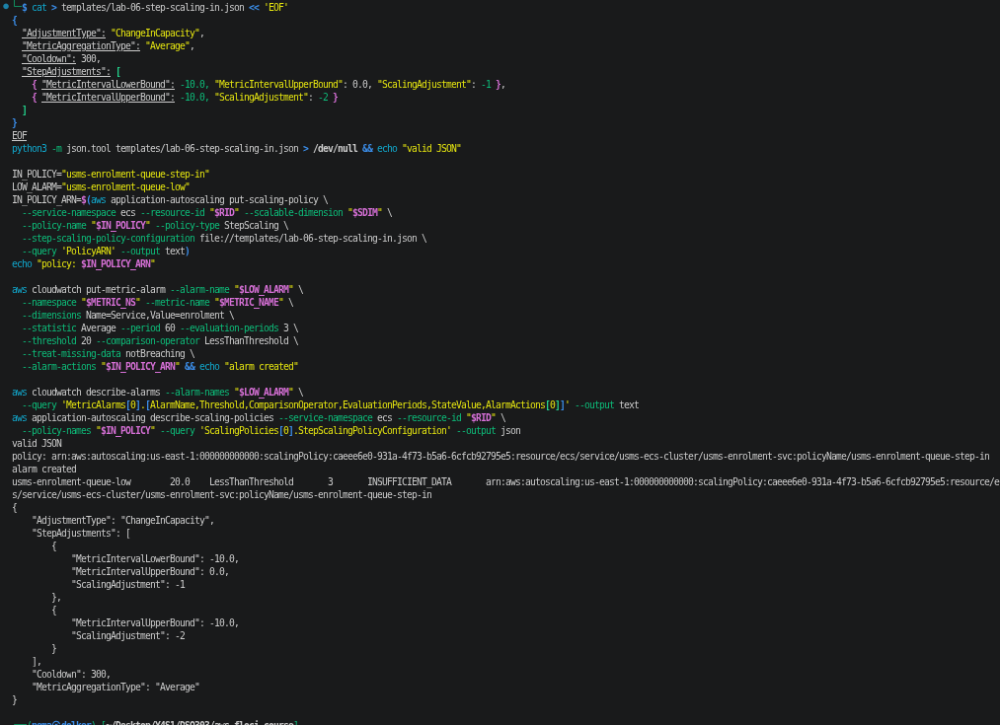

**Why the signs.** The step bounds are measured as the distance from the alarm threshold. A scale-in alarm
fires when the metric is BELOW the threshold, so every breach it reacts to is negative; that is why every
bound is zero or below, and the adjustments are negative because they remove tasks. The further below
zero the breach goes, the emptier the queue, so the bigger removal sits at the bottom, open-ended downwards.
`MetricIntervalUpperBound: 0` with `ScalingAdjustment: -1` means: "when the metric is anywhere below the
threshold by up to the next bound (here, between 10 and 20), remove one task". The upper bound 0 is the
threshold itself.

**Why the cooldown is longer (300 against 60).** Scale out eagerly, scale in reluctantly. A new Fargate task
takes 20-60 s plus the 60 s grace period before it serves, so removing capacity too quickly after a dip
means having to start it again a minute later, paying the start-up delay a second time while users wait.
A long scale-in cooldown lets the queue prove it is really empty before more tasks go.

**The unreachable step.** At the baseline of 2 tasks, 2 + (-2) = 0, which is below MinCapacity 2, so the
-2 step can never take full effect from the floor; it is clamped to 2 (as is -1, since 2 - 1 = 1 < 2). The
-2 step only applies in full when there are at least 4 tasks; at 3 it is clamped to -1.

**Test (screenshot ex2-2).** Pushed 5 three times (breach 5 - 20 = -15, the -2 step), then forced the alarm
with set-alarm-state. Result: nothing. desiredCount stayed 2 on all six polls, and no new scaling activity
was recorded (still the three from Step 12). That is the expected outcome, because the service was already
at the floor. On Floci even --include-not-scaled-activities showed nothing, so I cannot tell "invoked
and clamped" from "not invoked"; on real AWS a not-scaled activity would give the reason (already at
minimum capacity).

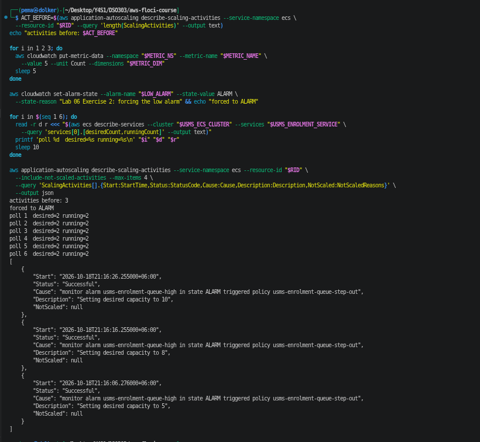

**Clean-up (screenshot ex2-3).** Deleted in dependency order, each with the four-line warning: the alarm
first (it points at the policy, so deleting the policy first would leave an alarm with a dead action), then
the policy. Afterwards: no usms-enrolment-queue-low, four policies left, desired 2, verify-lab-06.sh
back to PASS=39 FAIL=3 (only the three scheduled-action checks).

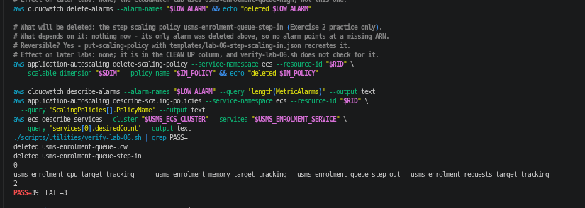

**A step policy on CPU at 60% next to the CPU target tracking policy at 50%.** Target tracking does not just
react to a threshold - it computes how many tasks are needed to bring CPU back to 50%, roughly current
tasks x (current CPU / 50), and keeps adjusting towards that number. When CPU passes 60%, the step policy
adds its fixed number of tasks; CPU then falls well below 50%, so target tracking's low alarm eventually
decides there are too many tasks and removes some; CPU climbs back over 60% and the step policy adds them
again. The two policies fight over the same number, and the service keeps going up and down (and paying
for the start-up delay each time). I would keep the target tracking policy, because it sizes the change to
the actual load, corrects itself in both directions, and AWS maintains its alarms; step scaling belongs on a
different signal that target tracking cannot express, like the queue depth in this lab.

## Exercise 3 - A scaling report tool

Script: `scripts/utilities/usms-scaling-report.sh` (screenshots ex3-1, ex3-2). No arguments; output also
written to `outputs/lab-06-scaling-report.json` (git-ignored).

How it works:
- Bash resolves the repo root from `${BASH_SOURCE[0]}`, sources only `configs/course.env`, and makes the first
  discovery call (`describe-scalable-targets --service-namespace ecs`). python3 does the rest.
- It keeps only targets whose resource ID matches `service/usms-*/<service>`; cluster and service names come
  from the resource ID, so nothing is hard-coded beyond the `usms-` prefix.
- For each target: one `ecs describe-services` (desired/running), `describe-scaling-policies`,
  `describe-scheduled-actions`, and `describe-scaling-activities --max-items 1`.
- Alarms are fetched in one `describe-alarms` call and matched to each policy two ways: the policy's own
  `Alarms` list, or any alarm whose `AlarmActions` contains the policy ARN. The second route is what finds
  `usms-enrolment-queue-high`, because Floci leaves the step policy's `Alarms` list empty (Step 10).
- Step adjustments are printed as a signed list built from the configuration (`+1 / +3`).
- No `set -e` (only `-uo pipefail`): some calls are expected to fail on this build (scheduled actions are
  UnsupportedOperation), so each call is checked on its own and a failure becomes "unavailable on this build"
  instead of ending the report. Empty cases print "none" / "none listed", never a blank row.

Verdict rules, top to bottom (the order is explained in a comment in the script):
PINNED (min = max) -> FROZEN (any suspension switch true) -> AT-CEILING (desired = max) ->
AT-FLOOR (desired = min and more than one policy) -> ELASTIC.
PINNED comes first because if min equals max nothing can change the count, so no other state matters.
FROZEN outranks AT-CEILING because "at the ceiling" only describes the number, while "frozen" says the
control loop is switched off - the hazard nobody sees, since the policies and alarms all still look normal. A
target that is frozen and at the ceiling cannot come back down by itself, and that is what the operator
needs to hear first.

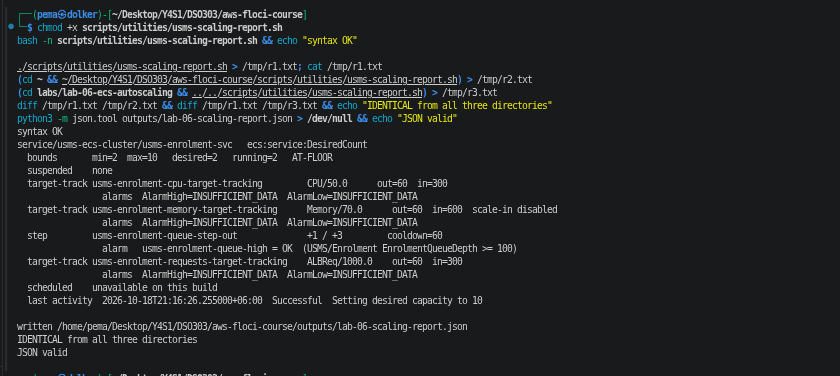

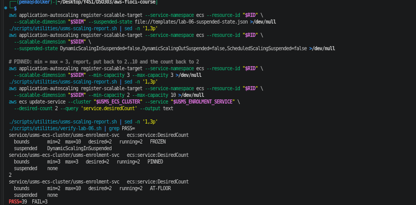

Results:
- Normal run: `AT-FLOOR` (desired 2 = min 2, four policies), suspended none, four policies with their
  alarms (managed ones INSUFFICIENT_DATA, because Floci does not publish AWS/ECS or ALB metrics), the step
  policy's alarm `usms-enrolment-queue-high = OK (... >= 100)`, scheduled "unavailable on this build", and the
  last activity from Step 12. The handout's example output shows ELASTIC for this same state, but by its own
  table desired = min with more than one policy is AT-FLOOR, so AT-FLOOR is correct.
- Identical output from the repo root, from `~` and from `labs/lab-06-ecs-autoscaling/` (diff empty).
- Suspended scale-in: `FROZEN`, `suspended DynamicScalingInSuspended`; resumed straight after.
- min = max = 3: `PINNED`, but desired stayed 2 - registering a higher floor did not raise the count on
  Floci (same gap as Step 6), which also shows why PINNED is checked first: the count can be outside its own
  bounds. Restored to 2 / 10 and desired 2.
- Afterwards: `AT-FLOOR`, suspended none, verify-lab-06.sh PASS=39 FAIL=3.
- The memory policy from Exercise 1 shows "scale-in disabled", and it still has two alarms (the Floci
  difference recorded in Exercise 1).

## Exercise 4 - The enrolment-week capacity plan

Assumptions (each to be confirmed by the project lead, see "What I need from you"):
- "The 14th" is **Monday 14 December 2026** (the next 14th that is a weekday); the three-week window runs
  14 December 2026 to Sunday 3 January 2027; the three cohort days are the three Mondays, 14, 21 and 28 December;
  enrolment opens at **09:00 Asia/Thimphu** each cohort day.
- Normal traffic is about **1,000 requests per minute** in total (500 per task on the two baseline tasks, half
  of the 1,000 target). Nobody has measured this; every task count below scales with it.
- One task can actually serve the Step 9 target of 1,000 requests per minute. Also not measured.
- Task size from configs/lab-04.env: 256 CPU units / 1024 MiB = 0.25 vCPU, 1 GB.

### 1. Is it solved? (three sentences)

Reactive scaling is good at following load that changes over several minutes - the slow rise and fall of the
"double traffic" weeks - and it puts tasks back when the load goes, so we only pay for what we use. It is bad
at sudden spikes, because every reaction is built from delays (alarm evaluation, task start, health-check
grace period), and it can never go above the ceiling we set. The first twenty minutes of a cohort day are a
sudden forty-fold spike, so auto scaling alone will not prevent last year's outage; only capacity that is
already running when the doors open can, which means scheduling it in advance.

### 2. Why forty times traffic is not a scaling problem

How long a reactive policy takes from 2 tasks to 10 (the Step 8 "Your turn" terms):
- The CPU AlarmHigh needs 3 consecutive breaching minutes: **180 s**.
- The policy decision is effectively instant: ~0 s.
- A Fargate task takes 20-60 s to start (AWS figure used in Lab 04); take **60 s**.
- The health-check grace period before it gets traffic: **60 s** (Lab 05).
- First step: 180 + 0 + 60 + 60 = **300 s**.
- CPU cannot go above 100%, so with a target of 50 one target tracking step can at most double the count:
  2 -> 4 -> 8 -> 10 (clamped). Each later step waits for the 60 s scale-out cooldown, then 60 s start and
  60 s grace: **180 s** each.
- CPU policy total: 300 + 180 + 180 = **660 s, about 11 minutes**. The request-count policy is not capped
  like CPU, so it could ask for 10 in one step: about **300 s, 5 minutes**.

For 5 to 11 minutes the two baseline tasks take forty times their normal load - that is the outage.

And even at the ceiling it is not enough. Capacity vs throughput: 10 tasks x 1,000 requests per target per
minute = 10,000 requests per minute = **about 167 requests per second**. Forty times the assumed normal traffic
is 40 x 1,000 = 40,000 requests per minute (about 667 per second), which needs **40 tasks** at the target.
The ceiling of 10 serves only a quarter of it, so the problem is the ceiling and the timing - capacity
planning - not whether scaling works.

### 3. The ceiling, checked against Lab 02

AWS reserves 5 addresses in every subnet (the first four and the last), so each /24 has 256 - 5 = **251**
usable addresses ([Subnet CIDR blocks](https://docs.aws.amazon.com/vpc/latest/userguide/subnet-sizing.html)).
- usms-private-subnet-a, 10.0.3.0/24: 251 - 1 (usms-db-01, Lab 03) = **250** for tasks.
- usms-private-subnet-b, 10.0.4.0/24: **251** for tasks.
- The S3 endpoint is a gateway endpoint and uses no addresses; the load balancer and NAT gateway are in the
  public subnets. Each awsvpc task uses one address.

ECS spreads tasks evenly across the two AZs, so the smaller subnet decides: 2 x 250 = **500 tasks**. But a
rolling deployment (default maximum 200%) runs the old and new tasks side by side, so the largest ceiling
that can still be deployed is half of that: **about 250**. A ceiling of 100 (used below) leaves room for a
deployment during enrolment (200 addresses) and for anything Lab 10 later puts in these subnets.

### 4. Capacity plan

Scheduled actions (all `--timezone Asia/Thimphu`; `put-scheduled-action` is create-or-replace):

| Action | Schedule | Min | Max | Why |
|---|---|---|---|---|
| usms-enrolment-window-open | `cron(0 8 14 12 ? 2026)` | 4 | 100 | double traffic for three weeks; raise the ceiling |
| usms-enrolment-cohort-prewarm | `cron(30 8 14,21,28 12 ? 2026)` | 40 | 100 | 40 tasks running 30 min before the doors open |
| usms-enrolment-cohort-cooldown | `cron(0 11 14,21,28 12 ? 2026)` | 4 | 100 | after the first hour (plus margin), back to the window floor |
| usms-enrolment-window-close | `cron(0 20 3 1 ? 2027)` | 2 | 10 | back to the Lab 04 baseline and the normal ceiling |

The pre-warm sets only the floor; the reactive policies can still go above 40 (up to 100) if the real spike is
bigger than estimated, and scale in afterwards once the 11:00 action lowers the floor.

Changes to existing configuration during the window:
- The weekday actions from Step 11 set MaxCapacity 10 at 07:45 and 20:00. Left alone, they would pull the
  ceiling back to 10 every weekday morning in the middle of enrolment. Re-put both with MaxCapacity 100 when
  the window opens, and back to 10 when it closes.
- Lower the CPU target from 50 to 40 for the window (re-run put-scaling-policy with a copy of
  templates/lab-06-target-tracking-cpu.json), so each task has more headroom while the next one starts.
- Ceiling: 100, from register-scalable-target with --max-capacity 100 (the scheduled actions above do it).

Reversible in one command each: every scheduled action (`delete-scheduled-action`), the CPU target (re-run
`put-scaling-policy` with the original file), and the bounds (`register-scalable-target --min-capacity 2
--max-capacity 10`). Remember that deleting a scheduled action does not undo the bounds it already set (Step 11).
On this Floci build none of this can be tested, because PutScheduledAction is unsupported.

### 5. Monthly cost estimate

Prices (US East, Linux/x86, [AWS Fargate pricing](https://aws.amazon.com/fargate/pricing/)): $0.000011244 per
vCPU-second and $0.000001235 per GB-second, so one 0.25 vCPU / 1 GB task costs
0.25 x 0.0404784 + 1 x 0.004446 = **$0.0145656 per hour**.

- Double traffic for three weeks: 2 extra tasks x 24 h x 21 days = 1,008 task-hours x $0.0145656 = **$14.68**.
- Cohort mornings: 36 tasks above the window floor of 4, for 2.5 hours (08:30-11:00), on 3 days:
  36 x 2.5 x 3 = 270 task-hours x $0.0145656 = **$3.93**.
- CloudWatch ([Amazon CloudWatch pricing](https://aws.amazon.com/cloudwatch/pricing/)): 5 standard alarms
  (4 managed + usms-enrolment-queue-high) x $0.10 = $0.50, plus 1 custom metric x $0.30 = $0.30: **$0.80**.
- **Total extra for the enrolment month: about $19.41.** The two baseline tasks (about $21 a month) are paid
  anyway and are not included.

Not included: load balancer capacity units for the extra traffic, NAT data processing, CloudWatch Logs
ingestion, and anything the database needs. If normal traffic turns out to be double my assumption, the
cohort tasks and their cost double too (80 tasks, about $7.87 for the mornings).

### 6. What I need from you

1. **A load test result: how many requests per second one task can really serve.** Every number in this lab
   (target 50, 1,000 requests, ceiling 10) is provisional because nobody has measured this (Section 11), and
   the 40-task estimate depends on it entirely.
2. **The real dates and opening time** of the three cohort days, and last year's actual requests per minute
   at normal times and in the first hour, so the floor is sized from data, not from "about forty times".
3. **Approval to raise the ceiling to 100 and the budget above**, and a check that the Fargate vCPU service
   quota for the account (100 tasks x 0.25 = 25 vCPU) and the database (usms-db-01 serving up to 100 tasks'
   connections) can take it.

### 7. Tidy-up 

```text
# What will be deleted: usms-enrolment-memory-target-tracking (Exercise 1), and its managed alarms.
# What depends on it: nothing - not in configs/lab-06.env, nothing refers to it.
# Reversible? Yes - put-scaling-policy with templates/lab-06-target-tracking-memory.json.
# Effect on later labs: none; the CPU and request policies (KEEP) are untouched.
aws application-autoscaling delete-scaling-policy --service-namespace ecs --resource-id "$RID" \
  --scalable-dimension "$SDIM" --policy-name usms-enrolment-memory-target-tracking
```

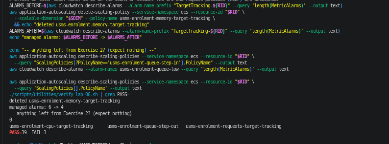

Exercise 2's usms-enrolment-queue-step-in and usms-enrolment-queue-low were already deleted at the end of
Exercise 2 (alarm first, then policy); checked again here and both are absent. Nothing in Section 15's KEEP
column was touched. Result: three policies left (cpu, queue-step-out, requests), managed alarms 6 -> 4, and
verify-lab-06.sh PASS=39 FAIL=3 - the remaining failures are the three scheduled-action checks, which
cannot pass on Floci 2.2.0.

## Exercise 5 - The hand-off to Lab 10

### 1-2. Export script 

`scripts/utilities/usms-scaling-history.sh` writes one JSON document, `outputs/lab-06-scaling-history.json`:
the scalable target (bounds and suspended state), every scaling policy, every scheduled action, every alarm
involved with its state, and every scaling activity requested with `--include-not-scaled-activities`.
- Every identifier is discovered: `ecs list-clusters` (usms- prefix) -> `list-services` -> the service ARN ->
  `resourceId` = the last colon-separated field of the ARN (as `${SVC_ARN##*:}` in Step 14). No resource ID,
  policy or alarm name is written in the script.
- Alarms are found from each policy's `Alarms` list and from any alarm whose `AlarmActions` contains a policy
  ARN, so the step policy's alarm is included even though Floci leaves its list empty.
- `generated` is a UTC timestamp from python3. Unsupported calls are recorded inside the document
  (`"scheduledActions": {"unavailable": "...UnsupportedOperation..."}`) instead of aborting.
- Run from `~` to prove it works from any directory. Result: resourceId service/usms-ecs-cluster/usms-enrolment-svc,
  3 policies, 5 alarms (4 managed + usms-enrolment-queue-high), 3 activities (Step 12), scheduled actions
  unavailable. `python3 -m json.tool` valid; size **14,755 bytes**.

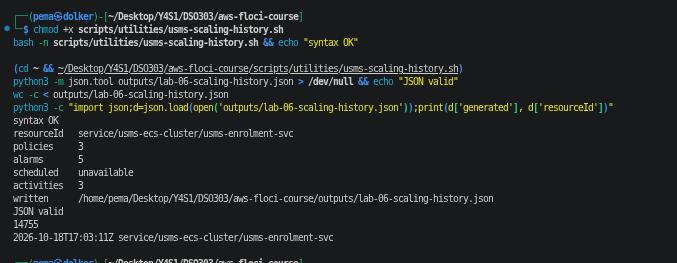

### 3. Scale-out latency 

- Method A, as asked: raised MinCapacity to 4 by re-registering, polled for 60 s. desiredCount stayed **2**
  the whole time (75 s elapsed): Floci stores the floor but does not apply it - the same gap as Step 6 and
  Exercise 3. On real AWS the registration itself raises desiredCount to 4.
- Method B, fallback: `update-service --desired-count 4`. running went 2 -> 4 in **15 s**
  (2026-10-18T17:05:12Z -> 17:05:27Z). This is how fast Floci starts containers, not a Fargate figure: on real
  AWS a Fargate task takes about 20-60 s to start, and the load balancer only sends it traffic after the 60 s
  grace period, so useful capacity arrives after roughly 80-120 s.
- Restored: MinCapacity 2, MaxCapacity 10, desired 2, running 2 (verified).

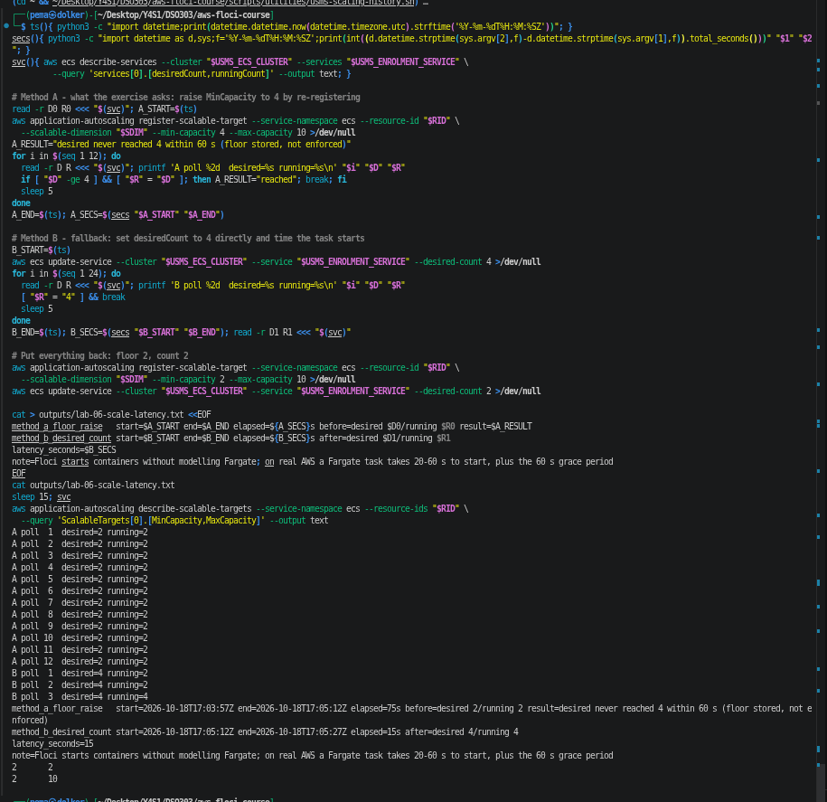

### 4. configs/lab-06.env 

Appended, both derived rather than typed: `USMS_SCALING_HISTORY_FILE` from `ls` of the file the script wrote, and
`USMS_SCALE_LATENCY_SECONDS` (15) read from the `latency_seconds=` line of the latency file. Empty-value check:
all values populated. **24 exports** (22 + 2).

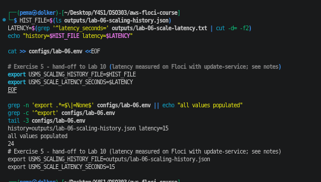

### 5-6. Lab 10 readiness (screenshot ex5-4, outputs/lab-06-lab10-readiness.txt)

- History file: outputs/lab-06-scaling-history.json, 14,755 bytes. Latency: 15 s (Floci, method B).
- Task role: arn:aws:iam::000000000000:role/usms-ecs-task-role (from configs/lab-04.env).
- Policy found on that role with `list-attached-role-policies`, then read with `get-policy` (default version
  v1) and `get-policy-version`: arn:aws:iam::000000000000:policy/USMSStudentDataReadWrite.
- The policy has two Resource entries. I recorded the **bucket** one, `arn:aws:s3:::usms-student-data`; the
  other is the objects, `arn:aws:s3:::usms-student-data/*`.
- It grants s3:ListBucket, s3:GetBucketLocation and s3:DeleteBucket on the bucket, and s3:GetObject,
  s3:PutObject and s3:DeleteObject on the objects. Observation: s3:DeleteBucket is more than an application
  task should have - the enrolment container could delete the student-data bucket itself. I would remove it
  from the policy in Lab 10, before the bucket exists and the permission becomes real.
- `aws s3api head-bucket --bucket usms-student-data` -> "An error occurred (404) when calling the HeadBucket
  operation: Not Found", **exit code 254**, captured with `|| true` so nothing aborted.
- After Lab 10's Step 1 creates the bucket, the same head-bucket command returns exit 0, and usms-ecs-task-role's
  permissions - attached since Lab 04, naming the bucket since Lab 01 - start applying to a real bucket at that
  moment, without any change to the role or the policy.

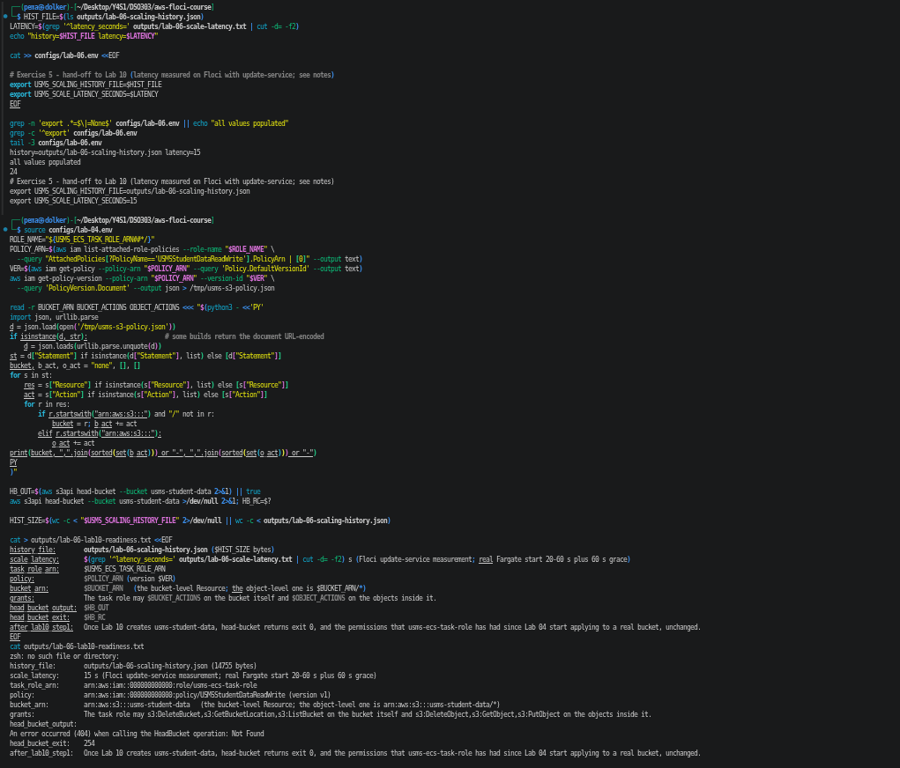
