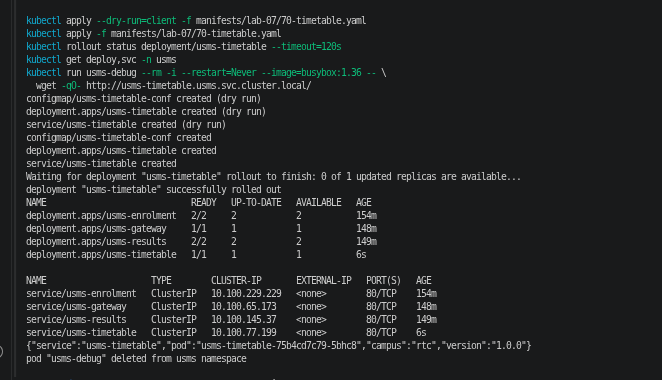
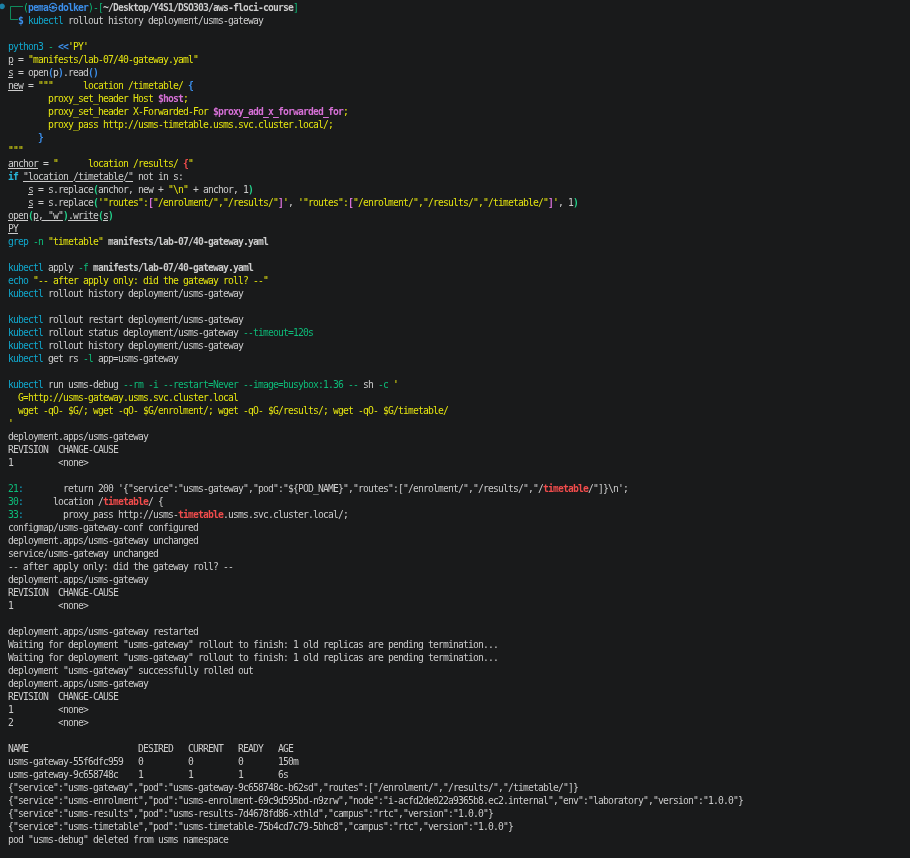
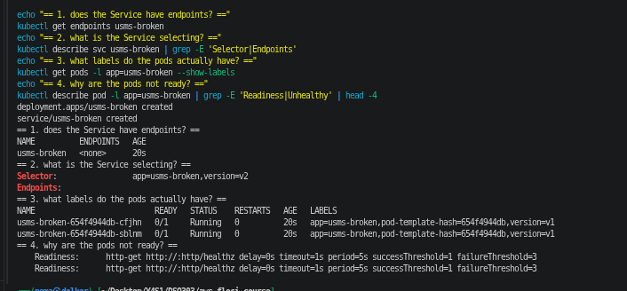
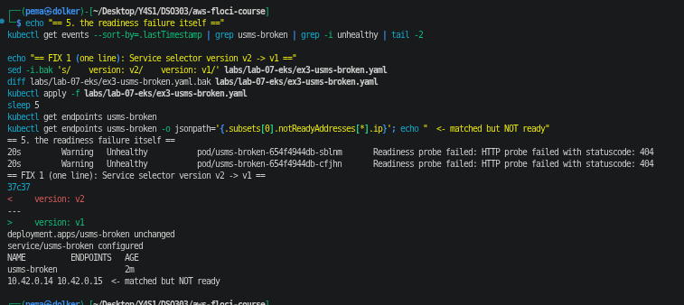
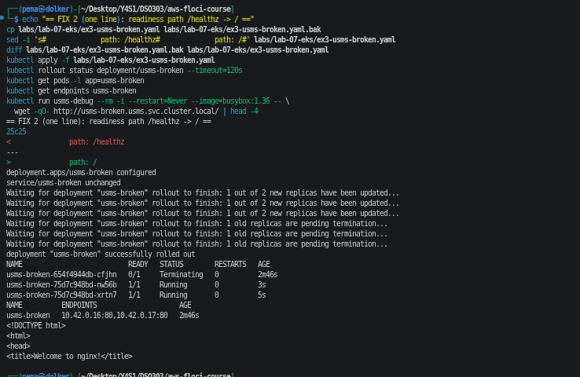
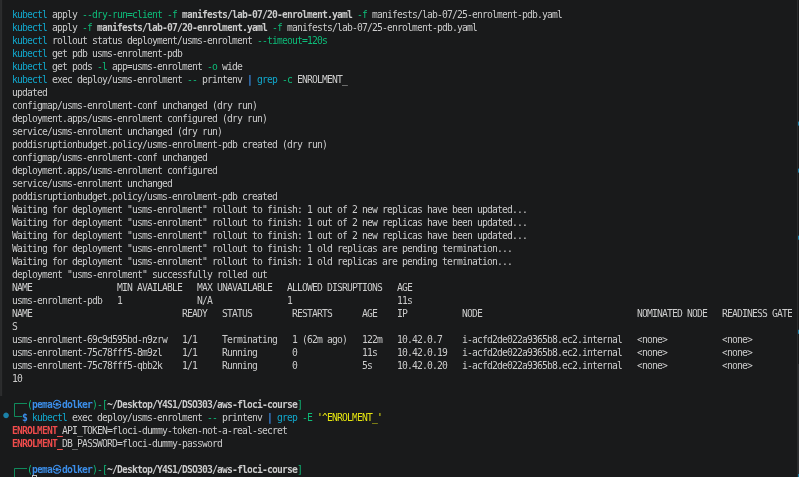
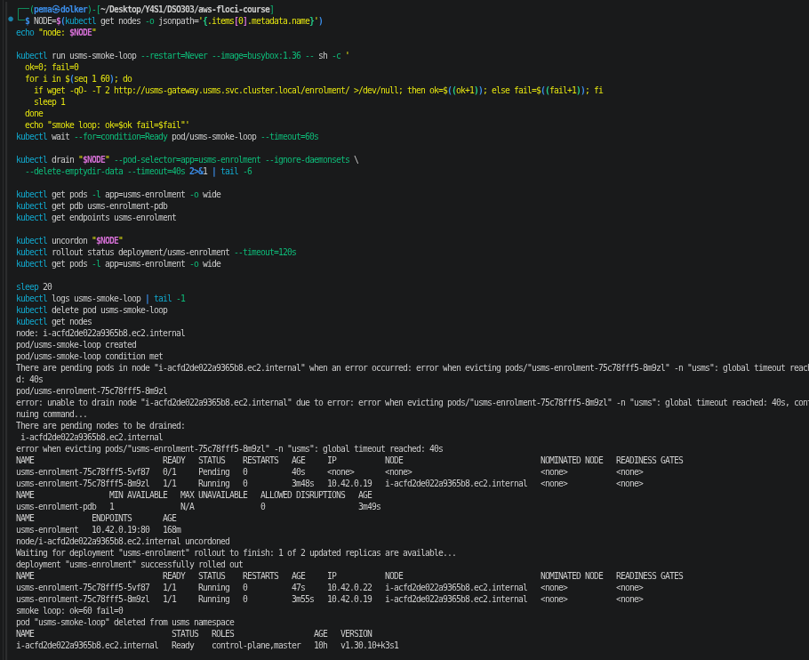
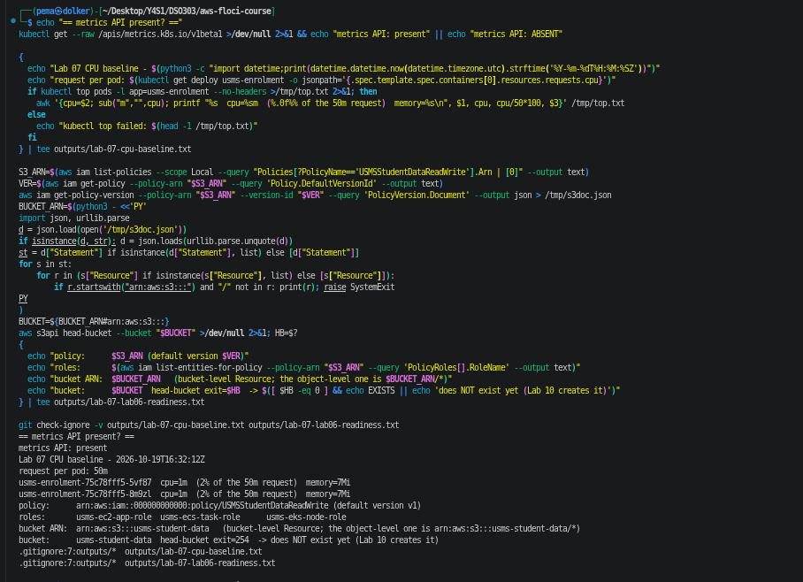

# Lab 07 - Independent Exercises

Environment: Floci 2.2.0, support Path A, single k3s node (i-acfd2de022a9365b8.ec2.internal).

## Exercise 1 - A fourth microservice

manifests/lab-07/70-timetable.yaml holds three objects in one file: ConfigMap usms-timetable-conf (nginx template
that returns JSON with the service, pod, campus and version), Deployment usms-timetable (1 replica,
nginx:1.27-alpine, labels app/project/tier like the other services, requests cpu 50m and memory 32Mi, limits
200m and 128Mi, readiness probe on /healthz, no liveness probe), and a ClusterIP Service on port 80 with
targetPort http. I wrote the manifest by hand, following the shape of 30-results.yaml, instead of generating it.

kubectl apply --dry-run=client validated all three objects first. After the real apply the rollout finished and
kubectl get deploy,svc -n usms showed four Deployments and four Services (usms-timetable ClusterIP 10.100.77.199).
From a busybox pod, http://usms-timetable.usms.svc.cluster.local/ returned
{"service":"usms-timetable","pod":"usms-timetable-75b4cd7c79-5bhc8","campus":"rtc","version":"1.0.0"}.

## Exercise 2 - Route /timetable/ through the gateway

Edited manifests/lab-07/40-gateway.yaml (no kubectl edit): added a location /timetable/ block that proxies to
http://usms-timetable.usms.svc.cluster.local/, and added /timetable/ to the routes list the gateway returns.
kubectl apply -f 40-gateway.yaml: "configmap/usms-gateway-conf configured", but "deployment.apps/usms-gateway
unchanged", and rollout history still showed 1 revision. The new route was only in the ConfigMap; the running
pod had read its config at start-up and did not see it (Step 18).
Of the two commands from Step 18, kubectl annotate only changes the Deployment's own metadata, so it cannot help
when the pod template has not changed. kubectl rollout restart writes a timestamp into the pod template, so it
was the command that caused the new ReplicaSet: rollout history went to 2 revisions, usms-gateway-9c658748c now
has the 1 pod and usms-gateway-55f6dfc959 is at 0.
One command, four answers through the gateway: / (routes now /enrolment/, /results/, /timetable/), /enrolment/,
/results/ and /timetable/, each answered by its own service.

## Exercise 3 - Find the misconfiguration

Manifest applied exactly as given (saved as labs/lab-07-eks/ex3-usms-broken.yaml). kubectl accepted it and the
Service returned nothing. Diagnosis with commands, in this order (screenshots ex3, ex3-2, ex3-3):
1. kubectl get endpoints usms-broken -> <none>. The Service has nobody to send traffic to.
2. kubectl describe svc usms-broken -> Selector: app=usms-broken,version=v2.
3. kubectl get pods -l app=usms-broken --show-labels -> both pods carry app=usms-broken,version=v1, and both are
   0/1 ready.
4. kubectl get events | grep Unhealthy -> "Readiness probe failed: HTTP probe failed with statuscode: 404" on
   both pods.

Fault 1: the Service selects version=v2 but the pods are labelled version=v1, so the selector matches nothing.
Fault 2: the readiness probe asks for /healthz, which the stock nginx image does not serve (404), so the pods
never become ready and a Service only sends traffic to ready pods.

Fixes, one line each:
- Service selector version: v2 -> v1 (diff showed only line 37). After this the Service matched both pods,
  but ENDPOINTS was still empty and the pod IPs 10.42.0.14 and 10.42.0.15 appeared under notReadyAddresses.
  This proves fixing one fault alone does not make it work.
- Readiness path /healthz -> / (diff showed only line 25). This changes the pod template, so the Deployment
  rolled out new pods; both were 1/1 Running and the Service got two endpoints, 10.42.0.16:80 and 10.42.0.17:80.
  A busybox pod then fetched the nginx welcome page through the Service.
The selector change did not restart anything, because it is on the Service, not the pods.
usms-broken was deleted afterwards (CLEAN UP item).

## Exercise 4 - Survive a node going away

The brief asks for three things: enrolment must not have all its capacity on one node, must never drop below one
healthy pod during a voluntary disruption like a drain, and must be able to say from the cluster itself which node
each pod is on. This cluster has only one schedulable node (i-acfd2de022a9365b8.ec2.internal; the node group's
"desired 2" is only an AWS record on Floci), so the first requirement cannot actually be met here. I configured it
anyway, explain what it would do, and demonstrated the part the cluster allows.

Changes (no new Deployment):
- manifests/lab-07/20-enrolment.yaml, in the pod template:
  - topologySpreadConstraints: maxSkew 1 on kubernetes.io/hostname, whenUnsatisfiable ScheduleAnyway,
    matching app=usms-enrolment. With two or more nodes the scheduler keeps the two enrolment pods on different
    nodes, so losing one node takes away half the capacity, not all of it.
  - affinity.podAntiAffinity, preferredDuringScheduling (weight 100) on kubernetes.io/hostname: "try not to put
    two enrolment pods on the same node".
- New object manifests/lab-07/25-enrolment-pdb.yaml: PodDisruptionBudget usms-enrolment-pdb, minAvailable 1,
  selecting app=usms-enrolment.

Why these and not stricter versions: both scheduling rules are advisory on purpose. ScheduleAnyway and "preferred"
mean that on this one-node cluster the pods still start (both landed on the same node, as -o wide shows). With
DoNotSchedule or a "required" anti-affinity, the second pod would stay Pending forever on one node, and the
service would run at half capacity all the time just to obey a rule it cannot satisfy. On a real node group
across two AZs I would consider making the spread DoNotSchedule, because then it can always be satisfied.
The PDB is the enforced rule: the eviction API refuses any voluntary eviction that would leave fewer than 1
ready enrolment pod. It does not protect against a node crashing (that is not voluntary), which is why the spread
rules are needed as well. The third requirement needs no new object: kubectl get pods -o wide reads the node of
each pod from the cluster's own records.

Demonstration (what the cluster allows), screenshot ex4-2:
- Applied both files; the Deployment rolled to new pods (pod template changed), the PDB showed MIN AVAILABLE 1,
  ALLOWED DISRUPTIONS 1, and both pods were on the same node. The two Secret values from Step 17 were still there.
- Started a busybox pod sending one request per second to /enrolment/ through the gateway for 60 s.
- kubectl drain on the node, only for app=usms-enrolment pods, with a 40 s timeout. The node was cordoned, one
  enrolment pod was evicted, and its replacement stayed Pending because the only node was cordoned. The PDB then
  had ALLOWED DISRUPTIONS 0, and the second eviction was refused until the drain timed out ("global timeout
  reached: 40s"). During this the Service still had one endpoint, 10.42.0.19:80.
- kubectl uncordon: the Pending pod was scheduled and both pods were Running again.
- The request loop finished ok=60 fail=0, so enrolment never stopped answering.

What I would have shown with two or more nodes: the two enrolment pods on different nodes from the start; a full
kubectl drain of one node evicting its enrolment pod, the replacement starting on the other node, and the drain
completing without ever going below one ready pod; and deleting every pod on one node at once leaving the
other node's pod serving.

## Exercise 5 - Prepare what Lab 08 needs, using what Lab 01 built

Part 1 (outputs/lab-07-cpu-baseline.txt): kubectl get --raw /apis/metrics.k8s.io/v1beta1 succeeded, so the metrics
API is present on this build (k3s ships metrics-server). kubectl top pods -l app=usms-enrolment at idle:
usms-enrolment-75c78fff5-5vf87 cpu 1m and usms-enrolment-75c78fff5-8m9zl cpu 1m, each 2% of the 50m request,
memory 7Mi each. Lab 08's HPA computes its percentage against that 50m request.

Part 2 (outputs/lab-07-lab06-readiness.txt), all read from the API, not from Lab 01's document:
- USMSStudentDataReadWrite = arn:aws:iam::000000000000:policy/USMSStudentDataReadWrite (default version v1).
- Roles carrying it: usms-ec2-app-role, usms-ecs-task-role, usms-eks-node-role.
- Bucket ARN read out of the policy document with get-policy and get-policy-version: arn:aws:s3:::usms-student-data.
  That is the bucket-level Resource; the object-level one is arn:aws:s3:::usms-student-data/*, and Lab 10 depends
  on the difference.
- The bucket does not exist: aws s3api head-bucket exited 254 (Lab 10 creates it).
Both files are git-ignored (.gitignore:7 outputs/*, checked with git check-ignore -v).

Part 3 is in notes/lab-07-notes.md ("What Lab 08 needs from configs/lab-07.env").

