# AWS Practical Laboratory 8 Report

**Student Name:** Pema Dolker
**Module:** DSO303
**Practical:** Lab 08 - Scaling and Exposing the USMS Application on Amazon EKS
**Environment:** Floci 2.2.0 (local AWS API emulator, Docker Compose, hybrid storage), account 000000000000, us-east-1, the k3s v1.30 cluster from Lab 07

**Support path:** A, with one gap. The eks API works and the cluster is real, so the Kubernetes half of the lab ran fully. The one thing that did not work on the AWS side is `update-nodegroup-config`, which Floci 2.2.0 does not have at all.

Step by step notes are in `notes/lab-08-notes.md` and the five exercises are in `labs/lab-08-eks-scaling/exercises.md`.

> Labels used below:
> **Observed** = I ran it and saw it.
> **Floci limitation** = behaved differently from real AWS.
> **Conceptual** = only possible on real AWS, so I explained it instead.

## 1. Aim / Objective

The aim of this practical is to make the USMS application on EKS scale and to expose it outside the cluster. On the scaling side I scaled by hand and by manifest, looked at requests, limits and QoS classes, created a HorizontalPodAutoscaler and made it move with real load, tried to scale the node group from the AWS side, used a nodeSelector and added PodDisruptionBudgets. On the exposure side I climbed the ladder from ClusterIP and port-forward to NodePort, LoadBalancer and Ingress, and compared it all with the ECS, ALB and Application Auto Scaling setup from Labs 04 to 06, with both running at the same time.

## 2. Introduction

Lab 07 got USMS running on EKS. This lab is about the two things you need next in production: handling more load, and letting people reach it.

Scaling in Kubernetes happens in four separate directions: more pods, bigger pods, more nodes and bigger nodes. Each one is owned by a different object. The HorizontalPodAutoscaler (HPA) adds and removes pods by changing a Deployment's replica count, based on CPU usage as a percentage of each pod's CPU request. Adding nodes is a different system on the AWS side (the node group), and nothing connects the two unless something like Cluster Autoscaler or Karpenter is installed.

Exposure also has levels. A ClusterIP Service only works inside the cluster, a NodePort opens a port on every node, a LoadBalancer Service asks the cloud for a load balancer, and an Ingress is a set of HTTP routing rules that an ingress controller turns into something real, which on EKS is an ALB.

The main parts I used in this lab:

- **HorizontalPodAutoscaler (autoscaling/v2)** - min and max replicas, a CPU target, and a behavior block for how fast to scale up and down.
- **metrics-server** - the add-on that gives the HPA and `kubectl top` their CPU numbers.
- **Requests, limits and QoS classes** - what the scheduler reserves, what the kubelet enforces, and who gets evicted first.
- **Managed node group scaling config** - min, max and desired number of nodes.
- **nodeSelector** - a hard rule for which nodes a pod may run on.
- **PodDisruptionBudget** - a limit on how many pods can be taken down on purpose at once.
- **Service types and Ingress** - ClusterIP, NodePort, LoadBalancer, and HTTP path routing.

This matters in cloud computing because paying for peak capacity all year is wasteful, and USMS is quiet for most of the year and very busy for about two months. Autoscaling and a single shared entry point keep it both available and cheap.

## 3. Use Case

- Enrolment week, when traffic jumps suddenly and the service needs more pods within a minute, then goes back down slowly afterwards.
- Node maintenance or upgrades, where pods must be moved off a node without the service ever going fully down.
- Keeping some workloads on specific nodes, for example by a `workload=usms` label.
- Giving one office (the Examinations Office) access to one path, like results, without exposing everything else and without paying for another load balancer.
- Putting many small services behind one load balancer, instead of one load balancer per service.

## 4. System Architecture / Design

```text
 SCALING
   metrics-server --CPU--> usms-enrolment-hpa (min 2, max 8, 50% of 50m)  --writes replicas--> Deployment usms-enrolment
                           usms-results-hpa   (min 2, max 6, 60%)          --writes replicas--> Deployment usms-results
   AWS side: usms-eks-nodes (min 2, max 4, desired 2)   <-- nothing connects this to the HPAs
   usms-enrolment: nodeSelector workload=usms, PDB maxUnavailable 1
   usms-gateway:   2 replicas, PDB minAvailable 1

 EXPOSURE (each rung keeps the one below it)
   ClusterIP     usms-enrolment, usms-results, usms-timetable        inside the cluster only
   port-forward  kubectl -> API server -> one pod                    debugging only
   NodePort      usms-results-np  80:30080 on the node
   LoadBalancer  usms-gateway  clusterIP 10.100.65.173, nodePort 30424, external 172.17.0.x (k3s ServiceLB)
   Ingress       usms-portal-ingress   /enrolment /results /timetable / (no controller on Floci)
                 usms-results-ingress  /results only, internal scheme (Exercise 4)

 STILL RUNNING FROM LABS 04 TO 06
   usms-enrolment-alb -> usms-enrolment-tg (ip) -> ECS tasks, scalable target min 2 max 10, three policies
```

The HPA does only one thing: it writes a number into the Deployment. Everything else, like starting pods and adding them to the Service, is done by the normal Kubernetes controllers I saw in Lab 07.

## 5. Implementation Procedure

1. **Steps 1 and 2** - started Floci, checked the CPU request and the `_lb_ports_` tag from Lab 07, ran verify-lab-07 and saved a baseline.
2. **Step 3** - wrote down the four dimensions of scaling and my plan for ten times the traffic.
3. **Steps 4 and 5** - scaled enrolment by hand to 5 and back, then created drift on purpose and saw apply undo it, and used `kubectl diff`.
4. **Step 6** - read the QoS classes and the node's allocated resources, and turned the gateway Guaranteed and back.
5. **Step 7** - checked that metrics-server and the metrics API were there.
6. **Steps 8 and 9** - created the enrolment HPA, generated load with three busybox pods, and watched it scale up and back down.
7. **Step 10** - tried to resize the node group from the AWS side.
8. **Step 11** - compared Cluster Autoscaler and Karpenter, applied a nodeSelector and proved it is enforced.
9. **Step 12** - created two PDBs and compared the eviction API with a plain delete.
10. **Steps 13 to 16** - climbed the exposure ladder: port-forward, NodePort, LoadBalancer and Ingress.
11. **Step 17** - compared ECS and EKS with both running.
12. **Steps 18 and 19** - restarted Floci and compared before and after, then wrote configs/lab-08.env.
13. **Section 8** - built and ran verify-lab-08.sh and the smoke test, and wrote (but did not run) the cleanup script.
14. **Section 15** - removed the load generator and the exercise leftovers.

## 6. Results and Evidence

### 6.1 CLI Output

**Steps 1 and 2 - starting point**

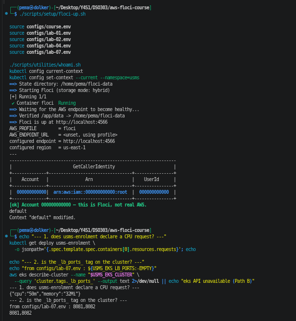
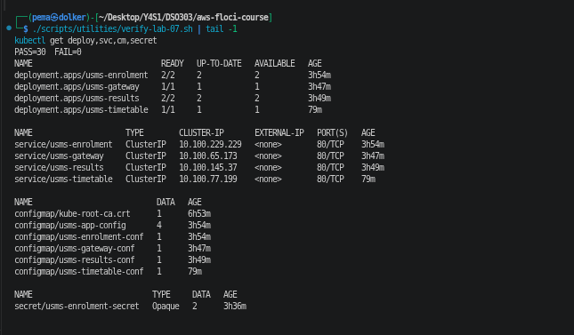
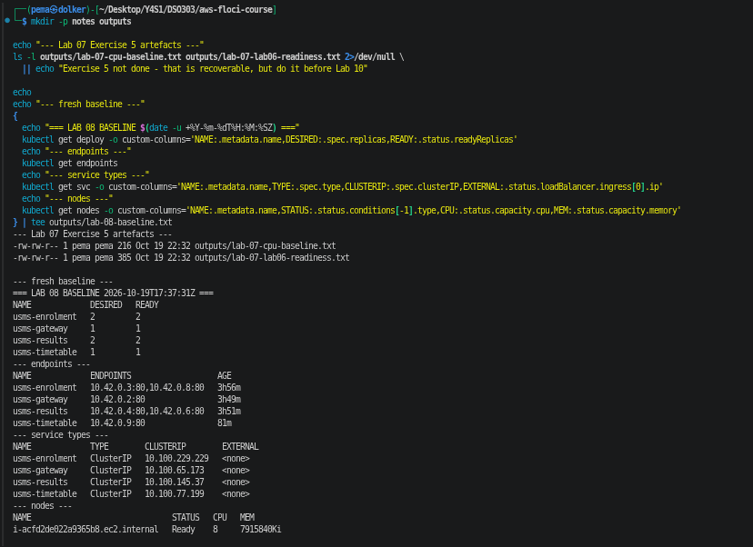

**Observed:** usms-enrolment requests `{"cpu":"50m","memory":"32Mi"}`, so the HPA has something to divide by. The `_lb_ports_` tag is 8081,8082 both in the env file and on the cluster. verify-lab-07 gave PASS=30 FAIL=0. There are four Deployments, not three, because of timetable from Lab 07 Exercise 1. There is one node with 8 CPU, and it already has the labels workload=usms and tier=app.

**Step 4 - scaling by hand**

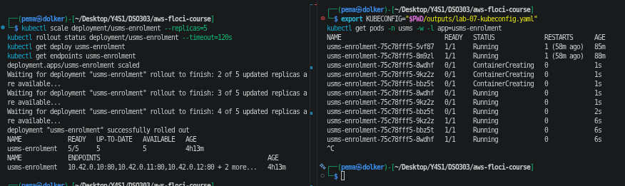
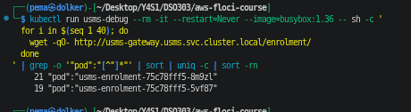
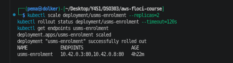

**Observed:** scaling to 5 grew the same ReplicaSet with no new rollout, and the endpoints were added one by one as each pod became Ready. Requests through the gateway reached all five pods. Scaling back to 2 kept the two original pods, because Kubernetes removes the newest pods first.

**Step 5 - drift**

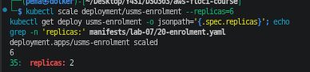
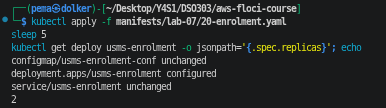
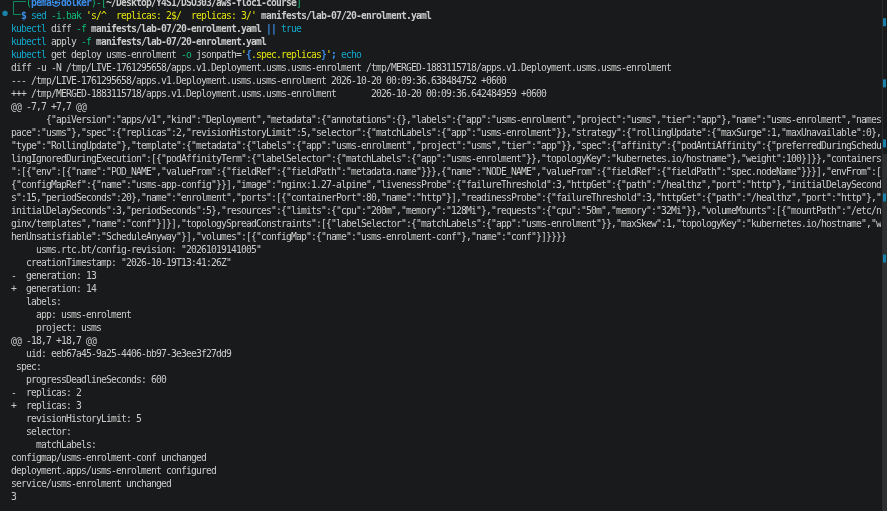
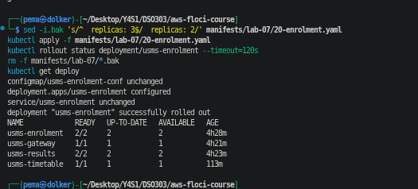

**Observed:** the cluster said 6 and the file said 2, and nothing warned me. A plain `kubectl apply` of the file quietly put it back to 2. `kubectl diff` showed the change (replicas 2 to 3) before applying it, and it exits 1 when there is a difference, which is not an error.

**Step 6 - requests, limits and QoS**

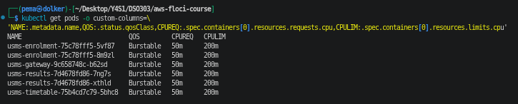
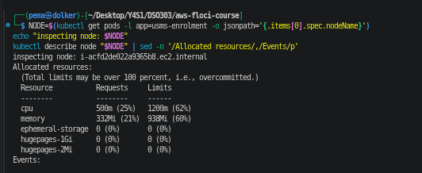
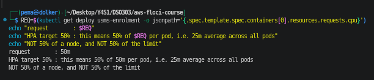
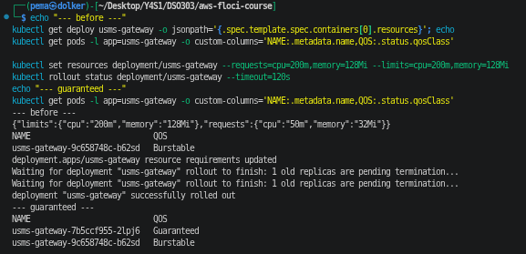
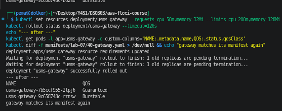

**Observed:** all USMS pods are Burstable (50m request, 200m limit). The HPA target of 50% means 25m per pod, not 50% of the node. In the Your turn, setting the gateway's requests equal to its limits made it Guaranteed, and putting them back made it Burstable again. The pod was replaced both times, because requests are part of the pod template.

**Step 7 - metrics**

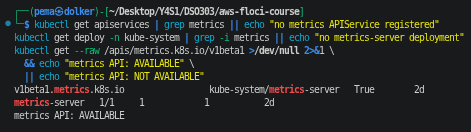
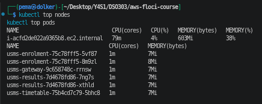

**Observed:** metrics-server ships with k3s, so the metrics API was AVAILABLE and nothing had to be installed. Every USMS pod idled at 1m CPU, which is 2% of the request. The node showed 79m as 4%, which made me check: the node's capacity is 8 CPU, but only 1930m is allocatable, because Floci holds the rest back for the system.

**Steps 8 and 9 - the HPA moving**

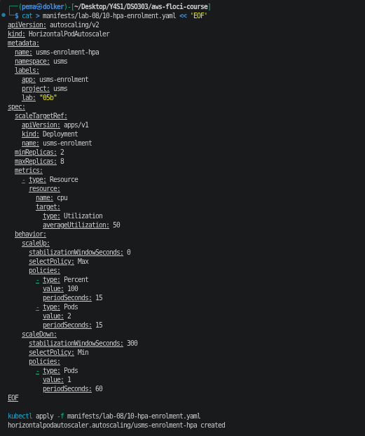
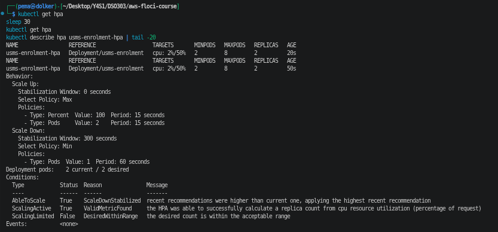
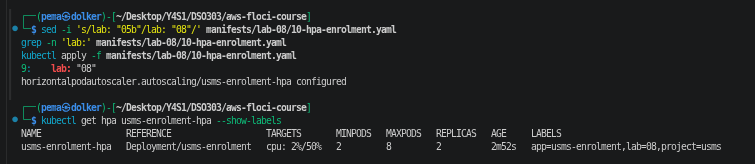
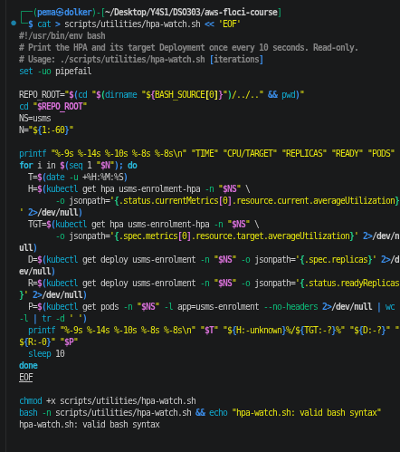
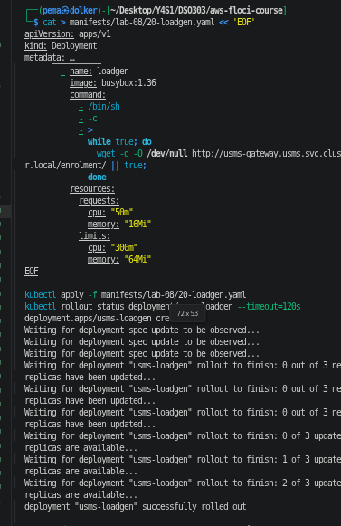
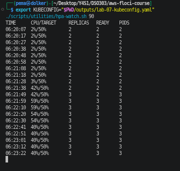
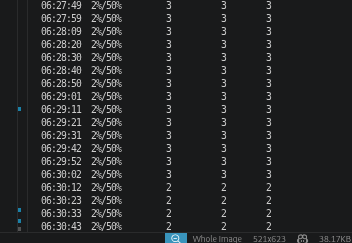
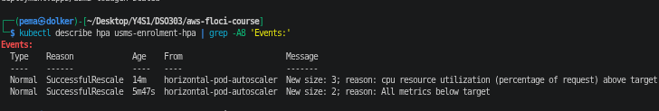

**Observed:** the HPA showed `cpu: 2%/50%` with ScalingActive True. With three load generators running, CPU went to 42% and then 59%, and the HPA scaled enrolment from 2 to 3. It stayed at 3 with about 40% CPU, because that was all the load my machine could make. After I removed the load, CPU dropped to 2% within 20 seconds, but the replicas stayed at 3 for about five minutes (the 300 second stabilisation window) before going back to 2. The two events were "New size: 3; reason: cpu resource utilization (percentage of request) above target" and "New size: 2; reason: All metrics below target".

**Step 10 - node group**

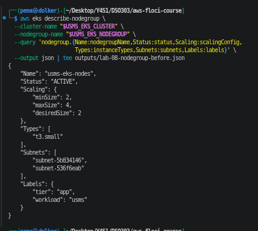
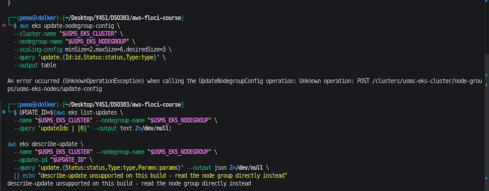
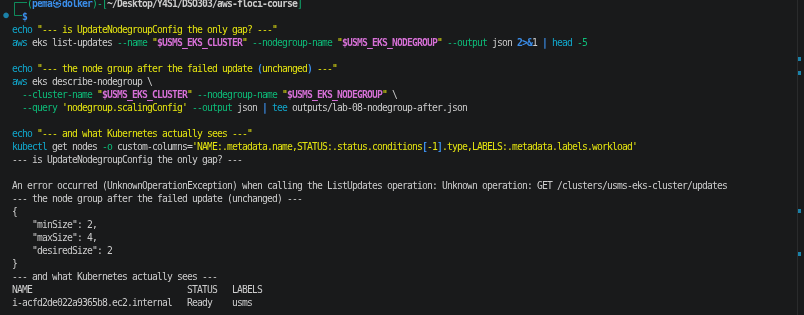

**Floci limitation:** `update-nodegroup-config` failed with "UnknownOperationException ... Unknown operation: POST /clusters/usms-eks-cluster/node-groups/usms-eks-nodes/update-config". So Floci 2.2.0 does not have the operation at all, which is worse than the handout expected (it said the numbers would be saved but no node would appear). The node group stayed at min 2, max 4, desired 2, and there is still one node.

**Step 11 - nodeSelector**

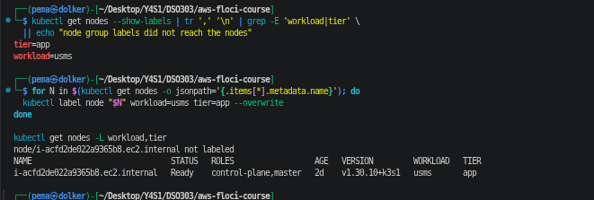
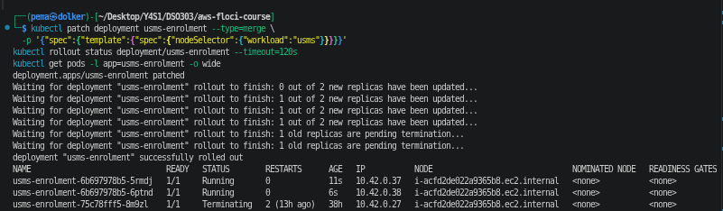
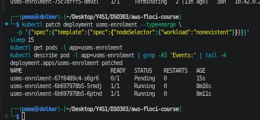
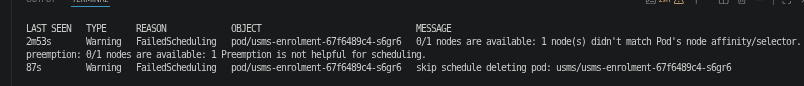
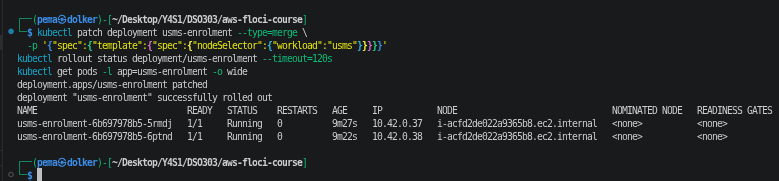
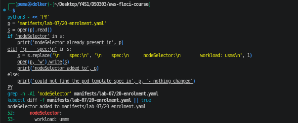

**Observed:** with `workload=nonexistent` the new pod stayed Pending with "didn't match Pod's node affinity/selector", while the two old pods kept serving because of maxUnavailable 0. Setting it back to `workload=usms` went back to the same two pods. I added the nodeSelector to the Lab 07 manifest so the file matches the cluster. **Conceptual:** Cluster Autoscaler and Karpenter are not installed, because both need IRSA and a real Auto Scaling group.

**Step 12 - PodDisruptionBudgets**

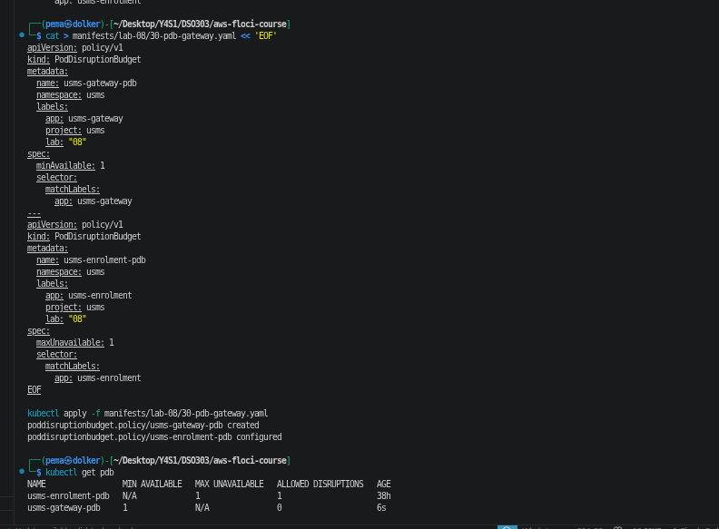
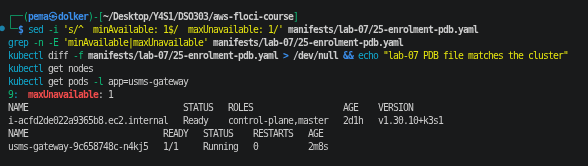
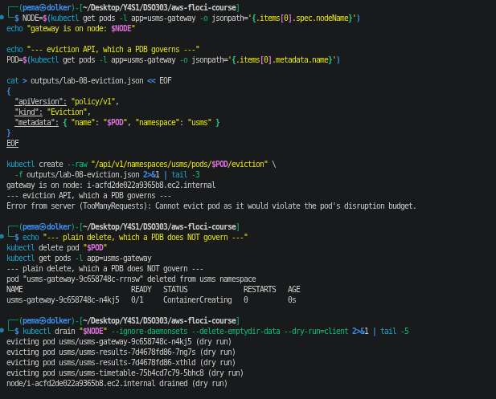

**Observed:** the gateway PDB (minAvailable 1) allowed 0 disruptions on a single gateway pod, and the enrolment PDB (maxUnavailable 1) allowed 1. The eviction API refused the gateway pod with "Cannot evict pod as it would violate the pod's disruption budget", but `kubectl delete pod` removed it straight away. The drain dry run listed the gateway as evictable, because a client dry run does not ask the eviction API.

**Steps 13 and 14 - port-forward and NodePort**

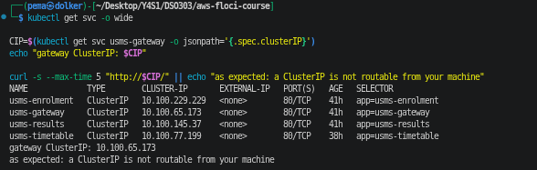
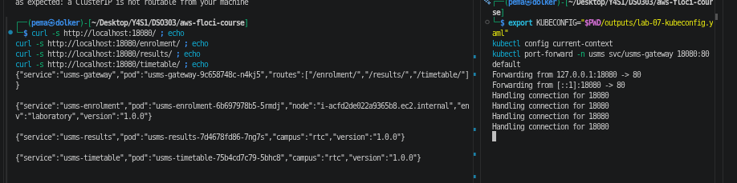
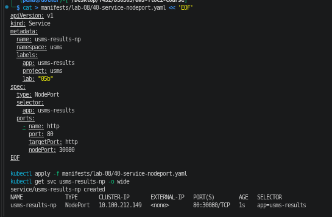
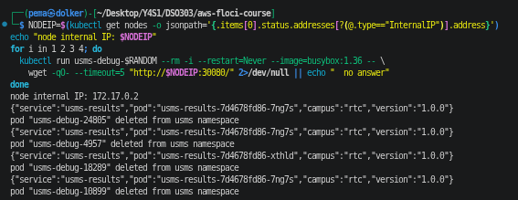
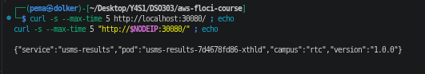
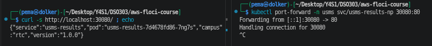

**Observed:** curl to the gateway's ClusterIP from my machine failed, and port-forward reached all four routes. The NodePort 80:30080 answered from both results pods inside the cluster. From my machine, `localhost:30080` failed (**Floci limitation:** the port is not published), but the node's own IP `172.17.0.2:30080` worked, because the k3s node is a Docker container on a bridge my machine can reach.

**Step 15 - LoadBalancer**

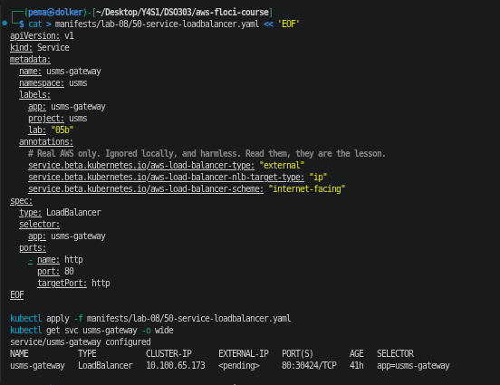
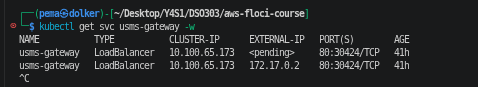
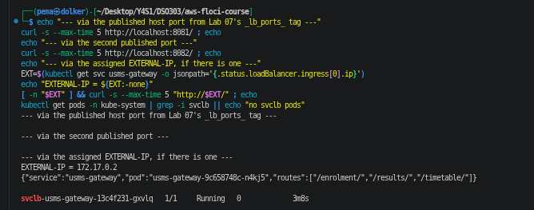
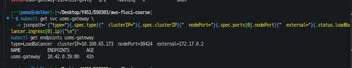

**Observed:** EXTERNAL-IP went from `<pending>` to 172.17.0.2 within seconds, because k3s has a small built-in load balancer that runs as a `svclb` pod. Curl to that IP reached the gateway. The whole ladder fits on one line: `type=LoadBalancer clusterIP=10.100.65.173 nodePort=30424 external=172.17.0.2`. **Floci limitation:** ports 8081 and 8082 gave nothing. `docker ps` shows the only published port on the k3s container is 6500 for the API, so the `_lb_ports_` tag is stored but never acted on.

**Step 16 - Ingress**

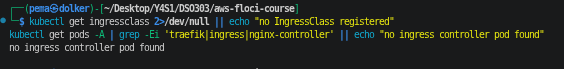
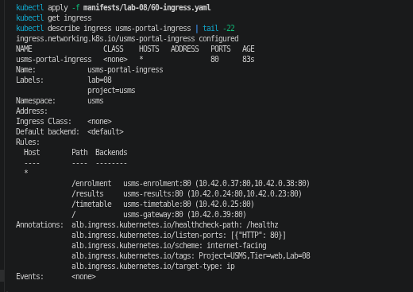
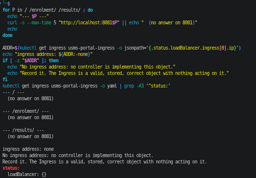

**Floci limitation:** there is no IngressClass and no ingress controller, because Floci starts k3s with Traefik turned off. The Ingress is stored and the API server resolved every path to the right pod IPs, but it has no address and nothing routes through it. **Conceptual:** on EKS the AWS Load Balancer Controller would turn it into an internet-facing ALB, doing for me the target group, load balancer, listener and rule commands I ran by hand in Lab 05.

**Step 17 - ECS and EKS side by side**


**Observed:** the ECS service is still at 2 of 2 tasks with min 2 and max 10 and three scaling policies, behind usms-enrolment-alb and an ip target group. The EKS side shows the HPA, five Services, the Ingress and both PDBs. The two filled-in comparison tables are in my notes.

**Steps 18 and 19 - persistence and env file**


**Observed:** after a full stop and start, everything I recorded was identical: PERSISTENCE PROVEN. Even the gateway's auto-allocated nodePort stayed 30424. The only thing that changed was the gateway's external IP, which went from 172.17.0.2 to 172.17.0.3, because Docker gave the node container a new address. configs/lab-08.env has 19 exports. The only empty one is the ingress class, since there is no controller.

**Section 8 and 15 - verification, cleanup script and tidy up**


**Observed:** verify-lab-08.sh gave **PASS=33 FAIL=1**. The one failure is "node group maxSize was raised to 6", which is the Step 10 limitation, and I left that check as it is because it is the honest result. The smoke test passed for all four routes. The cleanup script is written and syntax checked but not run. At the end there are four Deployments, two HPAs, two PDBs, two Ingresses, no load generator and no cordoned node.

### 6.2 AWS Management Console Verification

Floci does not have a web console, so there is no console screenshot for this lab. The `describe` and `kubectl get` commands in 6.1 are the verification.

## 7. Analysis and Discussion

The objectives were achieved for everything Kubernetes controls. The HPA really scaled on real load and held capacity through the stabilisation window, the nodeSelector and PDBs were enforced, every rung of the exposure ladder was shown, and all of it survived a restart. The parts that live on the AWS side (resizing the node group, a real load balancer, an ALB from an Ingress, Cluster Autoscaler and Karpenter) could not be shown on Floci, so I recorded them as limitations or explained them instead.

The result that taught me the most was Step 9. The handout example went from 2 to 4, mine went to 3 and stayed there, and working out why made the HPA make sense: there is a 10% tolerance, new pods without metrics count as 0% when scaling up, and once the load was spread over 3 pods each was under 50%, so 3 was the right answer for that much traffic. The other one was Step 12. A PDB is only a rule for cooperative tools like drain, and a plain delete goes straight through it.

Problems I ran into and how I fixed them:

- **Old "05b" labels.** The handout's manifests had `lab: "05b"`, which looks like a leftover from an older numbering of this lab. I applied the handout version a few times by mistake and fixed each one with sed and a second apply. Only the label changed, so nothing was restarted.
- **The Lab 07 gateway file still had the old ClusterIP Service.** After Step 15 the gateway is a LoadBalancer, so applying the Lab 07 file would have quietly undone it. I moved the Service out of that file and left a comment pointing to the Lab 08 one, so two files no longer fight over the same object.
- **Two PDBs with the same name.** The handout creates usms-enrolment-pdb, which I already had from Lab 07 Exercise 4 as minAvailable 1. I let the Lab 08 version (maxUnavailable 1) win and updated the Lab 07 file to match.
- **The handout's Python for the nodeSelector** looks for `spec:` directly followed by `containers:`, which my file does not have because of the Lab 07 spread rules. I used a version that puts the nodeSelector right under the pod template's spec.
- **The verify script** had the same `.gitkeep` bug as Labs 06 and 07, did not set KUBECONFIG, and expected exactly three Ingress paths while I have four. I fixed these and marked them `# FIX`.
- **A second terminal lost KUBECONFIG**, so port-forward failed with "You must be logged in to the server" until I exported it again.

## 8. Reflection

**What I learned.** I had used HPAs in DSO202, but I did not really know that the percentage is of the request, not the node, or what the behavior block does. Watching the replicas stay at 3 for five minutes at 2% CPU made the stabilisation window very clear. I also learned that scaling pods and scaling nodes are two different systems that do not talk to each other, and that an Ingress is only a description until a controller acts on it.

**Challenges.** The hardest part was keeping the repository and the cluster in agreement. Step 5 showed what drift does, and then I kept finding real drift of my own: old labels, a Service defined in two files, a PDB defined twice. Fixing those properly took longer than the steps themselves. Floci also did less on the AWS side than the handout expected, so I had to check each result instead of assuming it worked.

**Real world use.** For USMS I would still use ECS on Fargate, because there are no nodes to manage and Lab 06 already handles the busy weeks. If USMS grows into many services, one EKS cluster with one Ingress and HPAs would become worth it, especially because the manifests are not tied to AWS.

**What I want to explore more.** Karpenter and the AWS Load Balancer Controller on a real EKS cluster, to see a Pending pod turn into a new node and an Ingress turn into an ALB. I would also like to try KEDA, so the HPA could scale on the SQS queue the way Lab 06 did.

## 9. Conclusion

The objectives were achieved. usms-enrolment and usms-results now have HPAs, the HPA was seen scaling up under load and back down after its window, the gateway has two replicas and a PDB that allows safe drains, and USMS is exposed through every rung from port-forward to Ingress, with a results-only Ingress designed for the Examinations Office. Everything persisted across a restart, and the names and numbers are recorded in `configs/lab-08.env` for later labs.

The key ideas I am taking from this lab are that the HPA percentage is of the pod's request, that pods and nodes scale separately, that a PDB only protects against voluntary disruptions, and that each Service type keeps the one below it. I also learned to keep the files and the cluster in agreement, because apply will quietly undo anything the files do not say.

## 10. Appendix

- Notes, the four dimensions plan, the ECS and EKS comparison tables and the seven review questions: `notes/lab-08-notes.md`
- Exercises 1 to 5: `labs/lab-08-eks-scaling/exercises.md` (Exercise 3's manifests: `labs/lab-08-eks-scaling/ex3-reports-broken.yaml` and `ex3-reports-fixed.yaml`)
- Manifests: `manifests/lab-08/` (enrolment HPA, results HPA, load generator, PDBs, NodePort Service, LoadBalancer Service, portal Ingress, results Ingress)
- Lab 07 manifests updated: `20-enrolment.yaml` (nodeSelector), `25-enrolment-pdb.yaml` (maxUnavailable 1), `40-gateway.yaml` (2 replicas, Service moved to Lab 08)
- Recorded names and numbers: `configs/lab-08.env` (19 exports)
- Scripts: `scripts/utilities/hpa-watch.sh`, `scripts/utilities/verify-lab-08.sh`, `scripts/cleanup/lab-08-cleanup.sh` (not run)
- Screenshots: `screenshots/lab8/`
- Kept locally and not committed (git-ignored): the baseline, node group before and after files, restart comparison, eviction body, and the two Exercise 5 files for Lab 10

