# Lab 08 Exercises

All five exercises were done on the same Floci 2.2.0 cluster as the main lab. Screenshots are in `screenshots/lab8/`.

## Exercise 1 - Basic: a second autoscaler

**Task:** give usms-results its own HPA: min 2, max 6, 60% CPU, a 180 second scale-in window, and a scale-up policy that adds at most 2 pods every 30 seconds. It must be an autoscaling/v2 manifest, dry run first, no `kubectl autoscale`.

**What I did:** first I checked that usms-results has a CPU request (50m from Lab 07), because the HPA needs it. Then I wrote `manifests/lab-08/11-hpa-results.yaml`, ran a client dry run, and applied it.

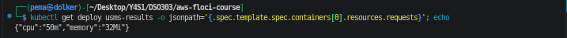
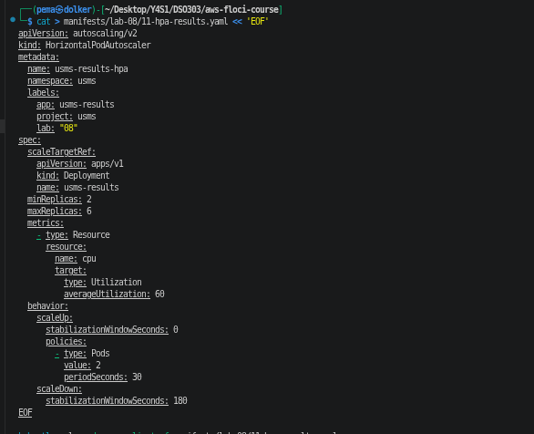
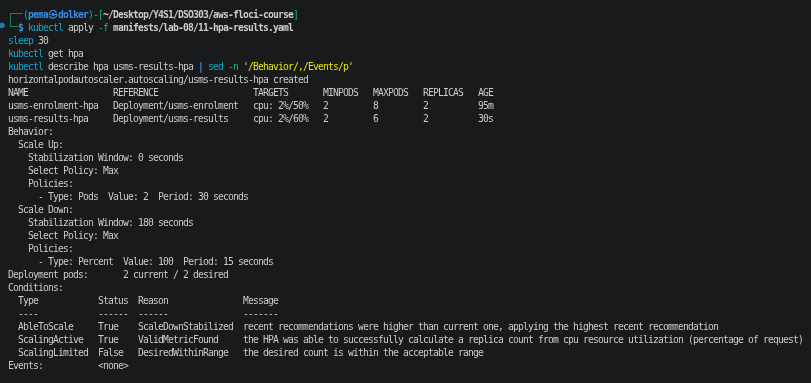

**Result:** `kubectl get hpa` shows two HPAs reporting percentages: usms-enrolment-hpa at 2%/50% (2 to 8) and usms-results-hpa at 2%/60% (2 to 6), both with ScalingActive True. The describe output shows the scale-up policy (Pods 2 every 30 seconds) and the 180 second scale-down window.

I did not write any scale-down policies, so Kubernetes filled in its default of Percent 100 every 15 seconds. After the 180 second window, results can drop back to its minimum in one step, while enrolment is limited to 1 pod per minute.

**Why 60% for results and 50% for enrolment:** results is read-mostly and its traffic builds up more gradually after results are released, so it can run hotter before adding pods, while enrolment gets sudden spikes when registration opens and needs more room per pod to absorb the first burst while new pods start.

## Exercise 2 - Intermediate: make the gateway drainable

**Task:** Step 12 showed usms-gateway-pdb allows zero disruptions. Fix it properly without weakening the PDB, keep the pods apart if there is more than one node, update `manifests/lab-07/40-gateway.yaml` and show a clean `kubectl diff`.

**What I found first:** the PDB was not the problem, the single replica was. With one pod and minAvailable 1, nothing can ever be evicted. But when I checked the Lab 07 gateway file, I found two more problems:

- The file still had the old ClusterIP usms-gateway Service, which Step 15 had replaced with the LoadBalancer one. `kubectl diff` on the file showed that applying it would turn the gateway back into a ClusterIP, so the file could never be clean.
- The live gateway Service had the label `lab: 05b`, because I had applied the handout version of the Step 15 manifest. I fixed the label and applied it again.

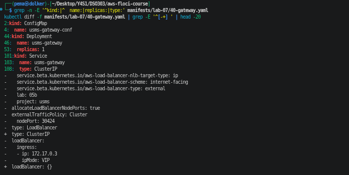
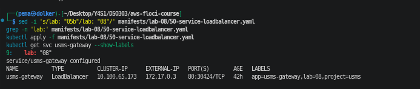

**Fix:** I removed the Service from the Lab 07 file with a small Python script and left a comment saying it moved to `manifests/lab-08/50-service-loadbalancer.yaml`, so two files no longer own the same object. Then I changed `replicas: 1` to `replicas: 2`. The minAvailable 1 on the PDB stayed as it was.

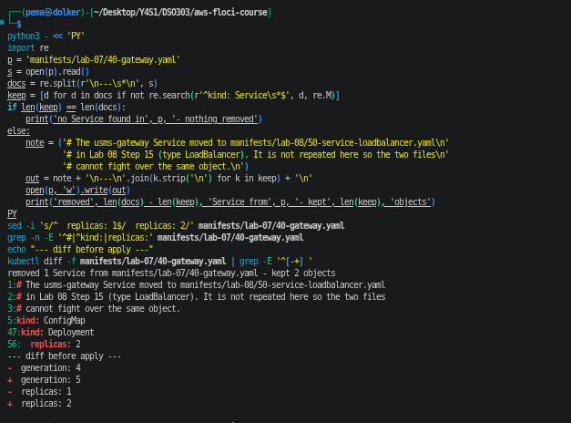
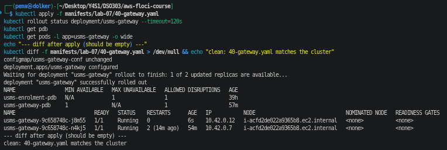

**Result:** before applying, the diff showed only replicas 1 to 2 (and generation 4 to 5). After applying, usms-gateway-pdb shows ALLOWED DISRUPTIONS 1, there are two gateway pods, and the file is clean against the cluster.

**Proof:** the same eviction API call that was refused in Step 12 now worked.

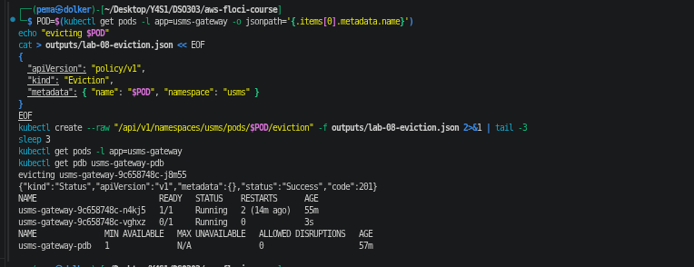

It returned `"status":"Success","code":201`. The evicted pod was replaced while the other one kept serving, so the gateway was never down. While the new pod was still starting (0/1), ALLOWED DISRUPTIONS went back to 0, so a second eviction would have been refused until it was Ready. That is what makes a drain safe: one gateway pod at a time.

**Spreading across nodes:** I only have one node, so both pods are on it. With more nodes I would add a topologySpreadConstraint on `kubernetes.io/hostname` with maxSkew 1 and ScheduleAnyway, the same as I did for enrolment in Lab 07 Exercise 4, so one node failing or being drained cannot take both gateway pods.

## Exercise 3 - Problem solving: the autoscaler that will not act

**Task:** apply the given manifest exactly (usms-reports and usms-reports-hpa), find both faults with commands, say which one gives `<unknown>` and which one stops the HPA even with good metrics, and fix each with one field.

The manifest I applied is saved as `labs/lab-08-eks-scaling/ex3-reports-broken.yaml`.

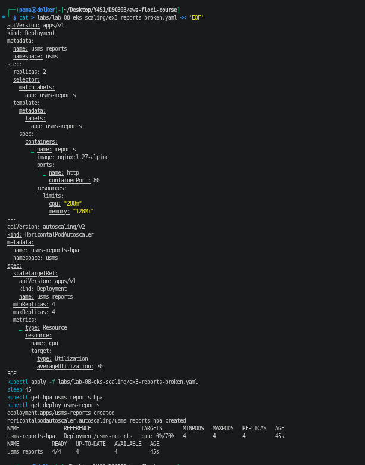
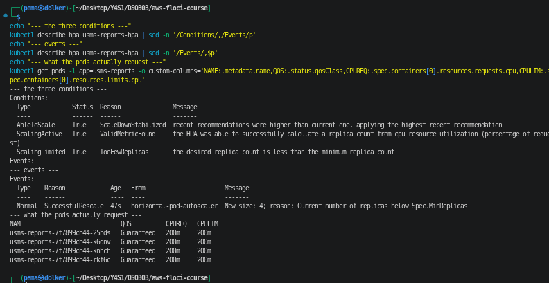

**What I saw first:** the HPA showed `cpu: 0%/70%`, not `<unknown>`, and it scaled the Deployment from 2 to 4 straight away ("New size: 4; reason: Current number of replicas below Spec.MinReplicas"). The pods showed a CPU request of 200m and QOS Guaranteed, even though the manifest only sets a limit. That is a Kubernetes rule: if a container has a limit but no request, the request is set equal to the limit. So the first fault was hidden. The HPA had a denominator, just the wrong one (70% of 200m, close to where the pod gets throttled).

The conditions showed the second fault clearly: "ScalingLimited True TooFewReplicas the desired replica count is less than the minimum replica count".

**Proving the `<unknown>` case:** I removed the CPU limit too, so the container had neither a CPU request nor a CPU limit.

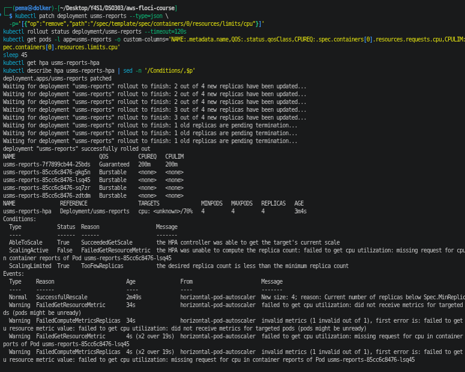

The HPA went to `cpu: <unknown>/70%` with "ScalingActive False FailedGetResourceMetric the HPA was unable to compute the replica count: failed to get cpu utilization: missing request for cpu in container reports of Pod usms-reports-85cc6c8476-lsq45". Both faults were visible in the same output.

**The two faults:**

- **Fault 1 (gives `<unknown>`):** the container has no CPU request, so the HPA has nothing to divide by. It only shows as `<unknown>` when the limit is missing too, because a limit gets copied into the request.
- **Fault 2 (stops it acting even with perfect metrics):** minReplicas and maxReplicas are both 4, so every recommendation is clamped to 4. Under heavy load it would want more and say TooManyReplicas, but 4 is the only possible value.

**Fixes, one field each,** in `labs/lab-08-eks-scaling/ex3-reports-fixed.yaml`:

- added `resources.requests.cpu: "50m"`
- changed `maxReplicas` from 4 to 8

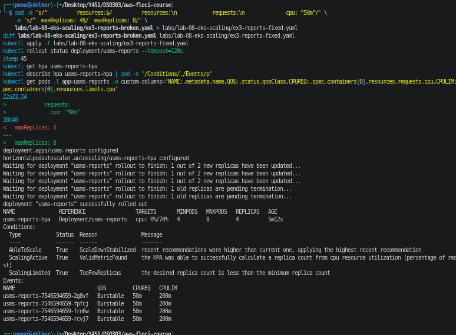

The diff between the two files shows only those two changes. After applying: `cpu: 0%/70%`, min 4, max 8, ScalingActive True, and the pods have a 50m request and 200m limit (Burstable). TooFewReplicas is still shown only because at 0% it would like to go below 4, but it now has room to scale up.

While applying, the rollout said "1 out of 2 new replicas", because the file says `replicas: 2`. The HPA set it back to 4 within seconds, which is the same point as Step 8: once an HPA owns a Deployment, the replicas in the file is only a starting value.

**Clean up:** deleted usms-reports and usms-reports-hpa.

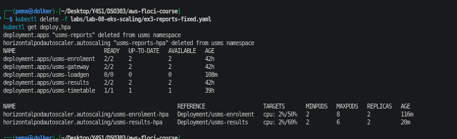

## Exercise 4 - Challenge: expose the results service properly

**The brief:** the Examinations Office wants results reachable from the university network at a stable address, on a normal HTTP port and its own path, without giving enrolment the same exposure and without a second load balancer. They also want to know the cost and what breaks if the cluster is down.

**Is the existing Ingress the answer?** No, it is the wrong shape. usms-portal-ingress also has `/enrolment`, and its `/` path goes to the gateway, which also proxies `/enrolment/`. Anyone who can reach it can reach enrolment. The gateway LoadBalancer Service from Step 15 has the same problem, and on real AWS it would be a second load balancer too.

**What I built:** `manifests/lab-08/61-ingress-results.yaml`, an Ingress called usms-results-ingress with one rule: `/results` (Prefix) to the usms-results Service on port 80.

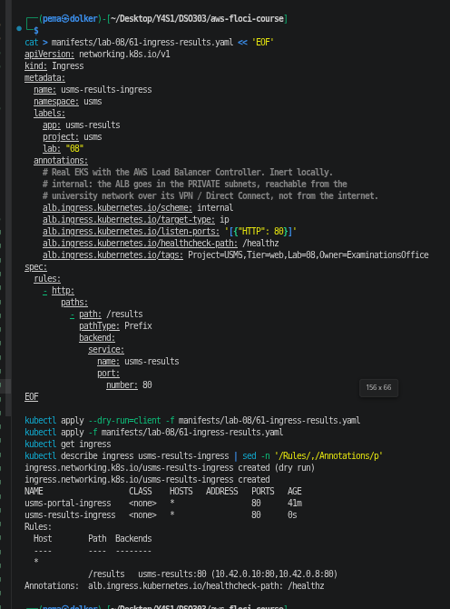
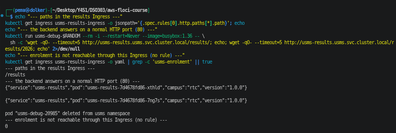

The only path in it is `/results`, it resolves to the two results pods, the backend answers on port 80 for both `/results/` and `/results/2026`, and `usms-enrolment` appears 0 times in the object.

**Which rung each part is on:**

- usms-results stays a ClusterIP Service (rung 1). The Ingress points at it by name, so it keeps working when pod IPs change, and they did change after the Step 18 restart.
- usms-results-ingress is the Ingress rung (rung 4). On EKS it becomes an ALB.
- No NodePort or LoadBalancer Service is needed (rungs 2 and 3), because with target-type ip the ALB sends traffic straight to pod IPs.

**My choices and why:**

- **University network only:** `scheme: internal` puts the ALB in the private subnets from Lab 02. The university network reaches it over its VPN or Direct Connect into the VPC, and the internet cannot.
- **Normal HTTP port:** `listen-ports` HTTP 80. For real use I would add an ACM certificate (`alb.ingress.kubernetes.io/certificate-arn`) and use 443.
- **Stable address:** the ALB's DNS name does not change, and I would add a Route 53 private record in front of it so the office never needs the AWS name. On Floci the gateway's 172.17.0.x address changed from .2 to .3 after a restart, which shows why an IP is not good enough.
- **Its own path:** `/results` with Prefix, so `/results/2026` matches and `/resultsarchive` does not.
- **Enrolment not exposed:** there is no enrolment rule and no `/` rule to the gateway.
- **No second load balancer:** I did not make another `type: LoadBalancer` Service because each one creates its own NLB with its own hourly charge, while one Ingress with any number of paths is one ALB. In production I would also turn usms-gateway back into a ClusterIP and remove usms-portal-ingress, so this ALB is the only load balancer. I kept them here only because the lab and its verify script still use them.

**What Floci could not show:** there is no ingress controller, so the Ingress has no address and nothing routes through it. On real EKS the AWS Load Balancer Controller (installed with IRSA) would create the internal ALB, an ip target group for usms-results and a listener rule for `/results`, driven by the scheme, target-type, listen-ports and healthcheck-path annotations.

**Cost:** one ALB is charged per hour plus LCUs for traffic. In us-east-1 that is roughly $0.0225 an hour, around $16 to $17 a month before traffic (worth checking against the current AWS pricing page). Adding more paths to the same Ingress does not add a load balancer, while each extra LoadBalancer Service would add another NLB at a similar base price.

**If the cluster is unavailable:** the ALB lives outside the cluster, so its DNS name keeps working. If only the control plane is down, the pods keep running and the ALB keeps sending traffic to the targets it already knows, but nothing updates (no scaling, no new targets). If the nodes or pods are down, the health checks fail and the ALB returns 502 or 503 errors until the pods are back. So the Examinations Office would get errors, not a timeout.

## Exercise 5 - Integration: what Lab 10 needs

**Part 1:** `outputs/lab-08-scaling-evidence.json`, built with a small Python script from live `kubectl get hpa -o json`, `kubectl get deploy -o json` and `aws eks describe-nodegroup` calls, plus a UTC timestamp. It holds the HPA spec and status, the Deployment's replicas and CPU request, and the node group scaling config with a note that `update-nodegroup-config` is not supported on this build. `python3 -m json.tool` accepts it.

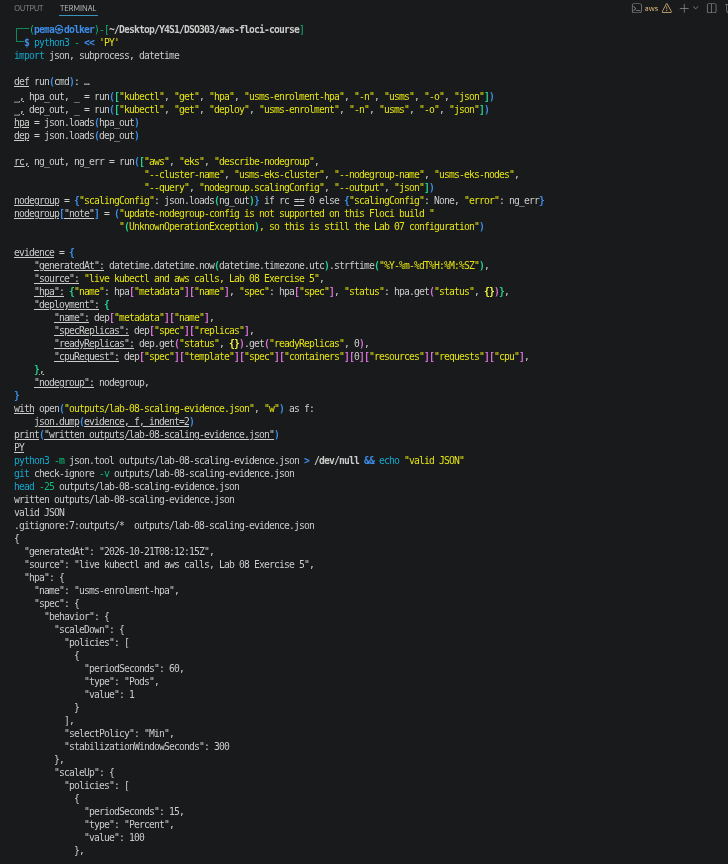

**Part 2:** `outputs/lab-08-lab06-readiness.txt`.

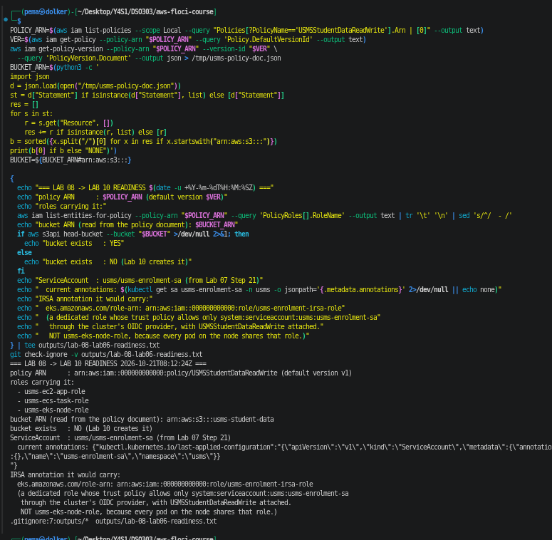

- Policy: `arn:aws:iam::000000000000:policy/USMSStudentDataReadWrite`, default version v1.
- Carried by three roles: usms-ec2-app-role, usms-ecs-task-role and usms-eks-node-role.
- Bucket ARN, read out of the policy document's Resource (not copied from Lab 07): `arn:aws:s3:::usms-student-data`. The bucket does not exist yet. Lab 10 creates it.
- ServiceAccount: usms-enrolment-sa from Lab 07 Step 21. Under IRSA it would be annotated with `eks.amazonaws.com/role-arn: arn:aws:iam::000000000000:role/usms-enrolment-irsa-role`. That is a dedicated role that trusts only `system:serviceaccount:usms:usms-enrolment-sa` through the cluster's OIDC provider, with USMSStudentDataReadWrite attached. It is not usms-eks-node-role, because every pod on the node shares that role, including the gateway and the load generator.

Both files are git-ignored by `.gitignore:7:outputs/*`.

**Part 3:** my "ECS or Kubernetes for USMS" argument (under 400 words) is in `notes/lab-08-notes.md`. In short, I would keep USMS on ECS with Fargate, because the extra work in Labs 07 and 08 almost all came from nodes, and the strongest argument against it is that one Ingress and portable manifests would pay off if USMS grows into many services or leaves AWS.
