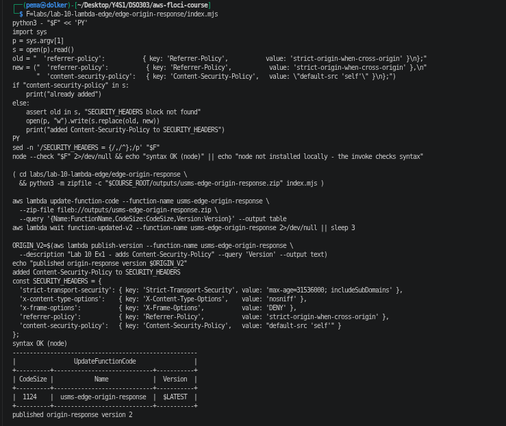
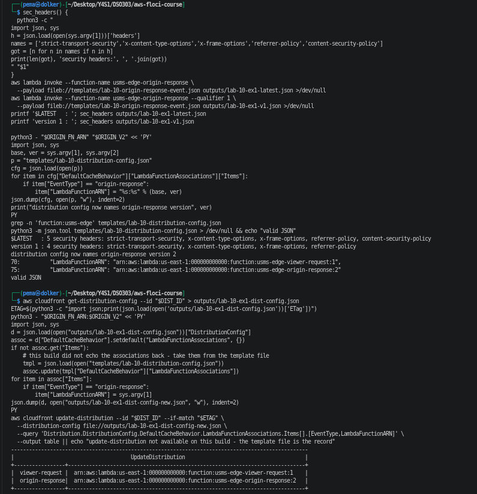
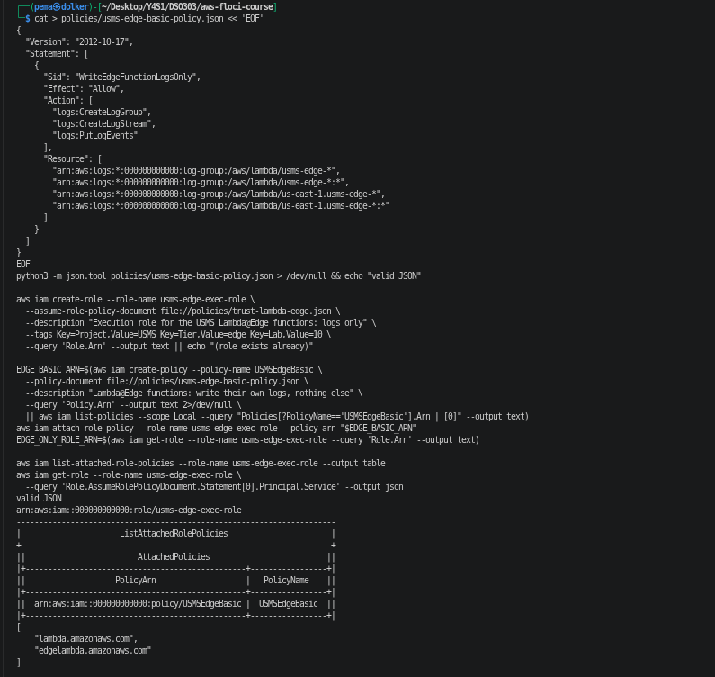
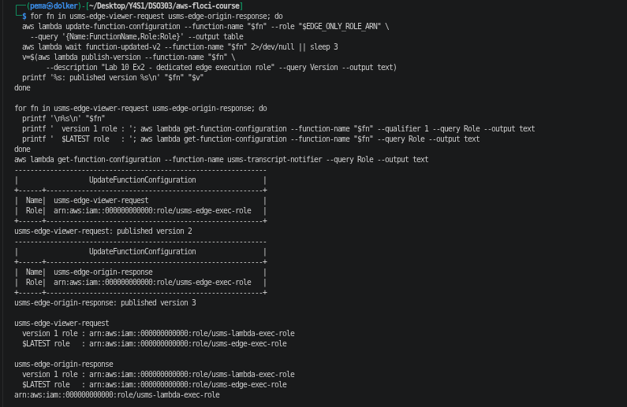
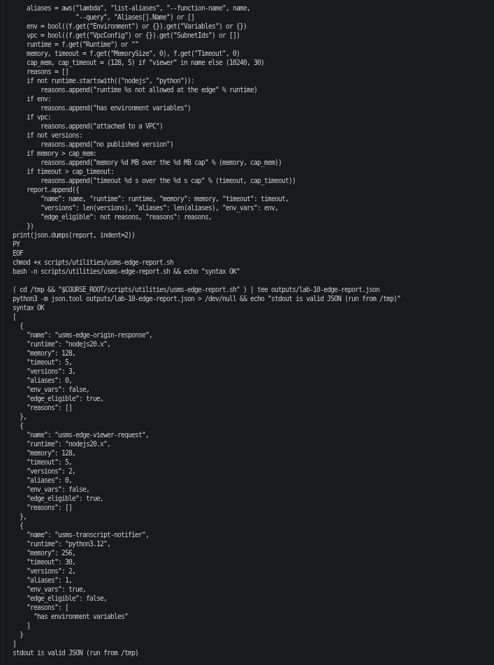
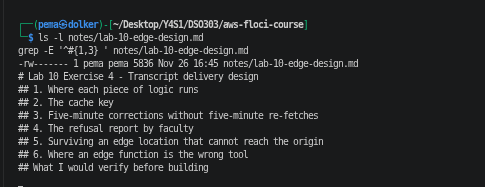
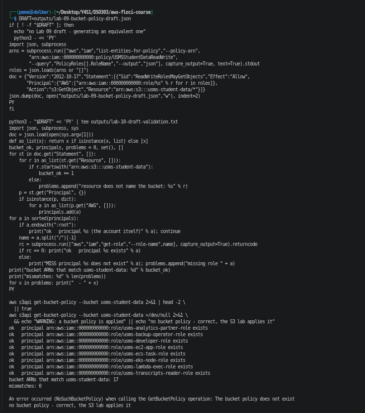
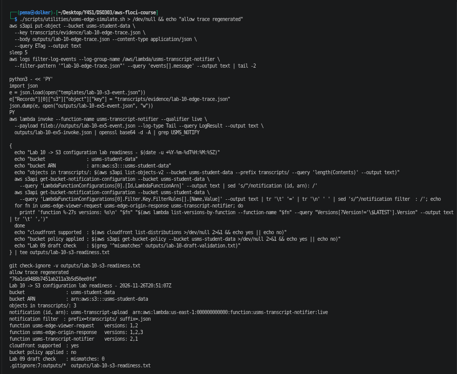

# Lab 10 Exercises

Command output for each exercise is in the screenshots.

## Exercise 1 - Basic: extend the security header set

Added `content-security-policy: default-src 'self'` as a fifth entry in the `SECURITY_HEADERS` object (no second block of code), rebuilt the zip, `update-function-code`, then `publish-version`, which gave a new version. Version 1 was not touched.

- `$LATEST` returns five security headers; `--qualifier 1` returns the original four. A version freezes the code, so the old edge release is still exactly what it was.
- `templates/lab-10-distribution-config.json` now names the new origin-response version. On Path A I also tried `update-distribution` with the ETag from `get-distribution-config`; that is the real-AWS way, because `update-distribution` replaces the whole config and needs `--if-match`.
- On real AWS this change would replicate to every edge location over several minutes; until then some locations serve 4 headers and some 5.

## Exercise 2 - Intermediate: a dedicated edge execution role

Created `usms-edge-exec-role` (reusing `policies/trust-lambda-edge.json` as it was) and `USMSEdgeBasic` from `policies/usms-edge-basic-policy.json`, which only allows `logs:CreateLogGroup/CreateLogStream/PutLogEvents` on `/aws/lambda/usms-edge-*` log groups (and their streams, the `:*` form). Repointed both edge functions at it and published new versions. `usms-lambda-exec-role` was not modified and the notifier still uses it.

One thing I added to the scoping: Lambda@Edge writes its logs in the region nearest the viewer, to a log group named `/aws/lambda/us-east-1.<function-name>` (the function's home region is put in front of the name). A policy scoped only to `/aws/lambda/usms-edge-*` in us-east-1 would miss those, so the resource list uses `arn:aws:logs:*:...` and includes the `us-east-1.usms-edge-*` form too. It still only covers edge function log groups.

**What happened to version 1's role.** Nothing. `--qualifier 1` still reports `usms-lambda-exec-role`; `$LATEST` and the new versions report `usms-edge-exec-role`. The role is part of the function's configuration, and a published version freezes configuration together with code. So rolling the distribution back to version 1 would also roll back to the broader role, which carries `s3:GetObject` on the student data. If the point of the change is least privilege, the old version has to be retired (no association points at it) and eventually deleted, not just superseded.

## Exercise 3 - Problem solving: an edge-readiness report

`scripts/utilities/usms-edge-report.sh` lists every `usms-` function with `list-functions` (no hard-coded list), then calls `list-versions-by-function` and `list-aliases` per function, and builds the JSON in Python. JSON goes to stdout, errors from failed calls go to stderr. It finds the repo root from `${BASH_SOURCE[0]}`, so it runs from any directory (I ran it from `/tmp` to check), and it reads `Environment` and `VpcConfig` with `.get(...) or {}` so a missing key is not an error.

Output: `outputs/lab-10-edge-report.json`. Both edge functions are `edge_eligible: true`. The notifier is `false`, and the report lists the reasons in a `reasons` array rather than just the boolean. Under the rules as given (non-viewer cap of 10240 MB and 30 s), its environment variables are the blocking reason. The second independent reason the handout expects is that the notifier is built for a different job altogether: it is triggered by S3 through an alias, and an alias can never be associated with CloudFront. If the caps were the origin-trigger caps the handout's checks assume, it also sits at the limit (30 s), so any timeout increase would make it ineligible a second way.

## Exercise 4 - Challenge: transcript delivery policy

Written in `notes/lab-10-edge-design.md`.

## Exercise 5 - Integration: hand the S3 lab a bucket

1. `outputs/lab-09-bucket-policy-draft.json` exists from Lab 09 Exercise 5, so nothing was generated.
2. Validated it in Python: every `Resource` must start with `arn:aws:s3:::usms-student-data`, every role principal must answer `iam get-role`, and the account root is accepted as the account. Result in `outputs/lab-10-draft-validation.txt` (mismatches reported, not fixed).
3. Not applied: `get-bucket-policy` fails with `NoSuchBucketPolicy`, which is correct.
4. Uploaded the allow trace to `transcripts/evidence/lab-10-edge-trace.json`, checked the notifier's log group, and also invoked `live` directly with an S3 event naming that key; the decoded log has the `USMS_NOTIFY` line for it.
5. `outputs/lab-10-s3-readiness.txt` is produced by one `{ ...; } | tee` block, so it can be regenerated at any time, and `git check-ignore -v` shows it is covered by `outputs/*`.

