# Lab 11 Exercises

Command output for each exercise is in the screenshots.

## Exercise 1 - Basic: a second build project for the results service

Created `labs/lab-11-cicd/app-results/` with `VERSION` (r1), `src/index.html` and its own `buildspec.yml` (service name `results`), tested it with the local runner, uploaded it to `source/usms-results-src.zip`, and created `usms-results-build` from a copy of the Lab 11 project template where only `name`, `description`, `source.location`, `artifacts.name`, the log group and the `USMS_SERVICE` variable change (`templates/lab-11-ex1-results-project.json`). Same role, `usms-codebuild-role`. Source type `S3`, so it runs standalone.

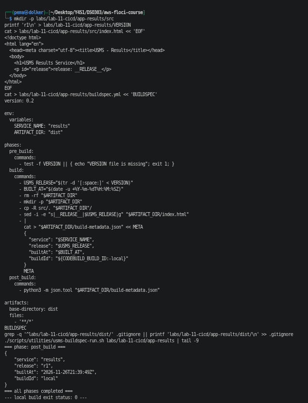
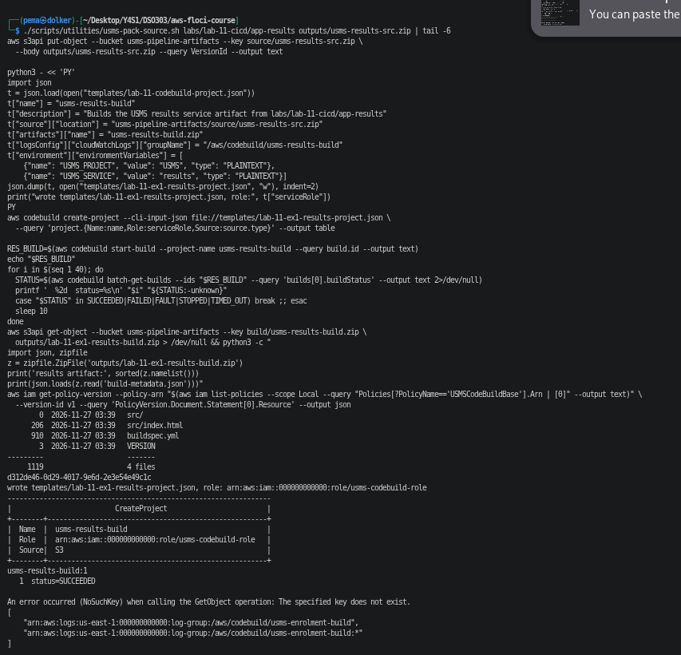

Locally, `build-metadata.json` says `"service": "results"`, so it is easy to tell apart from the enrolment build. In CodeBuild the build was `SUCCEEDED` straight away, but downloading `build/usms-results-build.zip` gave `NoSuchKey`. Floci records builds without running them, so there is no artifact (see the report, Steps 9 to 13).

**Does `USMSCodeBuildBase` already permit this build?** Not completely. The S3 part is fine because it covers the whole `usms-pipeline-artifacts` bucket, but the logs statement only names `/aws/codebuild/usms-enrolment-build`. On real AWS this build would fail to create its log stream in `/aws/codebuild/usms-results-build`. It works here only because Floci does not enforce IAM. The fix would be a policy version that adds the second log group, or a role per project. I did not create that version, because Lab 12 publishes v2 of this policy and its verify script expects the default to be exactly v2.

## Exercise 2 - Intermediate: a `finally` block and a build report

`post_build` now runs the smoke tests as `SMOKE_RC=0; bash tests/smoke.sh || SMOKE_RC=$?`, writes the code to `/tmp/usms-smoke-rc` and ends with `test "$SMOKE_RC" -eq 0`, so the phase still fails when a test fails. A `finally` block (sibling of `commands`) writes `dist/build-summary.txt` with the release, the test exit code and the time.

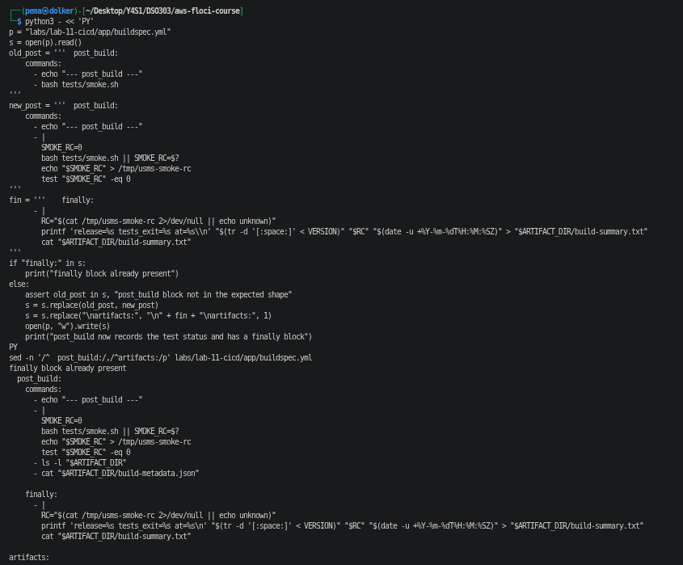
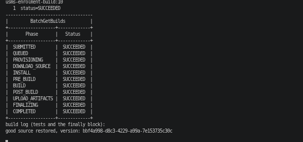
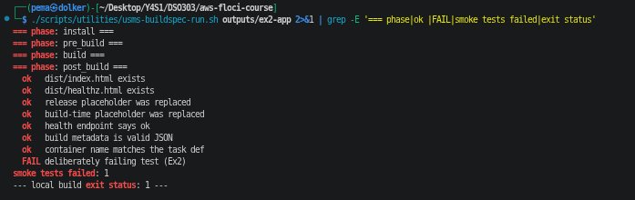

**How I tested it.** I made a copy of the app in `outputs/ex2-app/` (the real source was not touched) and added a deliberately failing test (`t "..." "false"`) to the copy.

- **In CodeBuild:** Floci ignored `--source-location-override`, so I uploaded the broken copy to the project's own source key for one build (`usms-enrolment-build:10`) and put the good source back straight after. Floci said `SUCCEEDED` for every phase, the log stream was empty and there was no artifact, so no `build-summary.txt`. The broken test never ran.
- **Locally:** the local runner on the same copy fails in `post_build`. It shows `FAIL deliberately failing test (Ex2)` and `smoke tests failed: 1`, and exits 1, so the `SMOKE_RC` change still fails the phase.

**What this claim covers.** I can claim only that `post_build` fails when a test fails, and only locally. I cannot claim the `finally` block ran: the local runner does not implement `finally`, and Floci did not run the build. On real AWS, CodeBuild runs `finally` after the failed `commands`, writes `build-summary.txt` with `tests_exit=1`, and the build still ends `FAILED`. `finally` does not rescue a build; it only makes sure the summary exists. Whether the summary is then uploaded depends on CodeBuild's artifact upload after a failed phase, which I could not observe here.

## Exercise 3 - Problem solving: a robust configuration check

Replaced the `grep -q '"container": "enrolment-api"'` check with a one-line Python check that parses the JSON and exits with `config/service.json names container 'X', expected 'enrolment-api'`. Standard library only.

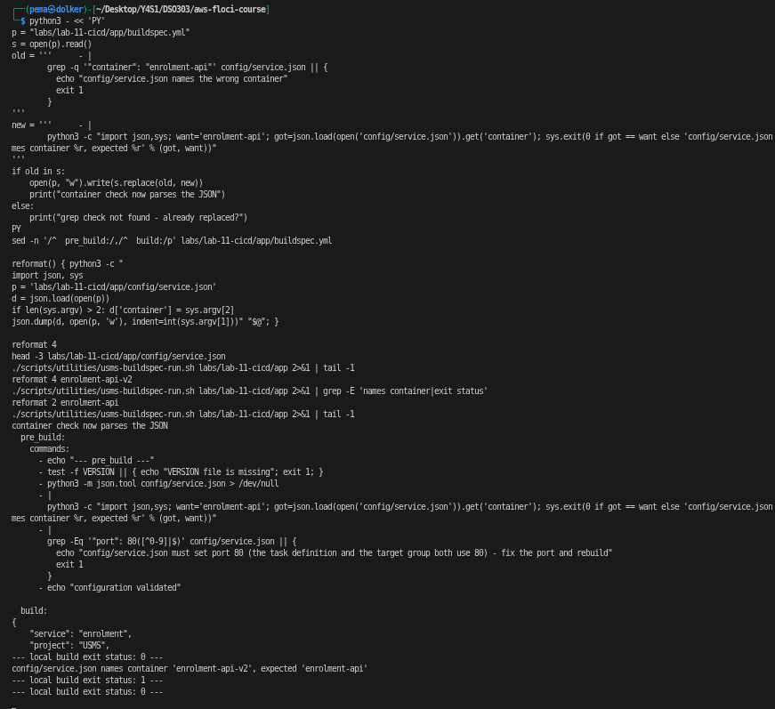
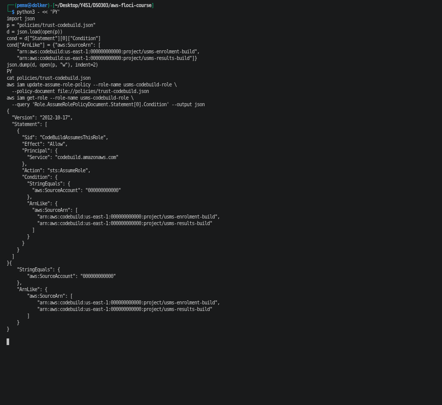

- Re-formatted `service.json` with 4-space indentation: the build still passes.
- Changed the container to `enrolment-api-v2`: the build fails and the message names both values.
- Restored it to 2-space indentation and the right name.

Trust policy: `policies/trust-codebuild.json` now has `aws:SourceAccount` **and** `ArnLike aws:SourceArn` listing the two project ARNs (`usms-enrolment-build`, `usms-results-build`), applied with `update-assume-role-policy`.

**What `aws:SourceArn` closes that `aws:SourceAccount` does not.** `aws:SourceAccount` stops CodeBuild projects in other accounts from assuming the role. It does nothing about other projects in **this** account. Anyone here who can create a CodeBuild project and pass this role (for example a developer with a broad PassRole) could create their own project, run their own buildspec, and get the build role's permissions, including writing to the pipeline's artifact bucket, which is the input to deployment. With `aws:SourceArn`, CodeBuild may only assume the role on behalf of the two named projects.

## Exercise 4 - Challenge: trigger the pipeline without polling

Design: S3 sends object events to EventBridge (bucket setting `EventBridgeConfiguration: {}`); an EventBridge rule matches `source: aws.s3`, `detail-type: Object Created`, bucket `usms-pipeline-artifacts`, key exactly `source/usms-enrolment-src.zip`; its target is the pipeline ARN with a role EventBridge assumes to call `codepipeline:StartPipelineExecution`.

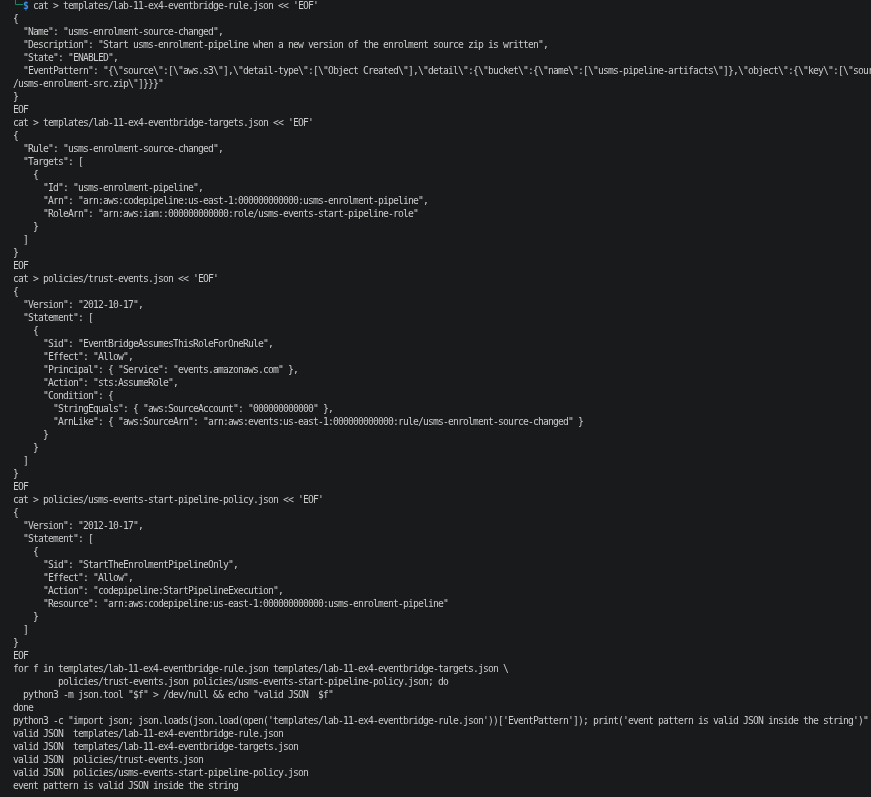
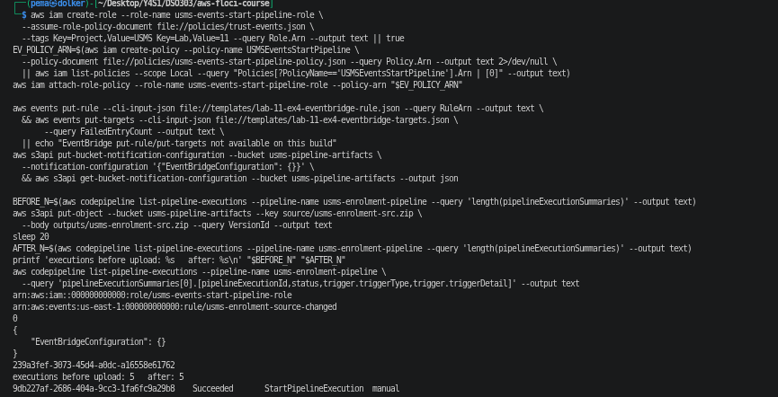

- Documents: `templates/lab-11-ex4-eventbridge-rule.json`, `templates/lab-11-ex4-eventbridge-targets.json`, `policies/trust-events.json`, `policies/usms-events-start-pipeline-policy.json`, all valid JSON (the event pattern is itself JSON inside a string, checked separately).
- **The target role.** `usms-events-start-pipeline-role`, trusted by `events.amazonaws.com` only for this rule (`aws:SourceArn`) in this account, allowed `codepipeline:StartPipelineExecution` on this one pipeline and nothing else. It is not the pipeline role: the pipeline role is what the pipeline runs as (S3, CodeBuild, PassRole); this role only needs to press the start button. Giving EventBridge the pipeline role would let a rule do everything the pipeline can do.
- **Two ways S3 events reach EventBridge.** The bucket's own EventBridge notification (used here) sends `Object Created` for every PutObject, including a new version of a versioned object. The older way is CloudTrail data events, which arrive as `AWS API Call via CloudTrail` with `eventName: PutObject` and need a trail with S3 data events enabled for the bucket (an extra cost). That CloudTrail dependency is what the console sets up when you pick "Amazon CloudWatch Events" for an S3 source.
- **What ran:** I uploaded a new version of the source and compared the number of executions before and after: the rule and target were stored but the upload did not start an execution (executions 5 -> 5). Either way the documents are the deliverable, and on real AWS the same rule and target work as written.

## Exercise 5 - Integration: the deployment contract for Lab 12

The `build` phase now writes `dist/imagedefinitions.json` with one Python line: the container name comes from `config/service.json` (not typed twice) and the image from `IMAGE_URI`, defaulting to `public.ecr.aws/nginx/nginx:stable-alpine`, the image Lab 04's task definition uses. It is always a JSON **array**. `tests/smoke.sh` got an eighth assertion that checks it is a one-element array naming `enrolment-api`.

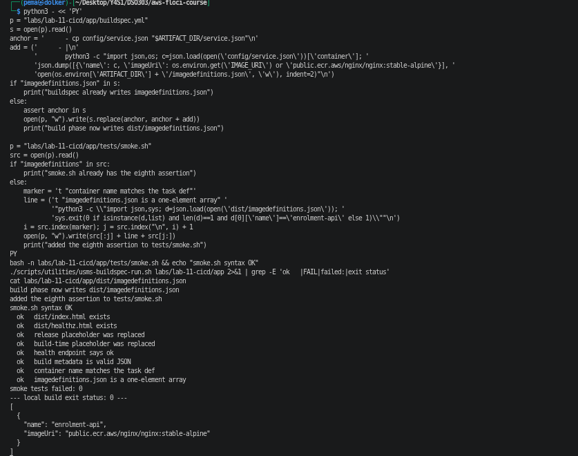
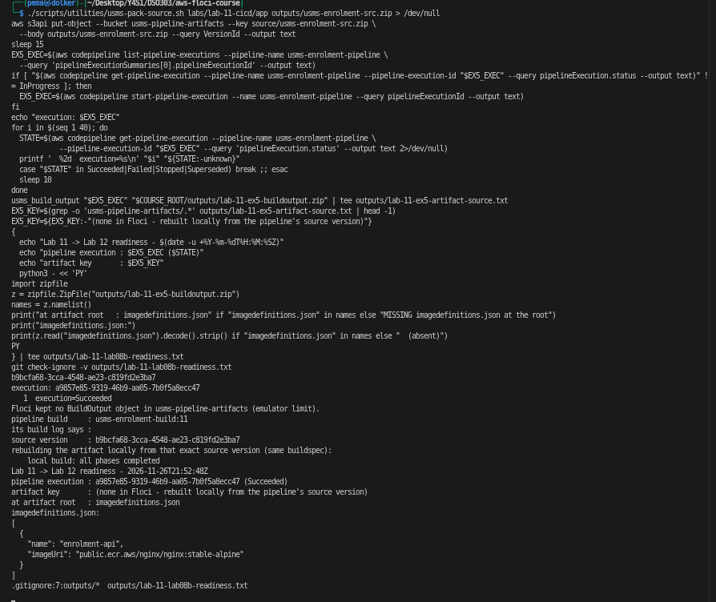

I ran the pipeline (`Succeeded`). Floci stored no BuildOutput object, so I rebuilt the artifact locally from the exact source version the pipeline was given, with the same buildspec, and confirmed `imagedefinitions.json` is at the root (not under `dist/`). The file's contents and the source of the artifact (rebuilt locally, not from S3) are in `outputs/lab-11-lab08b-readiness.txt`, which Lab 12 Step 1 reads; it is git-ignored.
