# AWS Practical Laboratory 11 Report

**Student Name:** Pema Dolker 
**Module:** DSO303  
**Practical:** Lab 11 - CI/CD Pipeline with AWS CodePipeline and CodeBuild  
**Environment:** Floci (local AWS API emulator, Docker Compose, hybrid storage), account 000000000000, us-east-1

**Support path:** A (from `scripts/utilities/cicd-support-probe.sh`). Floci runs every CodeBuild build in a real Docker container, using the project's image by name. `aws/codebuild/standard:7.0` is AWS's own curated image and is not on any public registry, so I tagged a local image with that name (python:3.12-slim tagged locally as aws/codebuild/standard:7.0). The project definition is exactly as the handout wrote it.

Step notes and the seven review questions are in `notes/lab-11-notes.md`, and the five exercises are in `labs/lab-11-cicd/exercises.md`.

> Labels used below:
> **Observed** = I ran it and saw it.
> **Floci limitation** = behaved differently from real AWS.
> **Conceptual** = only possible on real AWS, so I explained it instead.

## 1. Aim / Objective

The aim of this practical is to set up continuous integration for the USMS enrolment service. I replaced Lab 04's placeholder image with a real source tree (a static portal, a health page, a validated configuration file, smoke tests and a `buildspec.yml`), created a versioned artifact bucket, a CodeBuild project with its own role, and a two-stage pipeline (Source from S3, Build in CodeBuild) with a separate role. Then I proved the pipeline really used my source by changing one byte and reading it back out of the build artifact, broke the build on purpose and traced the failure to one command.

## 2. Introduction

CI/CD turns "a person builds and copies files" into a repeatable process. **CodeBuild** runs a build in a fresh container from a `buildspec.yml` with four phases (install, pre_build, build, post_build) and hands the listed files on as an artifact. **CodePipeline** chains stages; each stage contains actions, and stages only pass work to each other through artifacts stored in S3.

The main ideas I used:

- **buildspec phases** - a failure in a phase stops the build; `artifacts.base-directory` decides what the next stage receives.
- **Artifacts and the artifact store** - every stage output is a zip in the pipeline's bucket, so the data flow is visible.
- **S3 versioning** - every upload of the source gets a version ID, which makes each run traceable to exact bytes.
- **Separate service roles** - CodeBuild and CodePipeline each get only what their job needs.
- **`iam:PassRole`** - the pipeline may hand `usms-codebuild-role` to `codebuild.amazonaws.com` and nothing else, so it cannot escalate.
- **Heredoc quoting** - `<< 'BUILDSPEC'` writes text exactly; the nested `<< META` inside it is unquoted so the build expands the variables later.

I used S3 as the source because CodeCommit has been closed to new customers since July 2024.

## 3. Use Case

- Building the enrolment portal the same way every time, with the release number and build time stamped into it.
- Stopping a bad configuration in `pre_build`, before anything is built or deployed.
- Proving to an auditor which source version a given artifact came from.
- Giving the build and the pipeline separate, narrow identities so a compromised build cannot touch student records.

## 4. System Architecture / Design

```text
 labs/lab-11-cicd/app  --usms-pack-source.sh-->  s3://usms-pipeline-artifacts/source/usms-enrolment-src.zip
                                                  (versioned: r3, r4, r5 ...)
                                                        |
 usms-enrolment-pipeline  (role usms-codepipeline-role, PassRole -> codebuild only)
   Source  (S3)        --> SourceOutput/<zip>
   Build   (CodeBuild) --> usms-enrolment-build (role usms-codebuild-role)
                             install > pre_build (VERSION, JSON, container, port 80)
                             > build (dist/, release + time stamped, build-metadata.json)
                             > post_build (8 smoke tests)
                        --> BuildOutput/<zip>  = contents of dist/
   logs: /aws/codebuild/usms-enrolment-build
 USMSCodeBuildBase: own logs, artifact bucket, explicit Deny s3:* on usms-student-data
```


## 5. Implementation Procedure

1. **Steps 1 to 4** - started Floci, sourced ten env files, ran the CI/CD support probe and created the directories.
2. **Steps 5 and 6** - created the artifact bucket with versioning and a public access block, and proved versioning with two versions at one key.
3. **Steps 7 and 8** - wrote the source tree and `buildspec.yml`, and added a port check to `pre_build`.
4. **Steps 9 and 10** - created the CodeBuild role and policy, the project from a template, and the local stand-in for the build image.
5. **Steps 11 to 13** - packaged and uploaded the source, ran a standalone build, read its phases, logs and artifact.
6. **Step 14** - wrote the local buildspec runner and used it to test the build, including the port check failing on 8080.
7. **Steps 15 to 18** - created the pipeline role and policy, the pipeline definition and the pipeline, and switched the project to `CODEPIPELINE`.
8. **Steps 19 and 20** - ran releases r4 and r5 through the pipeline, read the release back out of the artifact, broke the build, diagnosed it to the phase and command, and fixed it.
9. **Step 21, Section 8, Exercises** - wrote `configs/lab-11.env`, the verify and cleanup scripts, did Exercises 1 to 5 and committed.

## 6. Results and Evidence

### 6.1 CLI Output

**Steps 1 to 4 - environment and support probe**

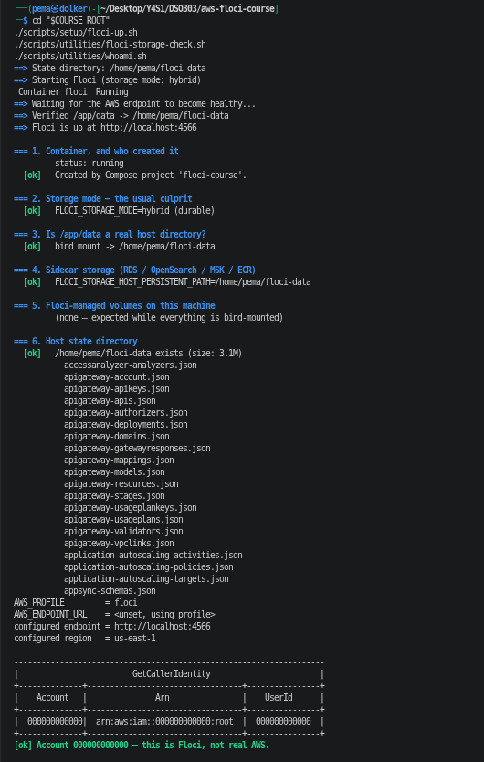


**Observed:** support path A, recorded in `outputs/lab-11-support-probe.txt`. The probe creates and deletes a throwaway project.

**Steps 5 and 6 - artifact bucket and versioning**

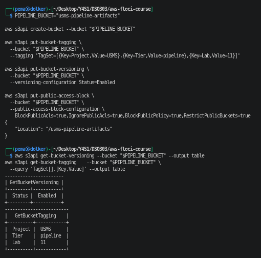
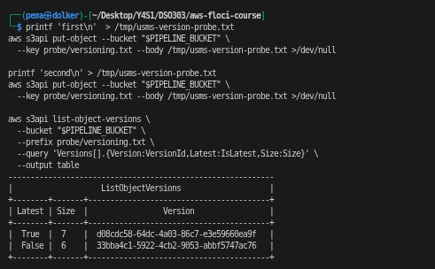


**Observed:** versioning `Enabled`, three tags, public access blocked. Two puts to one key gave two version IDs, one `IsLatest`. The probe versions were then deleted by version ID, leaving 0.

**Steps 7 and 8 - source tree and buildspec**


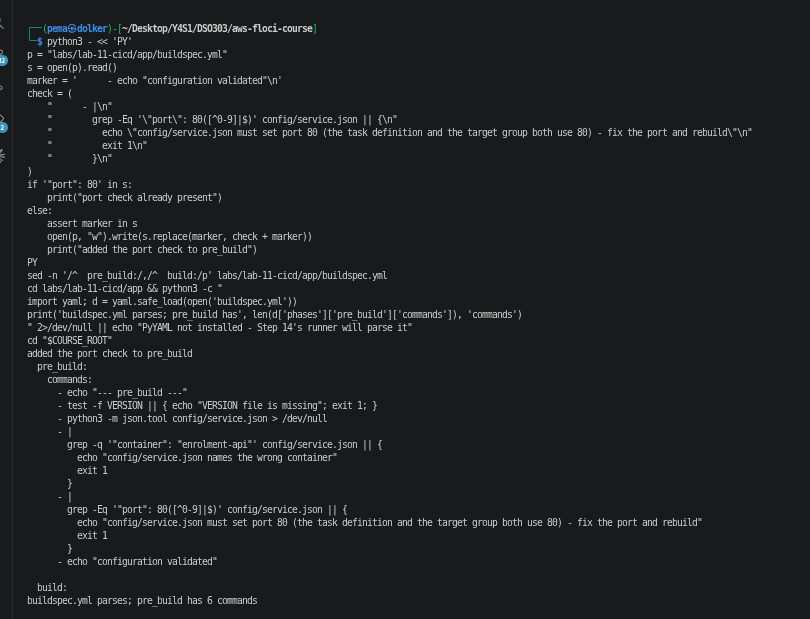

**Observed:** the buildspec parses with four phases. For the port check I used `grep -Eq '"port": 80([^0-9]|$)'`, because a plain `"port": 80` would also match `"port": 8080`, which is exactly the value the test uses.

**Steps 9 to 13 - CodeBuild**

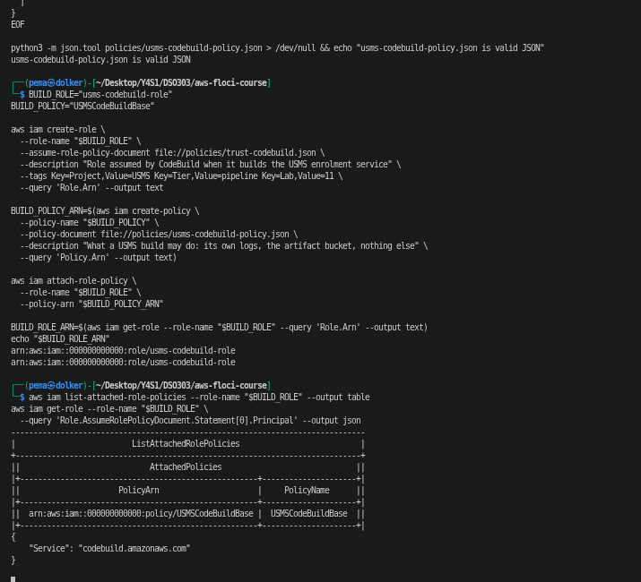

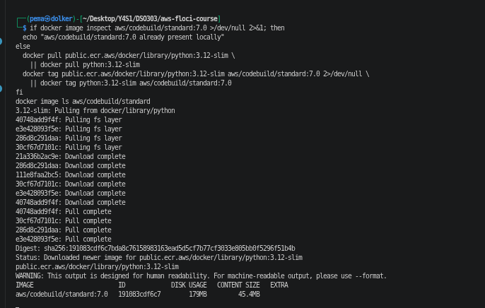


**Observed:** the project template had zero unexpanded `$`, so the role ARN was really substituted. The standalone build finished with status SUCCEEDED; the phases table, the log lines and the artifact under `build/` are in the screenshots. **Floci limitation:** builds start instantly and cost nothing, and the build image is a small stand-in (Python on Debian), not the full Ubuntu CodeBuild image.

**Step 14 - local runner**


**Observed:** all phases ran locally, seven smoke tests passed, `build-metadata.json` says `buildId: local`, and `dist/` is git-ignored. With port 8080 the build stopped in `pre_build` with my message; with 80 it passed again.

**Steps 15 to 18 - the pipeline**


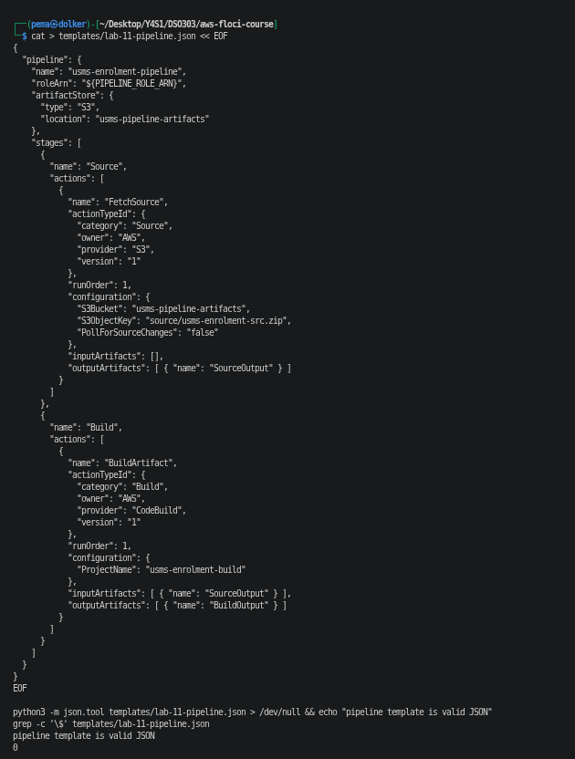
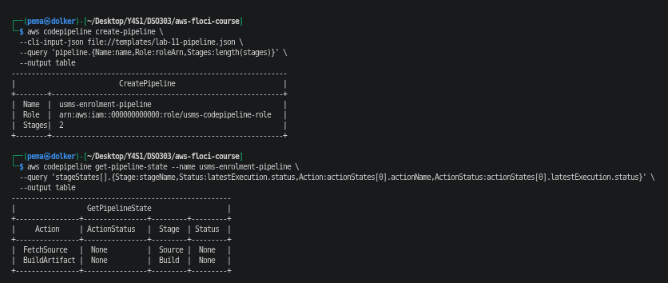
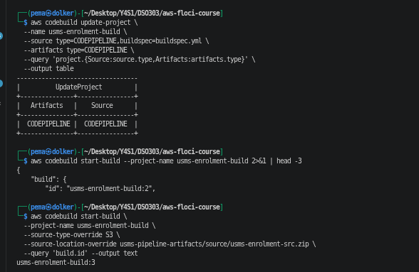

**Observed:** two stages from a validated document. After `update-project` the source and artifacts are `CODEPIPELINE`, and a plain `start-build` is refused because the project no longer has a source of its own; only the pipeline (or an explicit source override) can start it.

**Step 19 - prove the pipeline used my source**


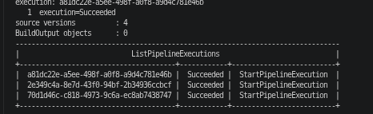

**Observed:** the r4 execution finished as Succeeded and the newest `BuildOutput` zip contains `build-metadata.json` with release r4: create, perturb, read back. For the r5 "Your turn" there were 4 versions of the source zip and 0 objects under `BuildOutput/`. The two numbers are not the same thing: a source version exists for every upload, a BuildOutput object only for every execution that got through Build. An upload that nobody runs (polling is off) adds a version but no artifact, and a failed build adds an execution but no artifact.

**Step 20 - deliberate failure**


**Observed:** with the container renamed to `enrolment-api-v2` the Build stage failed, and `batch-get-builds` named `PRE_BUILD` as the failed phase: stage → build → phase → command. After restoring the name the local runner passed and the pipeline ran again (Succeeded).

**Step 21 and Section 8**


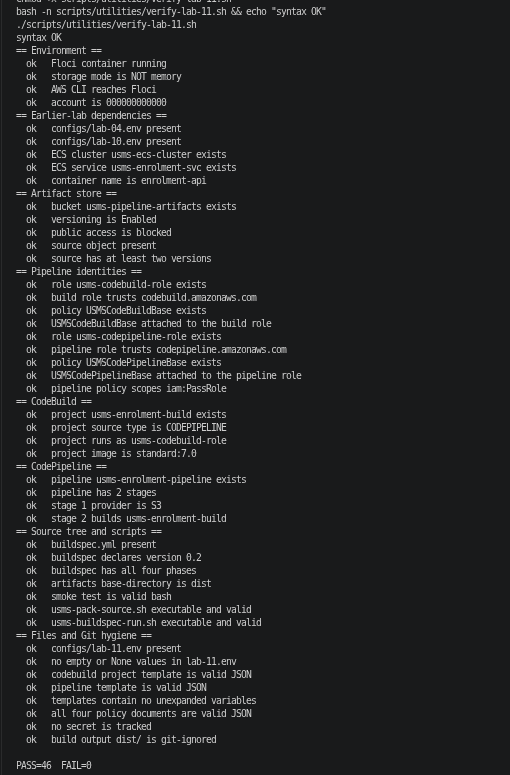
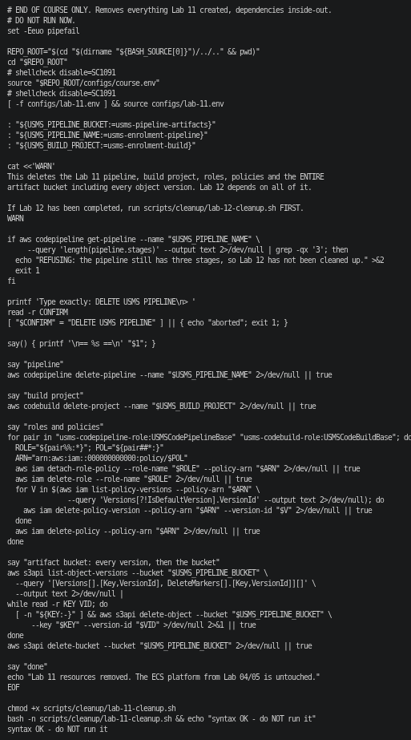

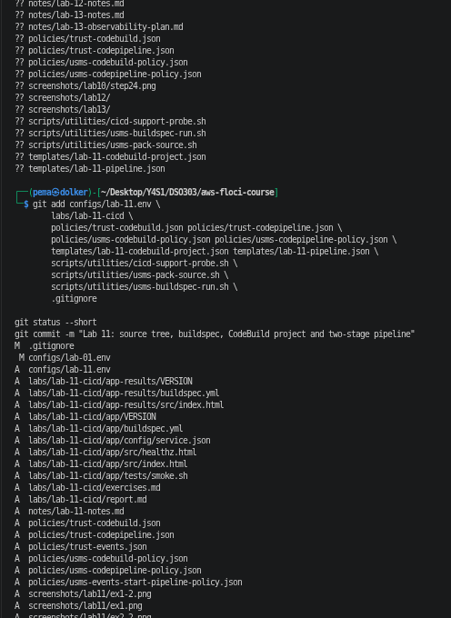

**Observed:** `configs/lab-11.env` has 26 exports, all populated. `verify-lab-11.sh` first run: PASS=46  FAIL=0; after the exercises: PASS=46  FAIL=0. The cleanup script is written but not run.

### 6.2 AWS Management Console Verification

Floci has no web console. The `batch-get-builds`, `get-pipeline-state` and `list-object-versions` output above is the verification.

## 7. Analysis and Discussion

The objectives were achieved: a versioned source, a build with validation and smoke tests, a pipeline that joins them, and proof from inside the artifact that a change in the source reached the output.

The most useful idea was proving the pipeline worked by reading the artifact, not the status. A green Build stage only says the commands exited 0. Reading `release: r4` out of the newest BuildOutput zip proves my bytes went through. In Step 20 the same chain worked backwards: the pipeline said Build failed, `batch-get-builds` said PRE_BUILD, and the log named the container check.

What I observed versus only recorded: I **observed** the zip layout, the four phases, smoke tests passing and failing, an artifact naming my release, a `pre_build` failure, and several versions at one key. I **recorded but could not see enforced**: the build role's scoping, the explicit `Deny` on student data, the scoped `iam:PassRole`, and the single project ARN; Floci does not evaluate IAM. Not available: build reports, approvals, KMS-encrypted artifacts and billing.

Problems I ran into and how I fixed them:

- **The build image.** Floci pulls `aws/codebuild/standard:7.0` by name and it does not exist on Docker Hub. Tagging a local Python image with that name lets the container start without changing the project.
- **The port check.** The obvious grep would have passed 8080; the pattern needs a non-digit after 80.
- **Waiting for the pipeline.** The handout waits a fixed 20 seconds in Step 20; on my laptop a build takes longer, so I polled the execution until it finished before reading the state.

## 8. Reflection

**What I learned.** I had only used CI tools that hide the artifacts. Seeing SourceOutput and BuildOutput as real objects in a bucket made it clear that a pipeline is just stages passing zips. I also understood `iam:PassRole` properly for the first time: being allowed to create something is different from being allowed to choose whose identity it runs with.

**Challenges.** The difference between quoted and unquoted heredocs, nested inside a YAML file, written by a bash heredoc. Getting one wrong gives no error, just a wrong file.

**Real world use.** I would use the explicit `Deny` pattern on real build roles, trigger the pipeline from EventBridge instead of polling, and add KMS encryption to the artifact store. For DevOps on our Semzung project this is the shape of the pipeline I would set up.

**What I want to explore more.** CodeBuild test reports, and CodePipeline V2 triggers with git branch filters.

## 9. Conclusion

The objectives were achieved. USMS now has a real enrolment source tree, a versioned artifact bucket, a CodeBuild project with its own role and a two-stage pipeline with a scoped `iam:PassRole`. A release change was traced from the source upload to the artifact, a deliberate configuration error was stopped in `pre_build` and traced to the exact command, and the pipeline was green again after the fix.

Key ideas: a pipeline is stages passing artifacts through S3; a status is not proof, the artifact is; versioning makes every run traceable to exact bytes; and the build and pipeline roles are kept separate and narrow.

## 10. Appendix

- Notes and review questions: `notes/lab-11-notes.md`; exercises: `labs/lab-11-cicd/exercises.md`
- Source and build: `labs/lab-11-cicd/app/` (`VERSION`, `src/`, `config/service.json`, `tests/smoke.sh`, `buildspec.yml`), `labs/lab-11-cicd/app-results/` (Exercise 1)
- Policies: `policies/trust-codebuild.json`, `usms-codebuild-policy.json`, `trust-codepipeline.json`, `usms-codepipeline-policy.json`, `trust-events.json`, `usms-events-start-pipeline-policy.json`
- Templates: `templates/lab-11-codebuild-project.json`, `lab-11-pipeline.json`, `lab-11-ex1-results-project.json`, `lab-11-ex4-eventbridge-*.json`
- Scripts: `scripts/utilities/cicd-support-probe.sh`, `usms-pack-source.sh`, `usms-buildspec-run.sh`, `verify-lab-11.sh`, `scripts/cleanup/lab-11-cleanup.sh` (not run)
- Recorded values: `configs/lab-11.env`; screenshots: `screenshots/lab11/`
- Git-ignored: source and artifact zips, build JSON, pipeline state, `outputs/lab-11-lab08b-readiness.txt`
