# AWS Practical Laboratory 11 Report

**Student Name:** Pema Dolker 
**Module:** DSO303  
**Practical:** Lab 11 - CI/CD Pipeline with AWS CodePipeline and CodeBuild  
**Environment:** Floci (local AWS API emulator, Docker Compose, hybrid storage), account 000000000000, us-east-1

**Support path:** A (from `scripts/utilities/cicd-support-probe.sh`). Both the CodeBuild and CodePipeline APIs exist in Floci 2.2.0, so I followed every step as written.

**Floci limitation (the important one):** Floci records builds and pipeline runs but does not actually run the buildspec. Every build went straight to `SUCCEEDED` with 0-second phases, an empty log stream and no artifact in S3, including builds of source I had broken on purpose (Step 20 and Exercise 2). So in this report "CodeBuild said SUCCEEDED" only means Floci accepted the call. Everything about what the buildspec really did comes from Step 14's local runner and is written as "passed locally" or "failed locally", as the handout asks. I still tagged `python:3.12-slim` as `aws/codebuild/standard:7.0`, so the project definition is exactly as the handout wrote it.

Step notes and the seven review questions are in `notes/lab-11-notes.md`, and the five exercises are in `labs/lab-11-cicd/exercises.md`.

> Labels used below:
> **Observed** = I ran it and saw it.
> **Floci limitation** = behaved differently from real AWS.
> **Conceptual** = only possible on real AWS, so I explained it instead.

## 1. Aim / Objective

The aim of this practical is to set up continuous integration for the USMS enrolment service. I replaced Lab 04's placeholder image with a real source tree (a static portal, a health page, a validated configuration file, smoke tests and a `buildspec.yml`), created a versioned artifact bucket, a CodeBuild project with its own role, and a two-stage pipeline (Source from S3, Build in CodeBuild) with a separate role. Then I traced a release from the source upload to the build output and broke the build on purpose to see where the failure shows up.

## 2. Introduction

CI/CD turns "a person builds and copies files" into a repeatable process. **CodeBuild** runs a build in a fresh container from a `buildspec.yml` with four phases (install, pre_build, build, post_build) and hands the listed files on as an artifact. **CodePipeline** chains stages; each stage contains actions, and stages only pass work to each other through artifacts stored in S3.

The main ideas I used:

- **buildspec phases** - a failure in a phase stops the build; `artifacts.base-directory` decides what the next stage receives.
- **Artifacts and the artifact store** - every stage output is a zip in the pipeline's bucket, so the data flow is visible.
- **S3 versioning** - every upload of the source gets a version ID, which makes each run traceable to exact bytes.
- **Separate service roles** - CodeBuild and CodePipeline each get only what their job needs.
- **`iam:PassRole`** - the pipeline may hand `usms-codebuild-role` to `codebuild.amazonaws.com` and nothing else, so it cannot escalate.
- **Heredoc quoting** - `<< 'BUILDSPEC'` writes text exactly; the nested `<< META` inside it is unquoted so the build expands the variables later.

I used S3 as the source because CodeCommit has been closed to new customers since July 2024.

## 3. Use Case

- Building the enrolment portal the same way every time, with the release number and build time stamped into it.
- Stopping a bad configuration in `pre_build`, before anything is built or deployed.
- Proving to an auditor which source version a given artifact came from.
- Giving the build and the pipeline separate, narrow identities so a compromised build cannot touch student records.

## 4. System Architecture / Design

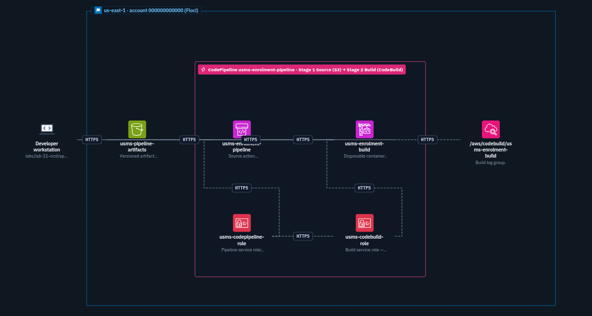

## 5. Implementation Procedure

1. **Steps 1 to 4** - started Floci, sourced ten env files, ran the CI/CD support probe and created the directories.
2. **Steps 5 and 6** - created the artifact bucket with versioning and a public access block, and proved versioning with two versions at one key.
3. **Steps 7 and 8** - wrote the source tree and `buildspec.yml`, and added a port check to `pre_build`.
4. **Steps 9 and 10** - created the CodeBuild role and policy, the project from a template, and the local stand-in for the build image.
5. **Steps 11 to 13** - packaged and uploaded the source, ran a standalone build, and checked its phases, log stream and artifact.
6. **Step 14** - wrote the local buildspec runner and used it to test the build, including the port check failing on 8080.
7. **Steps 15 to 18** - created the pipeline role and policy, the pipeline definition and the pipeline, and switched the project to `CODEPIPELINE`.
8. **Steps 19 and 20** - ran releases r4 and r5 through the pipeline, read the release back out of the build output (rebuilt locally from the exact source version, because Floci stored no artifact), broke the build on purpose, compared what Floci reported with what the local runner reported, and fixed it.
9. **Step 21, Section 8, Exercises** - wrote `configs/lab-11.env`, the verify and cleanup scripts, did Exercises 1 to 5 and committed.

## 6. Results and Evidence

### 6.1 CLI Output

**Steps 1 to 4 - environment and support probe**

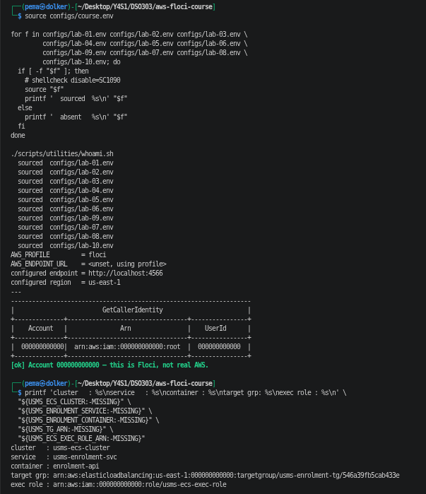
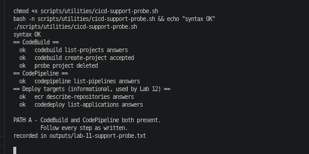
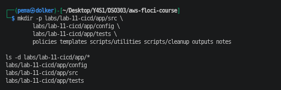

**Observed:** support path A, recorded in `outputs/lab-11-support-probe.txt`. The probe creates and deletes a throwaway project.

**Steps 5 and 6 - artifact bucket and versioning**

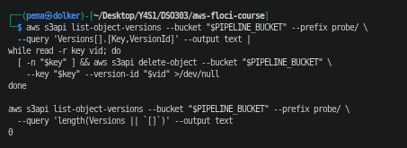

**Observed:** versioning `Enabled`, three tags, public access blocked. Two puts to one key gave two version IDs, one `IsLatest`. The probe versions were then deleted by version ID, leaving 0.

**Steps 7 and 8 - source tree and buildspec**

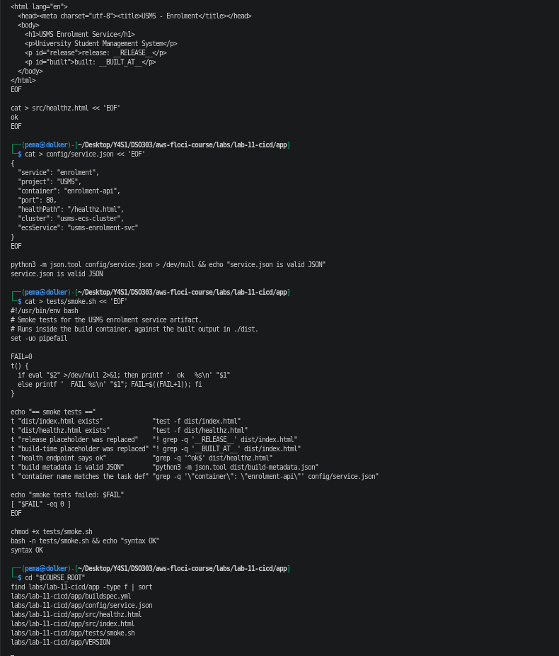
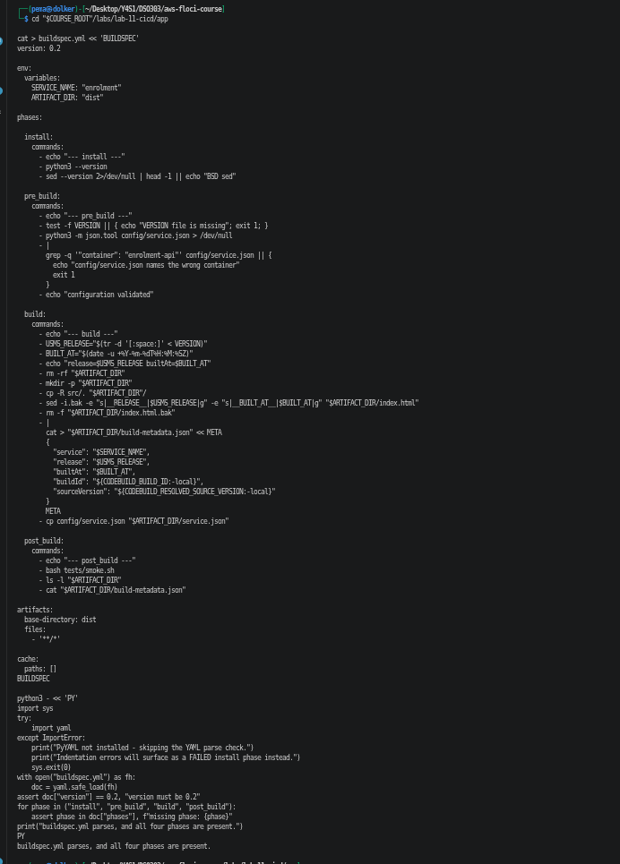

**Observed:** the buildspec parses with four phases. For the port check I used `grep -Eq '"port": 80([^0-9]|$)'`, because a plain `"port": 80` would also match `"port": 8080`, which is exactly the value the test uses.

**Steps 9 to 13 - CodeBuild**

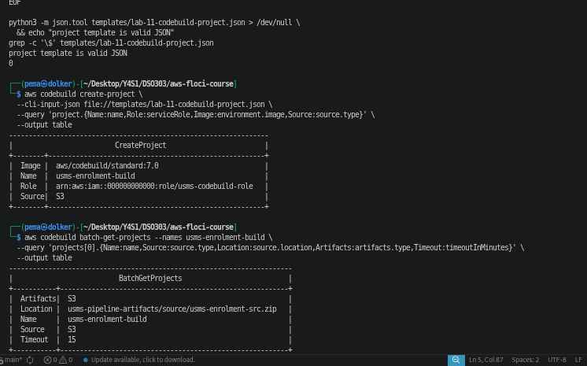

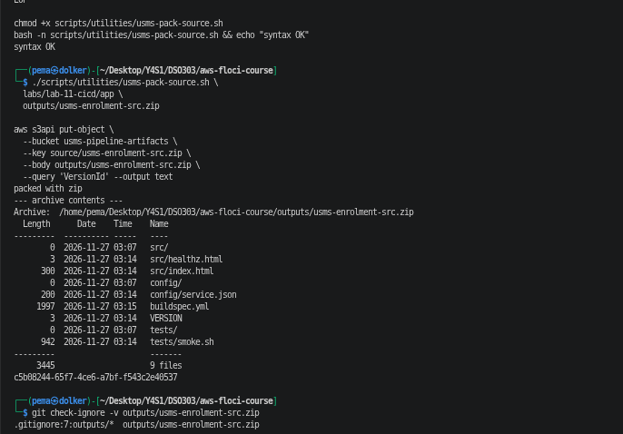
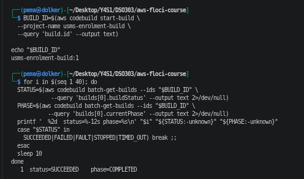
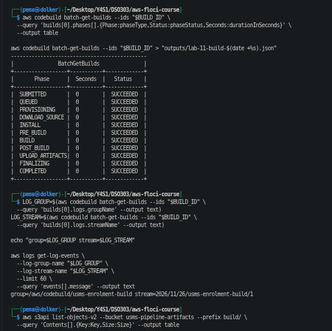

**Observed:** the project template had zero unexpanded `$`, so the role ARN was really substituted. The standalone build `usms-enrolment-build:1` was `SUCCEEDED` on the first poll, with every phase `SUCCEEDED` in 0 seconds. The log group and stream names came back (`/aws/codebuild/usms-enrolment-build`, `.../1`), but the stream had no events, and there was nothing under `build/` in the bucket.

**Floci limitation:** that is not what a real build looks like. A real one takes at least tens of seconds in PROVISIONING alone, writes its commands to the log, and uploads `build/usms-enrolment-build.zip`. Floci only records that a build happened. The handout warns that log streams are often empty here; the missing artifact and the 0-second phases show the buildspec never ran at all. That is why Step 14 matters.

**Step 14 - local runner**

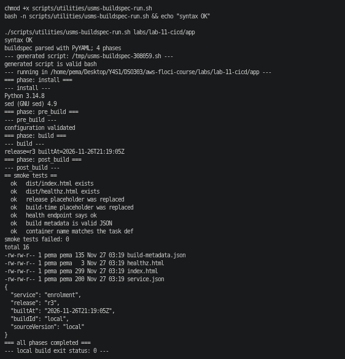
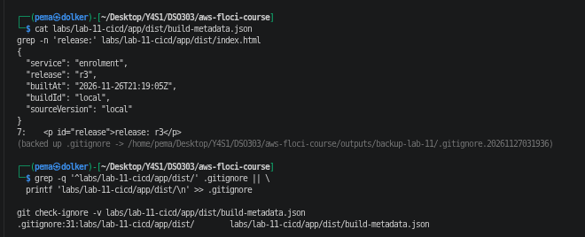
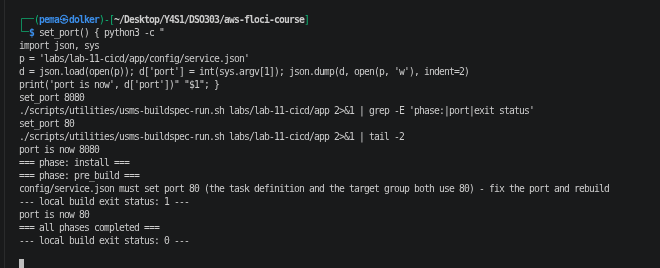

**Observed (locally):** all phases ran, seven smoke tests passed, `build-metadata.json` says `buildId: local`, and `dist/` is git-ignored. With port 8080 the build stopped in `pre_build` with my message; with 80 it passed again. This is the only place in the lab where the buildspec really executed, so it is my evidence that the buildspec works.

**Steps 15 to 18 - the pipeline**

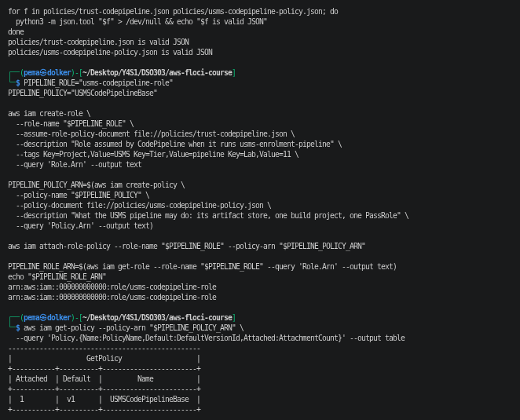

**Observed:** two stages from a validated document. After `update-project` the source and artifacts are `CODEPIPELINE`.

**Floci limitation:** on real AWS a plain `start-build` on a `CODEPIPELINE` project is refused, because the project has no source of its own and only the pipeline can feed it. Floci accepted it anyway and returned `usms-enrolment-build:2`. The override version (`usms-enrolment-build:3`) was accepted too, which is correct on both.

**Step 19 - prove the pipeline used my source**

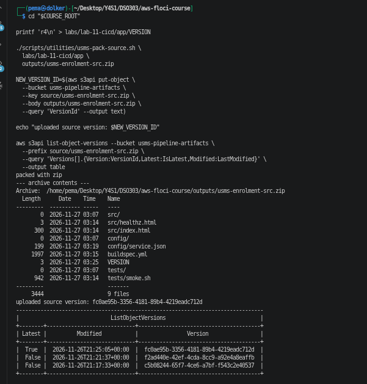
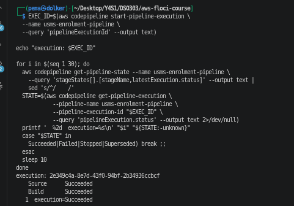
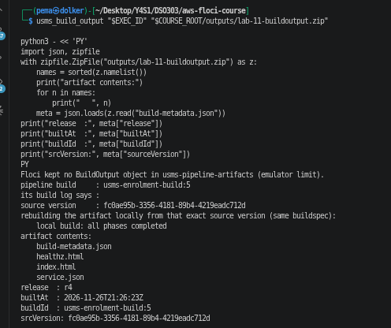

**Observed:** the r4 execution was `Succeeded` on the first poll, with Source and Build both `Succeeded`. But the bucket had no `BuildOutput` object at all; Floci keeps only the source zip.

To still close the loop, I took the exact source version the pipeline was given (`fc0ae95b-...`), downloaded that version, and built it locally with the same buildspec. The output says so on screen. The rebuilt artifact has `index.html`, `healthz.html`, `service.json` and `build-metadata.json` with `release: r4`. This proves that the bytes the pipeline was pointed at contain r4 and build correctly. It does **not** prove Floci's build ran them, because it did not.

For the r5 "Your turn": 4 versions of the source zip and 0 BuildOutput objects. On real AWS the two numbers still differ. Every upload adds a source version, but only an execution that gets through Build adds a BuildOutput object. An upload that nobody runs (polling is off) adds a version and no artifact, and a failed build adds an execution and no artifact. Here the BuildOutput count is 0 for a simpler reason: Floci never writes one.

**Step 20 - deliberate failure**

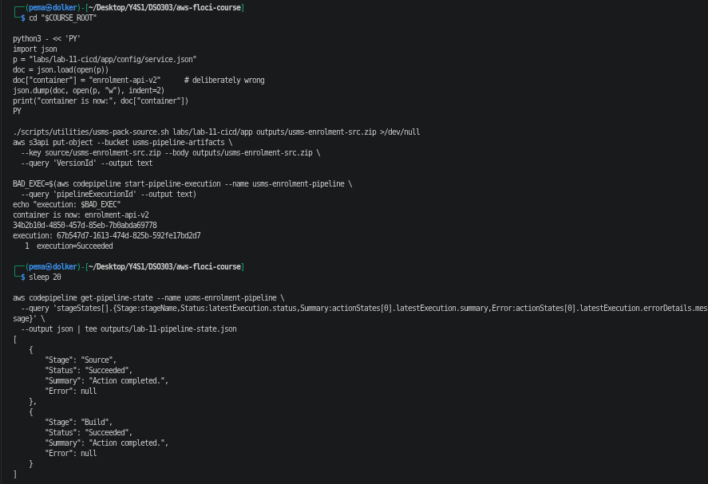
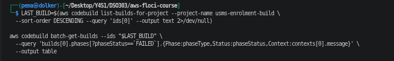
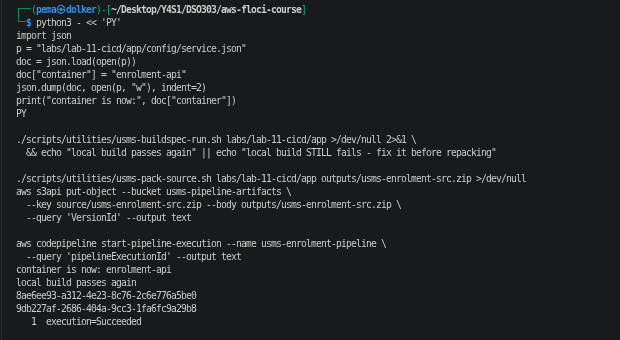

**Observed:** I renamed the container to `enrolment-api-v2`, uploaded it and ran the pipeline. **Floci said `Succeeded` for both stages**, and the "failed phases" query returned an empty table, because nothing failed: nothing ran. On real AWS the Build stage would be `Failed` and `batch-get-builds` would name `PRE_BUILD`, with the log ending at the container check. The trail would be stage → build → phase → command.

The same broken config does fail locally. In Exercise 3 (screenshot `ex3.png`) the local runner stops in `pre_build` with `config/service.json names container 'enrolment-api-v2', expected 'enrolment-api'` and exit status 1. After restoring the name, the local runner passed again and the pipeline was re-run (`Succeeded`).

This is the clearest result of the lab: a pipeline that is green on broken code is worse than no pipeline, because people trust it.

**Step 21 and Section 8**

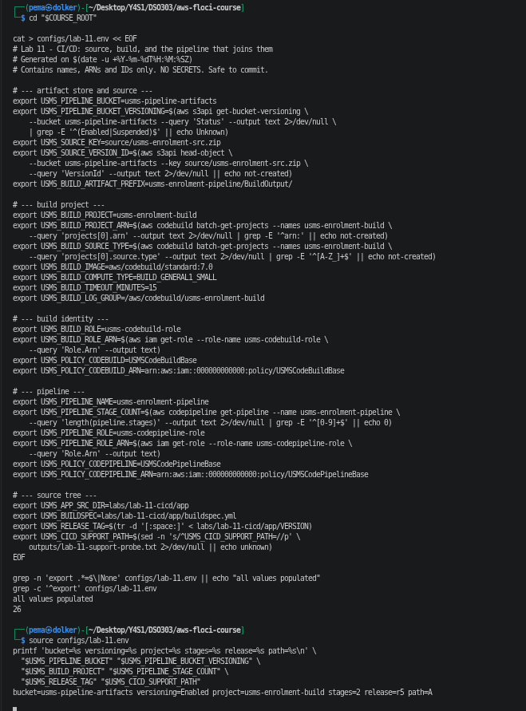

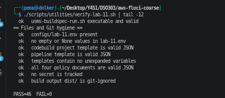

**Observed:** `configs/lab-11.env` has 26 exports, all populated. `verify-lab-11.sh` first run: PASS=46  FAIL=0; after the exercises: PASS=46  FAIL=0. The cleanup script is written but not run.

### 6.2 AWS Management Console Verification

Floci has no web console. The `batch-get-builds`, `get-pipeline-state` and `list-object-versions` output above is the verification.

## 7. Analysis and Discussion

The objectives were achieved: a versioned source, a build with validation and smoke tests, a pipeline that joins them, and proof from inside the artifact that a change in the source reached the output.

The most useful idea was that a status is not proof, and Floci showed it more strongly than the handout intended. Every build and every execution was green, including the two I broke on purpose. Had I only looked at statuses, I would have reported a working pipeline that catches errors. The artifact was the check that exposed it: no BuildOutput object, empty logs, 0-second phases. The only real execution was the local runner, and it behaved correctly: it passed good source and failed the wrong port, the wrong container name and the deliberately failing test.

What I observed versus only recorded:
- **Observed:** the zip layout, versioning (several versions at one key), the buildspec's four phases, and smoke tests passing and failing. I also saw a `pre_build` failure and an artifact naming my release. All of the buildspec observations come from the local runner.
- **Recorded but not executed by Floci:** the CodeBuild project, every build, and the pipeline and its executions, all of which Floci stored and reported as `SUCCEEDED`.
- **Recorded but not enforced:** the build role's scoping, the explicit `Deny` on student data, the scoped `iam:PassRole`, the `CODEPIPELINE`-only project, the `aws:SourceArn` trust condition and the EventBridge trigger (Floci does not evaluate IAM).
- **Not available:** build reports, approvals, KMS-encrypted artifacts and billing.

Problems I ran into and how I fixed them:

- **Builds that never ran.** At first I only noticed that the build artifact was missing in Step 19 (`sort_by(Contents...)` on an empty listing). Listing the whole bucket showed only the source zip. Going back to Step 13 then showed 0-second phases and an empty log. After that, I took execution evidence only from the local runner.
- **`--source-location-override` ignored.** For Exercise 2 the override build still built the normal source, so I put the broken copy at the project's own source key for one build and restored the good source straight after. Even then, Floci said `SUCCEEDED`, so the real result for Exercise 2 is the local run.
- **The build image.** `aws/codebuild/standard:7.0` is not on Docker Hub, so I tagged a local Python image with that name to keep the project definition unchanged.
- **The port check.** The obvious grep would have passed 8080; the pattern needs a non-digit after 80.

## 8. Reflection

**What I learned.** I had only used CI tools that hide the artifacts. Designing SourceOutput and BuildOutput as objects in a bucket made it clear that a pipeline is just stages passing zips. Seeing an emulator report green on broken code taught me to always check the output, not the status. I also understood `iam:PassRole` properly for the first time: being allowed to create something is different from being allowed to choose whose identity it runs with.

**Challenges.** The difference between quoted and unquoted heredocs, nested inside a YAML file, written by a bash heredoc. Getting one wrong gives no error, just a wrong file.

**Real world use.** I would use the explicit `Deny` pattern on real build roles, trigger the pipeline from EventBridge instead of polling, and add KMS encryption to the artifact store. For DevOps on our Semzung project this is the shape of the pipeline I would set up.

**What I want to explore more.** CodeBuild test reports, and CodePipeline V2 triggers with git branch filters.

## 9. Conclusion

The objectives were achieved as far as Floci allows. USMS now has a real enrolment source tree, a versioned artifact bucket, a CodeBuild project with its own role and a two-stage pipeline with a scoped `iam:PassRole`, all created and recorded. The buildspec itself was proven with the local runner. It builds r4 from the exact source version the pipeline was given, and it stops a wrong port, a wrong container name and a failing test.

Floci reported every build and execution as successful without running them, so I did not claim that CodeBuild caught my deliberate errors. On real AWS the same pipeline would.

Key ideas: a pipeline is stages passing artifacts through S3; a status is not proof, the artifact is; versioning makes every run traceable to exact bytes; and the build and pipeline roles are kept separate and narrow.

## 10. Appendix

- Notes and review questions: `notes/lab-11-notes.md`; exercises: `labs/lab-11-cicd/exercises.md`
- Source and build: `labs/lab-11-cicd/app/` (`VERSION`, `src/`, `config/service.json`, `tests/smoke.sh`, `buildspec.yml`), `labs/lab-11-cicd/app-results/` (Exercise 1)
- Policies: `policies/trust-codebuild.json`, `usms-codebuild-policy.json`, `trust-codepipeline.json`, `usms-codepipeline-policy.json`, `trust-events.json`, `usms-events-start-pipeline-policy.json`
- Templates: `templates/lab-11-codebuild-project.json`, `lab-11-pipeline.json`, `lab-11-ex1-results-project.json`, `lab-11-ex4-eventbridge-*.json`
- Scripts: `scripts/utilities/cicd-support-probe.sh`, `usms-pack-source.sh`, `usms-buildspec-run.sh`, `verify-lab-11.sh`, `scripts/cleanup/lab-11-cleanup.sh` (not run)
- Recorded values: `configs/lab-11.env`; screenshots: `screenshots/lab11/`
- Git-ignored: source and artifact zips, build JSON, pipeline state, `outputs/lab-11-lab08b-readiness.txt`
