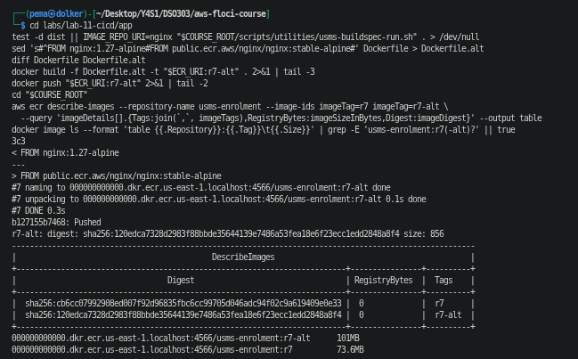
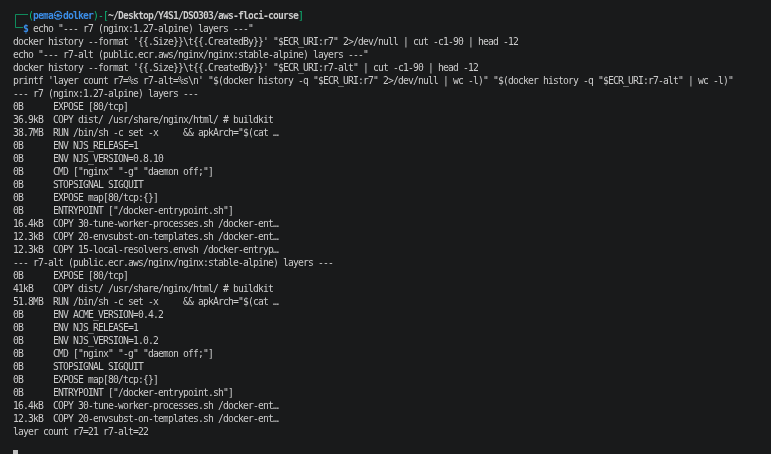
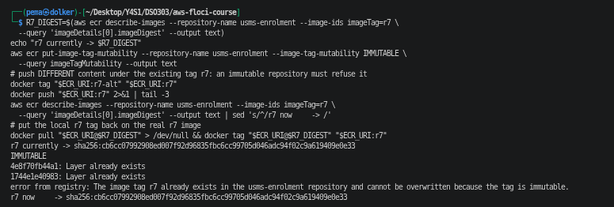
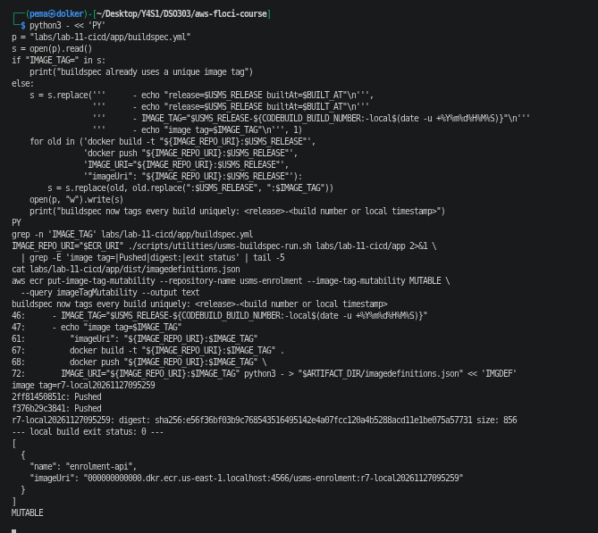
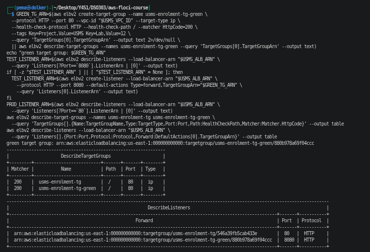
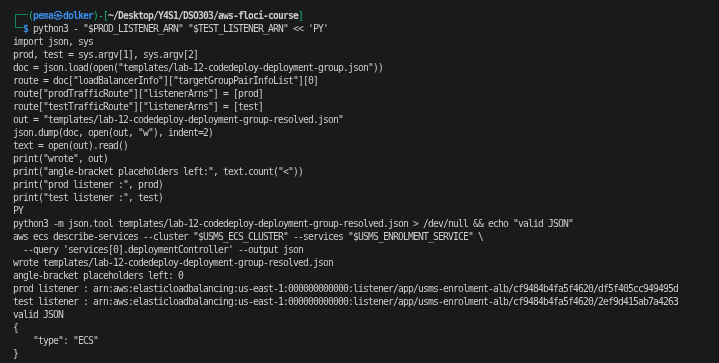
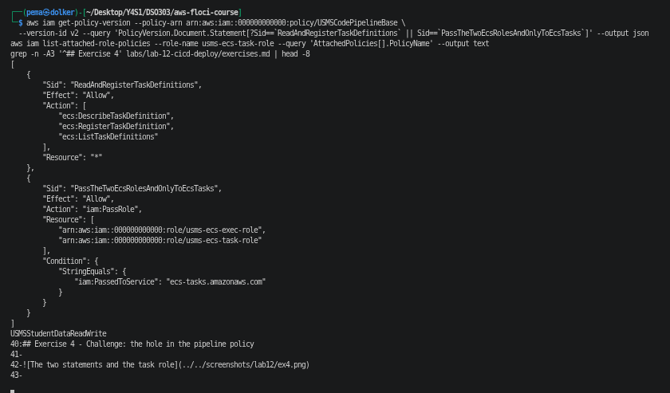
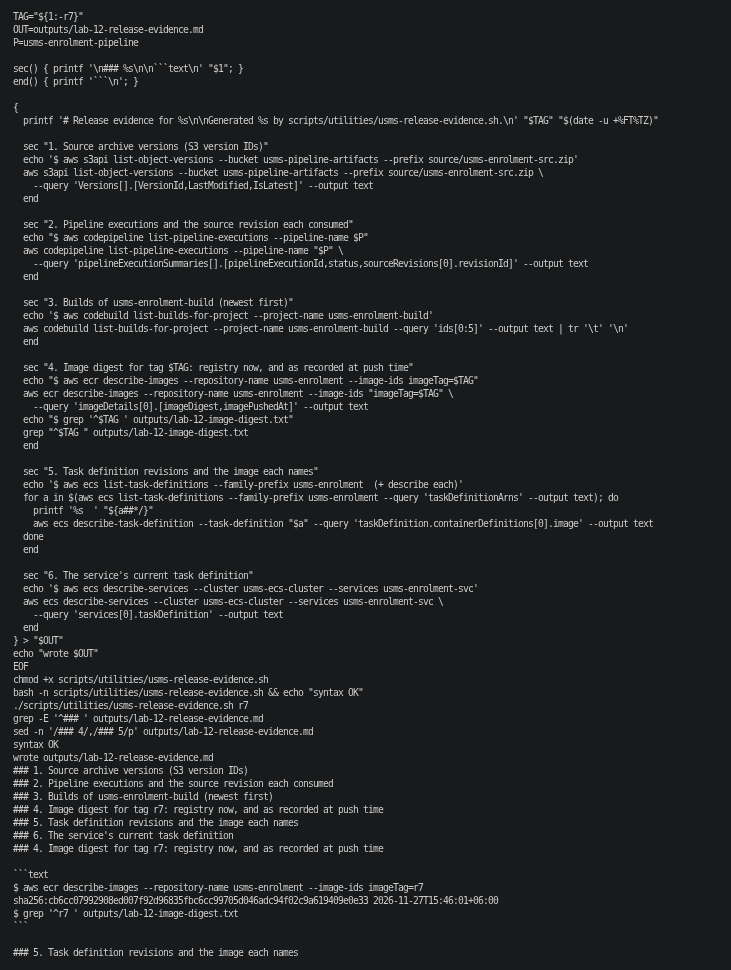
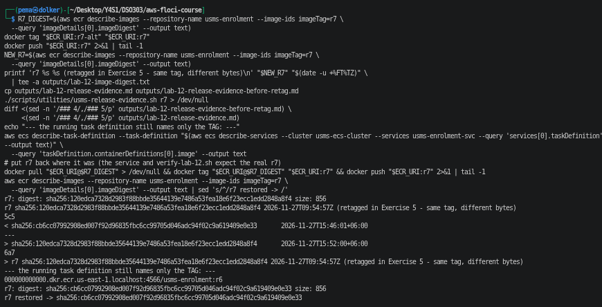

# Lab 12 Exercises

Command output for each exercise is in the screenshots.

## Exercise 1 - Basic: a second base image

`Dockerfile.alt` is the same Dockerfile with `FROM public.ecr.aws/nginx/nginx:stable-alpine` (the image Lab 04's placeholder task definition uses). Built and pushed as `r7-alt`; `VERSION` was not changed and nothing was deployed.

`describe-images` reports `imageSizeInBytes` = 0 for both. **Floci limitation:** it does not compute sizes. The local sizes are real: `r7` (nginx:1.27-alpine) is 73.6 MB, `r7-alt` (public.ecr.aws stable-alpine) is 101 MB. `docker history` shows 21 and 22 layers; nginx's main install layer is 38.7 MB in r7 and 51.8 MB in r7-alt, and my `COPY dist/` layer is about 40 kB in both.

**Why the registry and local numbers differ.** The registry reports the size of the compressed layers it stores (what gets downloaded). The local daemon reports the uncompressed size on disk after extraction, which is always larger. The rest of the difference is that the two numbers count different things: the registry counts each layer once per image, while the local listing can include layers shared with other images and does not include the manifest. Between `r7` and `r7-alt` the difference itself is the base: both are nginx on Alpine, but different nginx versions and builds, so the base layers differ in size and count, while my one `COPY dist/` layer is the same few kilobytes in both (visible in `docker history`).

## Exercise 2 - Intermediate: immutable tags

Set `IMAGE_TAG_MUTABILITY=IMMUTABLE` with `put-image-tag-mutability`, then tried to push **different** content under the existing tag `r7` (the `r7-alt` image retagged as `r7`). **Observed, and really enforced:** the registry refused the push with `The image tag r7 already exists in the usms-enrolment repository and cannot be overwritten because the tag is immutable`, and `r7` still pointed at its original digest (`sha256:cb6cc079...`). On real ECR the error is `ImageTagAlreadyExistsException`. The local `r7` tag was then put back on the real r7 image.

**What had to change in the buildspec.** With immutable tags the build can never reuse a tag, and `$USMS_RELEASE` alone (r7) is reused by every rebuild of the same release. The build phase now sets `IMAGE_TAG="$USMS_RELEASE-${CODEBUILD_BUILD_NUMBER:-local<UTC timestamp>}"` and uses it for `docker build`, `docker push`, `imageUri` in `build-metadata.json` and `imagedefinitions.json`. CodeBuild sets `CODEBUILD_BUILD_NUMBER`; the local runner does not, so the fallback is `local` plus a timestamp, which cannot collide either. A local run pushed `r7-local<time>` while the repository was immutable, and `imagedefinitions.json` named that tag, so it is still deployable.

**What immutable tags buy and cost.** They buy trust in a tag: once `r7-15` exists it is those bytes forever, which is the guarantee a digest gives but in a readable name, and it closes the Exercise 5 attack. They cost convenience: you cannot "fix" a tag, every rebuild produces a new tag that has to be carried through to the deployment, and tags pile up, so a lifecycle policy becomes necessary.

**Left as:** set back to `MUTABLE` at the end, because Exercise 5 has to move `r7` and the verify script does not check this field, so a later lab would otherwise be surprised by a rejected push.

## Exercise 3 - Problem solving: blue/green scaffolding

Created `usms-enrolment-tg-green` with Lab 05's settings (target type `ip`, HTTP:80, health check `/`, matcher 200, same VPC), and a test listener on port 8080 of `usms-enrolment-alb` forwarding to it. The ARNs were queried, not copied.

`templates/lab-12-codedeploy-deployment-group-resolved.json` is the Step 19 document with `<PROD_LISTENER_ARN>` and `<TEST_LISTENER_ARN>` replaced by the real ARNs (substituted in Python, as in Step 16). It is valid JSON with no angle-bracket placeholders. The original document is unchanged. The service's deployment controller was not touched (it is still `ECS`), as Step 19 warns.

One thing I would also need on real AWS: the ALB's security group only allows 80 and 443 in, so testers could not reach 8080 until I added an ingress rule for it, ideally only from the test machines.

## Exercise 4 - Challenge: the hole in the pipeline policy

**The attack.** With v2, a compromised pipeline role can call `ecs:RegisterTaskDefinition` (allowed on `*`) to register a new `usms-enrolment` revision whose container is not the enrolment image but any image the attacker likes, or the same image with a different `command`, and whose `taskRoleArn` is `usms-ecs-task-role`. Passing that role is allowed by design (`iam:PassRole` to `ecs-tasks.amazonaws.com`). Then `ecs:UpdateService` on the one allowed service runs it. That task runs as `usms-ecs-task-role`, which carries `USMSStudentDataReadWrite` from Lab 01, so the attacker's code can read and change every student record. The PassRole scoping does not help: it limits which role the pipeline can pass, not what the code running under that role does.

**Can IAM alone close it?** Not in this policy. `RegisterTaskDefinition` does not support resource-level restrictions, and I could not find a documented condition key that restricts the image or the command in a task definition (I would check the "Actions, resources, and condition keys for Amazon Elastic Container Service" page in the Service Authorization Reference before claiming one exists). Removing `RegisterTaskDefinition` would break the ECS deploy action, which registers a revision itself. So I did not write a v3. The control belongs elsewhere:

- **Shrink what the task role can do** - the enrolment service does not need write access to all student data; a role scoped to what enrolment actually touches limits any task, legitimate or not.
- **Only allow images from our registry** - ECR repository policies and requiring that tasks pull only from `usms-enrolment` (on real AWS, a detective rule: EventBridge on `RegisterTaskDefinition` that alerts when the image is not from our repository or the command is overridden).
- **Separate who can change the pipeline from who can deploy** - the pipeline role is only as safe as whoever can edit the pipeline or the buildspec; review on the source is the real gate.

## Exercise 5 - Integration: release evidence for an auditor

`scripts/utilities/usms-release-evidence.sh r7` writes `outputs/lab-12-release-evidence.md`: every value comes from a command, and each section shows the command and its output, in this order: S3 version IDs of the source archive; pipeline executions with the source revision each consumed; the build IDs; the image digest for `r7` now, next to the digest recorded at push time; every task definition revision with its image; the service's current task definition.

**The deliberate break.** Retagged `r7` to the `r7-alt` image and pushed it (the repository was back to MUTABLE). The new digest was appended to `outputs/lab-12-image-digest.txt` as a second `r7` line. Regenerating the document and diffing section 4 shows the registry's `r7` digest changed from `cb6cc079...` to `120edca7...`, with nothing else in the document flagging it. Nothing was deployed.

The running service is on `usms-enrolment:3`, which names `:r6`, not `:r7`, because the pipeline's Deploy stage never succeeded on Floci (report, Step 17). The point is the same for any revision that names a tag: a revision naming `:r7` would look identical before and after the retag.

**What the document can and cannot still prove.** It can still prove which source version each execution used, which builds ran, and which revision the service points at. It can no longer prove which bytes a task runs, because the revision names a tag and the tag now points somewhere else; a task started after the retag would run different code under the same revision. The only link that survives is the digest recorded at push time, which shows the tag was moved. A task definition that named the digest instead of the tag would not have this gap. Afterwards I pushed the original r7 image back under `r7` (`r7 restored -> sha256:cb6cc079...`) so `verify-lab-12.sh` sees the real r7 again.
