# AWS Practical Laboratory 12 Report

**Student Name:** Pema Dolker 
**Module:** DSO303  
**Practical:** Lab 12 - Deploying to Amazon ECS from the Pipeline 
**Environment:** Floci (local AWS API emulator, Docker Compose, hybrid storage), account 000000000000, us-east-1

**Support path:** A (from `scripts/utilities/deploy-support-probe.sh`); CodeDeploy answered: yes. The build container is the local stand-in image from Lab 11, which has no Docker daemon, so image pushes ran on my machine through the local buildspec runner (same commands). Blue/green was written and validated, not run.

Step notes and the seven review questions: `notes/lab-12-notes.md`. Exercises: `labs/lab-12-cicd-deploy/exercises.md`.

> **Observed** = I ran it and saw it. **Floci limitation** = behaved differently from real AWS. **Conceptual** = only possible on real AWS, so I explained it instead.

## 1. Aim / Objective

Lab 11's pipeline stopped at a build artifact. The aim here is to take it all the way to a running service: build a container image from the enrolment service, push it to a private ECR repository, register a task definition revision that names it, and add a third pipeline stage, Deploy, that reads `imagedefinitions.json` and updates the ECS service. Then deploy a release whose image does not exist, see what does (and does not) notice, roll back by hand, and write the CodeDeploy blue/green documents on paper.

## 2. Introduction

A container image is the deployable unit; a registry (ECR) stores it; a task definition says which image to run with what CPU, memory, roles and logging; and a service keeps a number of tasks running from one task definition revision. The ECS deploy action in CodePipeline changes exactly one thing: it reads `imagedefinitions.json` from the build artifact, registers a new revision with the image swapped, and points the service at it.

The main ideas I used:

- **Tag versus digest** - a tag (`:r7`) is a movable name; a digest (`sha256:...`) is the content itself and never changes.
- **Task definition revisions** - immutable; every change is a new revision, and the service points at one.
- **Rolling update and circuit breaker** - ECS replaces tasks gradually and, on real AWS, rolls back a deployment whose new tasks keep failing to start.
- **IAM policy versions** - a managed policy changes by publishing a new version and setting it as default; up to five versions are kept, so permission changes can be rolled back too.
- **Replace-only APIs** - `update-pipeline` replaces the whole pipeline, so it is always get → modify → update.
- **Blue/green** - CodeDeploy runs the new version beside the old one and shifts traffic; rollback is moving traffic back.

## 3. Use Case

- Shipping a new enrolment portal release with no one typing `aws ecs update-service`.
- Knowing exactly which bytes are running, by digest, when someone asks.
- Rolling back to the last good revision in one command when a release is broken.
- Planning a zero-downtime deployment with a test listener before real traffic moves.

## 4. System Architecture / Design

```text
 source zip (S3, versioned)
     |
 usms-enrolment-pipeline
   Source  -> SourceOutput
   Build   -> builds image <ECR_URI>:<release>, pushes it, writes imagedefinitions.json
              -> BuildOutput (imagedefinitions.json at the root)
   Deploy  (ECS) -> registers usms-enrolment:<N+1> with the new image -> update-service
     |
 ECR usms-enrolment (MUTABLE, scanOnPush, AES256)   ECS usms-ecs-cluster / usms-enrolment-svc
 USMSCodeBuildBase v2 (ECR push)   USMSCodePipelineBase v2 (UpdateService + PassRole to ecs-tasks)
 CodeDeploy blue/green: templates/lab-12-appspec.yaml + deployment group (conceptual)
```


## 5. Implementation Procedure

1. **Steps 1 to 3** - started Floci, read Lab 11's readiness file, sourced eleven env files, probed the deployment surface.
2. **Step 4** - published the ECR port range in `docker-compose.yml` (backed up first) and confirmed the recreate lost nothing.
3. **Steps 5 to 9** - created the ECR repository, logged Docker in with the token on stdin, wrote the Dockerfile, built and pushed r6 by hand, recorded its digest and pulled it back by digest.
4. **Steps 10 and 11** - derived a new task definition revision from the current one (describe → strip read-only fields → change the image → register) and deployed it by hand.
5. **Steps 12 to 15** - published v2 of both pipeline policies, set `privilegedMode` and `IMAGE_REPO_URI` on the build project, and rewrote the buildspec to build, push and write `imagedefinitions.json`.
6. **Steps 16 and 17** - added the Deploy stage with get → modify → update, ran r7 end to end and proved the service moved to the new image.
7. **Step 18** - deployed r8, whose image was never pushed, observed the result, and rolled back by naming the good revision.
8. **Step 19** - wrote and validated `appspec.yaml` and the CodeDeploy deployment group.
9. **Step 20, Section 8, Exercises, Step 21** - wrote `configs/lab-12.env`, the verify and cleanup scripts, did Exercises 1 to 5 and committed.

## 6. Results and Evidence

### 6.1 CLI Output

**Steps 1 to 4 - environment, probe, ports**

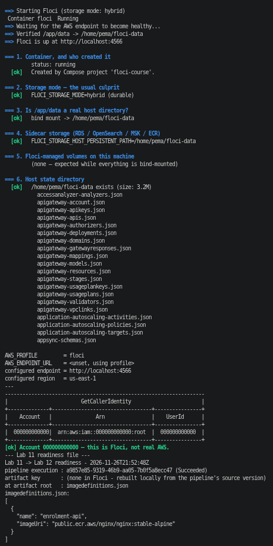

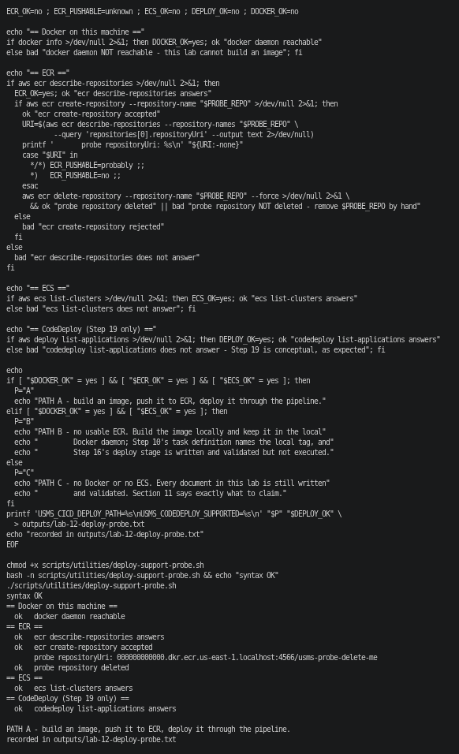
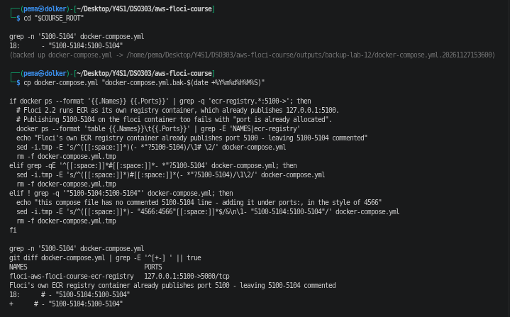
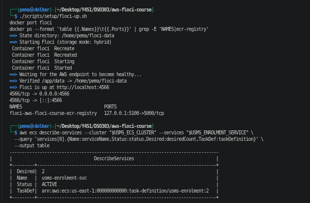

**Observed:** path A. My `docker-compose.yml` had no commented `5100-5104` line to uncomment (the handout's `sed` assumes one), so I added `- "5100-5104:5100-5104"` under `ports:` next to `4566`, after copying the file to `docker-compose.yml.bak-<time>` and to `outputs/backup-lab-12/`. `floci-up.sh` recreated the container; the ECS service was still `ACTIVE` afterwards, which proves hybrid storage kept everything.

**Steps 5 to 9 - registry, image, digest**

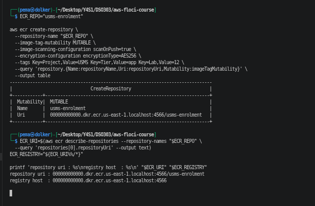


**Observed:** repository URI `000000000000.dkr.ecr.us-east-1.localhost:4566/usms-enrolment`, read from the API, never typed. The login token went through a pipe to `--password-stdin`, so it is not in `ps` or shell history. r6 was built from `dist/` (the built output, not the source) and pushed; its digest is `sha256:75c3fcbeb66de43efa5b1f919c985ff9015a01152ae8e16aa78b01a493c498cb`, appended to `outputs/lab-12-image-digest.txt`. After deleting every local copy I pulled it back **by digest**, which is the strongest proof the registry holds those exact bytes. **Floci limitation:** the registry may be plain HTTP and the URI is a localhost host and port; `scanOnPush` is stored but nothing is scanned.

**Steps 10 and 11 - a revision by hand**

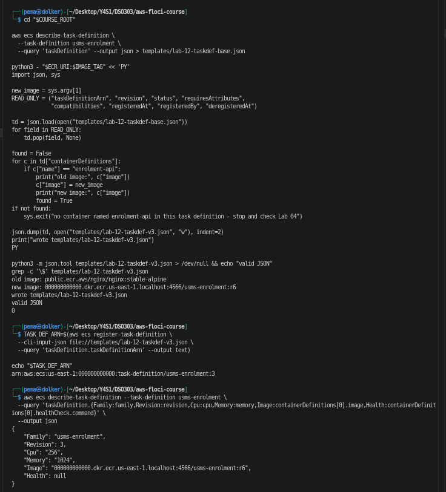


**Observed:** the new revision is `usms-enrolment:3`, with only the image changed. The handout deploys `usms-enrolment:3`; my family already had more revisions from Lab 04 and 05, so I deployed the ARN that `register-task-definition` returned instead of a hard-coded number. **Floci limitation:** the service pointer changes, but deployment state such as `rolloutState` may not be reported.

**Steps 12 to 15 - permissions and build**


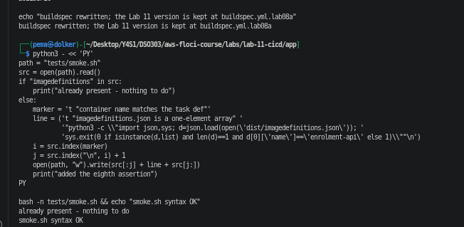


**Observed:** `USMSCodeBuildBase` default is v2 (ECR push actions on one repository; `ecr:GetAuthorizationToken` on `*` because it cannot be scoped); v1 is kept. The project now has `privilegedMode: true` and `IMAGE_REPO_URI`, and source is still `CODEPIPELINE`. The local run built and pushed the image and printed `imagedefinitions.json`. `USMSCodePipelineBase` default is v2. My draft (`notes/lab-12-my-pipeline-policy.json`) differs from the handout's in two statements; the comparison is in the notes.

**Steps 16 and 17 - the Deploy stage and an end-to-end release**

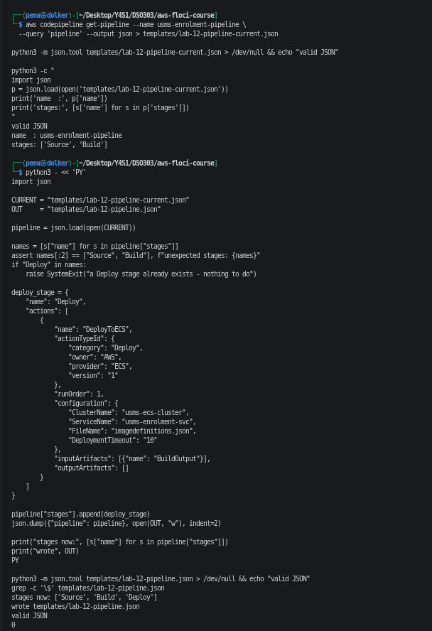


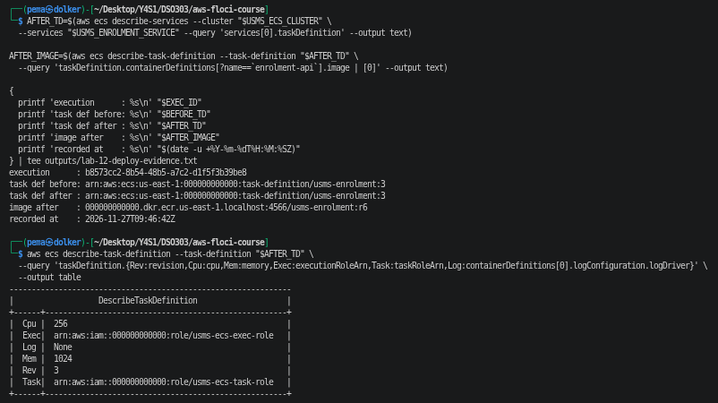

**Observed:** three stages with the artifact chain nothing → SourceOutput → BuildOutput. The r7 execution ended as Failed. Service task definition before: `usms-enrolment:3`; after: `usms-enrolment:3`; image after: `000000000000.dkr.ecr.us-east-1.localhost:4566/usms-enrolment:r6` (`outputs/lab-12-deploy-evidence.txt`). Because the stand-in build image has no Docker, the r7 image was pushed from my machine with the local runner just before the pipeline run; the pipeline's own build still wrote `imagedefinitions.json` and the Deploy stage did the rest.

**Step 18 - the rollback drill**

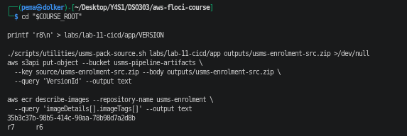

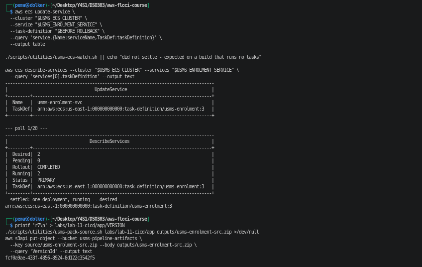

**Observed:** the registry had r6 and r7 but no r8. After the pipeline ran for r8 the service pointed at `usms-enrolment:3`, a revision whose image does not exist, and nothing on this emulator objected. I rolled back by naming the good revision, `usms-enrolment:3`, and put the source back to r7. **Floci limitation / Conceptual:** on real AWS the tasks would fail with `CannotPullContainerError`, the circuit breaker would mark the deployment FAILED and roll back automatically. The lesson that does show here: a deployment with no health signal cannot roll itself back.

**Step 19 - blue/green on paper**

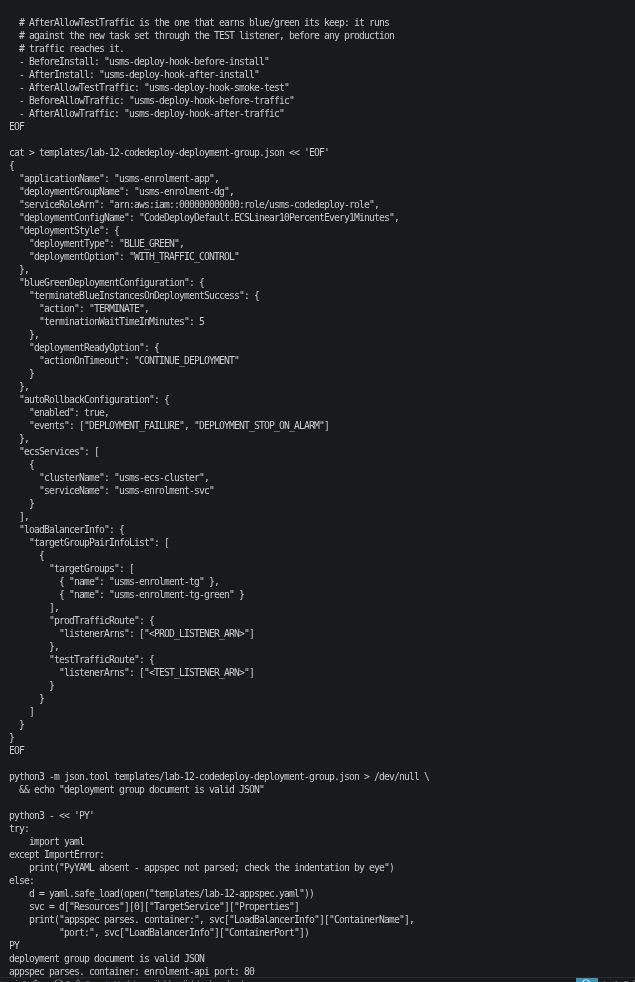

**Conceptual:** `templates/lab-12-appspec.yaml` and `templates/lab-12-codedeploy-deployment-group.json` are valid (container `enrolment-api`, port 80, linear 10% per minute, auto-rollback on failure and alarm). Not executed; no blue/green deployment is claimed.

**Step 20, Section 8, Step 21**

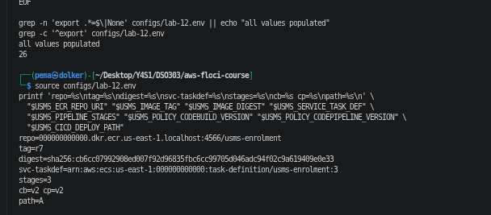

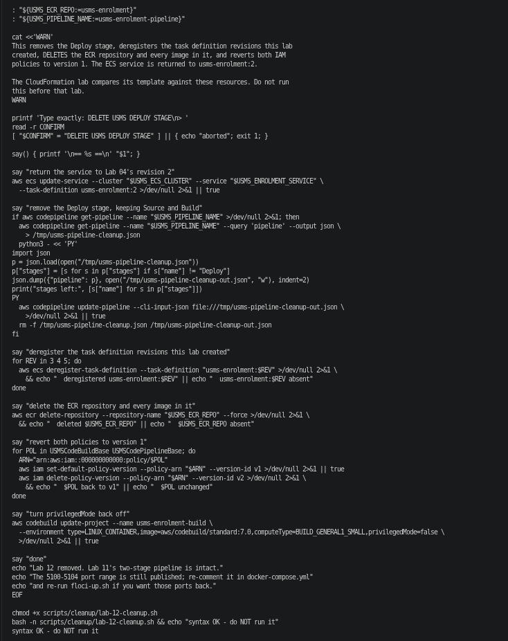
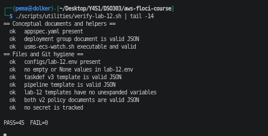


**Observed:** `configs/lab-12.env` has 26 exports; `USMS_ROLLBACK_REVISION` is the real good revision, not the handout's hard-coded 4. `verify-lab-12.sh`: PASS=45  FAIL=0 first, PASS=45  FAIL=0 after the exercises. The cleanup script is not run. `.gitignore` now covers `docker-compose.yml.bak-*`.

### 6.2 AWS Management Console Verification

Floci has no console; the `describe-images`, `describe-services` and `get-pipeline` output above is the verification.

## 7. Analysis and Discussion

The objectives were achieved on this path: an image in a private registry identified by digest, a revision derived from the previous one with one field changed, a three-stage pipeline that moves the service, and a rollback by naming a revision.

The most important thing I saw was Step 18. The pipeline happily deployed a revision whose image did not exist, the service pointed at it, and every status was green. Everything was "successful" except the actual outcome. On real AWS the circuit breaker covers this one case (an image that cannot be pulled), but not an application that starts and then misbehaves. That needs a health signal the deployment can watch: load balancer health checks, alarms tied to the deployment, or CodeDeploy's test listener.

Tag versus digest also became concrete. The task definition names `:r7`. Exercise 5 retagged `r7` to different bytes, and the task definition could not tell; only the digest recorded at push time could.

What I observed versus recorded: **observed** - image built and pushed, digest, pull by digest, revision with one field changed, service pointer moving, three-stage pipeline, an undetected bad deploy, rollback by revision. **Recorded but not enforced** - the ECR push permissions, the second `iam:PassRole`, the single-service ARN, `scanOnPush`, tag immutability (Exercise 2 shows what this build did), and the CodeDeploy documents. **Not available** - blue/green, a tripping circuit breaker, scan results, lifecycle expiry.

Problems and fixes:

- **`docker-compose.yml` had no commented port line.** Added the line in the same style, with two backups, and showed the diff.
- **Hard-coded revision numbers.** `usms-enrolment:3` and `USMS_ROLLBACK_REVISION=4` assume a fresh family; mine had more revisions, so both use the captured ARNs.
- **No Docker in the build container.** The r7 push ran on my machine with the same buildspec commands; recorded rather than hidden.
- **Waiting.** The handout sleeps 30 s before reading the r8 deployment; I polled the execution until it ended.

## 8. Reflection

**What I learned.** I knew Docker images had digests but never used them. Pulling an image back by digest, then watching a tag move to different bytes while the task definition stayed the same, made it obvious why production deployments should pin digests, and also why it is inconvenient.

**Challenges.** Keeping track of revision numbers across labs, and the replace-only APIs: one `update-pipeline` with a partial document would have deleted the Source and Build stages. Committing `templates/lab-11-pipeline.json` in Lab 11 is what makes that recoverable.

**Real world use.** For our Semzung project I would deploy by digest, make the repository immutable with unique tags per build, and add a deployment alarm so a bad release rolls back on its own.

**What I want to explore more.** Running CodeDeploy blue/green for real, and ECR image signing.

## 9. Conclusion

The objectives were achieved. The enrolment service now goes from a version bump to a running ECS service through Source, Build and Deploy, with the image in ECR and its digest recorded. A deploy of a missing image was shown to go unnoticed without a health signal, and was rolled back by naming the good revision. Blue/green is designed and validated for real AWS.

Key ideas: a tag is a name and a digest is the content; a task definition revision is immutable and the service just points at one; replace-only APIs are always get → modify → update; and a deployment is only as safe as the health signal it watches.

## 10. Appendix

- Notes and review questions: `notes/lab-12-notes.md`; my policy draft: `notes/lab-12-my-pipeline-policy.json`; exercises: `labs/lab-12-cicd-deploy/exercises.md`
- Container: `labs/lab-11-cicd/app/Dockerfile`, `.dockerignore`, `Dockerfile.alt` (Exercise 1); buildspec `labs/lab-11-cicd/app/buildspec.yml` (Lab 11 version kept as `buildspec.yml.lab08a`)
- Policies: `policies/usms-codebuild-policy-v2.json`, `policies/usms-codepipeline-policy-v2.json`
- Templates: `templates/lab-12-taskdef-v3.json`, `lab-12-codebuild-update.json`, `lab-12-pipeline.json`, `lab-12-appspec.yaml`, `lab-12-codedeploy-deployment-group.json`, `lab-12-codedeploy-deployment-group-resolved.json` (Exercise 3)
- Scripts: `scripts/utilities/deploy-support-probe.sh`, `usms-ecs-watch.sh`, `usms-release-evidence.sh` (Exercise 5), `verify-lab-12.sh`, `scripts/cleanup/lab-12-cleanup.sh` (not run)
- Changed existing files (backed up in `outputs/backup-lab-12/`): `docker-compose.yml` (port range), `.gitignore` (compose backups)
- Recorded values: `configs/lab-12.env`; screenshots: `screenshots/lab12/`
- Git-ignored: `outputs/lab-12-image-digest.txt`, `lab-12-deploy-evidence.txt`, `lab-12-release-evidence.md`, `lab-12-deploy-probe.txt`
