# AWS Practical Laboratory 12 Report

**Student Name:** Pema Dolker 
**Module:** DSO303  
**Practical:** Lab 12 - Deploying to Amazon ECS from the Pipeline 
**Environment:** Floci (local AWS API emulator, Docker Compose, hybrid storage), account 000000000000, us-east-1

**Support path:** A (from `scripts/utilities/deploy-support-probe.sh`); CodeDeploy answered: yes. Blue/green was written and validated, not run.

**What was real and what was only recorded.**
- **Real (Floci runs it):** ECR is a real Docker registry here. I built, pushed, pulled by digest and had a push refused by tag immutability.
- **Recorded only:** as in Lab 11, Floci records CodeBuild builds without running them. Every image push therefore ran on my machine through the local buildspec runner, with the same commands the buildspec gives CodeBuild.
- **The pipeline's Deploy stage ended `Failed` both times**, so the service was never moved by the pipeline. It stayed on the revision I deployed by hand in Step 11.

Step notes and the seven review questions: `notes/lab-12-notes.md`. Exercises: `labs/lab-12-cicd-deploy/exercises.md`.

> **Observed** = I ran it and saw it. **Floci limitation** = behaved differently from real AWS. **Conceptual** = only possible on real AWS, so I explained it instead.

## 1. Aim / Objective

Lab 11's pipeline stopped at a build artifact. The aim here is to take it all the way to a running service: build a container image from the enrolment service, push it to a private ECR repository, register a task definition revision that names it, and add a third pipeline stage, Deploy, that reads `imagedefinitions.json` and updates the ECS service. Then deploy a release whose image does not exist, see what does (and does not) notice, roll back by hand, and write the CodeDeploy blue/green documents on paper.

## 2. Introduction

A container image is the deployable unit; a registry (ECR) stores it; a task definition says which image to run with what CPU, memory, roles and logging; and a service keeps a number of tasks running from one task definition revision. The ECS deploy action in CodePipeline changes exactly one thing: it reads `imagedefinitions.json` from the build artifact, registers a new revision with the image swapped, and points the service at it.

The main ideas I used:

- **Tag versus digest** - a tag (`:r7`) is a movable name; a digest (`sha256:...`) is the content itself and never changes.
- **Task definition revisions** - immutable; every change is a new revision, and the service points at one.
- **Rolling update and circuit breaker** - ECS replaces tasks gradually and, on real AWS, rolls back a deployment whose new tasks keep failing to start.
- **IAM policy versions** - a managed policy changes by publishing a new version and setting it as default; up to five versions are kept, so permission changes can be rolled back too.
- **Replace-only APIs** - `update-pipeline` replaces the whole pipeline, so it is always get → modify → update.
- **Blue/green** - CodeDeploy runs the new version beside the old one and shifts traffic; rollback is moving traffic back.

## 3. Use Case

- Shipping a new enrolment portal release with no one typing `aws ecs update-service`.
- Knowing exactly which bytes are running, by digest, when someone asks.
- Rolling back to the last good revision in one command when a release is broken.
- Planning a zero-downtime deployment with a test listener before real traffic moves.

## 4. System Architecture / Design

```text
 source zip (S3, versioned)
     |
 usms-enrolment-pipeline
   Source  -> SourceOutput
   Build   -> builds image <ECR_URI>:<release>, pushes it, writes imagedefinitions.json
              -> BuildOutput (imagedefinitions.json at the root)
   Deploy  (ECS) -> registers usms-enrolment:<N+1> with the new image -> update-service
     |
 ECR usms-enrolment (MUTABLE, scanOnPush, AES256)   ECS usms-ecs-cluster / usms-enrolment-svc
 USMSCodeBuildBase v2 (ECR push)   USMSCodePipelineBase v2 (UpdateService + PassRole to ecs-tasks)
 CodeDeploy blue/green: templates/lab-12-appspec.yaml + deployment group (conceptual)
```

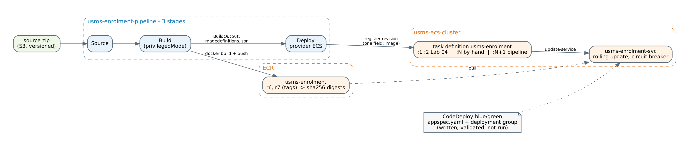

## 5. Implementation Procedure

1. **Steps 1 to 3** - started Floci, read Lab 11's readiness file, sourced eleven env files, probed the deployment surface.
2. **Step 4** - tried to publish the ECR port range in `docker-compose.yml` (backed up first), found Floci's own registry container already owns port 5100, left the range commented, and confirmed the recreate lost nothing.
3. **Steps 5 to 9** - created the ECR repository, logged Docker in with the token on stdin, wrote the Dockerfile, built and pushed r6 by hand, recorded its digest and pulled it back by digest.
4. **Steps 10 and 11** - derived a new task definition revision from the current one (describe → strip read-only fields → change the image → register) and deployed it by hand.
5. **Steps 12 to 15** - published v2 of both pipeline policies, set `privilegedMode` and `IMAGE_REPO_URI` on the build project, and rewrote the buildspec to build, push and write `imagedefinitions.json`.
6. **Steps 16 and 17** - added the Deploy stage with get → modify → update, pushed r7 and ran the pipeline end to end, then compared the service's revision before and after.
7. **Step 18** - ran the pipeline for r8, whose image was never pushed, observed the result, and ran the rollback by naming the good revision.
8. **Step 19** - wrote and validated `appspec.yaml` and the CodeDeploy deployment group.
9. **Step 20, Section 8, Exercises, Step 21** - wrote `configs/lab-12.env`, the verify and cleanup scripts, did Exercises 1 to 5 and committed.

## 6. Results and Evidence

### 6.1 CLI Output

**Steps 1 to 4 - environment, probe, ports**


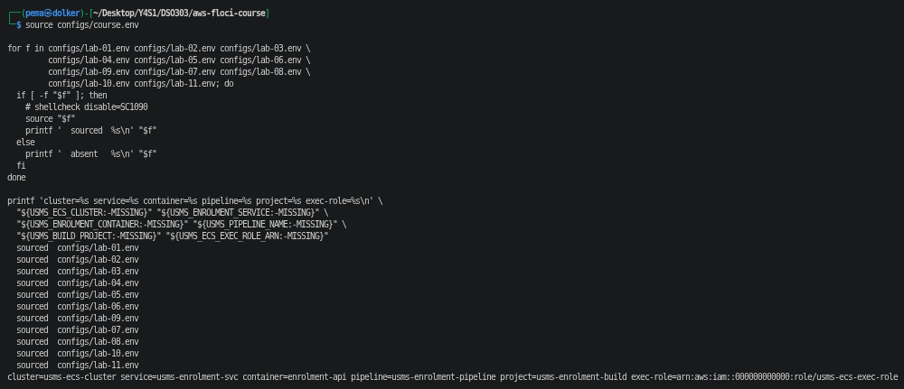


**Observed:** path A. My `docker-compose.yml` had no commented `5100-5104` line, so I added `- "5100-5104:5100-5104"` under `ports:` (backups: `docker-compose.yml.bak-<time>` and `outputs/backup-lab-12/`). `floci-up.sh` then failed with `Bind for 127.0.0.1:5100 failed: port is already allocated`. Floci was down, and the next command could not reach `localhost:4566`.

`docker ps` and `ss -ltnp` showed the owner of the port: `floci-aws-floci-course-ecr-registry`, a registry container that **Floci itself** starts for ECR, publishing `127.0.0.1:5100->5000`. **Floci limitation:** the handout's step is for a Floci that serves the registry from the main container. In 2.2 the registry is a separate container, so publishing the same ports on `floci` collides with it.

I left the line in the file but commented out, and Floci started normally. The ECS service was still `ACTIVE` afterwards, so hybrid storage kept everything.

**Steps 5 to 9 - registry, image, digest**


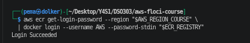
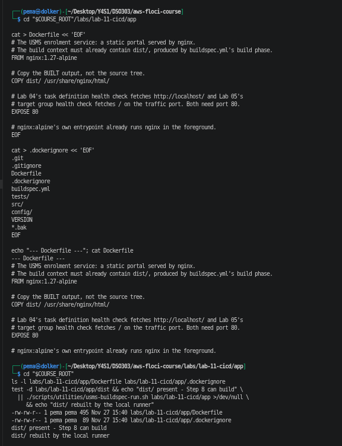
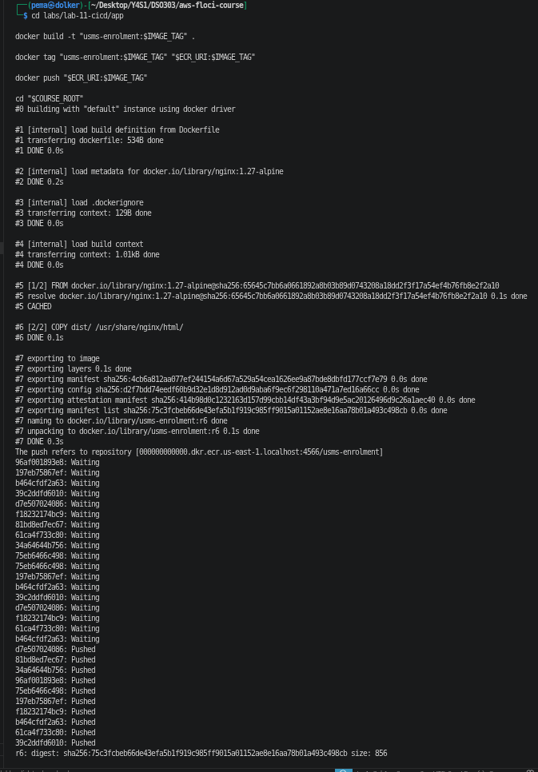
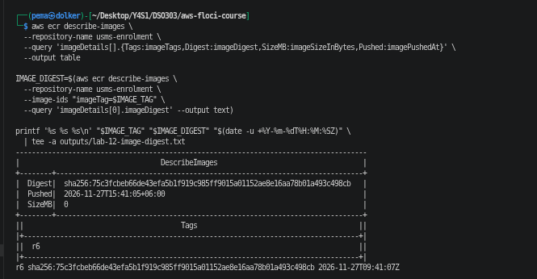
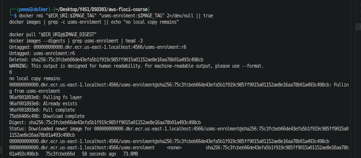

**Observed:** repository URI `000000000000.dkr.ecr.us-east-1.localhost:4566/usms-enrolment`, read from the API, never typed. The login token went through a pipe to `--password-stdin`, so it is not in `ps` or shell history. r6 was built from `dist/` (the built output, not the source) and pushed. Its digest, `sha256:75c3fcbeb66de43efa5b1f919c985ff9015a01152ae8e16aa78b01a493c498cb`, is appended to `outputs/lab-12-image-digest.txt`. After deleting every local copy I pulled it back **by digest**, which is the strongest proof the registry holds those exact bytes.

**Floci limitation:** the registry speaks plain HTTP on a `*.localhost:4566` name. Docker only allows plain HTTP for `localhost` itself, so my first push failed with `server gave HTTP response to HTTPS client`. I added that one registry to `insecure-registries` in `/etc/docker/daemon.json` (keeping my existing DNS setting), restarted Docker and pushed again. On real AWS, ECR is HTTPS and this step does not exist. Also, `describe-images` reports a size of 0 and `scanOnPush` is stored but nothing is scanned.

**Steps 10 and 11 - a revision by hand**


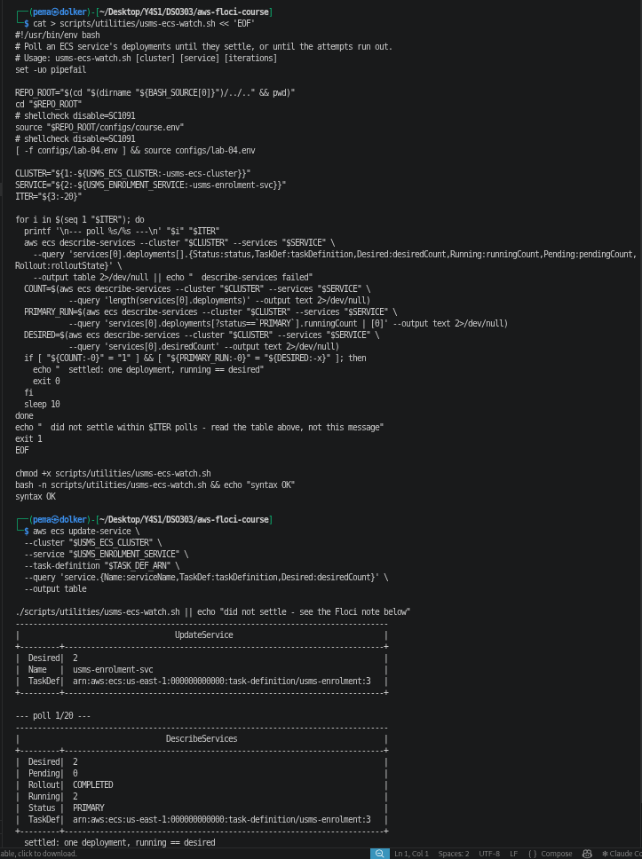

**Observed:** the new revision is `usms-enrolment:3`, with only the image changed (to `:r6`). I deployed the ARN that `register-task-definition` returned rather than a hard-coded number. The service now points at `:3`, and `usms-ecs-watch.sh` reported `COMPLETED`, running 2 of 2, on its first poll. **Floci limitation:** a real rolling update takes minutes and goes through PENDING tasks. Floci reports the end state straight away, so this shows the pointer moved, not that new containers really started.

**Steps 12 to 15 - permissions and build**

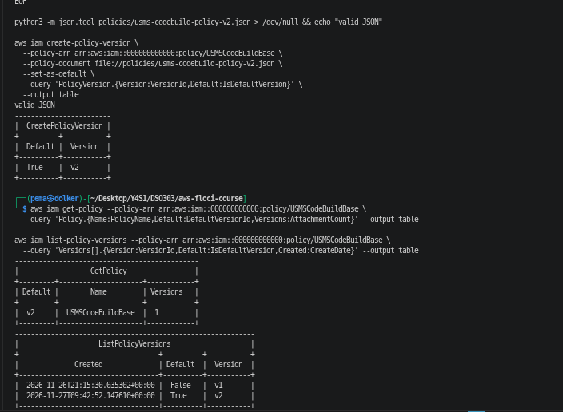
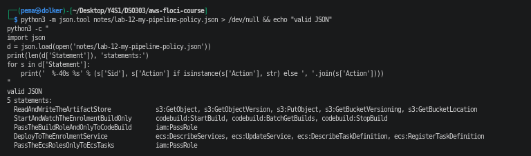
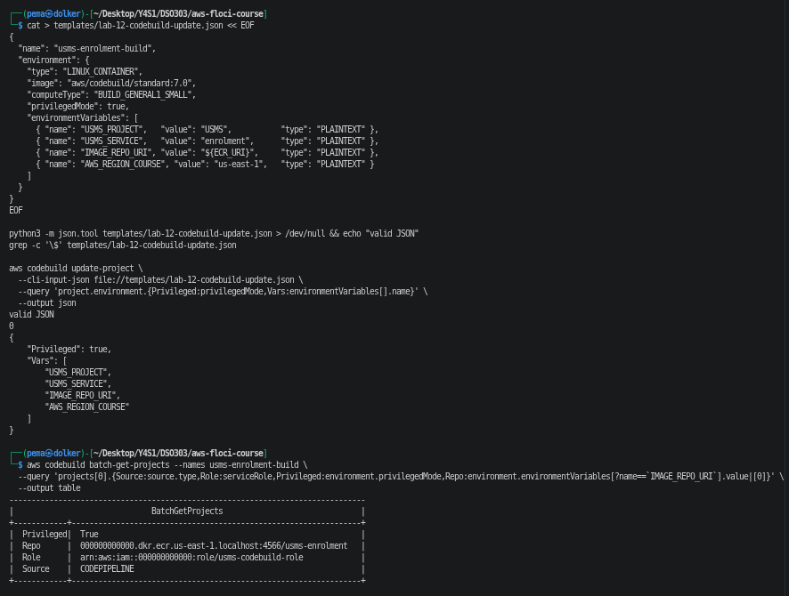

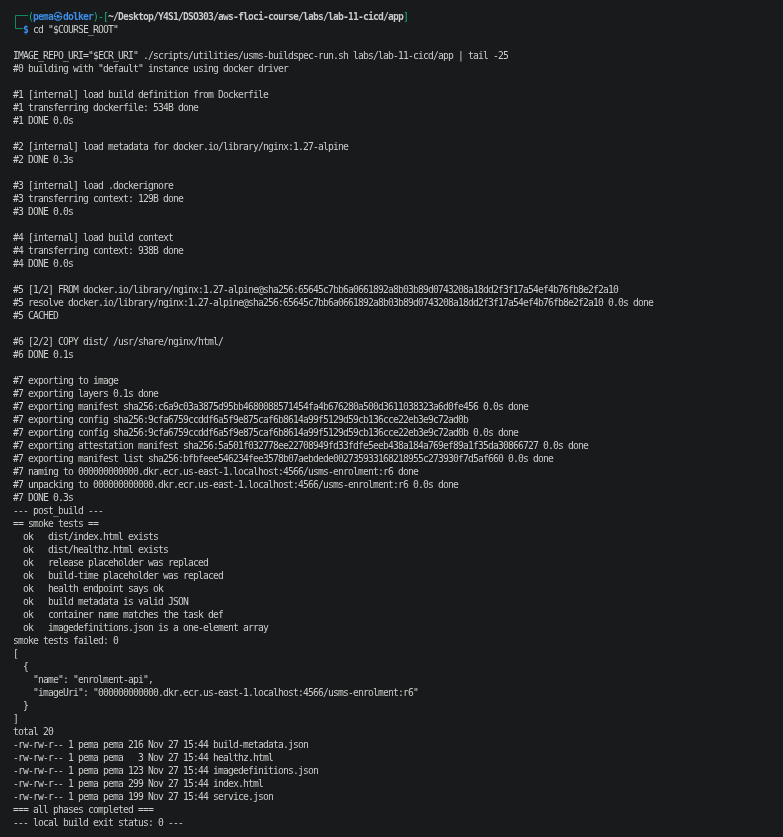
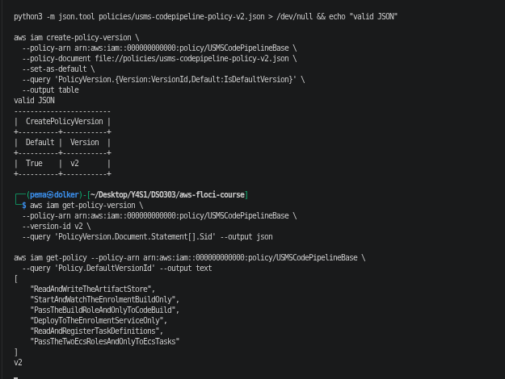

**Observed:** `USMSCodeBuildBase` default is v2 (ECR push actions on one repository; `ecr:GetAuthorizationToken` on `*` because it cannot be scoped); v1 is kept. The project now has `privilegedMode: true` and `IMAGE_REPO_URI`, and source is still `CODEPIPELINE`. The local run built the image, passed all 8 smoke tests and printed `imagedefinitions.json` naming the repository URI. This was the local runner, not CodeBuild; Floci records builds without running them (Lab 11). `USMSCodePipelineBase` default is v2. My draft (`notes/lab-12-my-pipeline-policy.json`) differs from the handout's in two statements; the comparison is in the notes.

**Steps 16 and 17 - the Deploy stage and an end-to-end release**


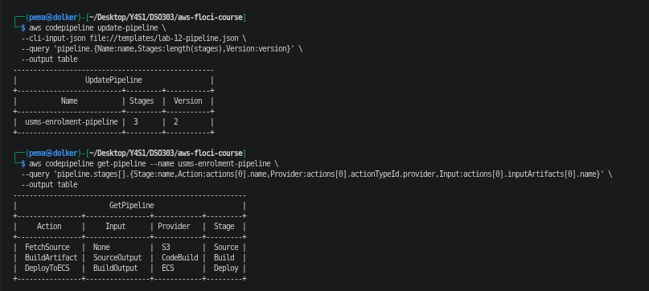
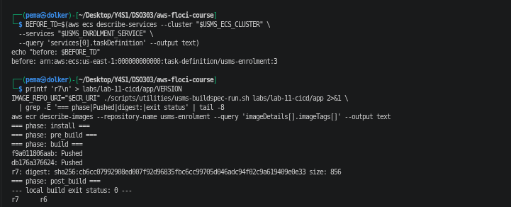
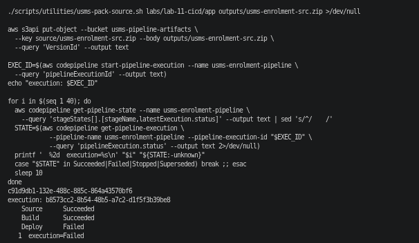


**Observed:** three stages with the artifact chain nothing → SourceOutput → BuildOutput. I pushed r7 from my machine with the local runner (digest `sha256:cb6cc079...`, now in the registry next to r6), uploaded the r7 source and started the pipeline. Source and Build reported `Succeeded`, **Deploy reported `Failed`**, and the execution ended `Failed` on the first poll.

The evidence file (`outputs/lab-12-deploy-evidence.txt`) shows the service did **not** move: task definition before `usms-enrolment:3`, after `usms-enrolment:3`, image after still `:r6`.

**Floci limitation:** Floci gives no reason for the failure: `get-pipeline-state` shows the Deploy action as `Failed` with an empty `errorDetails`. The most likely cause is the artifact chain. The ECS deploy action reads `imagedefinitions.json` from the BuildOutput artifact, and as Lab 11 showed, Floci's Build stage never writes a BuildOutput object, so Deploy has nothing to read. On real AWS this run would register `usms-enrolment:4` naming `:r7` and roll the service to it. What I can honestly claim: the r7 image exists in the registry, the buildspec writes the right `imagedefinitions.json` (local run), and the pipeline has the right three stages. I cannot claim the pipeline deployed it.

**Step 18 - the rollback drill**


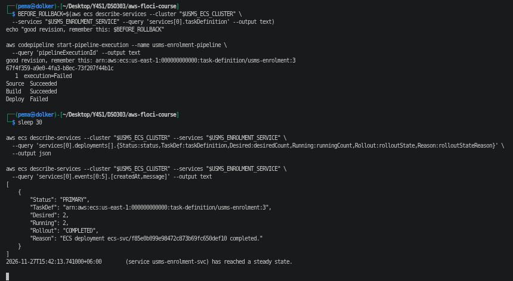


**Observed:** the registry had r6 and r7 but no r8. The r8 execution also ended with Deploy `Failed`, so no revision naming `:r8` was registered and the service stayed on `usms-enrolment:3` (r6). The "rollback" (`update-service --task-definition usms-enrolment:3`) was therefore a no-op that confirmed the good revision. I then put the source back to r7.

**Floci limitation / Conceptual:** the drill only partly happened. On real AWS, Deploy would succeed: it would register a revision naming `:r8` and point the service at it, because nothing checks that the tag exists. The new tasks would then fail with `CannotPullContainerError`, the circuit breaker would mark the deployment FAILED and roll back, and the pipeline's Deploy action would fail. Here Deploy failed for a different reason (no artifact), so the result looks right but is not evidence of that chain.

**Step 19 - blue/green on paper**


**Conceptual:** `templates/lab-12-appspec.yaml` and `templates/lab-12-codedeploy-deployment-group.json` are valid (container `enrolment-api`, port 80, linear 10% per minute, auto-rollback on failure and alarm). Not executed; no blue/green deployment is claimed.

**Step 20, Section 8, Step 21**


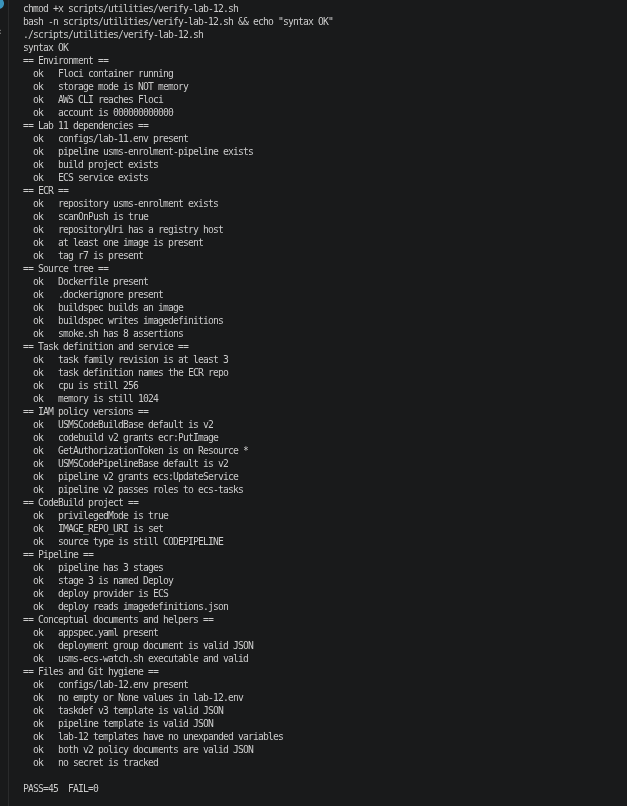


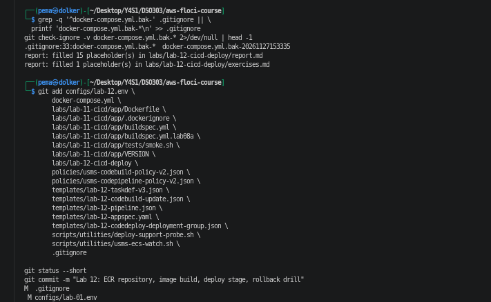

**Observed:** `configs/lab-12.env` has 26 exports; `USMS_ROLLBACK_REVISION` is the real good revision (`usms-enrolment:3`), not the handout's hard-coded 4. `verify-lab-12.sh`: PASS=45  FAIL=0 first, PASS=45  FAIL=0 after the exercises. The verify script checks that things exist and are configured (repository, images, policy versions, three stages), not that a deployment happened, which is why it passes even though Deploy failed. The cleanup script is not run. `.gitignore` now covers `docker-compose.yml.bak-*`.

### 6.2 AWS Management Console Verification

Floci has no console; the `describe-images`, `describe-services` and `get-pipeline` output above is the verification.

## 7. Analysis and Discussion

The objectives were partly achieved. These worked for real: an image in a private registry identified by digest, a revision derived from the previous one with one field changed, a hand deployment, and a three-stage pipeline definition. The pipeline itself never moved the service: Deploy failed on both runs, because Floci's Build stage produces no artifact for Deploy to read.

The most important thing this lab showed is how a deployment pipeline depends on the artifact chain. The Deploy stage is only as good as the file it is handed. When BuildOutput is missing, Deploy fails, while Source and Build both look green. That makes Lab 11's point sharper: a green Build means nothing if it did not produce the artifact the next stage needs.

On real AWS, the Step 18 drill shows the opposite danger. Deploy would happily register a revision naming a tag that does not exist, because nothing checks the tag. Only the circuit breaker would catch it, and only because the image cannot be pulled. An application that starts and then misbehaves needs a health signal the deployment can watch: load balancer health checks, alarms tied to the deployment, or CodeDeploy's test listener.

Tag versus digest became concrete in Exercise 5. I moved `r7` to different bytes, and only the digest recorded at push time showed it. Any task definition naming `:r7` could not tell.

What I observed versus recorded:
- **Observed:** image built and pushed, digest, pull by digest, an immutable repository refusing a push, a revision with one field changed, the service pointer moving on a hand deploy, the three stages, and Deploy failing.
- **Recorded but not executed:** the CodeBuild builds and a successful pipeline deploy.
- **Recorded but not enforced:** the ECR push permissions, the second `iam:PassRole`, the single-service ARN and `scanOnPush`.
- **Written only:** the CodeDeploy documents.
- **Not available:** blue/green, a tripping circuit breaker, scan results and lifecycle expiry.

Problems and fixes:

- **Port 5100 already allocated.** Floci 2.2 runs ECR as its own registry container on `127.0.0.1:5100`, so publishing the range on the main container broke `floci-up.sh`. Found the owner with `docker ps` and `ss -ltnp`, and left the range commented.
- **`server gave HTTP response to HTTPS client`.** The emulated registry is plain HTTP on a non-`localhost` name. Added it alone to Docker's `insecure-registries` and restarted Docker.
- **Builds that do not run.** Floci records CodeBuild builds without running them, so every image was built and pushed by the local runner with the buildspec's own commands.
- **Deploy failed.** No BuildOutput artifact means no `imagedefinitions.json`, so the ECS action has nothing to deploy. Reported as it happened rather than worked around.

## 8. Reflection

**What I learned.** I knew Docker images had digests but never used them. Pulling an image back by digest, then watching a tag move to different bytes while the task definition stayed the same, made it obvious why production deployments should pin digests, and also why it is inconvenient.

**Challenges.** Keeping track of revision numbers across labs, and the replace-only APIs: one `update-pipeline` with a partial document would have deleted the Source and Build stages. Committing `templates/lab-11-pipeline.json` in Lab 11 is what makes that recoverable.

**Real world use.** For our Semzung project I would deploy by digest, make the repository immutable with unique tags per build, and add a deployment alarm so a bad release rolls back on its own.

**What I want to explore more.** Running CodeDeploy blue/green for real, and ECR image signing.

## 9. Conclusion

The objectives were achieved as far as Floci allows. The image path is real: built, pushed to ECR, identified and pulled by digest, protected by immutable tags, and deployed to ECS by hand as revision `:3`. The pipeline has its three stages, but on Floci its Deploy stage failed both times because the Build stage leaves no artifact. So the automated deploy and the rollback drill are explained, not demonstrated. Blue/green is designed and validated for real AWS.

Key ideas: a tag is a name and a digest is the content; a task definition revision is immutable and the service just points at one; replace-only APIs are always get → modify → update; and a deployment is only as safe as the health signal it watches.

## 10. Appendix

- Notes and review questions: `notes/lab-12-notes.md`; my policy draft: `notes/lab-12-my-pipeline-policy.json`; exercises: `labs/lab-12-cicd-deploy/exercises.md`
- Container: `labs/lab-11-cicd/app/Dockerfile`, `.dockerignore`, `Dockerfile.alt` (Exercise 1); buildspec `labs/lab-11-cicd/app/buildspec.yml` (Lab 11 version kept as `buildspec.yml.lab08a`)
- Policies: `policies/usms-codebuild-policy-v2.json`, `policies/usms-codepipeline-policy-v2.json`
- Templates: `templates/lab-12-taskdef-v3.json`, `lab-12-codebuild-update.json`, `lab-12-pipeline.json`, `lab-12-appspec.yaml`, `lab-12-codedeploy-deployment-group.json`, `lab-12-codedeploy-deployment-group-resolved.json` (Exercise 3)
- Scripts: `scripts/utilities/deploy-support-probe.sh`, `usms-ecs-watch.sh`, `usms-release-evidence.sh` (Exercise 5), `verify-lab-12.sh`, `scripts/cleanup/lab-12-cleanup.sh` (not run)
- Changed existing files (backed up in `outputs/backup-lab-12/`): `docker-compose.yml` (port range), `.gitignore` (compose backups)
- Recorded values: `configs/lab-12.env`; screenshots: `screenshots/lab12/`
- Git-ignored: `outputs/lab-12-image-digest.txt`, `lab-12-deploy-evidence.txt`, `lab-12-release-evidence.md`, `lab-12-deploy-probe.txt`
