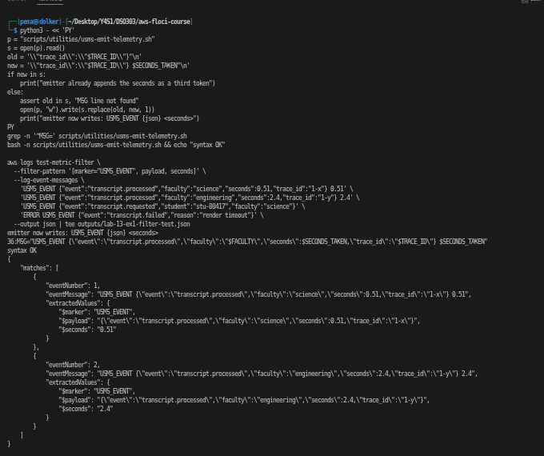
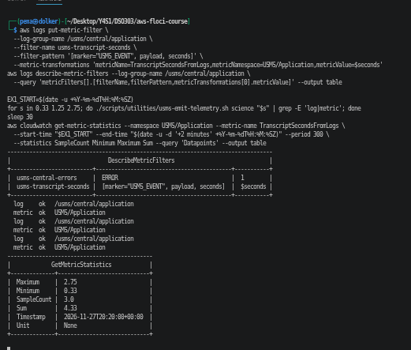
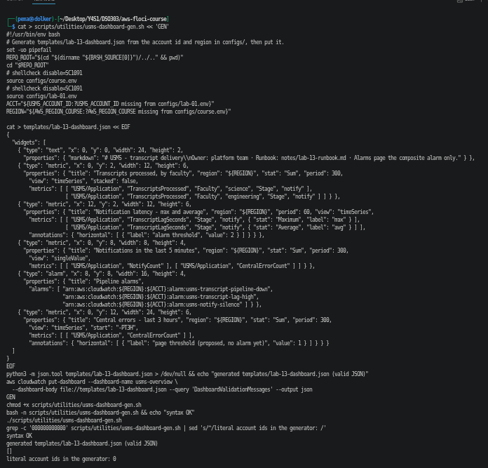
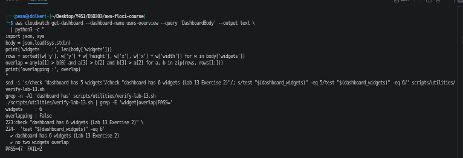
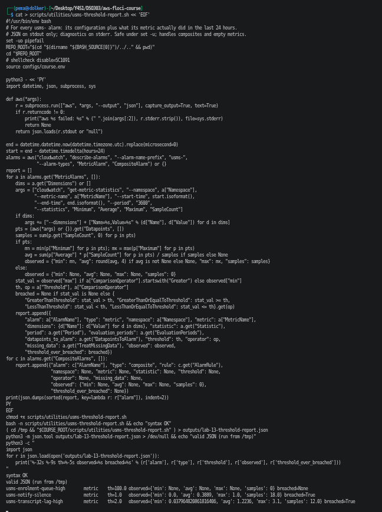
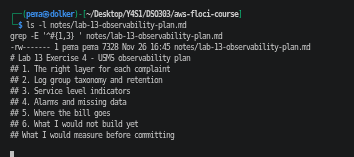
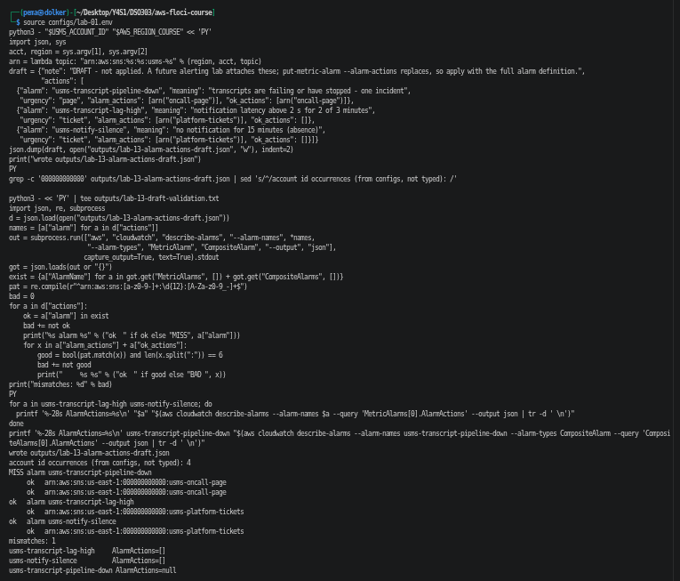
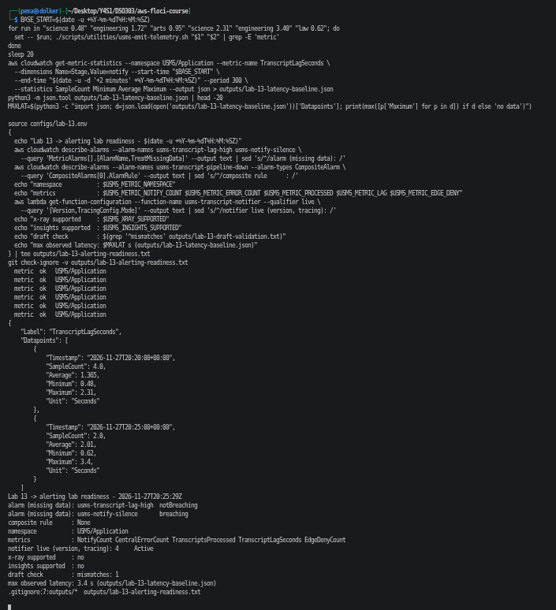

# Lab 13 Exercises

Command output for each exercise is in the screenshots.

## Step 8 "Your turn" - the ERROR pattern and the false positive

Tested with `test-metric-filter` against the four Step 7 messages plus `USMS_EVENT {"event":"transcript.processed","reason":"no ERROR here"}`:

- `ERROR` matched event 4 (the real failure) and event 5 (the false positive). A bare term matches anywhere in the message.
- `"ERROR USMS_EVENT"` (quoted phrase) matched only event 4.

Would I accept `ERROR` in production? No. A free-text field that contains the word "ERROR" (a reason, a student's comment, an error message being reported as fixed) would count as a failure, and the alarm built on it would page for nothing. The phrase works because the application writes failures with a fixed prefix. I kept the handout's `ERROR` for the deployed filter so the verify script matches, and recorded the better pattern here.

## Step 10 "Your turn" - defaultValue

A 15-minute window 24 hours earlier returned an **empty** `Datapoints` list; the window containing today's upload returned data. An empty list means no log events arrived at all, so the filter had nothing to evaluate; a list full of zeros would mean log events arrived and none matched (that is when `defaultValue=0` is written). My build produced the empty list for the quiet window, which is the honest answer: `defaultValue` cannot make silence visible, only the alarm's missing-data setting can.

## Step 13 "Your turn" - rollback

Same alias, two payload shapes: `live` → 1 returned no `trace_id`; `live` → v2 returned it. A real rollback of this deployment takes one `update-alias` call and applies to the next invocation, so seconds. The Lambda@Edge rollback in Lab 10 Step 11 is minutes, because CloudFront has to replicate the old version to every edge location before it takes effect everywhere.

## Exercise 1 - Basic: extract a value instead of counting

The `USMS_EVENT ` prefix means the message is not pure JSON, so the JSON filter dialect (`{ $.seconds = * }`) cannot be used. I changed what the emitter writes instead: it now appends the seconds as a third space-separated token, `USMS_EVENT {json} 0.51`, and used the text dialect's positional pattern `[marker="USMS_EVENT", payload, seconds]` with `metricValue=$seconds`. The JSON has no spaces in it, so it is one token.

- `test-metric-filter` was run first (`outputs/lab-13-ex1-filter-test.json`): the two new-format lines match and extract 0.51 and 2.4; the old two-token lines and the `ERROR` line do not match (the marker must be exactly `USMS_EVENT` in the first position).
- `usms-central-errors` was not touched.
- Three emitter runs (0.33, 1.25, 2.75) and `get-metric-statistics` on `TranscriptSecondsFromLogs`: the minimum, maximum and count are in the screenshot.

**What it cost:** every consumer of the line had to keep working. The Step 23 Python parse splits on `USMS_EVENT` and takes the first `{...}`, so a trailing number does not affect it, and the Insights `parse` pattern still finds the faculty. Old lines do not produce the metric, so the metric only starts from today.

**Same thing, two routes.** `TranscriptLagSeconds` (Step 11) is published by code with `PutMetricData`; `TranscriptSecondsFromLogs` is extracted from a log line by CloudWatch. I would keep the log-based one if the line is written anyway: one source of truth, no extra API calls and no IAM permission for metrics, and the log line also carries the trace id for the same event. I would keep the direct one where the code is not mine to change its logs, or where I need high-resolution (1-second) metrics.

## Exercise 2 - Intermediate: a portable dashboard and a sixth widget

`scripts/utilities/usms-dashboard-gen.sh` sources `configs/course.env` and `configs/lab-01.env` and writes `templates/lab-13-dashboard.json` with an unquoted heredoc, so the file contains values, not commands. The alarm ARNs are built from `${REGION}` and `${ACCT}`; the generator contains no literal account id. It then `put-dashboard`s the result.

- Sixth widget at `x=0, y=12, width=24, height=6`: `CentralErrorCount`, `"start": "-PT3H"` (last three hours), with a horizontal annotation at 1 labelled as a proposed page threshold (there is no alarm on this metric yet).
- `DashboardValidationMessages` is empty; the overlap check passes with six widgets.
- `verify-lab-13.sh` checked for exactly 5 widgets; I changed it to 6. A hard-coded count is useful because it catches a widget silently lost in a bad `put-dashboard` (also replace-only), and annoying because every legitimate change to the dashboard breaks the check until someone edits the script, which is exactly what happened here.

## Exercise 3 - Problem solving: are the thresholds defensible?

`scripts/utilities/usms-threshold-report.sh` reads every alarm whose name starts with `usms-` (no list typed in), metric and composite, and for each metric alarm asks `get-metric-statistics` for the last 24 hours with the **exact dimensions from the alarm**, in one-hour periods. It builds the JSON in Python, prints only JSON on stdout (errors go to stderr), runs from any directory (tested from `/tmp`), and handles alarms with no dimensions, metrics with no data (nulls and `samples: 0`) and composites (nulls where a metric would be).

`threshold_ever_breached` compares the observed maximum (for `Greater...` operators) or minimum (for `Less...`) with the threshold. Output: `outputs/lab-13-threshold-report.json`.

Reading it: there is no composite entry, because Floci could not create `usms-transcript-pipeline-down` (the script handles composites, but there was none to list). `usms-transcript-lag-high` has real observations from the emitter: 12 samples, max 3.1 s, so its 2 s threshold has been breached. `usms-notify-silence` has 18 samples with a minimum of 0, so it has been breached too: those are the `defaultValue=0` points from non-matching log lines, and the quiet periods when it really fired. The finding the exercise is after is the alarm whose threshold has never been approached, or that has no data at all: for those, the threshold is not based on anything observed yet. `usms-enrolment-queue-high` from Lab 06 is also listed because it starts with `usms-`; its metric gets no data in this lab, so its threshold is untested by real traffic.

## Exercise 4 - Challenge: observability plan

Written in `notes/lab-13-observability-plan.md`.

## Exercise 5 - Integration: alarm actions for the alerting lab

1. `outputs/lab-13-alarm-actions-draft.json`: for each of the three designed alarms, its meaning, urgency (the composite pages, the two children open tickets) and placeholder SNS ARNs `arn:aws:sns:us-east-1:<account>:usms-<topic>`, where the account and region come from `configs/lab-01.env` and `configs/course.env`.
2. Validated with one `describe-alarms` call for all three names and a regex for six-field SNS ARNs; result in `outputs/lab-13-draft-validation.txt`: `mismatches: 1`. The mismatch is the composite, which the draft names but Floci could not create. It is reported rather than "fixed" by deleting it from the draft, because on real AWS it is the alarm that should page.
3. **Not applied.** `AlarmActions` is still `[]` on the two alarms that exist, shown in the screenshot. `put-metric-alarm` replaces the whole alarm, so applying actions with a partial definition would silently drop the Step 19 settings.
4. Ran the emitter six times with mixed faculties and latencies (0.48 to 3.40 s) and saved `get-metric-statistics` for `TranscriptLagSeconds` to `outputs/lab-13-latency-baseline.json`. Maximum observed: 3.4 s.
5. `outputs/lab-13-alerting-readiness.txt` is written by one re-runnable `{ ...; } | tee` block. It records the alarm names and missing-data policies, and the composite rule (`None`, since Floci has no composite). It also has the namespace and five metric names, the notifier's alias (version 4, tracing `Active`), X-Ray and Insights support (`no`, `no`), the validation result and the maximum latency (3.4 s). `git check-ignore -v` shows it is covered by `outputs/*`.

